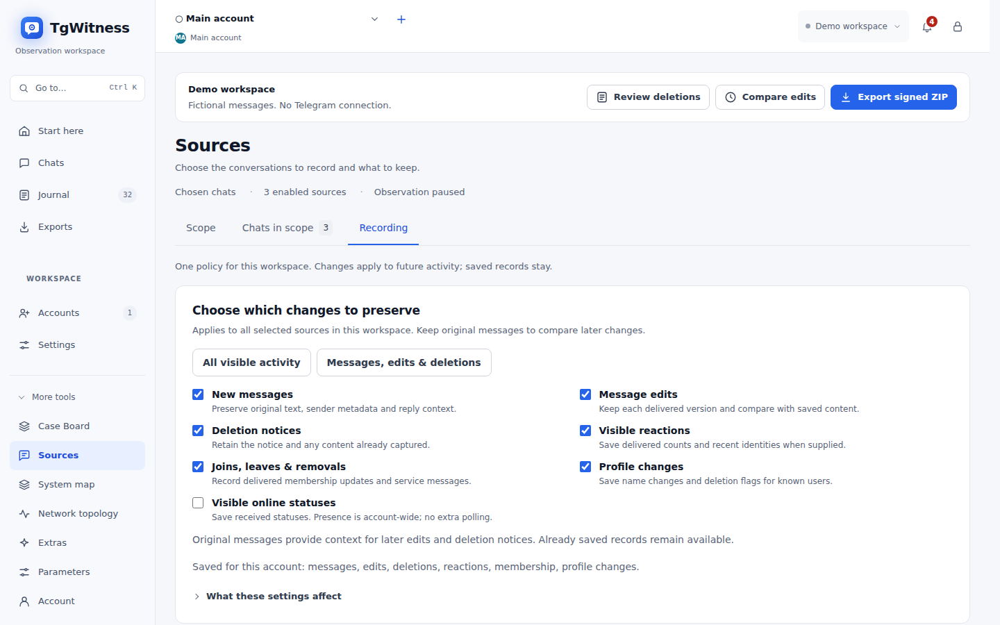
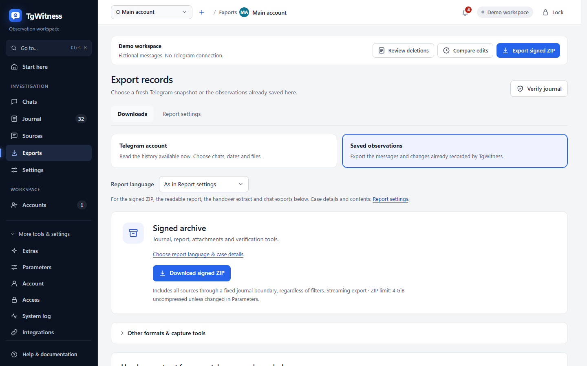

[TgWitness](../../README.md) / [Документация](../README.md) / [Папка](README.md) · [Project reference](../README.md)

[English](../PROJECT-GUIDE.md) · **Русский**


<a id="complete-project-guide"></a>
# Полное руководство по проекту

[Главная страница проекта](../../README.md) · [Вики на GitHub](https://github.com/phishdestroy/TgWitness/wiki)

<picture>
  <source media="(max-width: 640px)" srcset="assets/presentation/mobile.svg">
  <source media="(prefers-reduced-motion: reduce)" srcset="assets/presentation/tgwitness-investigation-static.svg">
  
</picture>

<p align="center">
  
  <strong>
  Рабочая среда для мониторинга Telegram, которую вы управляете самостоятельно.</strong><br>
  Сохраняет переписки, фиксирует изменения и удаления, экспортирует данные, которые могут проверить другие пользователи.
</p>

<p align="center">
  
  <a href="CHANGELOG.md">
  v0.9.3 </a>
  &nbsp; · &nbsp;
  <a href="QUICKSTART.md">
  Python 3.11+ </a>
  &nbsp; · &nbsp;
  <a href="../LICENSE">
  Лицензия MIT </a>
  
</p>

<p align="center">
  
  <a href="#quick-start"></a>
  
  <a href="wiki/Home.md"></a>
  
  <a href="README.md"></a></a><a href="../.github/CONTRIBUTING.md">
  
  <a href="#repository-map"></a>
</p>
<p align="center"><a href="#screenshots"></a></p>

<picture>
  
  <source media="(prefers-color-scheme: dark)" srcset="assets/chats-dark.png">
  
  
  
</picture>
  
<p align="center"><sub>
  Светлая и тёмная темы. Вымышленные демонстрационные данные.</sub></p>

<a id="features"></a>
## Особенности

<table>

<tr>

<td width="50%" valign="top"><h3>
<td width="50%" valign="top"><h3>
Сообщения с историей</h3><p>
Каждое изменение сохраняется в виде</h3><p>
отдельной версии. Удаление никогда не стирает</p></td>
<td valign="top"><h3>
то,
</tr>
<tr>
что</h3><p>
уже было сохранено.</p></td>
Дополнительный пароль. </p>
</td>

<td valign="top">
<h3>
Подключения </h3>
<p>
Поиск по всему, построение временных шкал, просмотр того, кто с кем общается и какие файлы где появляются.</p></td>
</p>
</td>

</tr>

<tr>

<td valign="top"><h3>
</table>
</h3><p>
<td valign="top"><h3></h3><p></p></td>
</tr>

<details>

<summary>
Все функции и их ограничения</summary>

- **Журнал событий, наблюдаемых аккаунтом.** Новые сообщения, правки, удаления, реакции, вступления/выходы из чатов и пробелы в охвате.
- **Область охвата.** Выбранные чаты, папка Telegram или весь аккаунт, по типу (каналы, группы, личные чаты, боты). Новые чаты добавляются по мере появления ([коллекция](../COLLECTION.md#observation-scope-chosen-chats-a-folder-or-the-whole-account)).
- **Режим расследования.** Для выделенного аккаунта, который вступает в группы и общается с ботами: всё, что он видит и отправляет, записывается, сохраняются кнопки ботов, для каждого нового чата сохраняются его профиль и видимая история ([подробности](../COLLECTION.md#investigation-mode-joining-teams-and-talking-to-bots)). В **Руководстве по выделенным аккаунтам** на панели объясняется, почему никогда не следует использовать свой основной аккаунт.
- **Действия из чатов.** Отправляйте сообщения, нажимайте кнопки ботов, просматривайте приглашения и принимайте их. Всё это попадает в подписанный журнал ([мини-клиент](../COLLECTION.md#act-from-the-panel)).
- **Зафиксированный охват и изменения.** Отчёты сохраняют интервалы наблюдения, зафиксированные версии, уведомления об удалении, результаты повторной проверки и пробелы в восстановлении, причём каждый из них связан со своими исходными записями.
- **Профили пользователей** (подписка в каждом чате). История имен/имений пользователей, аватары, активность, кто кому отвечает, упомянутые кошельки, телефоны и ссылки. Каждый факт соотносится со своей записью ([модель доказательств](../EVIDENCE.md#people-profiles)).
- **Независимый свидетель.** Отдельный процесс со своим ключом и ботом, публикующий заголовки журнала в канале ([свидетель](../WITNESS.md)).
- **Страница параметров.** Все ограничения и временные рамки с диапазонами и значениями по умолчанию; каждое изменение попадает в журнал ([ниже](#settings-and-parameters)).
- **Подписанные экспорты.** Цепочка хешей SHA-256 + подписи Ed25519. В ZIP-архиве содержатся файлы JSONL, CSV, отчет в формате HTML, мультимедиа и верификатор. Опциональный пароль AES-256 ([модель доказательств](../EVIDENCE.md#investigation-handoff)).
- **Уведомления** через [Apprise](https://github.com/caronc/apprise) (Matrix, Telegram, Discord, Slack, ntfy, электронная почта…). Текст сообщений не отображается, если не включена функция выдержек.
- **Несколько аккаунтов**, каждая со своей сессией, журналом, ключом, прокси и политикой.
- **Вход** по телефону, QR-коду, Telethon/Pyrogram `.session`, ZIP-архиву TData, StringSession или ключу аутентификации.
- **Прокси для каждой учетной записи.** SOCKS5, HTTP CONNECT, MTProxy. Неработающий прокси никогда не переключается незаметно на прямое соединение.
- **Конфиденциальность.** Работает на вашем компьютере. Без Node.js, без хостинга, без телеметрии. Секретные данные хранятся в зашифрованном хранилище.

</details>

<a id="quick-start"></a>
## Быстрый старт

Начните с демо-версии — аккаунт в Telegram не требуется:

| Windows | Linux / macOS |
| --- | --- |
| Дважды щелкните **`scripts\Demo.cmd`** | Запустить **`sh start.sh --demo`** |

Требуется Python 3.11+ из исходного кода; остальное устанавливает программа запуска. Откройте **http://127.0.0.1:8787**.

Когда будете готовы, остановите демо и запустите **`Start.cmd`** (Windows) или **`sh start.sh`**.
Вставьте токен из `data/live/panel-token.txt` и [подключите выделенную учетную запись](#connect-a-telegram-account).
Однострочный установщик, портативные сборки и Docker: [руководство по установке](../QUICKSTART.md#install-and-start).


<a id="screenshots"></a>
## Скриншоты

| Сравнить сохраненные правки | Выберите, что наблюдать |
| --- | --- |
| [](../assets/detail.png) | [](../assets/sources.png) |
| **Подготовьте подписанный акт передачи** | **Ознакомьтесь с журналом наблюдений** |
| [](../assets/exports.png) | [](../assets/workspace-dark.png) |

Везде встречаются вымышленные демонстрационные данные.

<a id="how-it-works"></a>
## Как это работает

Каждое зафиксированное изменение становится записью, связанной с предыдущей записью посредством её хеша и подписанной.



1. **Просматривайте** чаты, доступные вашему аккаунту.
2. **Сохраняйте** события в подписанном журнале, доступном только для добавления, с версиями и пробелами.
3. **Проверяйте** экспорт с помощью отпечатка ключа, который вы сохранили в другом месте.

В подписанном журнале хранятся данные о полученных на счёт записях, идентификаторы источников и каждая зафиксированная
версия. Получатель проверяет подписи и хэши файлов, а также время, предоставленное сторонней
организацией для последней записи, и сравнивает журнал с контрольными точками, хранящимися в другом месте.
[Подробнее о модели доказательств →](../HOW-IT-WORKS.md)

<details>

<summary>
Что содержит каждое наблюдение</summary>

| Наблюдение | Сохранено |
| --- | --- |
| Новое сообщение | Текст, отправитель, ответ, метаданные, время просмотра — для выбранных источников |
| Редактировать | Новая версия |
| Удаление | Идентификатор сообщения + всё, что было сохранено ранее |
| Реакции | Количество пользователей и список последних пользователей, если Telegram их отправляет |
| Членство | Сервисные сообщения и новости для участников |
| Приложение | Файл с SHA-256 (необязательно) и результатом загрузки |
| Объем охвата | Запуски, остановки, отключения, сигналы проверки работоспособности |
| Краткий обзор истории | Последние отображаемые сообщения (по умолчанию — 500) |

Подробнее в [коллекции](../COLLECTION.md).

</details>


<a id="connect-a-telegram-account"></a>
## Подключить аккаунт Telegram

> [!ПРЕДУПРЕЖДЕНИЕ]
> **Используйте отдельный аккаунт, который вы можете позволить себе потерять.** Telegram может ограничить доступ к аккаунтам или заблокировать их.
> Не подключайте свой личный аккаунт и не создавайте на нём учетные данные для API.
> [Руководство по работе с аккаунтами](../ACCOUNTS.md).

Войдите в систему с помощью телефона, QR-кода или файла сеанса, выберите источники, сохраните настройки и нажмите
**«Начать наблюдение»**. Кнопка **«Приостановить наблюдение»** останавливает сбор данных, а кнопка **«Заблокировать»** лишь закрывает панель браузера.

<details>

<summary>
Форматы авторизации и встроенный пул API</summary>

Вам не нужен собственный API-ID. TgWitness поставляется с 50 общедоступными парами API, которые уже используются
другими клиентами с открытым исходным кодом, и при отказе Telegram пробует следующую пару. У вас есть собственный?
Введите его в поле **API ID + Hash**; к каждому клиенту применяются
[Условия использования API Telegram](https://core.telegram.org/api/obtaining_api_id).

| Что у вас есть | Где |
| --- | --- |
| Телефон с доступом к учетной записи | Вкладка **«Телефон»** (введите код, затем пройдите двухфакторную аутентификацию, если она настроена) |
| Приложение Telegram с авторизацией | Вкладка **«QR-код»**: «Настройки» → «Устройства» → «Подключить настольное устройство» |
| Телемарафон / Пирограмма `.session` | Вкладка **«Файлы»** |
| `name.session` + `name.json` | На вкладке **«Файлы»** выберите оба |
| Telegram Desktop `tdata` | ZIP `key_datas` + `D877F783D5D3EF8Cs`, затем **Файлы** |
| StringSession, `.txt`, `.tgwitness-session` | **Файлы** или *код доступа или текст сеанса* |
| JSON-файл учетной записи с ключом сеанса или ключом аутентификации | Вкладка **«Файлы»** |
| Ключ аутентификации (512 шестнадцатеричных символов) + идентификатор DC | Вкладка **Ключ аутентификации** |

Не поддерживается: TDLib, строки сеансов Pyrogram, токены ботов, TData для нескольких аккаунтов.
Подробная информация по каждому формату: [руководство по аккаунтам](../ACCOUNTS.md).

</details>

<a id="evidence-and-verification"></a>
## Доказательства и проверка

Передайте **подписанный ZIP-файл**. В нём содержатся записи, мультимедиа, отчёт об охвате, автономный отчёт
и верификатор. Отпечаток ключа и контрольную точку храните отдельно.
[Пошаговая инструкция → ](../wiki/Exports-and-Verification.md)

<details>

<summary>
Форматы экспорта и команды проверки</summary>

| Экспорт | Содержание | Честность |
| --- | --- | --- |
| **Подписанный ZIP-файл** | JSONL, CSV, HTML, охват, мультимедиа, манифест, средство проверки | События со знаком + манифест со знаком. Используйте этот вариант |
| JSONL | Записи с хешами и подписями | Сигнатуры для каждого события, цепочка хешей |
| CSV / HTML | Таблица / отчет в автономном режиме | Содержится только внутри ZIP-архива |
| JSON-файл контрольной точки | Длина журнала и хеш заголовка | Подпишите отдельно, храните в другом месте |
| JSON-файл с квитанцией о запуске | Хэши кода, версии, область действия, настройки | Подписано отдельно |
| Профили людей в формате JSON | Профили одного чата | Подписано, сверено с ZIP-архивом |
| Журнал свидетеля ZIP | Что увидел и опубликовал свидетель | Подписано с помощью ключа-свидетеля |

Экспортные файлы всегда содержат полную версию журнала до определенного момента; фильтры влияют только на просмотр.

```sh
python -m pip install cryptography
python tgwitness/verify.py tgwitness-evidence.zip --fingerprint TRUSTED_PUBLIC_KEY_SHA256 --tsa-ca TSA-ROOT.pem --require evidence
# with a witness and its public channel (post dates read from Telegram)
python tgwitness/verify.py tgwitness-evidence.zip --fingerprint TRUSTED_PUBLIC_KEY_SHA256 \
    --witness witness.zip --witness-fingerprint WITNESS_SHA256 --channel https://t.me/s/WITNESS_CHANNEL
```

Верификатор выводит на экран информацию о том, кто подписал запись, а также данные о периодах наблюдения, пробелах и неизвестных идентификаторах сообщений, и
выдает ошибку, если журнал не совпадает с тем, что видел свидетель.

Храните отпечаток ключа и контрольные точки вне коллектора, чтобы у получателя была
независимая точка отсчёта. [GitHub Actions capture](../SEALED-ACTIONS.md) также проверяет архив
на соответствие утверждённой версии размещённого рабочего процесса и коллектора.

Минимальным требованием для подтверждения является подтвержденный отпечаток плюс время от третьей стороны,
охватывающее последнюю запись; контрольная точка подписывается ключом сборщика и сама по себе
не соответствует этому требованию. В режиме подтверждения контрольные точки маркируются с использованием RFC 3161 и OpenTimestamps, а
также учитываются записи свидетелей, считываемые с t.me. Панель также может подготовить
офлайн-запрос по RFC 3161. См. [маркеры времени](../TIMESTAMP.md),
[запись проверки](../VERIFICATION.md) и [контрольный список передачи](../EVIDENCE.md#investigation-handoff).

</details>


<a id="deployment"></a>
## Развертывание

Запустите его локально или воспользуйтесь шаблонами Docker, HTTPS и сервиса.
[Настройка сервера](../DEPLOYMENT.md) · [Резервное копирование и восстановление](../wiki/Backup-and-Recovery.md) · [Настройки подключения](../CONNECTION-SECURITY.md)

<details>

<summary>
Команды и переменные окружения</summary>

**Docker:**

```sh
docker compose up -d --build --wait
docker compose exec tgwitness cat /data/panel-token.txt
```

Без прав root, файловая система только для чтения, прослушивает порт `127.0.0.1:8787`, данные находятся в томе с именем.

**Публичный сервер с HTTPS (Caddy):** скопируйте `deploy/env.example` в `.env`, настройте
`TGWITNESS_DOMAIN`, настройте DNS, откройте порты 80/443:

```sh
docker compose -f compose.yaml -f deploy/compose/compose.https.yaml up -d --build --wait
```

**Портативная версия для Windows:** в ZIP-архиве с версией уже содержатся Python и все необходимые зависимости. Для обновления распакуйте
новую версию и скопируйте папку `data`.

**Без Docker:** шаблоны для systemd, задачи входа в систему Windows и launchd находятся в папке [deploy/](../../deploy/README.md).

<a id="command-line"></a>
### Командная строка

```text
python start.py [--demo] [--setup-only] [--check [--json]] [--host HOST] [--port PORT] [--data-dir DIR]
```

| Задача | Команда |
| --- | --- |
| Проверить готовность без запуска | `python start.py --check` |
| Преобразовать сеанс телемарафона в автономный режим | `python -m tgwitness.sessions account.session --out account.tgwitness-session` |
| Потоковая запись большого объема данных на диск | `python -m tgwitness.download --token-file data/live/panel-token.txt --out evidence.zip` |
| Проверить архив | `python tgwitness/verify.py tgwitness-evidence.zip --fingerprint SHA256` |
| Проверить архив размером более 4 ГиБ | `python tgwitness/verify.py big-evidence.zip --fingerprint SHA256 --max-gib 16` |
| Запустить свидетель из конфигурации | `python -m tgwitness.witness run --config witness.json` |

Выполните команды внутри `python -m tgwitness…` в `.venv`.

| Переменная | Цель |
| --- | --- |
| `TGWITNESS_HOST`, `TGWITNESS_PORT` | Адрес прослушивания (по умолчанию `127.0.0.1:8787`) |
| `TGWITNESS_DATA` | Каталог данных (по умолчанию `data/live`) |
| `TGWITNESS_TOKEN` | Токен с фиксированной панелью, 24 и более символов |
| `TGWITNESS_VAULT_KEY_FILE` | Ключ внешнего хранилища для новых установок |
| `TGWITNESS_DOMAIN`, `TGWITNESS_IMAGE` | Имя хоста и образ Docker по протоколу HTTPS |
| `TGWITNESS_WITNESS_*` | Варианты свидетелей ([witness](../WITNESS.md#options)) |

</details>

<details>

<summary>
Настройки и параметры коллекции</summary>

<a id="settings-and-parameters"></a>
## Настройки и параметры

Все настройки задаются в панели для каждой рабочей среды. Каждое изменение фиксируется в подписанном журнале
с указанием значений «до» и «после».

| Где | Что |
| --- | --- |
| **Дополнительные инструменты → Источники** | Область применения, типы источников, исключения, собственные действия, какие изменения следует сохранять, типы и размеры вложений, интервалы повторной проверки |
| **Экспорт** | Пароль для скачивания |
| **Настройки** или **Дополнительные инструменты → Дополнительные функции** | Режим «Доказательства», внешняя копия в S3, уведомления |
| **Дополнительные инструменты → Дополнительные функции → Независимый свидетель** | Токены-свидетели, доступные только для чтения, и готовые команды |
| **Дополнительные инструменты → Параметры** | Все остальное: размеры списков, интервалы, повторные проверки, резерв дискового пространства, ограничения на скачивание, шаблоны профилей пользователей, частота уведомлений, ограничения на ZIP-файлы, таймауты в Telegram |

Для значений отображаются диапазон и значение по умолчанию; измененные значения отмечены и их можно сбросить.
Для ZIP-архива размером более 4 ГиБ требуется `verify.py --max-gib N` ([операции](../OPERATIONS.md#panel-layout)).

</details>


<a id="security-and-project-status"></a>
## Безопасность и ход реализации проекта

По умолчанию панель прослушивает соединения на localhost. Сессии, учетные данные и ключи хранятся в
зашифрованном хранилище. Сообщения и файлы не зашифрованы, поэтому, если это важно для вас, используйте шифрование диска.
[Модель безопасности](../CONNECTION-SECURITY.md) · [Сообщить об уязвимости](../../.github/SECURITY.md)

Пока что это предварительная версия. Что уже протестировано, а что нет: [журнал проверки](../VERIFICATION.md).

<details>

<summary>
Сведения о защите данных</summary>

- Для удалённого доступа используйте профиль HTTPS или SSH-туннель, ни в коем случае не простой HTTP.
- Хранилище зашифровано с помощью Fernet. Его ключ находится в каталоге данных, если вы не задали параметр
  `TGWITNESS_VAULT_KEY_FILE`.
- Данные, сессии, токены, ключи и экспортированные файлы исключаются из сборок Git и Docker.
- Сообщайте об уязвимостях в частном порядке, см. [SECURITY.md](../../.github/SECURITY.md).

</details>

<details>

<summary>
Ответственность и защита данных (GDPR)</summary>

<a id="responsibility-and-data-protection-gdpr"></a>
## Ответственность и защита данных (GDPR)

TgWitness — это инструмент. Тот, кто его использует, решает, какие данные собираются, зачем и как долго, и несет
за это ответственность — в соответствии с Общим регламентом по защите данных (GDPR) ЕС/Великобритании, как правило, в качестве *контролера* этих персональных данных.
Сообщения в Telegram содержат персональные данные людей, которые никогда не давали согласия на их сбор: имена,
имена пользователей, идентификаторы, фотографии, номера телефонов, мнения. Применяйте законодательство, регулирующее вашу деятельность, и
условия использования Telegram; приведённые ниже пункты отражают общепринятую практику.

- **Наличие законного основания и цели.** Предотвращение мошенничества, сетевая и информационная безопасность,
  а также защита от судебных исков обычно рассматриваются в качестве законных интересов
  (GDPR, ст. 6(1)(f), преамбура, пп. 47 и 49; ст. 9(2)(f) в отношении судебных исков). Записывайте цель
  для каждого конкретного случая. Государственные органы действуют на основании собственных правовых оснований.
- **Собирайте только тот объем данных, который необходим для достижения цели.** Начните с выбранных чатов. Режимы «Папка» и «Весь аккаунт»
  записывают личные чаты и сообщения третьих лиц: используйте их только на специальных
  аккаунтах; панель запрашивает подтверждение, а подписанный журнал фиксирует это. Отключите типы событий,
  типы вложений и собственные действия, которые вам не нужны, а также исключите чаты.
- **Профили пользователей — это профилирование.** По умолчанию они отключены и включаются для каждого чата отдельно. Используйте
  их для конкретного расследования, не основывайте на них автоматизированные решения в отношении людей
  (ст. 22) и отключайте их или удаляйте чат по завершении работы — это приведет к их удалению. Систематический
  мониторинг большого числа людей обычно требует проведения оценки воздействия на защиту данных (ст. 35).
- **Обеспечьте безопасность.** Сеансы, учетные данные и ключи хранятся в зашифрованном хранилище; поместите данные
  каталог на зашифрованный диск, защищайте экспортируемые файлы паролем (AES-256 ZIP), размещайте панель управления за
  HTTPS и предоставляйте свидетелю только его токен только для чтения. Уведомления не содержат текста сообщения,
  если вы не включите функцию выдержек, которая отправляет текст в службу уведомлений.
- **Хранение и удаление.** Журнал доступен только для добавления записей, чтобы можно было подтвердить его целостность;
  отдельные записи нельзя удалить без нарушения цепочки подписей. Планируйте хранение данных для
  каждого рабочего пространства и удаляйте добавленное рабочее пространство («Аккаунты» → «Удалить»), когда цель достигнута. Главное
  рабочее пространство нельзя удалить из панели: выйдите из Telegram на странице **Дополнительные инструменты → Аккаунт**, остановите
  TgWitness и удалите его каталог данных. Внесайтовые копии, защищённые S3 Object Lock, нельзя удалить до истечения
  срока хранения — выбирайте период соответственно. Право на удаление данных имеет исключения, например,
  для установления или защиты правовых претензий (ст. 17(3)(e)).
- **Запросы от лиц, данные о которых хранятся.** Экспорты чатов и файлы профилей позволяют
  узнать, какие данные о человеке хранятся (ст. 15).
- **Ничего не отправляется авторам.** TgWitness не использует телеметрию и не предоставляет хостинговых услуг; данные
  покидают ваш компьютер только по настроенным вами маршрутам (Telegram, сервисы временных меток,
  копия в S3, уведомления, Witness).

</details>


<a id="development"></a>
## Разработка

Приветствуются PR. Ознакомьтесь с [руководством по внесению изменений](../../.github/CONTRIBUTING.md) и используйте фиктивные данные в примерах.

<details>

<summary>
Настройка и проверки для разработчиков</summary>

```sh
python -m venv .venv && source .venv/bin/activate     # Windows: .venv\Scripts\Activate.ps1
python -m pip install -c deploy/constraints.txt -e ".[dev]"
python -m ruff check .
python -m playwright install chromium
python tools/build_portable.py                         # Windows portable ZIP
python tools/build_source.py                           # source ZIP + SHA-256 manifest
python tools/build_site.py                             # site in dist/site
```

При проверке в браузере используются синтетические данные Telegram.

</details>

<a id="documentation"></a>
## Документация

| Используйте это | Понять это | Поработай над этим |
| --- | --- | --- |
| [Быстрый старт](../QUICKSTART.md) | [Как это работает](../HOW-IT-WORKS.md) | [Автор](../../.github/CONTRIBUTING.md) |
| [Вики-страница проекта](../wiki/Home.md) | [Факты и доверие](../EVIDENCE.md) | [Архитектура](../ARCHITECTURE.md) |
| [Расследования](../INVESTIGATION.md) | [Коллекция и охват](../COLLECTION.md) | [Журнал изменений](../CHANGELOG.md) |
| [Устранение неполадок](../wiki/Troubleshooting.md) | [Независимый свидетель](../wiki/Independent-Witness.md) | [Веб-сайт и издательская деятельность](../internal/PUBLISHING.md) |

[Все руководства → ](../README.md) &nbsp; · &nbsp; [Получить помощь → ](../../.github/SUPPORT.md)

<details>

<summary>
Ознакомьтесь с обзором проекта на вашем языке</summary>

**Английский** · [Русский](../ru/README.md) · [Украинский](../uk/README.md) · [Испанский](../es/README.md) · [Португальский (Бразилия)](../pt/README.md) · [Турецкий](../tr/README.md) · [Арабский](../ar/README.md) · [Персидский](../fa/README.md) · [Урду](../ur/README.md) · [Хинди](../hi/README.md) · [Индонезийский](../id/README.md) · [Вьетнамский](../vi/README.md) · [Упрощённый китайский](../zh/README.md)

</details>


<a id="license"></a>
## Лицензия

[Лицензия MIT](../../LICENSE). Наша
[позиция в отношении компании Taylor Wessing](../OPERATOR-INCOMPATIBILITY.md) представляет собой заявление, а не условие лицензии.

<a id="repository-map"></a>
## Схема репозитория

| Где | Что |
| --- | --- |
| [Заявка](../../tgwitness/README.md) | Коллекционеры, журналы, экспорт и экспертная комиссия |
| [Документация](../README.md) · [Вики](../wiki/Home.md) | Настройка, исследования, эксплуатация, проверка |
| [Инструменты](../../tools/README.md) | Сборки, проверка в браузере, скриншоты, упаковка |
| [Развертывание](../../deploy/README.md) | Шаблоны служб и HTTPS |
| [Веб-сайт](../../website/README.md) | Публичные страницы, руководства, переводы |
| [Настройки GitHub](../../.github/AUTOMATION.md) | Автоматизация, формирование бланков, обновление зависимостей |

<a id="archive-and-integrations"></a>
## Архив и интеграции

[Руководство по рабочему процессу](https://phishdestroy.github.io/TgWitness/docs/archive/) ·
[Загрузка истории](../HISTORY.md) · [Анализ архива](../ANALYSIS.md) · [MCP](../MCP.md) ·
[OCR / транскрипция](../MEDIA-ANALYSIS.md) · [Веб-хуки](../WEBHOOKS.md)
