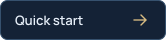
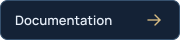
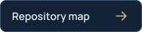
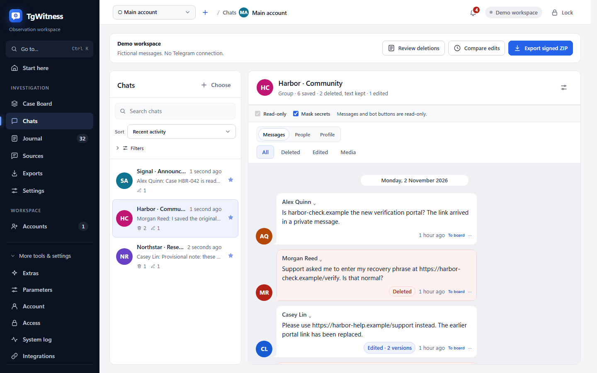
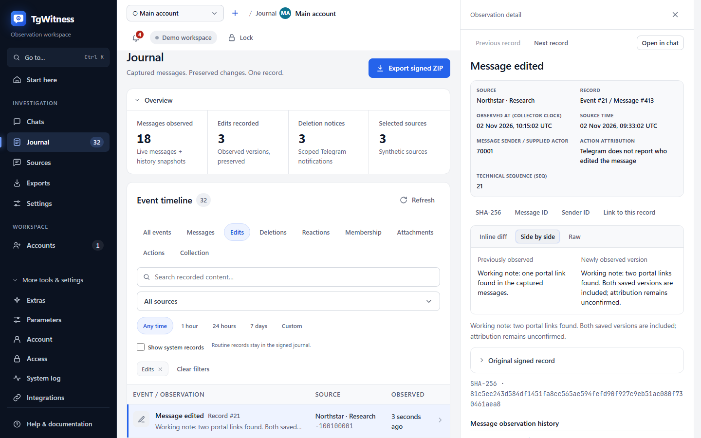
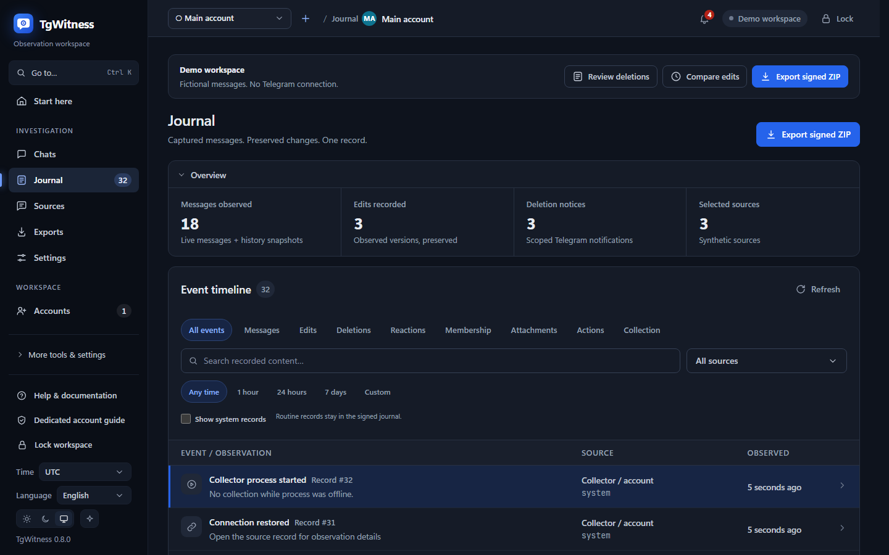

[TgWitness](../../README.md) / [Документация](../README.md) / [Папка](README.md) · [Справочная документация по проекту](../README.md)


<a id="complete-project-guide"></a>
# Полное руководство по проекту

[Главная страница проекта](../../README.md) · [Вики GitHub](https://github.com/phishdestroy/TgWitness/wiki)

<picture>
  <source media="(max-width: 640px)" srcset="../assets/presentation/mobile.svg">
  <source media="(prefers-reduced-motion: reduce)" srcset="../assets/presentation/tgwitness-investigation-static.svg">
  
</picture>

<p align="center">
  <strong>Рабочую область для наблюдения за Telegram вы запускаете самостоятельно.</strong><br>
Сохраняет переписки, фиксирует изменения и удаления, экспортирует данные, которые могут быть проверены верификаторами.
</p>

<p align="center">
  <a href="../CHANGELOG.md">v0.9.3</a>   ·  
  <a href="QUICKSTART.md">Python 3.11+</a>   ·  
  <a href="../../LICENSE">Лицензия MIT</a>
</p>

<p align="center">
  <a href="#quick-start"></a>
  <a href="../wiki/Home.md"></a>
  <a href="../README.md"></a>
  <a href="#repository-map"></a>
</p>
<p align="center"><a href="#screenshots">Ознакомьтесь с рабочей областью</a> · <a href="../../.github/CONTRIBUTING.md">Присоединяйтесь к</a> <a href="#screenshots">разработке</a></p>

<picture>
  <source media="(prefers-color-scheme: dark)" srcset="../assets/chats-dark.png">
  
</picture>
<p align="center"><sub>Светлая и тёмная темы. Вымышленные демонстрационные данные.</sub></p>

<a id="features"></a>
## Функции

<table>
<tr>
<td width="50%" valign="top"><h3>Сообщения с историей</h3><p>Каждое изменение сохраняется в виде отдельной версии. Удаление никогда не стирает то, что уже было сохранено.</p></td>
<td width="50%" valign="top"><h3>Ваша область ответственности</h3><p>Несколько чатов, папка или весь аккаунт. У каждого аккаунта есть собственный журнал и настройки.</p></td>
</tr>
<tr>
<td valign="top"><h3>Экспортируемые данные, которые вы можете проверить</h3><p>Подписанные записи, файлы, отчёт для работы в автономном режиме и автономный верификатор. Пароль (необязательно).</p></td>
<td valign="top"><h3>Связи</h3><p>Выполняйте поиск по всем данным, создавайте хронологии, просматривайте, кто с кем общается и какие файлы отображаются в каких местах.</p></td>
</tr>
<tr>
<td valign="top"><h3>Ежедневное использование</h3><p>Тёмная тема, 25 языков, навигация с клавиатуры, возможность действовать прямо из окна чата.</p></td>
<td valign="top"><h3>Дополнительные материалы</h3><p>Бот-свидетель, внешние временные метки, уведомления. Для каждого из них имеется собственное руководство.</p></td>
</tr>
</table>

<details>
<summary>Все функции и их ограничения</summary>

- **Журнал событий, видимых в аккаунте.** Новые сообщения, правки, удаления, реакции, вступления/выходы из чатов и пробелы в охвате.
- **Область действия.** Выбранные чаты, папка Telegram или Весь аккаунт, с разбивкой по типам (каналы, группы, личные чаты, боты). Новые чаты добавляются по мере их появления ([коллекция](COLLECTION.md#observation-scope-chosen-chats-a-folder-or-the-whole-account)).
- **Режим расследования.** Для выделенного аккаунта, который вступает в группы и общается с ботами: всё, что он просматривает и отправляет, фиксируется; сохраняются кнопки ботов; для каждого нового чата сохраняются его профиль и видимая история ([подробнее](COLLECTION.md#investigation-mode-joining-teams-and-talking-to-bots)). В **руководстве по выделенным аккаунтам** на панели объясняется, почему ни в коем случае не следует использовать ваш основной аккаунт.
- **Действия из чатов.** Отправляйте сообщения, нажимайте кнопки ботов, просматривайте приглашения и присоединяйтесь к группам. Всё это попадает в подписанный журнал ([мини-клиент](COLLECTION.md#act-from-the-panel)).
- **Зафиксированный охват и изменения.** Отчёты сохраняют интервалы наблюдения, зафиксированные версии, уведомления об удалении, результаты повторной проверки и пробелы в восстановлении данных, причём каждая запись привязана к исходным данным.
- **Профили пользователей** (с возможностью включения для каждого чата). История имен/имен пользователей, аватары, активность, кто кому отвечает, упомянутые кошельки, телефоны и ссылки. Каждый факт сопоставляется со своей записью ([модель доказательств](EVIDENCE.md#people-profiles)).
- **Независимый свидетель.** Отдельный процесс со своим собственным ключом и ботом, публикующий вершины журнала в канале ([свидетель](WITNESS.md)).
- **Страница параметров.** Все ограничения и временные параметры с диапазонами и значениями по умолчанию; каждое изменение фиксируется в журнале (см. [ниже](#settings-and-parameters)).
- **Подписанные экспорты.** Цепочка хешей SHA-256 + подписи Ed25519. Архив ZIP содержит файлы JSONL, CSV, отчёт в формате HTML, медиафайлы и верификатор. Дополнительный пароль с шифрованием AES-256 ([модель доказательств](EVIDENCE.md#investigation-handoff)).
- **Уведомления** через [Apprise](https://github.com/caronc/apprise) (Matrix, Telegram, Discord, Slack, ntfy, электронная почта…). Текст сообщений не отображается, если вы не включите отображение выдержек.
- **Поддержка нескольких аккаунтов**, каждый из которых имеет собственный сеанс, журнал, ключ, прокси и политику.
- **Вход в систему** с помощью телефона, QR-кода, `.session` из Telethon/Pyrogram, ZIP-архива TData, StringSession или ключа аутентификации.
- **Прокси-серверы для каждого аккаунта.** SOCKS5, HTTP CONNECT, MTProxy. Неработающий прокси-сервер никогда не переключается на прямое соединение без предупреждения.
- **Конфиденциальность.** Работает на вашем компьютере. Без Node.js, без хостинга, без телеметрии. Секретные данные хранятся в зашифрованном хранилище.

</details>

<a id="quick-start"></a>
## Быстрый старт

Начните с демо-версии, аккаунт в Telegram не требуется:

| Windows | Linux / macOS |
| --- | --- |
| Дважды щелкните файл **`scripts\Demo.cmd`** | Запустите команду `**`sh start.sh --demo`**` |

Требуется Python 3.11+ из исходного кода; остальные компоненты устанавливаются программой запуска. Откройте страницу **http://127.0.0.1:8787**.

Когда будете готовы, остановите демонстрацию и запустите файл **`Start.cmd`** (Windows) или команду **`sh start.sh`**. Вставьте токен из файла `data/live/panel-token.txt` и [подключите выделенный аккаунт](#connect-a-telegram-account). Однострочный установщик, портативные сборки и Docker: [руководство по установке](QUICKSTART.md#install-and-start).


<a id="screenshots"></a>
## Снимки экрана

| Сравнение зафиксированных изменений | Выберите, что наблюдать |
| --- | --- |
| [](../assets/detail.png) | [](../assets/sources.png) |
| **Подготовьте подписанную передачу** | **Просмотрите журнал наблюдений** |
| [](../assets/exports.png) | [](../assets/workspace-dark.png) |

Везде используются вымышленные демонстрационные данные.

<a id="how-it-works"></a>
## Как это работает

Каждое наблюдение становится записью, связанной с предыдущей посредством её хеша и подписанной.


1. **Просматривайте** чаты, доступные для вашего аккаунта.
2. **Сохраняйте** события в подписанном журнале, доступном только для добавления, с версиями и пробелами.
3. **Проверьте** экспорт с помощью отпечатка ключа, который вы сохранили в другом месте.

Подписанный журнал хранит информацию о том, что получила учетная запись, идентификаторы источников и каждую зафиксированную версию. Получатель проверяет подписи и хеши файлов, а также время, предоставленное третьей стороной для последней записи, и сравнивает журнал с контрольными точками, хранящимися в другом месте. [Подробнее о модели доказательств →](HOW-IT-WORKS.md)

<details>
<summary>Что содержит каждое наблюдение</summary>

| Наблюдение | Сохранено |
| --- | --- |
| Новое сообщение | Текст, отправитель, ответ, метаданные, время просмотра для выбранных источников |
| Редактировать | Новая версия |
| Удаление | Идентификатор сообщения + все, что было сохранено ранее |
| Реакции | Статистика и список последних пользователей, если Telegram их отправляет |
| Членство | Сервисные сообщения и обновления об участниках |
| Вложение | Файл с SHA-256 (необязательно) и результатом загрузки |
| Покрытие | Запуски, остановки, разрывы соединения, сигналы активности |
| Снимок истории | Последние видимые сообщения (по умолчанию — 500) |

Дополнительные данные в [коллекции](COLLECTION.md).

</details>


<a id="connect-a-telegram-account"></a>
## Подключите аккаунт Telegram

> [!ВНИМАНИЕ] **Используйте специальный аккаунт, который вы можете позволить себе потерять.** Telegram может ограничить доступ к аккаунтам или заблокировать их. Не подключайте свой личный аккаунт и не создавайте в нём учетные данные для API. [Руководство по работе с аккаунтом](ACCOUNTS.md).

Войдите с помощью номера телефона, QR-кода или файла сеанса, выберите источники, сохраните настройки и нажмите **Начать наблюдение**. Кнопка **Приостановить наблюдение** останавливает сбор данных, а **Заблокировать —** лишь закрывает панель браузера.

<details>
<summary>Форматы входа в систему и встроенный пул API</summary>

Вам не нужен собственный API-ID. TgWitness предоставляет 50 общедоступных пар API, которые уже используются другими клиентами с открытым исходным кодом, и пробует следующую пару, если Telegram отказывает. У вас есть собственный? Введите его в **поле API-ID + хеш**; [условия использования API](https://core.telegram.org/api/obtaining_api_id) Telegram распространяются на всех клиентов.

| Что у вас есть | Где |
| --- | --- |
| Телефон с доступом к аккаунту | Вкладка **Телефон** (код, затем 2FA, если настроено) |
| Приложение Telegram с авторизованным аккаунтом | Вкладка **QR-код**: «Настройки» → «Устройства» → «Связать настольное устройство» |
| Telethon / Pyrogram`.session` | Вкладка **Файлы** |
| `name.session` + `name.json` | Вкладка **Файлы**, выберите оба |
| Telegram Desktop `tdata` | ZIP-архив `key_datas` + `D877F783D5D3EF8Cs`, затем **Файлы** |
| StringSession.`.txt`, `.tgwitness-session` | **Файлы**, *пароль или текст сеанса* |
| JSON-файл аккаунта с сеансом или ключом аутентификации | Вкладка **Файлы** |
| Ключ аутентификации (512 шестнадцатеричных символов) + DC ID | Вкладка **Ключ аутентификации** |

Не поддерживается: TDLib, строки сеанса Pyrogram, токены ботов, TData для нескольких аккаунтов. Подробная информация по каждому формату: [руководство по аккаунтам](ACCOUNTS.md).

</details>

<a id="evidence-and-verification"></a>
## Подтверждение и верификация

Передайте **подписанный ZIP**-файл. В нём содержатся записи, медиафайлы, отчёт об охвате, отчёт в автономном режиме и верификатор. Храните отпечаток ключа и контрольную точку отдельно. [Пошаговая инструкция →](../wiki/Exports-and-Verification.md)

<details>
<summary>Форматы экспорта и команды верификатора</summary>

| Экспорт | Содержание | Целостность |
| --- | --- | --- |
| **Подписанный ZIP-архив** | JSONL, CSV, HTML, отчет о покрытии, медиафайлы, манифест, верификатор | Подписанные события + подписанный манифест. Используйте этот вариант |
| JSONL | Записи с хешами и подписями | Подписи для каждого события, цепочка хешей |
| CSV / HTML | Таблица / отчёт в автономном режиме | Описано только внутри архива ZIP |
| JSON контрольной точки | Длина журнала и хеш вершины | Подписывается отдельно, храните его в другом месте |
| JSON-файл квитанции запуск | Хеши кода, версии, область действия, настройки | Подписываются отдельно |
| JSON-файлы профилей пользователей | Профили одного чата | Подписано, проверено по ZIP-архиву |
| Журнал свидетеля в формате ZIP | То, что увидел и опубликовал свидетель | Подписано ключом свидетеля |

Экспортные файлы всегда содержат полный журнал до определённого момента; фильтры влияют только на просмотр.

```sh
python -m pip install cryptography
python tgwitness/verify.py tgwitness-evidence.zip --fingerprint TRUSTED_PUBLIC_KEY_SHA256 --tsa-ca TSA-ROOT.pem --require evidence
# with a witness and its public channel (post dates read from Telegram)
python tgwitness/verify.py tgwitness-evidence.zip --fingerprint TRUSTED_PUBLIC_KEY_SHA256 \
    --witness witness.zip --witness-fingerprint WITNESS_SHA256 --channel https://t.me/s/WITNESS_CHANNEL
```

Верификатор выводит информацию о том, кто подписал, отмечает периоды наблюдения, пробелы и идентификаторы сообщений, которые ранее не встречались, и возвращает ошибку, если журнал не соответствует тому, что видел свидетель.

Храните отпечаток ключа и контрольные точки вне сборщика, чтобы получатель имел независимый эталон. [Функция фиксации GitHub Actions](SEALED-ACTIONS.md) также сверяет архив с утверждённой версией размещённого рабочего процесса и сборщика.

Минимальным требованием для доказательства является подтверждённый отпечаток ключа плюс время от третьей стороны, охватывающее последнюю запись; контрольная точка подписывается ключом сборщика и сама по себе не соответствует этому требованию. В режиме «Доказательства» контрольные точки маркируются с использованием RFC 3161 и OpenTimestamps; также учитываются сообщения свидетелей, считываемые с t.me. Панель также может подготовить автономный запрос по RFC 3161. См. [временные метки](TIMESTAMP.md), [запись проверки](VERIFICATION.md) и контрольный [список передачи](EVIDENCE.md#investigation-handoff).

</details>


<a id="deployment"></a>
## Развертывание

Запустите программу локально или воспользуйтесь шаблонами Docker, HTTPS и сервиса. [Настройка сервера](DEPLOYMENT.md) · [Резервное копирование и восстановление](../wiki/Backup-and-Recovery.md) · [Параметры подключения](CONNECTION-SECURITY.md)

<details>
<summary>Команды и переменные среды</summary>

**Docker:**

```sh
docker compose up -d --build --wait
docker compose exec tgwitness cat /data/panel-token.txt
```

Без прав root, файловая система только для чтения, прослушивание на `127.0.0.1:8787`, данные в томе с именем.

**Публичный сервер с HTTPS (Caddy):** скопируйте файл `deploy/env.example` в папку `.env`, установите переменную `TGWITNESS_DOMAIN`, настройте DNS, откройте порты 80/443:

```sh
docker compose -f compose.yaml -f deploy/compose/compose.https.yaml up -d --build --wait
```

**Портативная версия для Windows:** в ZIP-архиве релиза содержатся Python и все необходимые зависимости. Для обновления распакуйте новую версию и скопируйте папку `data`.

**Без Docker:** шаблоны для systemd, задачи автозапуска Windows и launchd находятся в [папке deploy/](../../deploy/README.md).

<a id="command-line"></a>
### Командная строка

```text
python start.py [--demo] [--setup-only] [--check [--json]] [--host HOST] [--port PORT] [--data-dir DIR]
```

| Задача | Команда |
| --- | --- |
| Проверка готовности без запуска | `python start.py --check` |
| Конвертировать сеанс Telethon в автономный режим | `python -m tgwitness.sessions account.session --out account.tgwitness-session` |
| Потоковая передача большого объёма данных на диск | `python -m tgwitness.download --token-file data/live/panel-token.txt --out evidence.zip` |
| Проверить архив | `python tgwitness/verify.py tgwitness-evidence.zip --fingerprint SHA256` |
| Проверить архив объёмом более 4 ГиБ | `python tgwitness/verify.py big-evidence.zip --fingerprint SHA256 --max-gib 16` |
| Запустите свидетеля из конфигурации | `python -m tgwitness.witness run --config witness.json` |

Запускайте команды `python -m tgwitness…` внутри `.venv`».

| Переменная | Назначение |
| --- | --- |
| `TGWITNESS_HOST`, `TGWITNESS_PORT` | Адрес прослушивания (по умолчанию `127.0.0.1:8787`) |
| `TGWITNESS_DATA` | Каталог данных (по умолчанию — `data/live`) |
| `TGWITNESS_TOKEN` | Фиксированный токен панели, не менее 24 символов |
| `TGWITNESS_VAULT_KEY_FILE` | Внешний ключ хранилища для новых установок |
| `TGWITNESS_DOMAIN`, `TGWITNESS_IMAGE` | Имя хоста Docker HTTPS и образ |
| `TGWITNESS_WITNESS_*` | Параметры свидетеля ([свидетель](WITNESS.md#options)) |

</details>

<details>
<summary>Настройки и параметры коллекций</summary>

<a id="settings-and-parameters"></a>
## Настройки и параметры

Все настройки выполняются в панели управления для каждой рабочей области. Каждое изменение фиксируется в подписанном журнале с указанием значений «до» и «после».

| Где | Что |
| --- | --- |
| **Дополнительные инструменты → Источники** | Область действия, типы источников, исключения, собственные действия, какие изменения сохранять, типы и размеры вложений, интервалы повторной проверки |
| **Экспорт** | Пароль для загрузки |
| **Настройки** или **Дополнительные инструменты → Дополнительные функции** | Режим «Доказательства», внешняя копия в S3, уведомления |
| **Дополнительные инструменты → Дополнительные функции → Независимый свидетель** | Токены свидетеля только для чтения и готовые команды |
| **Дополнительные инструменты → Параметры** | Всё остальное: размеры списков, интервалы, повторные проверки, резерв дискового пространства, ограничения на загрузку, шаблоны профилей пользователей, частота уведомлений, ограничения на размер ZIP-архивов, таймауты в Telegram |

Значения отображаются с указанием диапазона и значения по умолчанию; изменённые значения отмечены и могут быть сброшены. Для ограничения ZIP-файлов свыше 4 ГиБ необходимо выполнить команду ``verify.py --max-gib N`` ([операций](OPERATIONS.md#panel-layout)).

</details>


<a id="security-and-project-status"></a>
## Безопасность и статус проекта

Панель по умолчанию прослушивает порт localhost. Сеансы, учетные данные и ключи хранятся в зашифрованном хранилище. Сообщения и файлы не зашифрованы, поэтому, если это имеет значение, используйте шифрование диска. [Модель безопасности](CONNECTION-SECURITY.md) · [Сообщить об уязвимости](../../.github/SECURITY.md)

Версия всё ещё находится на стадии предварительного выпуска. Что было протестировано, а что нет: [журнал проверки](VERIFICATION.md).

<details>
<summary>Сведения о защите данных</summary>

- Для удалённого доступа используйте профиль HTTPS или SSH-туннель, ни в коем случае не обычный HTTP.
- Хранилище зашифровано с помощью Fernet. Его ключ находится в каталоге данных, если вы не задали переменную `TGWITNESS_VAULT_KEY_FILE`.
- Данные, сеансы, токены, ключи и экспортированные файлы исключены из сборок Git и Docker.
- Сообщайте об уязвимостях в конфиденциальном порядке, см. файл [SECURITY.md](../../.github/SECURITY.md).

</details>

<details>
<summary>Ответственность и защита данных (GDPR)</summary>

<a id="responsibility-and-data-protection-gdpr"></a>
## Ответственность и защита данных (GDPR)

TgWitness — это инструмент. Лицо, запускающее его, решает, какие данные собираются, с какой целью и на какой срок, а также несёт за это ответственность — в соответствии с GDPR ЕС/Великобритании, как правило, в качестве *контролёра* этих персональных данных. Сообщения в Telegram содержат персональные данные людей, которые никогда не давали согласия на их запись: имена, имена пользователей, идентификаторы, фотографии, номера телефонов, мнения. Применяйте законодательство, регулирующее вашу деятельность, а также условия использования Telegram; приведённые ниже пункты отражают общепринятую практику.

- **Убедитесь в наличии правового основания и цели.** В качестве законных интересов обычно указываются предотвращение мошенничества, сетевая и информационная безопасность, а также защита от судебных исков (статья 6(1)(f) Общего регламента по защите данных (GDPR), преамбулы 47 и 49; статья 9(2)(f) в отношении судебных исков). Описывайте цель для каждого конкретного случая. Государственные органы действуют на основании собственных правовых оснований.
- **Собирайте только тот объем данных, который необходим для достижения цели.** Начните с выбранных чатов. Режимы «Папка» и «Весь аккаунт» фиксируют личные чаты и сообщения третьих лиц: используйте их только на специальных аккаунтах; панель запрашивает подтверждение, а подписанный журнал фиксирует это. Отключите ненужные типы событий, типы вложений и собственные действия, а также исключите чаты.
- **Профили пользователей представляют собой профилирование.** По умолчанию они отключены и включаются для каждого чата отдельно. Используйте их для конкретного расследования, не основывайте на них автоматизированные решения в отношении людей (ст. 22) и отключайте их или удаляйте чат по завершении работы — это приведёт к их удалению. Систематический мониторинг большого числа лиц, как правило, требует проведения оценки воздействия на защиту данных (ст. 35).
- **Обеспечьте безопасность.** Сеансы, учетные данные и ключи хранятся в зашифрованном хранилище; разместите каталог данных на зашифрованном диске, защитите экспортные файлы паролем (AES-256 ZIP), обеспечьте доступ к панели управления только через HTTPS и предоставьте свидетелю только его токен, предназначенный исключительно для чтения. Уведомления не содержат текста сообщений, если вы не включите функцию выдержек, при которой текст отправляется в службу уведомлений.
- **Хранение и удаление.** Журнал ведётся в режиме «только добавление», что позволяет подтвердить его целостность; отдельные записи нельзя удалить без нарушения цепочки подписей. Планируйте срок хранения для каждой рабочей области и удаляйте добавленную рабочую область («Аккаунты» → «Удалить») по завершении её использования. Главную рабочую область нельзя удалить из панели: выйдите из Telegram на странице **Дополнительные инструменты → Аккаунт**, остановите TgWitness и удалите его каталог данных. Внешние копии, защищённые с помощью S3 Object Lock, не могут быть удалены до истечения срока их хранения — выбирайте период соответственно. Право на удаление данных имеет исключения, например, для установления или защиты правовых претензий (ст. 17(3)(e)).
- **Запросы от лиц, данные о которых были зафиксированы.** Экспортированные чаты и файлы профилей позволяют узнать, какие данные о человеке хранятся (ст. 15).
- **Никакие данные** не **отправляются разработчикам.** В TgWitness отсутствует телеметрия и хостинговые сервисы; данные покидают Ваш компьютер только по настроенным Вами маршрутам (Telegram, сервисы временных меток, копия в S3, уведомления, свидетель).

</details>


<a id="development"></a>
## Разработка

Приветствуются PR. Ознакомьтесь с [руководством по внесению вкладов](../../.github/CONTRIBUTING.md) и используйте фиктивные данные в примерах.

<details>
<summary>Настройка и проверки для разработчиков</summary>

```sh
python -m venv .venv && source .venv/bin/activate     # Windows: .venv\Scripts\Activate.ps1
python -m pip install -c deploy/constraints.txt -e ".[dev]"
python -m ruff check .
python -m playwright install chromium
python tools/build_portable.py                         # Windows portable ZIP
python tools/build_source.py                           # source ZIP + SHA-256 manifest
python tools/build_site.py                             # site in dist/site
```

При проверке в браузере используются синтетические данные Telegram.

</details>

<a id="documentation"></a>
## Документация

| Использование | Поймите его | Работайте над проектом |
| --- | --- | --- |
| [Быстрый старт](QUICKSTART.md) | [Как это работает](HOW-IT-WORKS.md) | [Участие в проекте](../../.github/CONTRIBUTING.md) |
| [Вики-страница проекта](../wiki/Home.md) | [Доказательства и доверие](EVIDENCE.md) | [Архитектура](ARCHITECTURE.md) |
| [Расследования](INVESTIGATION.md) | [Сбор данных и охват](COLLECTION.md) | [Журнал изменений](../CHANGELOG.md) |
| [Устранение неполадок](../wiki/Troubleshooting.md) | [Независимый свидетель](../wiki/Independent-Witness.md) | [Веб-сайт и публикации](../internal/PUBLISHING.md) |

[Все руководства →](../README.md) &nbsp; · &nbsp; [Получить помощь →](../../.github/SUPPORT.md)

<details>
<summary>Ознакомьтесь с обзором проекта на вашем языке</summary>

[English](../PROJECT-GUIDE.md) · **Русский** · [Українська](../uk/README.md) · [Español](../es/README.md) · [Português (Brasil)](../pt/README.md) · [Türkçe](../tr/README.md) · [العربية](../ar/README.md) · [فارسی](../fa/README.md) · [اردو](../ur/README.md) · [हिन्दी](../hi/README.md) · [Bahasa Indonesia](../id/README.md) · [Tiếng Việt](../vi/README.md) · [简体中文](../zh/README.md)

</details>


<a id="license"></a>
## Лицензия

[Лицензия MIT](../../LICENSE). Наша [позиция в отношении Taylor Wessing](OPERATOR-INCOMPATIBILITY.md) представляет собой заявление, а не условие лицензии.

<a id="repository-map"></a>
## Карта репозитория

| Где | Что |
| --- | --- |
| [Приложение](../../tgwitness/README.md) | Сборщики, журналы, экспортные данные и панель управления |
| [Документация](../README.md) · [Вики](../wiki/Home.md) | Настройка, исследования, эксплуатация, проверка |
| [Инструменты](../../tools/README.md) | Сборки, проверка в браузере, скриншоты, упаковка |
| [Развертывание](../../deploy/README.md) | Шаблоны сервисов и HTTPS |
| [Веб-сайт](../../website/README.md) | Публичные страницы, руководства, переводы |
| [Настройка GitHub](../../.github/AUTOMATION.md) | Автоматизация, формы для создания запросов, обновления зависимостей |

<a id="archive-and-integrations"></a>
## Архив и интеграции

[Руководство по рабочему процессу](https://phishdestroy.github.io/TgWitness/docs/archive/) · [Загрузка истории](HISTORY.md) · [Анализ архива](ANALYSIS.md) · [MCP](MCP.md) · [OCR / транскрипция](MEDIA-ANALYSIS.md) · [Веб-хуки](WEBHOOKS.md)
