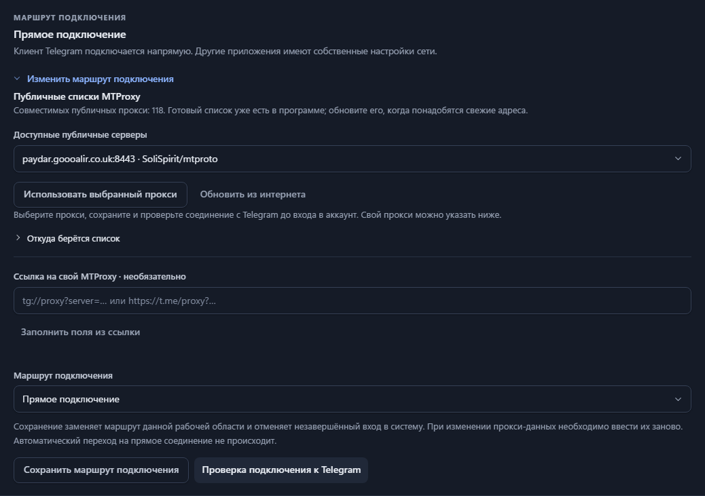

# Публичный прокси или свой — в одном месте

Откройте **Аккаунт → Настройки → Параметры подключения → Изменить маршрут подключения**.
Список публичных MTProxy уже есть в программе, без ручного поиска адресов и JSON-файлов.

1. Выберите сервер из списка и сохраните маршрут.
2. Нажмите **Проверить соединение с Telegram**. Входить в аккаунт для этой проверки не нужно.
3. Если соединение установлено, подключайте аккаунт и выбирайте источники наблюдения.

**Обновить из интернета** скачивает списки из
[SoliSpirit/mtproto](https://github.com/SoliSpirit/mtproto) и
[zakky8/mtproto-proxy-pro](https://github.com/zakky8/mtproto-proxy-pro).
У каждого источника видна дата сохранения. Если источник временно недоступен или
вернул только несовместимые записи, сохраняется его предыдущий список. Обновление
не меняет текущий прокси аккаунта. Автоматического перебора серверов пока нет.

В поставку включён снимок на 29 октября 2026 года: **118 уникальных совместимых адресов**.
Это данные из списков, а не 118 проверенных соединений. Если прокси не отвечает,
выберите другой. Проверка транспорта не доказывает доставку всех сообщений.

## Общий пул и свои списки

В **Аккаунт → Настройки → Настройки подключения → Прокси-серверы** видны серверы, пинг, статус проверки,
страна при наличии данных и источник. Фильтры помогают выбрать сервер;
**Использовать** сохраняет его для текущего аккаунта. Сначала приостановите сбор.

В **Списки и источники** администратор может отключить встроенный список,
добавить HTTPS-адрес, загрузить файлы или вставить ссылки. Списки общие для всей
установки, а маршрут каждого аккаунта остаётся отдельным. Необязательный GitHub
токен включает поиск новых списков при обновлении; токен хранится зашифрованным.
Определение стран можно отключить: оно передаёт IP прокси сервису геолокации через
настроенный внешний маршрут. Пинг и страна не означают, что прокси надёжен.

Массовая загрузка аккаунтов находится в **Аккаунты → Импорт аккаунтов**.
Файлы с одинаковым именем без расширения объединяются в один комплект:
`alpha.session` + `alpha.json`. Для каждого аккаунта создаётся своё рабочее
пространство. Группа позволяет разово скопировать выбранные настройки из образца,
не объединяя ключи, сессии и доказательства.

## Свой прокси

Ниже списка можно вставить `tg://proxy?...` или `https://t.me/proxy?...`, заполнить поля
из ссылки и сохранить. Ручной ввод SOCKS5, HTTP CONNECT и MTProxy тоже доступен.
У каждого аккаунта свой маршрут. Перед его сменой остановите наблюдение.

Поддерживаются обычные секреты из 32 шестнадцатеричных знаков и `dd` + 32 знака.
Fake TLS `ee` пока не поддерживается: такие записи отбрасываются при загрузке списков.
Повторяющиеся записи также удаляются. Внешний список не может выбрать локальный или
зарезервированный IP. Для домена проверяются ответы DNS, после чего сохраняется
проверенный публичный IP. Чтобы заново разрешить изменившийся домен, примените запись ещё раз.

## Для оператора

По умолчанию списки загружаются с сервера отдельным прямым HTTPS-соединением.
При необходимости задайте `TGWITNESS_PROXY_FEED_PROXY`, например
`socks5://proxy.example.org:1080`. Эта настройка поддерживается и в Docker.
Сессии Telegram, API ID/hash и токены панели или бота поставщикам списков не отправляются.
Сеть загрузки списков указана в раскрывающемся пункте **Откуда берётся список**.

Последний удачный список хранится отдельно в каталоге каждого рабочего пространства.
Один запрос ограничен размером 1 МиБ и временем 20 секунд, сохраняется до 64 совместимых
записей от каждого источника. Повторное обновление доступно через минуту.

`TGWITNESS_PROXY_CATALOG` позволяет полностью заменить подписки каталогом оператора.
Тогда загрузки из интернета отключены. Пустой каталог отключает публичные предложения,
сохраняя возможность указать свой прокси. [Формат и запуск](../CONNECTION-SECURITY.md#public-proxies-supplied-by-your-installation).

MTProxy относится к собирающему аккаунту. Для бота-свидетеля доступны отдельные
HTTP/SOCKS5-настройки в [Дополнениях](EXTRAS.md).
