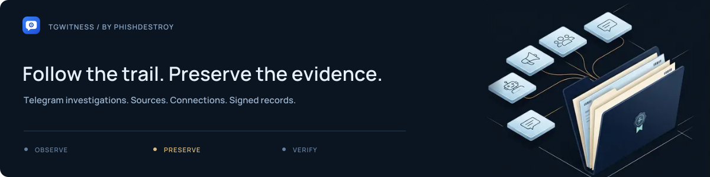

[English](../../README.md) · **Русский** · [Українська](../uk/README.md) · [Другие языки](../../README.md#read-the-project-overview-in-your-language)



# TgWitness

Сохраняет переписку Telegram, правки и уведомления об удалении. Можно искать
по архиву, сравнивать версии сообщений и выгружать чаты с цифровой подписью.
Работает на вашем компьютере или сервере.

[Демо без входа в Telegram](https://phishdestroy.github.io/TgWitness/demo/?lang=ru) ·
[Инструкции](START-HERE.md) · [Изменения](../CHANGELOG.md)

## Быстрый старт

Установщик сам добавит Python. Эти же команды обновляют программу.

**Linux / macOS:**

```sh
curl -fsSL https://get.destroy.tools/install.sh | bash
```

**Windows — PowerShell или CMD:**

```powershell
powershell.exe -NoProfile -ExecutionPolicy Bypass -Command "irm https://get.destroy.tools/install.ps1 | iex"
```

На сервере Ubuntu запускайте от root, на домашнем компьютере — от обычного
пользователя. [Установка, доступ к панели и проверка загрузки](../INSTALLATION.md).

## Возможности

- Сбор из выбранных чатов, папки Telegram или всего аккаунта.
- Сохранение правок и уже записанных сообщений после удаления.
- Загрузка старой переписки с паузой и продолжением.
- Поиск по архиву, связям между чатами и участниками.
- Экспорт чатов и аккаунта, отчёты HTML/PDF и подписанный ZIP.
- Несколько аккаунтов со своими настройками, сессиями и ключами.

По желанию: [прокси](PROXIES.md), [бот-свидетель](WITNESS.md),
[OCR и расшифровка аудио](../MEDIA-ANALYSIS.md), [AI и поиск](../ANALYSIS.md),
[MCP](../MCP.md), [webhooks](../WEBHOOKS.md) и [копии в S3](../STORAGE.md).

## Подключение аккаунта Telegram

Используйте отдельный аккаунт: Telegram может ограничить или заблокировать его.

1. Откройте **Аккаунты**. Войдите по QR, телефону или импортируйте сессию.
2. Выберите чаты и нужные вложения, затем запустите сбор.
3. Отправьте тестовое сообщение, измените и удалите его. Проверьте, что история
   сохранилась в TgWitness.

Не используйте одну импортированную сессию одновременно в TgWitness и Telegram
Desktop: Telegram может её отозвать. Для параллельной работы войдите в TgWitness
отдельно по QR или телефону. [Подключение и форматы сессий](../ACCOUNTS.md).

<a name="скриншоты"></a>
<a name="история-наблюдений"></a>
<a name="подписанный-экспорт"></a>

[Посмотреть интерфейс](https://phishdestroy.github.io/TgWitness/demo/?lang=ru).
Демо использует вымышленные чаты.

## Как это работает

Сборщик записывает доступные аккаунту события в журнал. Каждая запись подписана
и связана хешем с предыдущей. Правка добавляет новую версию; уведомление об
удалении не стирает уже сохранённый текст.

TgWitness не восстанавливает сообщения, удалённые до начала сбора, не читает
секретные чаты и не собирает данные, пока выключен. В истории могут быть пропуски.

## Доказательства и проверка

Скачайте подписанный ZIP и проверьте его:

```sh
python -m tgwitness.verify evidence.zip --fingerprint TRUSTED_SHA256 --checkpoint checkpoint.json
```

Отпечаток ключа и ранее сохранённую контрольную точку нужно получить отдельно,
из доверенного источника.

**Подпись TgWitness — не подпись Telegram.** Она позволяет проверить архив
относительно доверенного ключа и контрольной точки. Она не доказывает, что
содержание сообщений правдиво, что их создал Telegram или что история полна.
Владелец ключа может изготовить другой журнал.

[Проверка архива](TRUST.md) · [Модель доверия](../SECURITY-MODEL.md) ·
[Проведённые тесты](../VERIFICATION.md)

## Настройки и параметры

[Настройки](SETTINGS.md) · [Сбор и вложения](../COLLECTION.md) ·
[Аккаунты и группы](../ACCOUNTS.md) · [Доступ для команды](../ACCESS.md)

## Развертывание

[Сервер и Docker](DEPLOYMENT.md) · [Резервные копии и восстановление](../STORAGE.md) ·
[Диагностика](../OPERATIONS.md)

<a name="командная-строка"></a>

Для запуска из исходников и командной строки см. [быстрый старт](QUICKSTART.md).

<a name="ответственность-и-защита-данных-gdpr"></a>
<a name="безопасность-и-статус-проекта"></a>
<a name="что-проверено"></a>

Храните сессии, токены панели и ключи в секрете. Для шифрования сохранённых
сообщений и вложений нужен зашифрованный диск.
[Защита данных](../SECURITY-MODEL.md) · [Сообщить об уязвимости](../../.github/SECURITY.md)

## Разработка

[Установка для разработки и проверки](../../.github/CONTRIBUTING.md) ·
[Код приложения](../../tgwitness/README.md) · [Архитектура](../ARCHITECTURE.md)

<a name="инструкции-в-этой-папке"></a>

## Документация

[Все инструкции на русском](START-HERE.md) · [Полная документация](../README.md) ·
[Wiki](../wiki/Home.md)

## Лицензия

[MIT](../../LICENSE).

[Уведомление о несовместимости лицензий и архитектур](TAYLOR-WESSING-EXCLUSION.md) · [MIT License](../../LICENSE)
