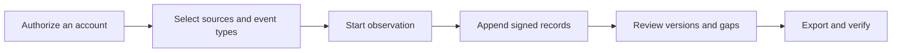

[English](../../README.md) · **Русский** · [Українська](../uk/README.md) · [Español](../es/README.md) · [Português (Brasil)](../pt/README.md) · [Türkçe](../tr/README.md) · [العربية](../ar/README.md) · [فارسی](../fa/README.md) · [اردو](../ur/README.md) · [हिन्दी](../hi/README.md) · [Bahasa Indonesia](../id/README.md) · [Tiếng Việt](../vi/README.md) · [简体中文](../zh/README.md)


<p align="center">
  <strong>Ваше пространство для наблюдения за Telegram.</strong><br>
  Сохраняйте переписку и её изменения, просматривайте историю и передавайте её с цифровой подписью.<br>На вашем компьютере или сервере. С вашими аккаунтами.
</p>

<p align="center">
  
  
  
  
  
</p>

<p align="center">
  <a href="#быстрый-старт">Быстрый старт</a> ·
  <a href="#возможности">Возможности</a> ·
  <a href="#подключение-аккаунта-telegram">Учётные записи</a> ·
  <a href="#доказательства-и-проверка">Доказательства</a> ·
  <a href="#развертывание">Развертывание</a> ·
  <a href="START-HERE.md">Документация</a>
</p>

> [!TIP]
> **Сначала попробуйте демо.** Запустите `scripts\Demo.cmd` или `sh start.sh --demo`: откроется пример с вымышленными чатами. Аккаунт Telegram не нужен.

**Впервые здесь?** [Начать →](QUICKSTART.md) · [Выбрать инструкцию →](START-HERE.md) · [Что уже проверено →](../VERIFICATION.md)

> [!WARNING]
> **Используйте отдельный аккаунт Telegram, который не жалко потерять.**
> Настоятельно не рекомендуем подключать личные и ценные аккаунты или создавать на них API ID / API hash.
> Telegram может ограничить или навсегда заблокировать аккаунт. [Подробнее о подключении](../ACCOUNTS.md).

## Возможности

- **Переписка с историей.** Читайте сохранённые сообщения, сравнивайте правки и просматривайте уведомления об удалении в контексте разговора.
- **Наблюдение в ваших границах.** Выберите отдельные чаты, папку Telegram или весь аккаунт. Для каждого аккаунта — своё пространство и свои настройки.
- **Экспорт, который можно проверить.** Подписанный ZIP, оригинальные записи, вложения и HTML-отчёт. При необходимости — архив с паролем.
- **Удобная ежедневная работа.** Светлая и тёмная темы, 13 языков, поиск, быстрый переход по Ctrl/Cmd+K и действия прямо из чата.
- **Дополнения по желанию.** Бот в Telegram за три шага, отдельная публичная страница
  и понятные инструкции. Выбирайте нужное в **Дополнениях**, раскрывайте сложные
  настройки по необходимости. [Что выбрать и как начать](EXTRAS.md).

<details>
<summary>Все возможности и технические подробности</summary>

- **Публичные прокси и свой маршрут.** В разделе **Аккаунт → Настройки прокси**: готовые
  списки MTProxy уже в программе, их можно обновить из интернета или вставить свою ссылку.
  Ручные настройки SOCKS5, HTTP и MTProxy тоже доступны. Списки скачиваются и фильтруются,
  но подключение аккаунта через сервер из списка ещё не проверялось. [Как это устроено](PROXIES.md).

- **Журнал, отражающий то, что на самом деле происходит с вашими аккаунтами.** Новые сообщения, правки, уведомления об удалении, реакции, события, связанные с членством, а также пробелы в охвате информации из выбранных вами групп и каналов.
- **Выбранные чаты, папка в Telegram или весь аккаунт.** Выберите типы объектов для записи — каналы, группы, личные чаты, боты — и новые чаты будут добавляться сразу же после их появления. Исключения чатов, собственные исходящие сообщения и правки, удаления в личных чатах с привязкой к их чату, приоритетные перепроверки и ограничения на вложения для каждого типа ([сбор данных](../COLLECTION.md#observation-scope-chosen-chats-a-folder-or-the-whole-account)).
- **Режим расследования.** Одна кнопка готовит отдельный аккаунт, который вступает в команды и
  общается с ботами: записывается всё, что он видит и отправляет; кнопки под сообщениями ботов
  (ссылки, веб-приложения, тексты для копирования) сохраняются, а правка одних только кнопок
  становится новой версией; у каждого нового чата или бота сразу сохраняются профиль (описание,
  команды, участники) и видимые ранее сообщения ([режим расследования](../COLLECTION.md#investigation-mode-joining-teams-and-talking-to-bots)).
  **Гайд: отдельный аккаунт** в панели (`/dedicated-account.html`) объясняет, почему нельзя
  подключать основной аккаунт, зачем TgWitness работает через публичные пары app ID/app hash и
  почему пара API сама по себе не даёт доступа к аккаунту (со ссылками на документацию Telegram),
  и перечисляет способы завести дополнительный аккаунт.
- **Действия прямо из чатов.** Отправка сообщений и ответов, нажатие callback- и текстовых кнопок
  ботов, просмотр приглашения в Telegram и вступление. Действие выполняет выбранный аккаунт;
  запросы, просмотры приглашений и ответы ботов (всплывающие окна и ссылки) попадают в его
  подписанный журнал ([мини-клиент панели](../COLLECTION.md#act-from-the-panel)).
- **Охват, который можно указать.** В отчётах и верификаторе указывается: «непрерывно наблюдалось с X по Y», перечисляются пробелы с указанием причин и идентификаторов сообщений, которые никогда не наблюдались — при этом они никогда не представляются как удалённые.
- **Профили людей, включаются для каждого чата отдельно.** История имен и имён пользователей, флаги Telegram, SHA-256 и pHash аватаров, активность, кто кому отвечает, а также упомянутые кошельки, телефоны, имена пользователей и ссылки — всё это формируется исключительно на основе сохраненных записей, причём каждый факт сопоставляется с соответствующей записью в журнале и экспортируется в виде отдельного подписанного файла ([модель доказательств](../EVIDENCE.md#people-profiles)).
- **Независимый свидетель.** Отдельный процесс с собственным ключом и ботом получает подписанную вершину журнала (head), публикует её в канале Telegram и сообщает, если сборщик не отвечает; верификатор сверяет экспорт с этими данными. Интервал, таймаут, какие проверки публиковать и текст постов задаются параметрами или JSON-файлом ([свидетель](../WITNESS.md)). Проверен с локальным сервером Bot API, с настоящим ботом и каналом — ещё нет.
- **Настройки сбора в панели.** Лимиты и темп сбора, перепроверки, загрузки, профили людей,
  уведомления и экспорт — на странице **Параметры**, с диапазонами и значениями по умолчанию;
  каждое изменение записывается в подписанный журнал ([настройки и параметры](#настройки-и-параметры)).
- **Изменения и удаления в контексте.** Каждое изменение представляет собой отдельную версию, отображаемую рядом с предыдущей; уведомление об удалении никогда не стирает контент, который уже был сохранен.
- **Подписанные и поддающиеся проверке экспортные файлы.** Каждое событие имеет хеш-цепочку (SHA-256) и подпись (Ed25519). Подписанный ZIP-архив содержит файлы в форматах JSONL и CSV, автономный HTML-отчёт, сохраненные медиафайлы и автономную программу проверки.
- **Экспорт с паролем.** По желанию любой экспорт можно упаковать в ZIP с шифрованием WinZip AES-256 — этот формат читают 7-Zip и WinRAR; подписанное содержимое внутри не меняется. Тестовый архив открылся в libarchive (`tar` в Windows) байт в байт, неверный пароль был отклонён ([модель доказательств](../EVIDENCE.md#investigation-handoff)).
- **Уведомления.** Проблемы (недостаток места на диске, выход из учетной записи, ошибки сборщика, копирования или временных меток), изменения в отслеживаемых чатах и ежедневная сводка, отправляемые через [Apprise](https://github.com/caronc/apprise) в Matrix, Telegram, Discord, Slack, ntfy, по электронной почте и во многие другие сервисы — без текста сообщений, если вы не включите выдержки — и отображаемые на панели. Доставка проверена на локальном сервере; сами сервисы ещё не проверялись.
- **13 языков интерфейса:** английский, русский, украинский, испанский, португальский (Бразилия), турецкий, арабский, персидский, урду, хинди, индонезийский, вьетнамский и упрощённый китайский, переведённые с помощью DeepL. Новые разделы пока показывают английский текст из явного списка исключений; кнопки мини-клиента — на английском. Содержимое Telegram и записи журнала всегда отображаются в точности так, как были сохранены.
- **Светлая и тёмная темы.** По умолчанию используются настройки системы; выбор темы сохраняется для каждого браузера.
- **Быстрый переход по разделам.** Нажмите **Ctrl+K** (на Mac — **⌘K**) или кнопку
  **«Перейти…»**. Начните вводить название раздела, выберите его стрелками и нажмите Enter.
  Escape закрывает меню и возвращает фокус.
- **Поддержка нескольких учетных записей.** Неограниченное количество изолированных рабочих пространств, каждое из которых имеет собственную сессию Telegram, журнал, ключ подписи, маршрут прокси и политику сбора данных.
- **Гибкие способы входа:** номер телефона + код + двухфакторная аутентификация (2FA), QR-код, Telethon/Pyrogram `.session`, ZIP-файл TData для Telegram Desktop, Telethon StringSession или полный ключ аутентификации с его DC-идентификатором. **«Выйти из аккаунта Telegram»** на странице «Аккаунт» завершает сессию в Telegram и стирает её; журнал и ключи остаются.
- **Прокси для каждого аккаунта.** SOCKS5 и HTTP CONNECT — проверены на локальных тестовых прокси; экспериментальный MTProxy с настоящим сервером ещё не проверялся. При сбое прокси соединение никогда не переключается молча на прямое.
- **Конфиденциальность заложена в саму концепцию.** Работает на вашем компьютере или сервере. Встроенный веб-интерфейс, без Node.js, без хостинга, без телеметрии. Сеансы, учетные данные API и секретные ключи прокси хранятся в зашифрованном хранилище.
- **Простой запуск.** Двойной щелчок в Windows, один скрипт в Linux/macOS или Docker Compose с автоматическим HTTPS по желанию. Пока запускались только варианты для Windows — см. [что проверено](#что-проверено).

</details>

## Быстрый старт

| Платформа | Как начать работу | Требования |
| --- | --- | --- |
| **Windows, ничего не установлено** | Загрузите файл `TgWitness-<version>-windows-amd64-portable.zip` из раздела «[Выпуски](../../../../releases)», распакуйте его и дважды щелкните по файлу **`TgWitness.cmd`** | Ничего; Python входит в состав дистрибутива |
| Windows, из исходного кода | Дважды щелкните по **`Start.cmd`** | Python 3.11+; предлагается и устанавливается автоматически в случае отсутствия |
| Linux / macOS | `sh start.sh` | Python 3.11+ с `venv`; в случае отсутствия необходимого компонента скрипт выведет команду установки для вашей системы |
| Docker, любая ОС | Дважды щелкните по **`scripts\Docker.cmd`** или запустите `sh scripts/docker-start.sh` | Docker Engine/Desktop с Compose версии 2.20 и выше |

1. Откройте **http://127.0.0.1:8787**.
2. Вставьте токен доступа к панели:
   - Установка из портативного пакета или исходного кода: содержимое `data/live/panel-token.txt`
   - Docker: напечатано с помощью `scripts\Docker.cmd`/`scripts/docker-start.sh` или `docker compose exec tgwitness cat /data/panel-token.txt`
3. Добавьте свой аккаунт в Telegram, выберите чаты для мониторинга и нажмите **«Начать мониторинг**».

При первом запуске исходного кода создаётся частный `.venv` и устанавливаются закреплённые зависимости (требуется доступ к Интернету). Помощники Docker собирают образ, дожидаются, пока панель не начнёт работать в нормальном режиме, и выводят её адрес и токен. `python start.py --check` (или `TgWitness-Check.cmd` в портативном пакете) выдает отчёт о готовности, не задействуя Telegram.

> **Просто хотите посмотреть?** Запустите **`scripts\Demo.cmd`** или `sh start.sh --demo`. Вымышленный журнал откроется прямо в браузере; он не привязан к учетной записи Telegram, а данные хранятся отдельно в `data/demo`.

<details>
<summary><strong>Посмотрите интерфейс: чаты, история и экспорт</strong></summary>

<picture>
  <source media="(prefers-color-scheme: dark)" srcset="../assets/chats-dark.png">
  
</picture>

### История наблюдений


### Подписанный экспорт


</details>


## Подключение аккаунта Telegram

> [!CAUTION]
> Подключайте только те учетные записи, потерей которых вы можете себе позволить. Telegram может заблокировать учетные записи навсегда и без предупреждения; ознакомьтесь с предупреждением в верхней части этой страницы. Почему и как получить отдельный аккаунт — в гайде панели **Гайд: отдельный аккаунт** (боковое меню или `/dedicated-account.html`).

Войдите с помощью телефона, QR-кода или существующей сессии — API-идентификатор или хэш не требуются.

**Зачем нужен встроенный пул API?** Известно, что создание собственного API-идентификатора на сайте [my.telegram.org](https://my.telegram.org) приводит к ограничению доступа к аккаунтам, при этом Telegram не публикует чётких ограничений — многие исследователи лишились своих основных аккаунтов именно таким образом. На собственной странице Telegram «[Получение идентификатора API](https://core.telegram.org/api/obtaining_api_id)» указано, что аккаунты, использующие неофициальные API-клиенты, автоматически попадают под наблюдение, а пользователи, ошибочно заблокированные, направляются на сайт recover@telegram.org. Поэтому TgWitness поставляется с общедоступными парами API, которые уже используются другими клиентами с открытым исходным кодом, благодаря чему вам никогда не придётся создавать собственный. Если у вас есть собственный API-идентификатор, введите его в поле **«API ID + Hash»**, и он будет использоваться вместо стандартных.

Если пара не введена, не импортирована или не сохранена в рабочей области, TgWitness выбирает одну из 50 пар в пуле и переходит к следующей, если Telegram отклоняет одну из них. Пара, с помощью которой был выполнен вход, остается привязанной к данной учетной записи. Пара идентифицирует приложение; вам по-прежнему необходимо отдельно авторизоваться в своём аккаунте Telegram. Токен доступа к панели открывает TgWitness и не связан с входом в Telegram.

| Что у вас есть | Как им пользоваться |
| --- | --- |
| Номер телефона с доступом к учётной записи | Вкладка **«Телефон**»: введите код из Telegram, а затем пароль двухфакторной аутентификации (если она включена) |
| Приложение Telegram, в котором уже выполнен вход | Вкладка **«QR-код**»: «Настройки» → «Устройства» → «Связать настольное устройство» |
| Telethon (схема 7/8) или Pyrogram (схема 2/3) `.session` | Вкладка **«Файлы»** |
| Пара файлов `name.session` + `name.json` | Вкладка **«Файлы»**, выберите оба; JSON даёт API ID и hash |
| Папка Telegram Desktop `tdata` | Упакуйте в ZIP только `key_datas` и `D877F783D5D3EF8Cs`, затем **«Файлы»**; локальный код-пароль, если он задан |
| Telethon StringSession, `.txt` или `.tgwitness-session` | Вкладка **«Файлы»** или *«Код-пароль или текст сессии»* |
| JSON-файл учетной записи с сессионным ключом или ключом аутентификации | Вкладка **«Файлы»** |
| Полный ключ аутентификации (512 шестнадцатеричных символов) + DC ID | Вкладка **«Ключ аутентификации»**; необязательный идентификатор пользователя сверяется с данными Telegram |

Не поддерживаются: хранилище TDLib, строки сеансов Pyrogram, токены ботов, TData с поддержкой нескольких учетных записей и массовые списки учетных записей. Файлы преобразуются в памяти вашего сервера и проверяются в Telegram перед сохранением. В руководстве по работе с учетными записями ([Руководство по работе с учетными записями](../ACCOUNTS.md)) шаг за шагом объясняется каждый формат: как получить учетные данные API, как распознать файл, поля JSON, ограничения и сообщения об ошибках.

После входа в систему откройте **раздел «Источники»** (ваши чаты загрузятся автоматически), добавьте необходимые группы, выберите, что следует фиксировать (например, *сообщения, правки и удаления*), и начните мониторинг. Обеспечьте непрерывность процесса: **при нажатии кнопки «Пауза»** сбор данных приостанавливается, а **кнопка «Заблокировать»** лишь ограничивает доступ через браузер.

## Скриншоты

| Сравнение версий | Источники и политика сбора данных |
| --- | --- |
|  |  |
| **Подписанные экспорты** | **Вход в систему** |
|  |  |
| **Журнал** | **Тёмная тема** |
|  |  |

На всех скриншотах использованы синтетические демонстрационные данные. QR-код в [файле qr-login.png](../assets/qr-login.png) содержит вымышленный токен из тестового транспорта.


## Как это работает



Каждая рабочая область привязана к одному аккаунту в Telegram. Коллектор принимает обновления от клиента данного аккаунта, применяет сохраненную политику сбора данных и добавляет наблюдения в журнал, доступный только для добавления записей.

| Наблюдение | Что сохраняется | Границы |
| --- | --- | --- |
| Новое сообщение | Текст, идентификатор отправителя, ссылка на ответ, метаданные, время наблюдения | Обновления предоставляются только для выбранных источников |
| Правка | Отдельная версия содержимого | Промежуточные версии, пропущенные, пока программа была выключена, восстановить невозможно |
| Удаление | Идентификатор сообщения и всё, что было сохранено раньше | Telegram, как правило, не сообщает, кто и когда удалил сообщение |
| Реакции | Количество и последние отреагировавшие, если Telegram их передаёт | Это снимок, а не полный журнал изменений |
| Участники | Служебные сообщения и обновления участников | Не каждое вступление или выход гарантированно доходит |
| Вложение | Файл по желанию, адресуемый по содержимому, с хешем SHA-256 | Файлы могут исчезнуть до загрузки; результат фиксируется |
| Охват | Запуски, остановки, отключения, heartbeat, изменения политики | То, что программа работала, не доказывает полноту сбора |
| Снимок истории | Последние видимые сообщения, до 500 (больше — в **Параметрах**), с явной пометкой | Невозможно восстановить пропущенные правки или удаления |

Политики, очереди вложений и перезапуски описаны в разделе [Как работает сбор данных](../COLLECTION.md).

## Настройки и параметры

Всё меняется в панели, для каждого рабочего пространства отдельно, без правки кода и
конфигурационных файлов. Каждое изменение охвата, политики или параметра записывается в
подписанный журнал со значениями до и после, а каждый запуск наблюдения называет действующие значения.

| Где | Что настраивается |
| --- | --- |
| **Источники** | Охват (выбранные чаты, папка Telegram, весь аккаунт), типы источников, исключения, собственные действия, какие изменения сохранять, типы вложений и размер для каждого типа (1–2 000 МиБ), интервал перепроверки приоритетных и остальных чатов (любое число минут, 0 — выключено), снимки истории, уведомления |
| **Экспорт** | Скачивание с паролем, режим доказательств (интервал, службы меток времени и календари), внешняя копия в S3 (интервал, срок и режим Object Lock) |
| **Свидетель** | Токены свидетеля только для чтения; собственные параметры свидетеля показаны с готовыми командами |
| **Параметры** | Размер и обновление списка чатов, интервалы heartbeat и контрольных точек, буфер при запуске, распределение запросов перепроверки (первая задержка, чатов за проход, пауза, сколько сообщений восстанавливать и перезапрашивать), резерв диска, таймаут, скорость и повторы загрузки, что ищут профили людей (включая ваши регулярные выражения), объём и темп уведомлений, лимиты снимков, ZIP и скачивания в браузере, таймаут действий панели, таймауты и повторы клиента Telegram |

Значения на странице **Параметры** показывают диапазон и значение по умолчанию; изменённые
помечены и сбрасываются по одному или все сразу. Они действуют со следующего использования,
таймауты и повторы клиента Telegram — со следующего подключения. Если лимит ZIP больше 4 ГиБ,
при проверке архива нужен `verify.py --max-gib N` ([эксплуатация](../OPERATIONS.md#panel-layout)).


## Доказательства и проверка

| Экспорт | Содержание | Целостность |
| --- | --- | --- |
| **Подписанный ZIP-файл** | JSONL, CSV, отчет в формате HTML, охват, медиафайлы, манифест, верификатор | Подписанные события, а также подписанный манифест каждого файла с указанием автора. Используйте это для передачи данных. |
| JSONL | Исходные записи с хешами и подписями | Подписи Ed25519 для каждого события и цепочка хэшей |
| CSV / HTML | Таблица, совместимая с электронными таблицами / отчёт, доступный для чтения в автономном режиме | Информация содержится исключительно в подписанном ZIP-архиве |
| JSON-файл контрольной точки | Длина журнала и хеш заголовка | Подписано отдельно; храните его вне коллектора |
| JSON-файл с подтверждением запуска | Хэши кода, версии зависимостей, область применения, настройки | Отдельно подписанное заявление о процедуре |
| Профили пользователей в формате JSON | Профили одного чата со ссылками на записи | Подписанное заявление; хэши записей сверены с ZIP-архивом |
| ZIP журнала свидетеля | Полученные свидетелем вершины журнала, пропущенные ответы, посты в канале | Подписан собственным ключом свидетеля |

Фильтры влияют только на просмотр; экспортируемые файлы всегда содержат полный журнал до заданного порядкового номера. Проверьте архив с помощью доверенной копии верификатора, а также независимо сохраненного отпечатка ключа и контрольной точки:

```sh
python -m pip install cryptography
python tgwitness/verify.py tgwitness-evidence.zip --fingerprint TRUSTED_PUBLIC_KEY_SHA256 --checkpoint tgwitness-checkpoint.json
# with an independent witness and its channel (Telegram Desktop export)
python tgwitness/verify.py tgwitness-evidence.zip --fingerprint TRUSTED_PUBLIC_KEY_SHA256 \
    --witness witness.zip --witness-fingerprint WITNESS_SHA256 --channel result.json
```

Верификатор выводит на экран подписанного производителя, периоды непрерывного наблюдения, пропуски и идентификаторы сообщений, которые никогда не наблюдались, и завершает работу с ошибкой, если журнал отличается от любого из тех, что видел свидетель.

Подписи обеспечивают защиту от несанкционированного вмешательства относительно доверенного ключа подписи. Они **не** подтверждают происхождение из Telegram, достоверность содержания или достоверное время, а также не обеспечивают защиту от оператора, контролирующего сборщик данных и его ключ. Для достоверного времени режим доказательств (по умолчанию выключен) ставит на контрольные точки метки времени служб RFC 3161 и календарей OpenTimestamps, либо панель готовит офлайн-запрос RFC 3161 ([процедура меток времени](../TIMESTAMP.md)). Оба способа проверены на локальных тестовых серверах, с публичными службами — ещё нет. Ознакомьтесь с моделью доказательств ([модель доказательств](../EVIDENCE.md)) и контрольным списком для передачи материалов расследования ([передача расследования](../EVIDENCE.md#investigation-handoff)).

## Развертывание

> [!NOTE]
> Варианты с Docker, Caddy (HTTPS), systemd и launchd ниже подготовлены, их файлы проходят
> проверку синтаксиса, но ни один из них ещё не запускался. Портативный пакет для Windows и
> запуск из исходников в Windows — запускались.

**Локальный сервер или отдельный сервер с использованием Docker:**

```sh
docker compose up -d --build --wait
docker compose exec tgwitness cat /data/panel-token.txt
```

Контейнер работает под учетной записью пользователя без прав root с файловой системой, доступной только для чтения, публикует данные исключительно на `127.0.0.1:8787` и хранит все данные в именованном томе.

**Публичный сервер с автоматической поддержкой HTTPS (Caddy):** скопируйте `deploy/env.example` в `.env`, настройте `TGWITNESS_DOMAIN`, настройте DNS на этот сервер, откройте порты TCP 80/443 и запустите

```sh
docker compose -f compose.yaml -f deploy/compose/compose.https.yaml up -d --build --wait
```

**Работа в Windows без установки:** портативный ZIP-файл, прилагаемый к каждому выпуску, содержит официальную встроенную среду выполнения Python и все необходимые зависимости. Данные хранятся в папке `data`; для обновления распакуйте новую версию и скопируйте эту папку в соответствующее место.

**Без использования Docker:** шаблоны для systemd, задачи входа в систему Windows и launchd находятся в папке «[deploy/](../../deploy/README.md)». Обновления, резервные копии, другие порты и образы GHCR (когда их опубликует release workflow) описаны в разделе «[развертывание](DEPLOYMENT.md)».

### Командная строка

```text
python start.py [--demo] [--setup-only] [--check [--json]] [--host HOST] [--port PORT] [--data-dir DIR]
```

| Задача | Команда (из среды проекта) |
| --- | --- |
| Проверка готовности без запуска | `python start.py --check` |
| Офлайн-конвертация сессии Telethon SQLite | `python -m tgwitness.sessions account.session --out account.tgwitness-session` |
| Сохранение большого экспорта на диск потоком | `python -m tgwitness.download --token-file data/live/panel-token.txt --out evidence.zip` |
| Проверка экспортированного архива | `python tgwitness/verify.py tgwitness-evidence.zip --fingerprint SHA256` |
| Проверка архива больше 4 ГиБ | `python tgwitness/verify.py big-evidence.zip --fingerprint SHA256 --max-gib 16` |
| Независимый свидетель из конфигурационного файла | `python -m tgwitness.witness run --config witness.json` |

Вспомогательные команды `python -m tgwitness…` должны выполняться внутри `.venv` (`.venv\Scripts\python.exe` в Windows, `.venv/bin/python` в остальных системах).

| Переменная | Цель |
| --- | --- |
| `TGWITNESS_HOST`, `TGWITNESS_PORT` | Адрес и порт прослушивания (по умолчанию `127.0.0.1:8787`) |
| `TGWITNESS_DATA` | Каталог данных (по умолчанию `data/live`) |
| `TGWITNESS_TOKEN` | Используется фиксированный токен панели вместо сгенерированного (не менее 24 символов) |
| `TGWITNESS_VAULT_KEY_FILE` | Внешний мастер-ключ хранилища для новых установок |
| `TGWITNESS_DOMAIN`, `TGWITNESS_IMAGE` | HTTPS-имя хоста Docker и опубликованный образ (см. `deploy/env.example`) |
| `TGWITNESS_WITNESS_*` | Независимый свидетель: сборщик, токены, канал, `_INTERVAL`, `_TIMEOUT`, `_POST` (all, changes, problems), `_TITLE`, `_CONFIG` ([свидетель](../WITNESS.md#options)) |


## Ответственность и защита данных (GDPR)

TgWitness — это инструмент. Лицо, управляющее им, самостоятельно определяет, какие данные собираются, с какой целью и в течение какого времени, а также несёт за это ответственность — в соответствии с Общим регламентом по защите данных (GDPR) ЕС/Великобритании, как правило, в качестве *контролёра* данных. Сообщения в Telegram содержат персональные данные людей, которые никогда не давали согласия на их сбор: имена, имена пользователей, идентификаторы, фотографии, номера телефонов, мнения. Данный раздел не является юридической консультацией; ознакомьтесь с применимым к вам законодательством и условиями использования Telegram.

- **Обеспечьте наличие правового основания и конкретной цели.** В качестве законных интересов обычно указываются предотвращение мошенничества, сетевая и информационная безопасность, а также защита от судебных исков (статья 6(1)(f) Общего регламента по защите данных (GDPR), преамбулы 47 и 49; статья 9(2)(f) в отношении судебных исков). Формулируйте цель для каждого конкретного случая. Государственные органы действуют на основании собственных правовых оснований.
- **Собирайте только ту информацию, которая необходима для достижения поставленной цели.** Начните с выбранных чатов. Режимы «Папка» и «Весь аккаунт» фиксируют личные чаты и сообщения третьих лиц: используйте их только на специальных аккаунтах; панель запросит подтверждение, и подписанный журнал зафиксирует это. Отключите ненужные типы событий, типы вложений и собственные действия, а также исключите ненужные чаты.
- **Профили пользователей представляют собой профилирование.** По умолчанию они отключены и включаются для каждого чата отдельно. Используйте их для конкретного расследования, не принимайте на их основе автоматизированных решений в отношении людей (ст. 22) и, по завершении работы, отключите их или удалите чат — это приведёт к их удалению. Систематический мониторинг большого числа лиц, как правило, требует проведения оценки воздействия на защиту данных (ст. 35).
- **Обеспечьте безопасность.** Сеансы, учетные данные и ключи хранятся в зашифрованном хранилище; разместите каталог данных на зашифрованном диске, установите пароль для экспорта данных (AES-256 ZIP), обеспечьте доступ к панели управления только через HTTPS и предоставьте наблюдателю только токен с правом чтения. Уведомления не содержат текста сообщений, если вы не включите функцию выдержек, при которой текст отправляется в службу уведомлений.
- **Хранение и удаление.** Журнал ведётся в режиме «только добавление», что позволяет подтвердить его целостность; отдельные записи невозможно удалить без нарушения цепочки подписей. Планируйте срок хранения для каждого рабочего пространства и по завершении работы удаляйте добавленное пространство («Аккаунты» → «Удалить»). Основное пространство из панели не удаляется: выйдите из аккаунта Telegram на странице «Аккаунт», остановите TgWitness и удалите его папку данных. Внешние копии под S3 Object Lock не могут быть удалены до истечения срока их хранения — выбирайте соответствующий период. Право на удаление данных имеет исключения, например, для установления или защиты правовых претензий (ст. 17(3)(e)).
- **Запросы людей, попавших в журнал.** Экспортированные данные чатов и файлы профилей позволяют выяснить, какая информация хранится о конкретном человеке (ст. 15).
- **Никакие данные не передаются авторам.** TgWitness не использует телеметрию и не имеет хостингового сервиса; данные покидают Ваш компьютер исключительно по настроенным Вами каналам (Telegram, сервисы временных меток, копирование в S3, уведомления, witness).

## Безопасность и статус проекта

- По умолчанию панель прослушивает запросы на localhost. Для удалённого доступа используйте профиль HTTPS Compose или SSH-туннель; ни в коем случае не используйте незащищённый HTTP.
- Сессии Telegram, параметры API и прокси, а также ключ подписи хранятся в зашифрованном хранилище Fernet. По умолчанию его ключ лежит в том же каталоге; для внешнего мастер-ключа задайте `TGWITNESS_VAULT_KEY_FILE`. Локальные сообщения и вложения **не** шифруются приложением — используйте зашифрованный диск или том. Для ZIP-экспорта можно включить защиту паролем.
- Файлы данных, сеансы, токены, ключи и экспортированные данные исключены из репозитория Git и сборок Docker.
- Сообщайте об уязвимостях в конфиденциальном порядке, как описано в файле [SECURITY.md](../../.github/SECURITY.md).

### Что проверено

TgWitness **0.6.1** работает в Windows 11 с Python 3.12. Состояние на 29 октября 2026:

| Что | Как проверено |
| --- | --- |
| Сообщения, правки, удаления, вложения, перепроверки после перезапусков, паузы FloodWait | **Реальный аккаунт Telegram**, 27–29 октября 2026: 9 968 подписанных записей, все подписи и цепочка хешей сходятся ([живой тест](../VERIFICATION.md#live-telegram-test-whole-account--29-october-2026)) |
| Охват «весь аккаунт» и снимки истории | **Реальный аккаунт**, 29 октября 2026: сообщения из 2 групп или каналов и 3 личных чатов и ботов |
| Нажатие кнопки под сообщением из **Чатов** | **Реальный аккаунт**: одно нажатие |
| Вход по файлам сессий Telethon/Pyrogram и TData из Telegram Desktop | **Один реальный аккаунт** |
| Вход по телефону, QR-коду и Auth Key, выход из аккаунта, новые чаты в области наблюдения с их прежними сообщениями, отправка сообщений, вступление по приглашению, реакции, участники, профили людей, несколько аккаунтов одновременно, экспорт и верификатор | Автотесты с синтетическими клиентами Telegram |
| Прокси SOCKS5/HTTP, бот-свидетель, монитор Proof, уведомления, копия в S3, RFC 3161 и OpenTimestamps | Автотесты с локальными тестовыми серверами |
| Публичные списки MTProxy | Скачиваются и фильтруются (118 серверов на 29 октября); подключение через них ещё не проверялось |
| MTProxy, Docker, HTTPS через Caddy, Linux, macOS, Python 3.11 и 3.13, CI и release workflow, долгие перерывы, независимый аудит безопасности | **Ещё не проверялось** |

Подробности: [журнал проверок](../VERIFICATION.md), [статус выпуска](../internal/RELEASE.md)
и [готовность](../internal/READINESS.md).


## Разработка

```sh
python -m venv .venv && source .venv/bin/activate     # Windows: .venv\Scripts\Activate.ps1
python -m pip install -c deploy/constraints.txt -e ".[dev]"
python -m pytest -q                                    # unit and integration tests
python -m playwright install chromium
python tools/check_browser.py                          # end-to-end UI acceptance
python tools/check_account_browser.py                  # sign-in flows
python tools/capture_screenshots.py --docs             # refresh README images
python tools/build_portable.py                         # Windows portable ZIP (Windows + Python 3.12)
python tools/build_source.py                          # source ZIP with SHA-256 manifest
python tools/build_site.py                             # static project site in dist/site
python tools/check_site.py                             # website browser acceptance
```

Автоматические тесты используют синтетические объекты Telegram и не подключают реальные
аккаунты; живой тест описан выше. CI настроен на проверки
Windows, Linux и macOS с Python 3.11–3.13, браузерные сценарии, упаковку исходников,
портативную сборку Windows и Docker. Release workflow настроен прикладывать к
опубликованному релизу GitHub исходники, wheel, портативный ZIP для Windows и образ GHCR.
Ни один из этих workflow ещё не запускался.
Перед пул-реквестом прочитайте [CONTRIBUTING.md](../../.github/CONTRIBUTING.md).

## Документация

| Руководство | Содержит |
| --- | --- |
| [Быстрый старт](QUICKSTART.md) | Первый запуск, подключение учетной записи и первый экспорт |
| [Дополнения без лишней сложности](EXTRAS.md) | Бот в три шага, публичная страница, планы GitHub; что выбрать и что понадобится |
| [Форматы учётных записей и сеансов](../ACCOUNTS.md) | Параметры входа в систему, преобразование данных, работа с несколькими учетными записями |
| [Как работает сбор данных](../COLLECTION.md) | Правила сбора данных, версии, вложения, пробелы |
| [Подключение и безопасность](../CONNECTION-SECURITY.md) | Прокси-серверы, шифрование и ключи |
| [Операционная деятельность](../OPERATIONS.md) | Ежедневный рабочий процесс, резервное копирование, восстановление, емкость |
| [Развертывание](DEPLOYMENT.md) и [шаблоны сервисов](../../deploy/README.md) | Серверы, контейнеры, HTTPS, обновления |
| [Развёртывание с повышенной доказуемостью](HIGH-ASSURANCE.md) | Сервер через API провайдера, без SSH, за Cloudflare Tunnel; отчёт для третьей стороны |
| [Модель доказательств](../EVIDENCE.md) и [временные метки](../TIMESTAMP.md) | Целостность, охват, профили участников, доверие и передача полномочий |
| [Бот-свидетель и прокси](WITNESS.md) | Настройка бота, токены чтения, свой канал и маршруты подключения |
| [Публичные списки и свои прокси](PROXIES.md) | Готовый выбор MTProxy, обновление списков, проверка до входа и каталог оператора |
| [Архитектура](../ARCHITECTURE.md) и [модель продукта](../PRODUCT.md) | Внутреннее устройство и проектные решения |
| [План проверяемых сборок и GitHub](TRUST-ROADMAP.md) | Предлагаемые форки, контроль версий софта, очереди пруфов и независимые свидетели |
| [Проверка](../VERIFICATION.md) и [готовность к работе](../internal/READINESS.md) | Проведённые проверки и оставшиеся задачи |
| [Журнал изменений](../CHANGELOG.md) | История выпусков |
| [Веб-сайт и публикации](../internal/PUBLISHING.md) | Предварительный просмотр локального веб-сайта, GitHub Pages, первая публикация |


## Лицензия

[MIT License](../../LICENSE)

## Инструкции в этой папке

| Файл | Содержание |
| --- | --- |
| [DEPLOYMENT.md](DEPLOYMENT.md) | Развертывание и эксплуатация |
| [HIGH-ASSURANCE.md](HIGH-ASSURANCE.md) | Развёртывание с повышенной доказуемостью и отчёт для передачи улик |
| [EXTRAS.md](EXTRAS.md) | Дополнения — когда нужны |
| [PROXIES.md](PROXIES.md) | Публичный прокси или свой — в одном месте |
| [QUICKSTART.md](QUICKSTART.md) | TgWitness: от запуска до первого сообщения |
| [START-HERE.md](START-HERE.md) | Документация TgWitness |
| [TRUST-ROADMAP.md](TRUST-ROADMAP.md) | Проверяемая сборка, непрерывность и GitHub |
| [WITNESS.md](WITNESS.md) | Бот-свидетель и свои прокси |

[Уведомление о несовместимости лицензий и архитектур](TAYLOR-WESSING-EXCLUSION.md) · [MIT License](../../LICENSE)
