[TgWitness](../../README.md) / [Документация](../README.md) / [Папка](README.md) · [Справочная документация по проекту](../README.md)

<picture>
  <source media="(max-width: 640px) and (prefers-reduced-motion: reduce)" srcset="../assets/presentation/tgwitness-investigation-mobile-static.svg">
  <source media="(prefers-reduced-motion: reduce)" srcset="../assets/presentation/tgwitness-investigation-static.svg">
  <source media="(max-width: 640px)" srcset="../assets/presentation/tgwitness-investigation-mobile-animated.svg">
  
</picture>

# Иллюстрированное расследование

Как формируется дело — в иллюстрациях. Примеры являются вымышленными; для просмотра реального интерфейса [откройте демо-версию](https://phishdestroy.github.io/TgWitness/demo/).

[Проект](../../README.md) · [Руководство по расследованию](../wiki/Home.md) · [Модель доказательств](HOW-IT-WORKS.md)

### Свяжите сохраненные события

<picture>
  <source media="(max-width: 640px) and (prefers-reduced-motion: reduce)" srcset="../assets/presentation/case-chain-mobile-static.svg">
  <source media="(prefers-reduced-motion: reduce)" srcset="../assets/presentation/evidence-chain-static.svg">
  <source media="(max-width: 640px)" srcset="../assets/presentation/case-chain-mobile.svg">
  
</picture>

[Модель доказательств](HOW-IT-WORKS.md)

### Обнаружение измененной записи

<picture>
  <source media="(prefers-reduced-motion: reduce)" srcset="../assets/presentation/evidence-tamper-static.svg">
  
</picture>

[Экспорт и проверка](../wiki/Exports-and-Verification.md)

### Сохранение независимой контрольной точки

<picture>
  <source media="(prefers-reduced-motion: reduce)" srcset="../assets/presentation/evidence-checkpoint-static.svg">
  
</picture>

[Независимый свидетель](../wiki/Independent-Witness.md)

Подпись подтверждает, что запись не была изменена после подписания. Проверка источника сообщения и проверка на наличие пропусков — это отдельные процедуры: происхождение проверяется по аутентифицированному сеансу Telegram учетной записи, а полнота — по записям об охвате и пробелах.

[Вернуться к проекту](../../README.md) · [Документация](../README.md)
