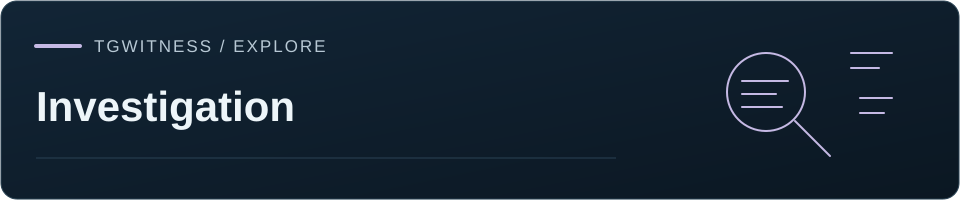

[TgWitness](../../README.md) / [Документация](../README.md) / [Папка](README.md) · [Расследование](INVESTIGATION.md)

[English](../SIMILAR-CHANNELS.md) · **Русский**



<a id="similar-channels"></a>
# Похожие каналы

Telegram ведет список каналов, которые он считает похожими на заданный канал, и
предлагает его подписчикам. TgWitness может проходить этот список, начиная с одного или нескольких исходных
каналов, и фиксировать результаты, возвращаемые Telegram.

Telegram формирует список рекомендаций на основе собственных данных об использовании. Рассматривайте полученный результат
как список потенциальных клиентов: общие операторы, владельцы, авторы или цели определяются на основе
данных из собственных записей каналов.

<a id="run-a-walk"></a>
## Пробежка или прогулка

```sh
curl -sS -X POST http://127.0.0.1:8000/api/channel-graph \
  -H "Authorization: Bearer $TGWITNESS_TOKEN" \
  -H "Content-Type: application/json" \
  -d '{"seeds": [-1001234567890], "depth": 2, "per_source": 20, "total": 100,
       "min_participants": 500, "require_username": true, "pause_seconds": 1}'
```

Только главный администратор может запустить прохождение, при этом учетная запись должна быть подключена.
Каждый «сед» должен представлять собой чат, который эта учетная запись уже прочитала, поэтому сначала необходимо определить канал
в панели.

| Настройки | Значение | Диапазон |
| --- | --- | --- |
| `seeds` | Каналы, с которых начинается прогулка | 1–50 идентификаторов чатов |
| `depth` | Сколько шагов необходимо выполнить в соответствии с рекомендациями; `1` считывает только исходные данные | 0–4 |
| `per_source` | Предложения, обработанные из одного канала до применения фильтров | 1–200 |
| `total` | Каналы во всех результатах, включая семена | 1–2000 |
| `min_participants`, `max_participants` | Диапазон абонентов, который необходимо сохранить | любая пара, согласующаяся с порядком |
| `require_username` | Удалить каналы без публичного имени пользователя | по умолчанию отключено |
| `skip_restricted` | Каналы, которые Telegram помечает как ограниченные | по умолчанию отключено |
| `pause_seconds` | Пауза между запросами | 0–60 |

Фильтры формируют список сохраненных узлов. Журнал фиксирует каждое обработанное
предложение, включая те, которые были отсеяны фильтром, и фиксирует их количество.
Бюджеты `per_source` и всего прогона могут привести к тому, что полученные предложения останутся необработанными.

<a id="what-the-journal-keeps"></a>
## Что хранится в журнале

`graph.started` сохраняет седы и настройки. Каждая запись `graph.suggestions`
для каждого посещённого канала содержит данные, возвращённые Telegram, количество сохраненных седов, а также
идентификаторы каналов и имена пользователей. `graph.source_unavailable` отмечает сед, который
аккаунт не может прочитать. `graph.finished` завершает цикл с указанием итоговых данных и
причины остановки.

Каждая запись с предложением разделяет количество каналов, о которых сообщил Telegram (`total`), на количество
полученных (`suggested`), обработанных (`returned`) и прошедших
фильтры (`kept`). Поэтому фрагментированный ответ API может содержать большее общее количество, чем
список, доступный для данной учетной записи. `response_complete` указывает, что все
сообщенные предложения были получены; `complete` дополнительно требует обработки
всего полученного списка. Эти флаги описывают ответ и обработку до
применения фильтров, а не полную карту каналов Telegram. Результирующий список `sources`
сохраняет те же значения количества и флаги для каждого успешно запрошенного источника.

Процесс остановки происходит раньше срока, и об этом сообщается при достижении `total` или когда Telegram просит
аккаунт подождать. Ответ на запрос о паузе из-за перегрузки фиксируется как `telegram.backoff`,
пауза для всего аккаунта соблюдается, а `stopped` отображается как `rpc_backoff`.

<a id="result"></a>
## Результат

Ответ представляет собой объект `tgwitness-channel-graph-v1`, содержащий `nodes` (ID чата, название,
имя пользователя, количество подписчиков, флаги Telegram, глубину обнаружения и источник) и
`edges` (какой канал что предложил). Каждый узел сохраняет флаги, предоставленные Telegram,
включая `scam`, `fake`, `verified` и `restricted`.
