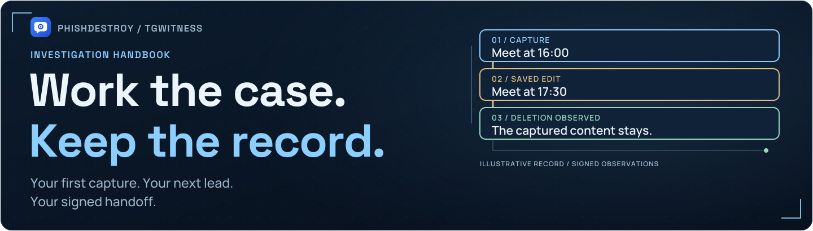

# Документация TgWitness

[English](../README.md) · [О проекте](README.md)

Начните с демо, затем подключите один аккаунт и проверьте сохранение сообщения.
Прокси, бот и публичная страница подключаются отдельно, когда понадобятся.

| Хочу | Куда перейти | Как понять, что получилось |
| --- | --- | --- |
| Разово выгрузить один закрытый чат через GitHub | [Выгрузка через Actions — предварительная версия](SEALED-ACTIONS.md) | Зашифрованный архив и проверенная аттестация закреплённого сборщика |
| Посмотреть интерфейс | [Быстрый старт](QUICKSTART.md#ознакомьтесь-с-интерфейсом) | Открылись вымышленные переписки без входа в Telegram |
| Подключить аккаунт | [Подключение](QUICKSTART.md#подключитесь-к-telegram) | Новое контрольное сообщение появилось в журнале |
| Выбрать публичный или свой прокси | [Прокси](PROXIES.md) | Проверка установила соединение с Telegram |
| Передать проверяемую историю | [Экспорт](QUICKSTART.md#просмотр-и-экспорт) | Подписи и ожидаемый отпечаток ключа проверены |
| Публиковать контрольные точки в канал | [Бот-свидетель](WITNESS.md) | Запущенный свидетель опубликовал подписанный пост |
| Оставить сбор на сервере | [Развёртывание](../DEPLOYMENT.md) | Данные сохранились, после перезапуска поступают новые события |
| Найти причину сбоя | [Эксплуатация](../OPERATIONS.md) | Найдена причина и проверено восстановление |

**Что уже проверено:** [журнал верификации](../VERIFICATION.md).
Там отдельно указаны реальные наблюдения Telegram, синтетические проверки
и оставшиеся испытания. Подпись помогает проверить целостность записанного,
а контрольный сценарий — доставку конкретных событий.

Нужны технические подробности

- [Дополнения: что выбрать и зачем](EXTRAS.md)
- [Сбор, источники и ограничения видимости](../COLLECTION.md)
- [Формат доказательств и границы доверия](../EVIDENCE.md)
- [Архитектура](../ARCHITECTURE.md)
- [Подключение и хранение секретов](../CONNECTION-SECURITY.md)
- [Готовность и известные ограничения](../internal/READINESS.md)
- [Процедура живой приёмки](../internal/LIVE_ACCEPTANCE.md)
- [GitHub и проверка сборки: планы](TRUST-ROADMAP.md)

## Анализ и интеграции

Эти технические руководства доступны на английском:

| Задача | Руководство |
| --- | --- |
| Дать доступ к выбранным чатам | [Права доступа](../ACCESS.md) |
| Подключить клиент к архиву в режиме чтения | [MCP](../MCP.md) |
| Найти записи и подготовить аналитический отчёт | [Анализ архива](../ANALYSIS.md) |
| Распознать текст и расшифровать аудио из вложений | [Локальная обработка](../MEDIA-ANALYSIS.md) |
| Отправлять события во внешнюю систему | [Вебхуки](../WEBHOOKS.md) |

Для разового сбора одного чата есть [инструкция по GitHub Actions](SEALED-ACTIONS.md)
на русском. Этот режим использует временный runner в вашем форке.

На сайте документации есть русская версия и локальный поиск.
[Как открыть его у себя или опубликовать на GitHub Pages](../internal/PUBLISHING.md#preview-the-website-locally).
