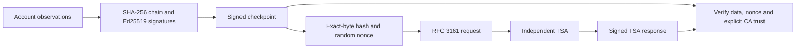

[TgWitness](../../README.md) / [Документация](../README.md) / [Папка](README.md) · [Доказательства и проверка](../EVIDENCE.md)

[English](../TIMESTAMP.md) · **Русский**


<a id="independent-timestamps-and-evidence-handoff"></a>
# Независимые временные метки и передача доказательств

TgWitness формирует запросы в соответствии с RFC 3161 и проверяет ответы центра сертификации временных меток (TSA).
Эта ручная процедура не предусматривает ни выбора TSA, ни отправки данных; режим подтверждения выполняет обе эти операции по
расписанию ([формат подтверждения](../EVIDENCE.md#rfc-3161-preparation-and-response-verification-02)). Подготовленный запрос
**ещё не подтверждение времени**.

<a id="what-the-proof-binds"></a>
## Что охватывает доказательство



Подпись сборщика связывает записи с его ключом. Доверенный ответ TSA позволяет
установить, что конкретный контрольный пункт существовал к указанному TSA моменту времени. Затем
контрольный пункт может привязать префикс журнала. Это верхнее временное ограничение применяется к
этому зафиксированному префиксу; отдельные действия Telegram сохраняют свои зарегистрированные времена событий.

<a id="procedure"></a>
## Порядок действий

Программа проверки журнала сообщает о шагах назад и нераспознаваемых значениях `observed_at`
в `chronology`, если таковые присутствуют, и включает предупреждение в вывод команды. Она
сохраняет подписанные временные метки и по-прежнему проверяет их подписи. Шаг назад
может быть вызван корректировкой часов, поэтому его следует сверять с записями о времени хоста.
Независимое время получается из проверенных внешних временных меток, сообщений свидетелей, считываемых с
их публичной страницы t.me, и раундов drand; `--strict` регулирует привязку подписантов и
поддерживаемые форматы.

Записанные значения drand проходят автономную проверку на структурную и хеш-внутреннюю согласованность.
`--check-drand` сравнивает выбранные записанные раунды с ответами HTTPS-ретрансляторов; в
результате указывается, сколько раундов было сравнено и какие ретрансляторы ответили, а
сравниваемые раунды обеспечивают аутентифицированную нижнюю временную границу.

1. Сохраните отпечаток ключа сборщика через отдельный доверенный канал; он
   идентифицирует сборщик независимо от проверяемого ZIP-файла.
2. В разделе **Экспорт → Подготовить запрос на временную метку** загрузите ZIP-файл запроса
   для выбранной рабочей области. Распакуйте файлы `checkpoint.json`, `timestamp.tsq`, `SHA256SUMS` и
   `README.txt`. Не изменяйте байты контрольной точки.
3. Выберите TSA, подходящий для данного расследования. Отправьте `timestamp.tsq`, используя
   описанный в документации метод, с `application/timestamp-query` для HTTP-сервиса.
   Сохраните исходный двоичный ответ как `timestamp.tsr`, а также конечную точку, время получения
   и результат запроса. Запрос содержит хеш и нонс, а не сообщения;
   сетевые метаданные по-прежнему раскрывают суть запроса.
4. Получите доверенный корневой сертификат независимо от ответа, а также любые
   необходимые промежуточные сертификаты. Сертификат в ответе не становится доверенным только
   потому, что он там включён.
5. С помощью доверенной установки TgWitness проверьте:

```sh
python -m tgwitness.anchor verify --checkpoint checkpoint.json --request timestamp.tsq --response timestamp.tsr --ca trusted-tsa-root.pem
```

При необходимости добавьте `--intermediates tsa-intermediates.pem`
. OpenSSL не требуется:
подпись, ссылка на сертификат подписи и цепочка сертификатов проверяются в Python с помощью
библиотеки `cryptography`
, которую использует и код `verify.py --tsa-ca`
. `openssl ts -verify`
остается отдельной дополнительной проверкой для специалиста, если он сочтёт это необходимым.

6. После создания контрольной точки экспортируйте ZIP-архив подписанного журнала так, чтобы он содержал этот префикс.
   Проверьте с помощью независимо известного отпечатка:

```sh
python tgwitness/verify.py evidence.zip --fingerprint TRUSTED_SHA256 --checkpoint checkpoint.json
```

   Файл `--checkpoint` должен представлять собой подписанную контрольную точку: `statement` с `format`, `public_key`,
   `event_count` и `head_hash`, а также `signature`. Любой другой файл отклоняется с следующим сообщением:
   *Файл --checkpoint не является подписанной контрольной точкой TgWitness*, после чего перечисляются необходимые поля.

   Это свидетельствует о том, что экспортный файл содержит префикс с отметкой времени. Элемент `verify.py` считывает
   квитанции с отметками времени только из архива ZIP, где они хранятся в режиме подтверждения; ручной
   ответ проверяется на этапе 5 и охватывает записи вплоть до этой контрольной точки.

7. Сохраните ZIP-архив, контрольную точку, запрос, ответ, цепочку сертификатов, результаты проверки
   и запись о передаче данных за пределами коллектора. Повторите проверку при получении.

Чтобы подготовить запрос на основе сохраненной контрольной точки:

```sh
python -m tgwitness.anchor prepare checkpoint.json --out timestamp-request.zip
```

При подготовке JSON преобразуется в канонический вид, а соответствующая контрольная точка включается в архив.
Для проверки TSA используйте **байты контрольной точки из этого архива**, даже если
входной файл содержал другие пробелы.

<a id="verification-boundaries"></a>
## Границы проверки

| Проверить | Текущее поведение |
| --- | --- |
| Данные | Хеш-код SHA-256 точных байтов контрольной точки должен совпадать с ответом |
| Запрос | С помощью `--request` проверяются исходный запрос и нонс |
| Фирменный знак TSA | Подпись, сертификат подписи и цепочка доверия до указанного центра сертификации проверяются на момент, указанный в отметке времени |
| Подпись коллекционера | Отдельно проверено специалистом по проверке журналов с помощью закрепленного ключа |
| Отзыв | В режиме «Evidence» хранятся данные OCSP/CRL, которые проверяет `verify.py` |
| Запланированная отправка | Режим «Доказательства», включаемый при каждой цели настройки |

`--request` технически не является обязательным, но его отсутствие не позволяет проверить
исходный нонс. Для выполнения этой процедуры в полном объёме результат `request_checked` должен быть истинным.
Каждый сертификат в цепочке должен быть действителен на момент проставления временной метки, а сертификат
подписи должен предназначаться исключительно для проставления временной метки.

Ответ TSA привязывает переданные байты контрольной точки к указанному времени.
Сравните этот результат с записями о получении данных и проверкой среды для
выбранного режима. Режим «Evidence» включает квалифицированный TSA правительства Бельгии
(`http://tsa.belgium.be/connect`; ответы по RFC 3161 подписаны, поэтому использование простого HTTP не
ослабляет их безопасность). После передачи корневого сертификата этого поставщика в `--tsa-ca`, `verify.py` сообщает о
квалифицированной временной метке eIDAS и единице измерения времени; Регламент (ЕС) № 910/2014,
статья 41(2), предполагает точность времени и целостность связанных данных.

<a id="signing-certificate-revocation"></a>
### Отзыв сертификата подписи

Сразу после каждого ответа режим проверки достоверности извлекает доказательство отзыва для сертификата подписи TSA:
ответ OCSP с адреса AIA OCSP сертификата или, в противном случае, список CRL
из его точки распространения (размером не более 4 MiB). Оно сохраняется рядом с ответом в виде
`checkpoint-N.<service>.ocsp` или `.crl` и экспортируется вместе с ним. Неудачное получение данных никогда не
задерживает отметку времени; запись `anchor.completed` указывает её как `unavailable` с указанием причины.

`verify.py` проверяет подпись ответа OCSP (подписанную эмитентом или сертификатом ответчика,
который эмитент предоставил для подписания OCSP), идентификатор сертификата и статус, а также то, что
ответ был выдан не ранее genTime или оставался действительным на тот момент (nextUpdate). В случае CRL
проверяется подпись эмитента, тот же временной интервал и отсутствие серийного номера в списке.
Затем выдается сообщение `signing certificate not revoked as of <time> (OCSP|CRL)`, сообщение о неудачной проверке
или `revocation not checked (no OCSP/CRL in the archive)`. Сертификат подписи, отозванный в момент genTime или
ранее, не проходит проверку; более поздний отзыв отображается в виде предупреждения.

<a id="evidence-records-and-renewal-rfc-4998"></a>
## Записи о доказательствах и продление (RFC 4998)

Метка времени по стандарту RFC 3161 сохраняет свою действительность только до тех пор, пока действительны используемый в ней алгоритм хеширования, а также ключ подписи и
сертификат TSA; при этом срок хранения данных по делу может превышать срок их действия. В режиме хранения доказательств также ведётся запись доказательств по стандарту RFC 4998
(ERS) для каждой сохраненной контрольной точки и осуществляется её обновление.

При каждом проходе проверки контрольные точки без записи помещаются в хеш-дерево, и настроенные TSA
опрашиваются по порядку для получения одной временной метки над его корнем. Каждая контрольная точка получает
`checkpoints/anchors/checkpoint-N.ers`: `EvidenceRecord`, в котором `ArchiveTimeStampSequence` содержит
один `ArchiveTimeStampChain` с `ArchiveTimeStamp`, несущим сокращённое хеш-дерево для данной
контрольной точки и токен TSA. Запись может содержать хэши соседних контрольных точек; валидаторы, такие
как EU DSS, выдают предупреждение об этом. Экспорт в формате ASiC-E также содержит `META-INF/evidencerecord.ers` с
`META-INF/ASiCEvidenceRecordManifest.xml` — записью доказательств для объектов данных контейнера
(ETSI EN 319 162-1). Экспорт в формате ZIP содержит записи контрольных точек в `anchors/`.

Продление осуществляется в соответствии с разделом 5 стандарта RFC 4998, при этом добавляется только следующее:

| Продление | Когда | Что проштамповано |
| --- | --- | --- |
| Продление срока действия временной метки | Срок действия сертификата подписи новейшего токена истекает через N месяцев (по умолчанию — 6), хэш его подписи помечен как «слабый» или по запросу | Хеш предыдущего токена, тот же алгоритм; отметка добавляется к последнему звену цепочки |
| Обновление хеш-дерева | Алгоритм хеширования цепочки отмечен как слабый или по запросу | `H(H(checkpoint) + H(previous ArchiveTimeStampSequence))` с использованием более надежного алгоритма (по умолчанию — SHA-512); добавляется новая цепочка |

Каждое обновление записывается в новый файл `checkpoint-N.renewal-K.ers`; предыдущие файлы и цепочки остаются
байт за байтом неизменными. Доказательство прослеживается до первой временной метки только в том случае, если все звенья цепочки проверяются
в правильном порядке, поэтому обновление следует производить, пока новейший токен остаётся действительным: до истечения срока действия его сертификата подписи,
исчезновения информации об отзыве или взлома алгоритма хеширования или подписи. Более позднее обновление
добавляет метку, но не расширяет предыдущее доказательство.

Цикл фоновой проверки в режиме «evidence-mode» проверяет политику ежедневно и по запросу
(`evidence_record.demand_renewal`). Каждая попытка регистрируется в журнале как `evidence_record.created` или
`evidence_record.renewed` с указанием службы, времени, алгоритма хеширования, корня дерева, диапазона контрольных точек,
`ok` и ошибок; нечитаемые записи попадают в `evidence_record.check_failed`. В случае сбоя TSA выполняется повторная попытка
с отсрочкой, определяемой по отметке контрольной точки, которая учитывается отдельно, в то время как выполняется попытка для следующего TSA в списке. Данная
политика (`months_before_expiry`, `weak_algorithms`, `algorithm`, `stronger_algorithm`) представляет собой
настройку профиля `evidence_record_policy`; на панели управления пока нет элементов для её управления.

Перед записью коллектор сверяет каждую новую запись с её контрольной точкой и подписью TSA.
`verify.py` проверяет каждую запись в экспорте: хеш-деревья, токены, порядок цепочек и продлений,
а также сообщает самое раннее подтверждённое время и состояние самой новой метки. EU DSS считывает те же
записи с контрольной точкой как отдельные данные.

Регламент (ЕС) № 2024/1183 (eIDAS 2.0) дополнил Регламент (ЕС) № 910/2014 положениями о квалифицированном электронном архивировании и квалифицированных электронных
реестрах. TgWitness записывает записи в стандартных форматах, но не является
доверительной службой; его архив и журнал не имеют статуса «квалифицированных». Квалифицированный поставщик должен,
помимо прочего:

- Архивирование (статьи 45i и 45j): квалифицированный поставщик доверительных услуг, обеспечивающий хранение данных в течение
  установленного законом или договором срока хранения, причем данные должны оставаться долговечными и читаемыми в течение всего срока технологической пригодности
  и защищенные от потери и изменения, с автоматизированным отчетом о целостности для
  уполномоченных полагающихся сторон с момента начала хранения до извлечения. Статья 45i(2)
  презумпция целостности и происхождения для такой услуги.
- Реестры (статьи 45k и 45l): реестр, созданный и управляемый одним или несколькими квалифицированными поставщиками
  доверительных услуг, который устанавливает происхождение записей, упорядочивает их по уникальному и
  хронологическому порядку и обеспечивает немедленное обнаружение последующих изменений. Журнал TgWitness имеет
  хеш-цепочку и подписан собственным ключом сборщика, что само по себе не является квалифицированным реестром.
- И то, и другое: квалифицированный статус, присваиваемый надзорным органом, и включение в список доверенных лиц (статьи 21 и
  22), обязательства, предусмотренные статьёй 24, оценка соответствия не реже одного раза в 24 месяца (статья 20)
  и эталонные стандарты, указанные в имплементационных актах в соответствии со статьями 45j(2) и 45l(2).

Квалифицированные временные метки, полученные от квалифицированного TSA (статьи 41 и 42), сохраняют свою собственную презумпцию в отношении
каждого токена; их обновление не создает такую презумпцию для записи в целом.

<a id="handoff-record"></a>
## Запись о передаче

Запишите идентификатор дела, отправителя и получателя, время передачи по UTC и его источник,
цель, имена файлов/значения SHA-256, отпечаток сборщика, диапазон последовательностей, известные
пробелы, версию верификатора и результат верификации. Подпишите и независимо храните эту
запись в соответствии с процедурами вашей организации. Система записей о хранении с участием нескольких пользователей
в TgWitness не реализована.

<a id="live-service-check-9-november-2026"></a>
## Проверка работоспособности сервиса в режиме реального времени, 9 ноября 2026 года

На каждую службу по умолчанию был отправлен один запрос в соответствии с RFC 3161. Обе службы удовлетворили его.

| Сервис | Ответить | Устройство для подписания | Результат проверки |
| --- | --- | --- | --- |
| `http://tsa.belgium.be/connect` | Утверждено, политика 2.16.56.13.6.3.1.1000 | Единица временной метки 202301 | Квалифицированная временная метка в соответствии с eIDAS |
| `https://freetsa.org/tsr` | Согласен | FreeTSA | Метка времени по стандарту RFC 3161 |

Бельгийский сертификат подписи содержит заявление о соответствии qcStatements и
совпадает с записью, хранящейся в верификаторе. В ходе локальных тестов также используется синтетический CA/TSA для
проверки отклонения измененных данных, измененного нонса и некорректного CA.

10 ноября 2026 года бельгийский сервер OCSP, имеющий сертификат делегированного ответчика, ответил
«good» для модуля временных меток 202301. OCSP-адрес FreeTSA (порт 2560) не ответил в течение
40 секунд с тестового хоста; вместо него был использован его CRL (PEM, 1 КБ).
