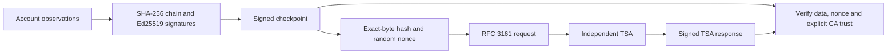

[TgWitness](../../README.md) / [Документация](../README.md) / [Папка](README.md) · [Доказательства и проверка](EVIDENCE.md)

[English](../TIMESTAMP.md) · **Русский**


<a id="independent-timestamps-and-evidence-handoff"></a>
# Независимые временные метки и передача доказательств

TgWitness формирует запросы по стандарту RFC 3161 и проверяет ответы органа авторизации временных меток (TSA). Эта ручная процедура не предусматривает ни выбора TSA, ни отправки данных; режим «Доказательства» выполняет обе эти операции по расписанию ([формат доказательств](EVIDENCE.md#rfc-3161-preparation-and-response-verification-02)). Подготовленный запрос **ещё не** является **доказательством временной метки**.

<a id="what-the-proof-binds"></a>
## Что связывает доказательство



Подпись сборщика связывает записи с его ключом. Ответ от доверенного TSA может подтвердить, что конкретная контрольная точка существовала на указанное TSA время. Затем эта контрольная точка может связать префикс журнала. Это верхнее временное ограничение применяется к данному зафиксированному префиксу; отдельные действия в Telegram сохраняют свои зафиксированные времена событий.

<a id="procedure"></a>
## Процедура

Верификатор журнала сообщает об обратных шагах и неразборчивых значениях `observed_at` в `chronology`, если таковые присутствуют, и включает предупреждение в вывод команды. Она сохраняет подписанные временные метки и по-прежнему проверяет их подписи. Обратный шаг может быть вызван корректировкой часов, поэтому его следует сверять с записями о времени хоста. Независимое время получается из проверенных внешних временных меток, сообщений свидетелей, считываемых с их публичной страницы t.me, а также из раундов drand; параметр `--strict` регулирует привязку подписантов и поддерживаемые форматы.

Записанные значения drand проходят автономную проверку на структурную и хеш-внутреннюю согласованность. Параметр `--check-drand` сравнивает выбранные записанные раунды с ответами ретрансляторов по протоколу HTTPS; в результате указывается, сколько раундов было сопоставлено и какие ретрансляторы ответили, а сопоставленные раунды обеспечивают аутентифицированную нижнюю временную границу.

1. Сохраните отпечаток ключа сборщика через отдельный доверенный канал; он идентифицирует сборщик независимо от проверяемого ZIP-архива.
2. В **разде**ле **Экспорт → Подготовить запрос на временную метку** загрузите ZIP-архив запроса из выбранной рабочей области. Распакуйте файлы `checkpoint.json`, `timestamp.tsq`, `SHA256SUMS` и `README.txt`. Не изменяйте байты контрольной точки.
3. Выберите TSA, подходящий для данного расследования. Отправьте файл `timestamp.tsq`, используя описанный в документации метод, с типом данных `application/timestamp-query` для HTTP-сервиса. Сохраните исходный двоичный ответ как файл `timestamp.tsr`, а также конечную точку, время получения и результат запроса. Запрос содержит хеш и нонс, а не сообщения; тем не менее, сетевые метаданные по-прежнему раскрывают суть запроса.
4. Получите доверенный корневой сертификат независимо от ответа, а также все необходимые промежуточные сертификаты. Сертификат, содержащийся в ответе, не становится доверенным лишь по той причине, что он там включен.
5. Из доверенной установки TgWitness проверьте:

```sh
python -m tgwitness.anchor verify --checkpoint checkpoint.json --request timestamp.tsq --response timestamp.tsr --ca trusted-tsa-root.pem
```

При необходимости добавьте параметр ``--intermediates tsa-intermediates.pem``. OpenSSL не требуется: подпись, ссылка на сертификат подписи и цепочка проверяются в Python с помощью библиотеки ``cryptography`` — того же кода, который используется в скрипте ``verify.py --tsa-ca``. Команда ``openssl ts -verify`` остаётся независимой дополнительной проверкой для специалистов, желающих её провести.

6. Экспортируйте ZIP-архив подписанного журнала после контрольной точки так, чтобы он содержал этот префикс. Проверьте с использованием независимо известного отпечатка:

```sh
python tgwitness/verify.py evidence.zip --fingerprint TRUSTED_SHA256 --checkpoint checkpoint.json
```

Файл, указанный параметром ``--checkpoint``, должен представлять собой подписанную контрольную точку: ``statement`` с параметрами ``format``, ``public_key``, ``event_count`` и ``head_hash``, а также ``signature``. Любой другой файл будет отклонен с следующим сообщением: *«Файл, указанный параметром `--checkpoint`*, *не является подписанной контрольной точкой TgWitness»*, за которым следуют необходимые поля.

Это свидетельствует о том, что экспортированный файл содержит префикс с отметкой времени. Скрипт ``verify.py`` считывает квитанции с отметками времени исключительно из ZIP-архива, где они хранятся в режиме «Доказательства»; ручной ответ проверяется на этапе 5 и охватывает записи вплоть до данной контрольной точки.

7. Сохраните архив ZIP, контрольную точку, запрос, ответ, цепочку сертификатов, результаты проверки и запись о передаче данных вне сборщика. Повторите проверку при получении.

Для подготовки запроса на основе сохраненной контрольной точки:

```sh
python -m tgwitness.anchor prepare checkpoint.json --out timestamp-request.zip
```

В ходе подготовки JSON канонизируется, а соответствующая контрольная точка включается в архив. Для проверки TSA используйте **байты контрольной** точки **из этого архива**, даже если входной файл содержал иные пробелы.

<a id="verification-boundaries"></a>
## Границы проверки

| Проверка | Текущее поведение |
| --- | --- |
| Данные | Хеш SHA-256 точных байтов контрольной точки должен совпадать с ответом |
| Запрос | С помощью параметра `--request` проверяются исходный запрос и нонс |
| Подпись TSA | Подпись, сертификат подписания и цепочка сертификатов до указанного центра сертификации проверяются на момент, указанный в отметке времени |
| Подпись сборщика | Проверяется отдельно верификатором журнала с использованием закреплённого ключа |
| Отзыв | Режим «Доказательства» хранит данные OCSP/CRL, которые проверяются скриптом `verify.py` |
| Запланированная отправка | Режим «Доказательства», включаемый при каждой цели настройки |

Параметр `--request` технически не является обязательным, однако его пропуск препятствует проверке исходного нонса. Для выполнения данной полной процедуры значение `request_checked` в результате должно быть true. Каждый сертификат в цепочке должен быть действителен на момент простановки временной метки, а сертификат подписи должен предназначаться исключительно для простановки временной метки.

Ответ TSA привязывает отправленные байты контрольных точек к указанному времени. Проверьте этот результат с помощью записей о получении и проверки среды для выбранного режима. Режим «Доказательства» включает квалифицированный TSA правительства Бельгии `http://tsa.belgium.be/connect`; ответы по RFC 3161 подписаны, поэтому использование простого HTTP не снижает их надежность). При передаче корневого сертификата данного поставщика в параметр `--tsa-ca` программа `verify.py` сообщает о наличии квалифицированной временной метки eIDAS и её единице измерения времени; Регламент (ЕС) № 910/2014, статья 41(2), предполагает точность указанного времени и целостность привязанных данных.

<a id="signing-certificate-revocation"></a>
### Отзыв сертификата подписи

Сразу после каждого ответа в режиме «Доказательства» извлекаются доказательства отзыва подписавшего сертификата TSA: ответ OCSP с адреса AIA OCSP сертификата или, в противном случае, список отзывов (CRL) из его точки распространения (не более 4 MiB). Эти данные хранятся рядом с ответом в виде файла `checkpoint-N.<service>.ocsp` или `.crl` и экспортируются вместе с ним. Неудачное получение данных никогда не задерживает создание временной метки; запись `anchor.completed` указывает её как `unavailable` с указанием причины.

Скрипт `verify.py` проверяет подпись ответа OCSP (выданную эмитентом или сертификатом ответчика, которому эмитент предоставил право на подпись OCSP), идентификатор сертификата и статус, а также то, что ответ был выдан не ранее genTime или оставался актуальным на тот момент (nextUpdate). В случае CRL проверяется подпись эмитента, тот же временной интервал, а также отсутствие серийного номера в списке. Проверяются все файлы OCSP и CRL, хранящиеся для данной временной метки, причём отзыв в одном из них имеет приоритет над положительным ответом в другом. Затем выдается сообщение `signing certificate not revoked as of <time> (OCSP|CRL)` (сертификат подписи не отозван по состоянию на <time>), `revocation check failed` (проверка отзыва не удалась), если эмитент сертификата подписи отсутствует как в ответе, так и в поле `--tsa-ca`, либо `revocation not checked (no OCSP/CRL in the archive)` (проверка отзыва не выполнена (в архиве отсутствуют файлы OCSP/CRL)). Сертификат подписи, отозванный не позднее момента genTime, не проходит проверку; более поздний отзыв отображается в виде предупреждения. Хранящийся файл OCSP или CRL, который не проходит проверку в отношении сертификата подписи (нечитаемый, подписанный другим ключом, относящийся к другому сертификату или устаревший), также не проходит проверку.

<a id="evidence-records-and-renewal-rfc-4998"></a>
## Записи доказательств и продление (RFC 4998)

Временная метка RFC 3161 действительна только до тех пор, пока действительны её алгоритм хеширования, а также ключ подписи и сертификат TSA; при этом срок действия дела может превышать срок действия этих элементов. Режим «Доказательства» также хранит запись доказательств RFC 4998 (ERS) для каждой сохраненной контрольной точки и обновляет её.

При каждом проходе проверки доказательств контрольные точки без записи попадают в хеш-дерево, и настроенные TSA запрашиваются по порядку для получения одной временной метки над его корнем. Каждая контрольная точка получает файл `checkpoints/anchors/checkpoint-N.ers`: это запись `EvidenceRecord`, в которой поле `ArchiveTimeStampSequence` содержит одну цепочку `ArchiveTimeStampChain` с меткой `ArchiveTimeStamp`, несущей сокращённое хеш-дерево для данной контрольной точки и токен TSA. Запись может содержать хеши соседних контрольных точек; валидаторы, такие как EU DSS, выдают предупреждения об этом. Экспорт в формате ASiC-E также содержит файл `META-INF/evidencerecord.ers` вместе с `META-INF/ASiCEvidenceRecordManifest.xml` — запись доказательств для объектов данных контейнера (ETSI EN 319 162-1). Экспорт в формате ZIP содержит записи контрольных точек в папке `anchors/`.

Продление осуществляется в соответствии с разделом 5 стандарта RFC 4998 и заключается исключительно в добавлении:

| Обновление | Когда | Что маркируется |
| --- | --- | --- |
| Обновление временной метки | Срок действия сертификата подписи самого нового токена истекает в течение N месяцев (по умолчанию — 6), хеш его подписи помечается как слабый или по запросу | Хеш предыдущего токена, тот же алгоритм; отметка добавляется в конец цепочки |
| Обновление хеш-дерева | Алгоритм хеша цепочки помечается как слабый, либо по запросу | `H(H(checkpoint) + H(previous ArchiveTimeStampSequence))` с использованием более надёжного алгоритма (по умолчанию SHA-512); добавляется новая цепочка |

Каждое обновление сохраняется в новом файле `checkpoint-N.renewal-K.ers`; предыдущие файлы и цепочки остаются неизменными байт за байтом. Доказательство прослеживается до самой первой временной метки только в том случае, если все звенья цепочки проверяются в правильном порядке; поэтому обновление следует производить, пока новейший токен ещё считается действительным: до истечения срока действия его сертификата подписи, исчезновения информации об отзыве или нарушения целостности алгоритма хеша или подписи. Последующее обновление добавляет отметку, но не расширяет предыдущее доказательство.

Фоновый цикл в режиме «Доказательства» проверяет политику ежедневно и по запросу (`evidence_record.demand_renewal`). Каждая попытка регистрируется в журнале как `evidence_record.created` или `evidence_record.renewed` с указанием службы, времени, алгоритма хеширования, корня дерева, диапазона контрольных точек, статуса `ok` и ошибок; нечитаемые записи попадают в `evidence_record.check_failed`. В случае сбоя TSA выполняется повторная попытка с отсрочкой простановки отметки контрольной точки, которая учитывается отдельно, в то время как проверяется следующий TSA из списка. Политика (`months_before_expiry`, `weak_algorithms`, `algorithm`, `stronger_algorithm`) определяется настройкой профиля `evidence_record_policy`; панель управления пока не имеет возможности её регулировать.

Сборщик перед записью каждой новой записи сверяет её с контрольной точкой и подписью TSA. Скрипт ``verify.py`` проверяет каждую запись в экспорте: хеш-деревья, токены, порядок цепочек и продлений, а также сообщает самое раннее подтверждённое время и состояние самой новой метки. Система EU DSS считывает те же записи с контрольной точкой в качестве отдельных данных.

Регламент (ЕС) № 2024/1183 (eIDAS 2.0) дополнил Регламент (ЕС) № 910/2014 положениями о квалифицированном электронном архивировании и квалифицированных электронных реестрах. TgWitness записывает записи в стандартных форматах, но не является доверенной службой; его архив и журнал не имеют статуса «квалифицированных». Квалифицированный поставщик должен, помимо прочего:

- Архивирование (статьи 45i и 45j): квалифицированный поставщик доверительных услуг должен хранить данные в течение установленного законом или договором срока хранения, обеспечивая их долговечность и читаемость после истечения срока технологической пригодности, а также защиту от потери и изменения, с предоставлением автоматизированного отчета о целостности для уполномоченных полагающихся сторон с момента начала хранения до момента извлечения. Статья 45i(2) предполагает обеспечение целостности и подлинности для такой услуги.
- Реестры (статьи 45k и 45l): реестр, созданный и управляемый одним или несколькими квалифицированными поставщиками доверительных услуг, который устанавливает происхождение записей, упорядочивает их в уникальном и хронологическом порядке и обеспечивает немедленное обнаружение последующих изменений. Журнал TgWitness представляет собой цепочку хешей, подписанную собственным ключом сборщика, что само по себе не является квалифицированным реестром.
- Оба требования: статус «квалифицированного», присваиваемый надзорным органом, и включение в список доверенных поставщиков (статьи 21 и 22), обязательства, предусмотренные статьёй 24, оценка соответствия не реже одного раза в 24 месяца (статья 20) и эталонные стандарты, установленные в нормативных актах в соответствии со статьями 45j(2) и 45l(2).

Квалифицированные временные метки от квалифицированного поставщика услуг временных меток (статьи 41 и 42) сохраняют собственную презумпцию достоверности для каждого токена; их обновление не создает презумпцию достоверности для записи в целом.

<a id="handoff-record"></a>
## Запись о передаче

Зафиксируйте идентификатор дела, отправителя и получателя, время передачи по UTC и его источник, цель, имена файлов/значения SHA-256, отпечаток сборщика, диапазон последовательности, известные пробелы, версию верификатора и результат верификации. Подпишите и храните данную запись независимо в соответствии с процедурами вашей организации. Система многопользовательского хранения записей в TgWitness не реализована.

<a id="live-service-check-9-november-2026"></a>
## Проверка работоспособности сервиса, 9 ноября 2026 г.

На каждую службу по умолчанию был отправлен один запрос по стандарту RFC 3161. Обе службы удовлетворили его.

| Служба | Ответ | Подписывающее устройство | Результат верификатора |
| --- | --- | --- | --- |
| `http://tsa.belgium.be/connect` | Удовлетворено, политика 2.16.56.13.6.3.1.1000 | Единица временной метки 202301 | Квалифицированная временная метка eIDAS |
| `https://freetsa.org/tsr` | Предоставлено | FreeTSA | Временная метка по стандарту RFC 3161 |

Бельгийский сертификат подписи содержит заявление о соответствии qcStatements и соответствует единице, зарегистрированной в верификаторе. В ходе локальных испытаний также используется синтетический центр сертификации (CA)/агент временных отмет (TSA) для проверки отклонения измененных данных, измененного нонса и некорректного центра сертификации.

10 ноября 2026 года бельгийский сервер OCSP, являющийся делегированным сертификатом-респондером, ответил «good» для единицы временной метки 202301. OCSP-адрес FreeTSA (порт 2560) не ответил в течение 40 секунд с тестового хоста; вместо этого был использован его CRL (PEM, 1 КБ).
