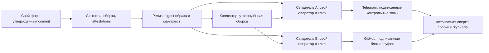

# Проверяемая сборка, непрерывность и GitHub

[Коротко и по шагам: какие дополнения выбрать](EXTRAS.md).

Проект следующего этапа, обновлён 31 октября 2026. [Текущие этапы и критерии готовности](../ROADMAP.md).
Здесь отдельно отмечено, что уже работает,
что найдено при чтении кода и что предлагается добавить. GitHub-интеграция, очередь
повторной публикации и проверка утверждённой сборки свидетелем пока не реализованы.

Цель: человек, получивший пруф, должен проверить **какую сборку использовали, какой
журнал она предъявила, какие внешние свидетели это сохранили и где были перерывы**.
Форк или GitHub-токен сами по себе такой проверки не дают.

## Что обнаружено сейчас

| Участок | Что есть | Что нужно усилить |
| --- | --- | --- |
| [Паспорт запуска](../../tgwitness/provenance.py) | Версия, хеш дерева исходников, версии нескольких зависимостей; паспорт попадает в подписанное событие запуска | JSON-ресурсы не измеряются; нет независимой сверки с утверждённым релизом; измерение выполняется при запуске |
| [Публикация свидетеля](../../tgwitness/witness.py) | Свой ключ, подписанный журнал, Telegram-публикации, запись ошибок отправки | После неудачной отправки запись остаётся в журнале без устойчивой очереди повторной доставки |
| [Публичный пруф](../../tgwitness/capture_proof.py) | Подписанные хеш, счётчики, состояние и случайный запрос проверки | Не привязан к проверяемому внешнему манифесту сборки и политике допустимых версий |
| [Выпуск](../../.github/workflows/release.yml) | Тесты, пакеты, OCI provenance/SBOM для образа | Загрузка файлов начинается после события published: это нужно переделать до включения immutable releases |
| Источники Git | Репозиторий `phishdestroy/TgWitness`, история коммитов и архив исходников | Связать каждый пакет релиза с одним проверенным commit; старый черновик не считать актуальной сборкой |
| Восстановление | Сохранение курсоров, catch-up и явные gaps | Атомарность фиксации наблюдений и курсоров, долгие разрывы и несколько реальных аккаунтов требуют дальнейшей квалификации |

Проверенные ранее реальные Telegram-наблюдения сохраняют свою доказательную ценность.
Эта таблица описывает новые границы проверки софта и внешней публикации, а не отменяет
[живой тест](../VERIFICATION.md#live-telegram-test--27-to-29-october-2026).

## Предлагаемая схема

Два места публикации одного свидетеля улучшают сохранность. Два независимых свидетеля
добавляют независимые наблюдения. Разные процессы или ключи на одном VPS сами по себе
не означают разных операторов и разных причин отказа.

## GitHub: форк и токен

Предлагаемый мастер настройки на стороне оператора/свидетеля:

1. Выбрать существующий форк либо подготовить его создание из указанного upstream.
2. Проверить владельца, числовой ID репозитория и наличие нужного commit.
3. Показать изменения относительно выбранной upstream-версии. Собственные изменения
   допустимы, но получают новую идентичность сборки и отдельное утверждение.
4. Выбрать утверждённый commit и пакет/образ с проверенным происхождением.
5. Выбрать отдельный репозиторий для публичных пруфов и подготовить конфигурацию
   свидетеля. Показать точные будущие операции до создания форка или первой публикации.
6. Сначала проверить параметры и права без изменения GitHub; фактическое создание
   и отправка — отдельные явно обозначенные действия.

Для личного сценария можно поддержать PAT, включая classic `ghp_…`. Предпочтительный
вариант — fine-grained PAT, ограниченный нужным репозиторием, или GitHub App для
длительной интеграции. Токен хранится в секретном файле/хранилище свидетеля; конфиг
содержит ссылку на него. Токен не попадает в Git remote URL, пруф, журнал или экспорт.
Это соответствует [рекомендациям GitHub по токенам](https://docs.github.com/en/authentication/keeping-your-account-and-data-secure/managing-your-personal-access-tokens).

Права начальной настройки и постоянного процесса должны отличаться. Создание форка
через API требует дополнительных прав; их нельзя автоматически считать необходимыми
для регулярной публикации пруфов. Конкретные варианты перечислены в
[Create a fork](https://docs.github.com/en/rest/repos/forks#create-a-fork). Мастер должен
учитывать ограничения аккаунта и организации, а не обещать универсальный токен с одним
набором прав. Для чтения публичного исходного кода персональный токен обычно не нужен.

Репозиторий пруфов отделяется от форка софта. У работающего свидетеля нет права менять
исходники, workflow выпуска или список утверждённых сборок. Его GitHub-права ограничены
местом публикации. Если процесс всё же контролирует владелец GitHub-репозитория, это
отражается в модели доверия, а не скрывается названием «независимый».

## Как закрепить сборку

Собирать утверждённый commit в CI, закреплять сторонние Actions и базовый образ по
неизменяемым идентификаторам. Создавать манифест поставки: хеши всех исполняемых файлов
и ресурсов, включая JSON, состав зависимостей, commit, идентификатор workflow, digest
артефакта. Проверять подписи происхождения при установке и у свидетеля, а не просто
сохранять рядом непроверенный файл attestation.

GitHub artifact attestations связывают артефакт с репозиторием и сборочным процессом;
они не подтверждают безопасность кода или то, что конкретный сервер сейчас исполняет
этот артефакт. [Границы attestations](https://docs.github.com/en/actions/concepts/security/artifact-attestations).

Порядок выпуска необходимо изменить: **черновик → все пакеты и attestations → проверка
комплектности → публикация**. GitHub immutable releases защищают файлы и привязанный тег
после публикации; текущий workflow с последующей загрузкой файлов для такого режима
не подходит. [Правила immutable releases](https://docs.github.com/en/code-security/concepts/supply-chain-security/immutable-releases).

На сервере устанавливать пакет с проверенным digest; контейнер запускать по digest,
без подменяемого тега `latest` и без монтирования другого дерева исходников поверх
пакета. Read-only файловая система и отдельный непривилегированный пользователь
уменьшают случайные изменения, но не доказывают отсутствие действий администратора.

У свидетеля хранить заранее утверждённый набор сборок. Новый неизвестный digest нельзя
молча принимать за эталон только потому, что его первым прислал коллектор.
Внешняя запись должна связывать версию политики проверки, `run_id`, манифест сборки,
границу журнала, хеш контрольной точки и свежий запрос проверки. Публичный вариант
не должен раскрывать список чатов и параметры аккаунта из полного паспорта запуска.

При обновлении записывать завершение старого запуска, последнюю внешнюю точку,
новую сборку и начало нового запуска. Смена версии остаётся видимой в истории.
При наличии прав администратора на хосте самопроверку Python можно подделать вместе
с ответом. Для более сильного утверждения нужна отдельная доверенная среда измерения
или аппаратная аттестация, которой сейчас в TgWitness нет.

## Доставка пруфов без тихих потерь

Первая реализационная задача — постоянная очередь исходящих публикаций на стороне
свидетеля. Подписанная запись и её задание на отправку фиксируются одной транзакцией.
После рестарта процесс продолжает очередь. У каждого назначения свой результат,
число попыток, следующая попытка и возраст самой старой неотправленной записи.

Обработка ошибок: учитывать Retry-After, увеличивать паузу с ограничением и случайным
разбросом, различать временную недоступность, неверные права и отозванный токен.
Новая ошибка не заменяет старую: сохраняются все исходные пруфы. При переполнении
очереди — явное состояние недостаточной внешней фиксации и уведомление.

Тайм-аут после успешного приёма Telegram может привести к повторной публикации.
Поэтому обещать exactly-once нельзя: повторные сообщения определяются по ID и хешу
подписанной записи. У пруфа отдельно сохраняются время наблюдения и время доставки.
Поздняя отправка не превращается в доказательство своевременной внешней публикации.

Для GitHub отправлять подписанные блоки контрольных точек, а не отдельный commit на
каждое сообщение Telegram. Начальный вариант: блок каждый час, отдельная итоговая
сводка за сутки. Имена блоков включают последовательность и хеш, каждый блок ссылается
на предыдущий. Загрузка идемпотентна: совпадающий объект принимается, несовпадающий
по тому же адресу вызывает конфликт; переписывать его запрещено.

При записи Git-истории проверять ожидаемый родительский commit и обрабатывать конфликт
без force-push. Защита ветки и внешние копии хешей дополняют друг друга: обычная Git-ветка
не является неизменяемым хранилищем. Не публиковать содержимое сообщений, аккаунтные
идентификаторы и полные конфиги; только согласованные публичные поля и подписи.

GitHub Actions можно использовать для сборки и периодической сверки опубликованного.
Не делать его расписание основными часами свидетеля: GitHub прямо допускает задержку
и пропуск scheduled jobs. [Ограничения расписания](https://docs.github.com/en/actions/how-tos/troubleshoot-workflows).

## Профили и гибкие настройки

Это предлагаемые профили, а не уже существующие переключатели интерфейса.

| Профиль | Сценарий | Основные настройки |
| --- | --- | --- |
| Личный | Один оператор, удобный сбор | Один свидетель, необязательная публичная публикация, уведомления о потерях |
| Публичный стенд | Проверяемая демонстрация | Два собирающих аккаунта, контрольные сообщения, Telegram и GitHub, публичные счётчики |
| Строгая фиксация | Заранее утверждённые правила | Разрешённые сборки, несколько свидетелей разных операторов, необходимое число подтверждений и срок их получения |

Разделить частоту опроса, частоту публикации и срок допустимой задержки. Настраивать
отдельно для каждого аккаунта и назначения. Изменение профиля, источников, лимитов,
политики восстановления и списка свидетелей сохранять в подписанной истории.

При строгом режиме неизвестная сборка не начинает новую доверенную сессию. Для уже
идущего сбора при потере свидетеля разумный базовый режим — продолжать сохранять
наблюдения, показывая отсутствие требуемых подтверждений. Автоостановка при потере
подтверждений может быть отдельной явно выбранной политикой: она сама создаёт пропуски.

Показывать пять состояний: **сбор**, **цепочка журнала**, **сборка**, **свидетели**,
**доставка пруфов**. Пример: «Сбор идёт · сборка разрешена · подтверждение 1/2 ·
GitHub недоступен 18 минут». Общая зелёная лампа не должна скрывать неполную проверку.

Поддержать контролируемую ротацию ключей: старый ключ подписывает объявление нового,
изменение заранее закрепляется внешне. При утрате старого ключа показать новый период
доверия, а не изображать непрерывную прежнюю идентичность. Резервная копия считается
проверенной после восстановления на отдельном стенде и сверки с внешними хешами.

## Сценарии приёмки

| Сбой или изменение | Ожидаемый проверяемый результат |
| --- | --- |
| Изменили `.py` или JSON-ресурс после утверждения сборки | Несовпадение с эталоном; сборка не считается разрешённой |
| В форке изменили исходники и сохранили старый номер версии | Другой digest и commit; прежний эталон не подходит |
| Перезаписали тег или подставили пакет другого workflow | Проверка происхождения/ожидаемого digest отклоняет пакет |
| Коллектор или сеть Telegram остановлены | Видимый перерыв, результат catch-up и контрольные сообщения после восстановления |
| Один свидетель остановлен | Недостаточно подтверждений, другой продолжает независимо |
| Telegram Bot API / GitHub недоступны | Очередь сохраняется, показывается задержка; после восстановления доставка продолжается |
| Процесс упал сразу после успешной отправки | Допустимый определяемый повтор, без потери подписанной записи |
| GitHub вернул конфликт, ограничение запросов или отказ в правах | Различимые состояния; нет force-push и бесконечного быстрого повтора |
| Часы сдвинулись назад | Событие изменения времени; порядок по цепочке не пересчитывается по неверным часам |
| Диск заполнен или хранилище повреждено | Явная ошибка; отсутствие новых подтверждений не выдаётся за пустой чат |
| Настройки источников изменены во время сбора | Новая подписанная версия политики и видимая граница её применения |
| Восстановлена устаревшая резервная копия | Внешний свидетель обнаруживает откат относительно ранее сохранённой точки |

## Порядок реализации

1. Полный манифест поставки, ожидаемый digest и привязка паспорта запуска к пруфам.
2. Устойчивая очередь публикаций и раздельные состояния доставки.
3. Выпуск через проверенный черновик, attestations и проверка установки; затем мастер форка/GitHub.
4. GitHub как дополнительное хранилище подписанных блоков.
5. Несколько независимых свидетелей, политики подтверждения и видимая ротация ключей.
6. Живые испытания перезапуска, разрывов связи, восстановления резервной копии и смены сборки.

Критерий успеха — не обещание «нарушений никогда не было», а воспроизводимый ответ:
какую сборку утвердили, какие измерения получили, какие записи подтвердили внешне
и на какие интервалы подтверждений не хватает.
