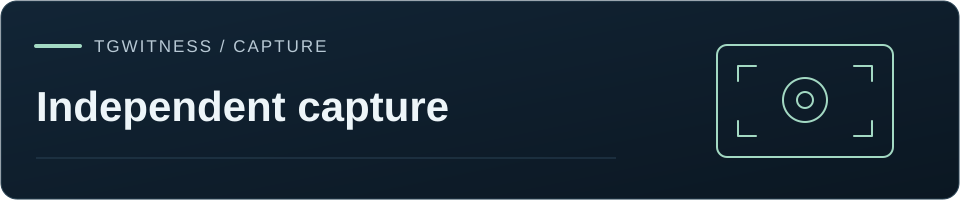
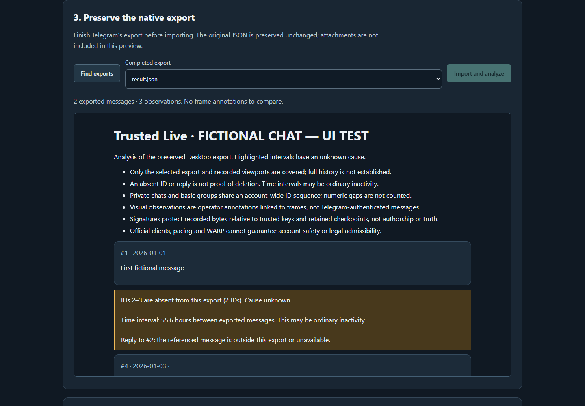

[TgWitness](../../README.md) / [Документация](../README.md) / [Папка](README.md) · [Независимый сбор данных](OPTIONAL-CAPTURE.md)

[English](../TRUSTED-LIVE.md) · **Русский**



<a id="trusted-live-preview"></a>
# Trusted Live (предварительная версия)

Trusted Live — это изолированный рекордер официального клиента, доступный наряду с другими рекордерами в разделе **Дополнительные инструменты → Дополнительные функции → Независимый захват**. На его панели можно выбрать Telegram Desktop для Linux или Telegram Web, нативный экспорт в JSON / визуальный захват / гибридный режим, а также подготовленный коннектор. Он не запускает сборщик Telethon от TgWitness и не импортирует сеанс Telegram.

Проверка включает автоматизированные приёмные испытания, а также [интеграцию с Ubuntu и WARP](VERIFICATION.md#trusted-live-cpu-ubuntu-and-warp--5-november-2026) на уровне [ЦП](VERIFICATION.md#trusted-live-cpu-ubuntu-and-warp--5-november-2026). Нативный экспорт с реальных аккаунтов / гибридный сбор данных и подтверждение подлинности образа TDX данного рекордера остаются отдельными проверками в режиме реального времени.



<details>
<summary>На этой странице</summary>

- [Что реализовано](#what-is-implemented)
- [Что охватывает каждая запись](#what-each-record-covers)
- [Развертывание в Linux, локальное или удалённое](#linux-deployment-local-or-remote)
- [Независимый свидетель и проверка](#independent-witness-and-verification)
- [Тесты](#tests)
- [Справочная информация по протоколу](#protocol-references)
</details>

<a id="what-is-implemented"></a>
## Что реализовано

| Компонент | Поведение |
| --- | --- |
| Изоляция аккаунтов | Одно дело на каждый том регистратора; новый профиль внутри tmpfs среды выполнения. Повторное открытие существующего дела допускает только экспорт. |
| Официальный клиент | Немодифицированная версия Telegram Desktop с фиксированным SHA-256; в качестве альтернативы используется Chromium, открывающий страницу `https://web.telegram.org/k/`. Отсутствует извлечение DOM, вызовы протокола Telegram или импорт сеанса. |
| Ручной сеанс | Оператор входит в систему, открывает чат и готовит нативный экспорт с помощью экрана авторизованного клиента. Данные для входа никогда не добавляются в журнал или командную строку процесса. |
| Защита от перехвата | Во время записи допускаются только отдельные шаги с помощью колесика прокрутки. Текст, щелчки, нажатия клавиш и действия с буфером обмена недоступны. Потеря фокуса или сбой соединения приводят к остановке работы клиента. Аварийная кнопка останавливает процесс до ожидания блокировки записи. |
| Видео | Сегменты FFmpeg в формате H.264, наложение локального времени по UTC, подписанные хеши сегментов. Кадры на этапе настройки или приостановки не сохраняются. Сбой видеообеспечения останавливает сбор данных в режиме реального времени. |
| Экспорт в исходном формате | Сохраняйте завершённые байты файла `result.json` из изолированного паппы `/exports`. Сохраняйте последующие версии, а не перезаписывайте более ранние данные. |
| Непрерывность | Интервалы идентификаторов с учётом типа чата, неразрешённые ответы и временные интервалы. Встроенные аннотации в отдельном окне чата и загружаемые артефакты в форматах HTML/JSON. Исходные экспортированные данные и пиксели клиента остаются без изменений. |
| Гибридный | Сравнение экспорта с сообщениями, **расшифрованными оператором,** привязанными к сохраненным кадрам. Отсутствие искусственных идентификаторов, сгенерированных на основе пикселей. Для кадров без аннотаций не производится автоматическое сравнение на уровне сообщений. |
| Целостность | Существующая цепочка Ed25519 с независимыми записями, артефакты с адресацией по содержанию, подписанный манифест ZIP и контрольные точки. Верификатор пересчитывает отчёты о непрерывности и HTML-код на основе сохраненных наблюдений. |
| Доказательства времени | Периодические запросы drand через выбранный HTTP/SOCKS-коннектор; ответы двух HTTPS-ретрансляторов должны совпадать. Независимый свидетель хранит подписанные контрольные точки с новыми запросами. |
| Сетевая изоляция | Политика OUTPUT контейнера блокирует все, кроме локального адреса `127.0.0.1`, установленных ответов и выбранного прокси-сервера (IPv4/порт). Встроенный DNS Docker по адресу `127.0.0.11` блокируется наряду с внешним DNS, IPv6 и прямым резервным подключением. Политика применяется до запуска клиента; после этого привилегии аннулируются. |
| Свидетель провайдера | Необязательный независимый опрос в режиме «только для чтения» состояния и подключений коннектора Cloudflare WARP, а также наблюдения за DNS шлюзом в определённом диапазоне; исходные ответы подписываются в качестве артефактов в журнале свидетеля. |
| Очистка | Остановите группу процессов и удалите созданный профиль. Выход из системы на стороне сервера никогда не происходит без подтверждения; оператор выходит из сеанса или аннулирует его в приложении «Устройства» в Telegram. |

<a id="what-each-record-covers"></a>
## Что охватывает каждая запись

- Telegram принимает решения об ограничениях аккаунта, проверке новых устройств и блокировках. Уведомления о прочтении и присутствие могут изменяться во время просмотра.
- Система защиты охватывает входные данные, **поступающие через данный регистратор** во время записи; управление хостом находится за пределами этой системы. Ручная настройка не регистрируется. Выбор параметров экспорта или выход из системы требуют приостановки, и эти интервалы фиксируются как пробелы в охвате.
- Генерация нативного экспорта осуществляется вручную. В данной версии сохраняются выбранный формат JSON и записанная процедура; связанные вложения упаковываются другими режимами экспорта. Проверьте сохраненный файл вместе с указанной процедурой.
- Пробелы имеют собственную метку, отличную от удалений. Идентификаторы частных и базовых групп используют общую для всего аккаунта последовательность; промежутки по каналам и супергруппам перечисляются в качестве возможных вариантов. Фильтры даты экспорта и настройки видимости объясняют отсутствие многих записей.
- Сбор данных «только видео» фиксирует то, что отображалось на экране. Гибридное сравнение связывает сообщения экспорта с видео с помощью аннотаций.
- Благодаря доверенному ключу и независимо сохраняемым контрольным точкам цепочка хешей обнаруживает полную перекомпиляцию или усечение. Drand обеспечивает нижнюю временную границу; параметр `--check-drand` сравнивает раунды между ретрансляторами.
- WARP настраивается оператором и может менять свой публичный IP-адрес. Для шлюзов HTTP/SOCKS сборщик данных отбирает выборку из HTTPS-трассировки Cloudflare, требует параметра `warp=on`/`plus` для маршрута с меткой WARP и прекращает работу при проведении наблюдения за изменением исходящего IP-адреса. Это позволяет проверить маршрут зонда; настройте шлюз так, чтобы он последовательно маршрутизировал все адреса назначения. Маршруты, использующие исключительно MTProxy, сообщают о недоступности зонда. Cloudflare отбирает образцы сетевой активности; содержание сообщений поступает из данных, захваченных на стороне клиента. Отсутствующие, недоступные или усечённые журналы DNS помечаются соответствующим образом. MTProxy не может передавать публичные HTTPS-запросы с использованием drand; эти интервалы явно помечаются как недоступные.
- Данный контейнер работает в качестве защищённого регистратора Docker. Аттестация Intel TDX применяется к отдельно измеренному запечатанному образу; для данного регистратора требуется собственная измеренная сборка, политика аттестации и текущая квалификация.

<a id="linux-deployment-local-or-remote"></a>
## Развертывание в Linux, локальное или удалённое

Используйте хост Docker под управлением Linux. Панель разработки для Windows позволяет тестировать рабочий процесс с использованием синтетических данных, однако не может запускать экран Linux или применять его брандмауэр пространства имён. Сохраняйте по одному проекту Compose и тому с доказательствами на каждый аккаунт/дело.

1. Образ фиксирует официальный [выпуск Telegram Desktop 7.3.5 для Linux](https://github.com/telegramdesktop/tdesktop/releases/tag/v7.3.5). SHA-256 его архива — `62082a56b212f22d75106dd13b7e3b9bc4ecdbfb472146b56c74da74199855b7`; в примере также указан SHA-256 извлечённого двоичного файла. Перед использованием проверьте исходный код. Для другого выпуска совместно задайте `TELEGRAM_ARCHIVE_URL`, `TELEGRAM_ARCHIVE_SHA256` и двоичный хеш конфигурации. Сборка Docker отклоняет изменившийся архив. Хеш, загруженный из того же скомпрометированного источника, не является независимым подтверждением происхождения.
2. Настройте выбранный вами шлюз SOCKS5/HTTP или MTProxy. Для WARP шлюз должен фактически маршрутизировать трафик через ваше развёртывание WARP. Выберите конечную точку с фиксированным числовым IPv4-адресом. Данная функция не создаёт аккаунт Cloudflare, подписку или коннектор.
3. Скопируйте файл `addons/capture/config/trusted.example.json` в частный файл конфигурации. Укажите бинарный хеш Desktop, а также адрес, порт и режим работы коннектора. Сохраните указанные в документации пути `/session`, `/exports`, `/data`, display и guard для предоставленного образа.
4. Укажите значения `TELEGRAM_ARCHIVE_SHA256`, `TRUSTED_CONFIG` (абсолютный путь к файлу) и `TRUSTED_CONNECTOR` (настроенный идентификатор коннектора), а затем запустите из корневого каталога репозитория:

   ```sh
   docker compose --project-directory . -p trusted-case001 \
     -f addons/capture/compose.trusted.yaml up --build -d
   ```

Порт управления привязан исключительно к адресу `127.0.0.1:8793`. На удалённом хосте перенаправьте его с использованием имеющегося у вас безопасного канала доступа. Не публикуйте этот незашифрованный HTTP-порт. При использовании обратного прокси установите для параметра `public_origin` точное значение источника браузера. Хост должен поддерживать песочницу Chromium; резервный вариант с параметром `--no-sandbox` не предусмотрен.
5. Считайте сгенерированный **токен управления** на хосте и откройте `http://127.0.0.1:8793`. **Токен свидетеля** разрешает только чтение контрольных точек. Ни один из этих токенов не является учетными данными Telegram. Главная панель TgWitness может закрепить отпечаток и URL данного регистратора; введите URL его экрана в поле «Подключение», чтобы открыть полный рабочий процесс.
6. Выберите сценарий/клиент/метод/коннектор. Для Desktop настройте тот же прокси в Telegram перед входом в систему. Прямые подключения уже блокируются средой выполнения. Вводите учетные данные только в изолированном официальном клиенте. При необходимости используйте **кнопку Обновить экран**; кадры предварительного просмотра также обновляются автоматически.
7. Выберите чат и, в случае экспорта или гибридного режима, завершите нативный экспорт Telegram в формате JSON в папку `/exports`. Закройте диалоговые окна входа в систему и экспорта. Начните запись, прокручивайте страницу в удобном для чтения темпе, а затем воспользуйтесь функцией **Найти экспорты → Импортировать и проанализировать**. Для сравнения добавьте аннотации к сохранённому фрагменту экрана, указав идентификаторы и текст, которые вы действительно наблюдали.
8. Сделайте паузу, выйдите из системы вручную и завершите сеанс. Проверьте отзыв сеанса в разделе «Устройства» Telegram. Загрузите подписанный ZIP-файл и сохраните контрольную точку отдельно. Команда `docker compose down` удаляет временный профиль и папку входящих экспортных данных; **не используйте команду `down -v`** до сохранения тома с доказательствами. Воссоздайте среду выполнения для другого аккаунта или другого случая.

Учетные данные прокси, при необходимости, вводятся в собственных настройках Desktop. Предоставленная конфигурация запуска Chromium и средство drand fetcher поддерживают только неаутентифицированные конечные точки шлюза; при необходимости разверните частный аутентифицированный источник за этим шлюзом.

<a id="independent-witness-and-verification"></a>
## Независимый свидетель и проверка

На другом доверенном хосте запустите существующую программу-свидетель для сбора данных:

```sh
python -m tgwitness_capture witness --data witness-case001 \
  --url https://recorder.example --token-file recorder-witness-token.txt \
  --fingerprint TRUSTED_RECORDER_SHA256 --interval 30
```

Для наблюдений за провайдером добавьте параметры ``--cloudflare-config provider.json`` и ``--cloudflare-token-file provider-read-token.txt``. JSON-файл провайдера содержит:

```json
{
  "account": "32_HEX_ACCOUNT_ID",
  "connector_id": "WARP_CONNECTOR_UUID",
  "gateway_location": "OPTIONAL_GATEWAY_LOCATION_UUID",
  "source_ip": "COLLECTOR_SOURCE_IP_AS_SEEN_BY_GATEWAY"
}
```

Опустите оба необязательных поля шлюза, если наблюдения DNS недоступны. Ограничьте область действия токена чтением данных коннектора и, где это применяется, чтением данных аналитики/PII. Данная реализация никогда не запрашивает токен развертывания коннектора WARP и не изменяет ресурсы провайдера. Запросы к шлюзу охватывают предыдущие пять минут, максимальный объем составляет 1 000 строк; о перегрузке сообщается как о возможном усечении данных. IP-адрес источника и сопоставление ресурсов с конкретными случаями проверяются независимо от конфигурации оператора.

Правильно остановите свидетеля, чтобы скомпоновать его подписанные сетевые наблюдения:

```sh
python -m tgwitness_capture export --data witness-case001 --output witness-case001.zip
python -m tgwitness_capture verify trusted-live.zip \
  --fingerprint TRUSTED_RECORDER_SHA256 \
  --receipt witness-case001/receipts/RECEIPT.json \
  --witness-fingerprint TRUSTED_WITNESS_SHA256 --require-final-anchor --check-drand
```

Приостановите сбор данных и позвольте свидетелю сохранить именно эту начальную часть **перед** экспортом архива сборщика. В квитанции должно быть указано точное ограничение для параметра `--require-final-anchor`. Сам процесс экспорта добавляет более позднее событие `export.created` за пределы экспортируемого диапазона. Наблюдения провайдера находятся в отдельном ZIP-файле свидетеля; храните его вместе с соответствующей квитанцией.

<a id="tests"></a>
## Тесты

```sh
python -m ruff check .
```

Набор тестов для частного сбора данных охватывает некорректно сформированный или дублирующийся JSON, область действия идентификаторов чатов, огромные ограниченные интервалы, неизвестные ответы, вставку HTML-кода, защищённые входы, регулирование скорости, потерю маршрута/фокуса, роли токенов, междоменные запросы, границы файлов, атрибуцию фреймов, пересчёт отчётов, усечение по сравнению с сохраненными контрольными точками, сбои провайдеров и реальное кодирование с помощью FFmpeg. В тесте FFmpeg используется синтетический видеоисточник; в наборе тестов браузера — локальные фикстуры. Эти тесты с использованием локальных фикстур **не** учитывают условия реального сеанса Telegram/WARP или работу брандмауэра Linux. Позднее [тестирование](VERIFICATION.md#trusted-live-cpu-ubuntu-and-warp--5-november-2026) с [использованием процессора Ubuntu и интеграции с WARP](VERIFICATION.md#trusted-live-cpu-ubuntu-and-warp--5-november-2026) фиксирует фактическую изоляцию маршрута, чтение данных провайдером, запуск официального клиента и проверку видео.

При приёмке частного контейнера создаётся закреплённый образ в Linux. Запускается неавторизованный официальный клиент Desktop, подключающийся к TCP-приёму, который ничего не пересылает; проверяется прямая блокировка IPv4/IPv6/DNS, осуществляется захват реального видео с экрана, импортируется сгенерированный JSON-фикстур, проверяется подписанный ZIP-файл и выполняется проверка очистки профиля. Рабочая область проверки сохраняет скриншоты, журналы и синтетические доказательства. Она не входит в Telegram и не осуществляет развёртывание WARP.

Локальная валидация от 05.11.2026 (Windows, Python 3.12): **77 тестов пройдено, ни один не был пропущен** при использовании параметров `--capture-browser` и `--capture-ffmpeg`, указывающих на установленный кодер. Новая панель также завершила импорт из native-export, стилизованные встроенные наблюдения, проверку мобильной верстки, очистку и загрузку ZIP-файла в Chromium без ошибок консоли. Ответы провайдера/drand и экран Telegram были синтетическими; кодирование с помощью FFmpeg было реальным. Проверки Ruff, синтаксиса JavaScript и исходного архива прошли успешно. Осталось одно предупреждение об устаревании в исходном коде Starlette TestClient. Задание CI с опцией optional-capture отдельно сообщает о проверке образа Linux и пространства имён. Более поздние результаты сетевых тестов WARP/provider зафиксированы в ходе интеграционного запуска, описанного выше. Вход в реальную учётную запись, экспорт, гибридное сравнение и аттестация TDX данного рекордера пока не выполнены.

Для локальной демонстрации синтетического пользовательского интерфейса (подключение к Telegram невозможно):

```sh
python tools/preview_trusted_live.py --ffmpeg /path/to/ffmpeg
```

Откройте `http://127.0.0.1:8794`, токен `synthetic-ui-only-not-a-real-account-token`. В предварительном просмотре используются временные данные и синтетический клиент. Это не режим развёртки.

<a id="protocol-references"></a>
## Справочная информация по протоколу

- [Последовательности идентификаторов сообщений Telegram](https://core.telegram.org/api/updates).
- [HTTP-API маяка drand](https://docs.drand.love/developer/API-v2/drand-http-api/).
- [Ограничения по верификации и маршрутизации Cloudflare WARP](https://developers.cloudflare.com/cloudflare-one/team-and-resources/devices/cloudflare-one-client/deployment/manual-deployment/).
- [Конечные точки WARP Connector, доступные только для чтения](https://developers.cloudflare.com/api/resources/zero_trust/subresources/tunnels/subresources/warp_connector/).
