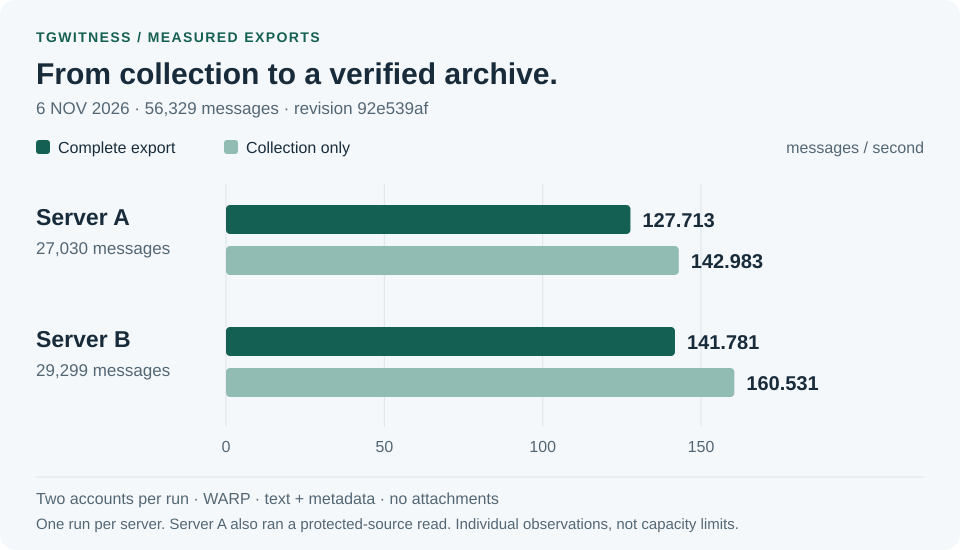

[TgWitness](../../README.md) / [Документация](../README.md) / [Папка](README.md) · [Доказательства и проверка](EVIDENCE.md)

[English](../VERIFICATION.md) · **Русский**


<a id="tgwitness-verification"></a>
# Проверка TgWitness

**Обновлено 10 ноября 2026 года.** Результаты привязаны к ревизии, среде и рабочей нагрузке, зафиксированным для каждого запуска. В [разделе Текущие возможности](STATUS.md) описаны доступные рабочие процессы; на этой странице фиксируется то, что было фактически проверено.

Здесь представлены отдельные результаты проверки из [истории разработки](OVERVIEW.md#testing-history-and-duration). Инженерные тесты, сбор данных в реальном времени, введение сбоев, проверки восстановления и верификация артефактов имеют свои чётко определённые области применения.

8 ноября опубликованный установщик по адресу `b35f8e18f3d1` был проверен без его запуска или установки: SHA-256- и RSA-подписи файла wheel и файла dependency-lock прошли проверку, а файл wheel содержал бэкенд Secret Chat, интерфейс, маршруты API, хуки сборщика и опциональное объявление зависимостей. См. [проверку пакета](PSEUDO-SECRET.md#package-availability). [Непрерывный цикл (CI) для данной ревизии](https://github.com/phishdestroy/TgWitness/actions/runs/42446658989) и [запуск установщика](https://github.com/phishdestroy/TgWitness/actions/runs/42446659252) завершились успешно. В более старых отчётах об аудите сохранены результаты проверки исходных снимков; текущая реализация и квалификация фиксируются отдельно.

[Графики производительности](https://phishdestroy.github.io/TgWitness/docs/validation/) · [Аудит на языке жестов](../../website/validation/audit/REPORT.md) · [Результаты измерений для скачивания](../../website/validation/audit/MEASUREMENTS.csv)

| Последние данные | Результат | Объём |
| --- | --- | --- |
| Масштабный запуск в крупной публичной группе · 20 ноября | 15 000 реальных сообщений публичных групп, собранных двумя аккаунтами в подписанные журналы; по три TSA в каждом; подтверждена целостность автономного верификатора | Две крупные публичные мегагруппы; экспорт доказательств + офлайн-проверка с верификатором |
| Приемлемость в суде в режиме реального времени · 20 ноября | RFC 3161, контрольные точки/усечение, канал свидетелей с внешним временем, судебный пакет в отношении трёх TSA, привязки OTS/Bitcoin, FloodWait, самоуничтожение секретных чатов и медиафайлов; в случаях, когда артефакт мог быть изменен, подделанная или усечённая копия отклонялась | Активные аккаунты и реальный канал; публичные TSA и API бота Telegram |
| Безопасность аккаунтов и экспорт данных · 10 ноября | Зонд свидетеля обнаружил второго клиента с тем же ключом; возобновлен экспорт данных из закрытых чатов; котировка TDX проверена в автономном режиме | Под «RunPod», три тестовых аккаунта; ревизии от `6c7171228` до `196a5bcd1` |
| Phala / Intel TDX с действующим аккаунтом · 9 ноября | Все 6 проверок TDX пройдены; сбор данных из Telegram в режиме реального времени; экспорт подтверждён | CVM `cvm_mjbvBdjM`; коммит `427621d4`; сеанс импортирован; уровень с самоподтверждением |
| Контрольная точка drand + проверка · 9 ноября | Раунд drand № 33818717 в подписанной контрольной точке, подтверждён через ретранслятор Cloudflare | Сборщик RunPod; `--check-drand`; нижняя временная граница для контрольной точки |
| отпечаток сеанса в журнале · 9 ноября | `auth_key_id` зарегистрирован в `session.fingerprint` в начале наблюдения | Верификатор может сопоставить файл сеанса после отзыва |
| Аудит выпуска · 6 ноября | Пройдено 1 461 основных тестов; 37 пропусков на платформе | Источник `92e539af40d8`; открытые проблемы сохранены |
| Новые экспорты · 6 ноября | 127,713 и 141,781 записей в секунду, полный цикл | Две аккаунты на каждый сервер; текст и метаданные через WARP |
| Сохраненные архивы · 6 ноября | 48 архивов; проверено 3 598 381 запись | Существующие архивы проверены на соответствие закреплённым ключам рабочих областей |
| «Trusted Live» · 5 ноября | Защищённая запись данных ЦП и проверки WARP | Экран приветствия Desktop и запись в защищённом режиме |
| Phala / Intel TDX · 4 ноября | Все 16 проверок верификатора были успешно пройдены в последующих запусках | Проверка инфраструктуры. В прогоне 9 ноября использовался действующий аккаунт Telegram. |

<details>
<summary>На этой странице</summary>

- [Аудит выпуска и новые экспорты · 6 ноября 2026 г.](#release-audit-and-fresh-exports--6-november-2026)
- [Trusted Live CPU Ubuntu и WARP · 5 ноября 2026 г.](#trusted-live-cpu-ubuntu-and-warp--5-november-2026)
- [Развертывание Phala Cloud в режиме реального времени · 4 ноября 2026 г.](#live-phala-cloud-deployment--4-november-2026)
- [Текущий перечень журналов серверов · 1 ноября 2026 года](#live-server-journal-inventory--1-november-2026)
- [Недавние проверки в режиме офлайн и с имитацией сбоев · 1 ноября 2026 г.](#recent-offline-and-fault-injection-checks--1-november-2026)
- [Живой тест в Telegram в режиме реального времени, весь аккаунт · 29 октября 2026 г.](#live-telegram-test-whole-account--29-october-2026)
- [Экспорт, защищённый паролем, открыт с помощью libarchive · 29 октября 2026 г.](#password-protected-export-opened-with-libarchive--29-october-2026)
- [Живой тест в Telegram в режиме реального времени · 27–29 октября 2026 г.](#live-telegram-test--27-to-29-october-2026)
- [Синтетическое измерение локальной пропускной способности](#synthetic-local-capacity-measurement)
- [Полнотекстовый поиск по одному миллиону сообщений · 5 ноября 2026 г.](#full-text-search-on-one-million-messages--5-november-2026)
- [Phala Cloud с действующим аккаунтом Telegram · 9 ноября 2026 г.](#phala-cloud-with-live-telegram-account--9-november-2026)
- [Закрепление и проверка контрольной точки drand · 9 ноября 2026 г.](#drand-checkpoint-anchoring-and-verify--9-november-2026)
- [Тесты параллельных сеансов и целостности сеансов · 9 ноября 2026 г.](#parallel-session-and-session-integrity-tests--9-november-2026)
- [Сеансный ключ, созданный внутри виртуальной машины TDX · 9 ноября 2026 г.](#session-key-created-inside-the-tdx-vm--9-november-2026)
- [Безопасность аккаунта и прерванные экспорты · 10 ноября 2026 г.](#account-security-and-interrupted-exports--10-november-2026)
- [Статус квалификации](#qualification-status)
</details>

<a id="phala-cloud-with-live-telegram-account--9-november-2026"></a>
## Phala Cloud с действующим аккаунтом Telegram · 9 ноября 2026 г.

В новом развёртывании Phala Cloud (`phala-live-6`) был запущен коммит `427621d4` с действующим аккаунтом Telegram. Сборщик импортировал существующий сеанс (`key_origin: imported`) и в течение примерно трёх минут проводил наблюдение за тремя каналами. Панель экспортировала ZIP-архив, защищённый паролем; инструмент `tgwitness verify` подтвердил его целостность.

| Настройка | Зафиксированное значение |
| --- | --- |
| Поставщик | Phala Cloud · `tdx.small` · US-WEST-1 |
| CVM | `cvm_mjbvBdjM` · приложение `408d07581ad77680b4285b041f5924e52464437a` |
| Коммит | `427621d4740f267e834c5cf754bc1007d6d01750` · v0.9.1 |
| Отпечаток сборщика | `fcdbda2d3d69b43937a4883102e579bbd51a5915a1c85baa4ce154417ec7dd0f` |
| Выпущены залоговые активы Intel | 09.11.2026 в 20:40:09Z |
| Уровень TCB | 13.08.2025 г., 00:00:00 · статус: UpToDate |
| Образ ОС dstack | `dstack-0.5.12` · хеш `8db40cb23008d6213668b5816702d100b37b859a8a5bfd18d938ae3a1b3715bd` |
| Аккаунт | специальный тестовый аккаунт · key_origin: `imported` |
| Целевые показатели | три канала |
| События журнала | 389 |
| Экспорт | ZIP-архив с защитой паролем · 2,9 МБ |
| Форматы отчётов | HTML + JSON + PDF (сертификат `TgWitness workspace fcdbda2d3d69b439`) |
| source_tree_sha256 | `8c228874c7cfdd57ffac0184e5f0c12245ecaa0571e65ec84dee5ce08d0cbc6c` |

**Аттестация Intel TDX — все 6 проверок пройдены:**

| Проверка | Результат |
| --- | --- |
| Цитата охватывает подписанное заявление и запрос | ПРОЙДЕНО |
| Intel подтверждает: подлинный TDX, TCB UpToDate, цитата версии v4, не в режиме отладки, не подлежит миграции | ПРОЙДЕНО |
| RTMR3 измеряет состав приложения, о котором сообщает сборщик данных | ПРОЙДЕНО |
| Измеренный состав приложения полностью совпадает с составом развернутого коммита байт за байтом | ПРОЙДЕНО |
| Данные получены из развернутой виртуальной машины CVM с ключами KMS и зашифрованным диском | ПРОЙДЕНО |
| Значения MRTD и RTMR0-2 совпадают со значениями, рассчитанными на основе опубликованного образа dstack-0.5.12 | ПРОЙДЕНО |

**Проверка результатов (выдержка):**

```
events: 389  files_checked: 35  sha256sums: 34
Report seal verified: report.html, language en.
JSON report seal verified: report.json.
PDF signature and Ed25519 seal verified: report.pdf
  certificate: TgWitness workspace fcdbda2d3d69b439
SHA256SUMS matches the signed manifest.
Chat channel-A: IDs 1-32, 8 not observed in 7 ranges
Chat channel-B: IDs 1-210, 69 not observed in 35 ranges
Chat channel-C: IDs 1-122, 2 not observed in 2 ranges
```

Уровень доверия — `self_attested`: сеанс был импортирован, и архив не содержал внешней метки времени. Вход с помощью QR-кода или телефонного кода через панель управления приводит к созданию сеансового ключа Telegram внутри виртуальной машины TDX (`key_origin: created`).

**Сводка анализа пробелов:**

| Чат | Диапазон ID | Наблюдение | Отсутствует | Диапазоны |
| --- | --- | --- | --- | --- |
| канал B | 1–210 | 141 | 69 | 35 |
| канал A | 1–32 | 24 | 8 | 7 |
| канал C | 1–122 | 120 | 2 | 2 |

Пробелы — это идентификаторы сообщений, присвоенные Telegram, которые никогда не отображались в данном аккаунте. Пробел фиксирует то, что сборщик не смог провести наблюдение; установление авторства и причины выходят за рамки возможностей сборщика.


<a id="drand-checkpoint-anchoring-and-verify--9-november-2026"></a>
## Закрепление и проверка контрольной точки drand · 9 ноября 2026 г.

Сборщик RunPod подключился к специальному тестовому аккаунту. API контрольной точки вернул контрольную точку, подписанную ключом сборщика, в которую встроен актуальный раунд drand с ретранслятора Cloudflare; команда `--check-drand` подтвердила соответствие этого раунда данным сети. Раунд drand является нижней временной границей: контрольная точка была подписана не ранее этого раунда. Наличие на определённый момент времени определяется в соответствии с RFC 3161, Bitcoin или свидетелем, поэтому уровень остаётся таким, каким его устанавливают эти проверки.

| Пункт | Значение |
| --- | --- |
| Сборщик | Экземпляр RunPod CPU · импортированный сеанс · key_origin `imported` |
| События журнала | 387 |
| Цепочка drand | `52db9ba70e0cc0f6eaf7803dd07447a1f5477735fd3f661792ba94600c84e971` |
| Количество раундов drand в контрольных точках | 33818717 (не ранее 09.11.2026, 21:25:15Z) и 33819014 (не ранее 21:40:06Z) |
| Зарегистрирован отпечаток сеанса | Зарегистрирован `auth_key_id` с порядковым номером 18 |
| Зарегистрирован пробел в покрытии | последовательный номер 28 · причина: обновления (`updates delivered while observation was paused`) |
| Отпечаток архива | `f304aa2afd49a5f0b7a064bfb01167151387797b4723ceeb90357458a8f35673` |

**Изменения в коде, проверенные в ходе данного прогона:**

| Файл | Изменение | Проверено |
| --- | --- | --- |
| `tgwitness/evidence.py` | Функция `checkpoint()` встраивает `drand_anchor` из действующего ретранслятора Cloudflare | ✓ раунд 33818717 в контрольной точке |
| `tgwitness/verifier/journal.py` | Функция `verify_checkpoint(check_drand=True)` подтверждает соответствие раунда данным ретрансляторов | ✓ генерирует ошибку в случае несоответствия |
| `tgwitness/collector.py` | Событие `session.fingerprint` регистрирует `auth_key_id` в журнале в начале наблюдения | ✓ секвенция 18 в журнале |
| `tgwitness/store.py` | `session.*` добавлен в группу типов `coverage` | ✓ отпечаток виден в покрытии |


<a id="release-audit-and-fresh-exports--6-november-2026"></a>
## Аудит выпуска и новые экспорты · 6 ноября 2026 г.

В ходе аудита использовалась версия v0.9.1 из исходного кода `92e539af40d8368d198ff5e040f1d876f2c1310e`, релиз `92e539af40d8-83e41104669e`. Проверки работоспособности установленных пакетов прошли успешно на трёх серверах. Подписанный отчёт фиксирует состояние, наблюдавшееся на тот момент.

[](https://phishdestroy.github.io/TgWitness/docs/validation/)

| Рабочая нагрузка | Записи | Сбор данных | Полный цикл | Коэффициент завершения циклов |
| --- | ---: | ---: | ---: | ---: |
| Сервер A · две учетные записи аккаунтов | 27 030 | 189,043 с | 211,647 с | 127,713 записей/с |
| Сервер B · две учетные записи аккаунтов | 29 299 | 182,513 с | 206,650 с | 141,781 записей/с |

Оба экспорта начались без возобновления, исключили вложения и аватары и завершились с нулевым количеством дубликатов или повторно использованных записей. Полный цикл включает подготовку, сбор данных, отбор, упаковку и проверку архива. На сервере A также была выполнена проверка чтения защищённого чата. Были учтены четыре события FloodWait на сервере A и три — на сервере B.

| Проверка | Результат | Квалификация |
| --- | --- | --- |
| Основной pytest | 1 461 пройдено | 37 пропусков на платформе |
| Браузер / пользовательский интерфейс браузера / доказательства / сайт | 102 / 66 / 15 / 9 пройдено | Эти программы частично дублируют другие тесты; результаты не суммируются |
| Дополнение Capture | 124 прошли | Три официальных веб-проверки заблокированы в соответствии с требованиями песочницы Chromium |
| Авторизация API | 269 маршрутов; 538 запросов прошли | Отсутствующие учетные данные и отозванный доступ |
| Сохраненные архивы | 48 из 48 проверено | 3 598 381 запись; закреплённые ключи рабочей области |
| Проверки чтения данных парка в режиме реального времени | 24 из 40 профилей прошли проверку | 16 маршрутов WARP не прошли квалификацию; эти профили не были подключены |

В [подписанном отчёте](../../website/validation/audit/REPORT.md) зафиксированы все выявленные проблемы, включая три дефекта в неопубликованном снимке секретного чата, отсутствующем в проаудированной основной сборке. При предыдущей [квалификации публичной истории](../EXPORT-BENCHMARK-2026-11-06.md) использовались иная версия и иная рабочая нагрузка; её показатели не должны суммироваться с данными настоящего сравнения.

Проверьте исходный отчёт с помощью [закреплённого ключа и верификатора](../../website/validation/audit/README.md#verify-the-original-files). Его подпись защищает сохраненный отчёт от изменения. В отчёте указаны протестированная ревизия, рабочая нагрузка, среда и результаты проверки для данного прогона.

<a id="trusted-live-cpu-ubuntu-and-warp--5-november-2026"></a>
## Trusted Live CPU Ubuntu и WARP · 5 ноября 2026 г.

В сохраненном цикле интеграции использовалась гостевая система Ubuntu 24.04.5, работающая исключительно на ЦП (4 vCPU, 8 GiB), под управлением QEMU внутри хоста RunPod CPU. В качестве сборщика использовалась версия `14e642a5`; для верификации — `02072461`. Окончательные исправления были объединены в [PR № 114](https://github.com/phishdestroy/TgWitness/pull/114) под номером `755f78f6`, дерево которого соответствовало тестируемой вершине PR. Данная среда не являлась TEE.

- Реальный WARP-коннектор сообщил о нормальном состоянии; проксированный HTTPS сообщил о включенных WARP и шлюзе. Три теста зафиксировали один и тот же исходящий адрес.
- Отключение WARP привело к сбою проксированного запроса. Прямой HTTPS-запрос к шлюзовой службе был отклонен. В пространстве имён регистратора были заблокированы прямые IPv4/IPv6-запросы, внешний DNS и встроенный UDP-резолвер Docker.
- Токен провайдера с ограниченной областью действия и режимом «только для чтения» мог считывать данные о работоспособности и соединениях, но не мог считывать токен регистрации коннектора. Наблюдения за подписанными провайдерами включали явные примеры недоступности. Свидетель работал на хосте оператора; тест охватывает запись и хранение данных.
- В приложении Official Desktop был отображён экран приветствия без аутентификации. Защищённый ввод с клавиатуры был отклонен во время записи. Были декодированы три сегмента отображения в формате H.264, и была проверена накладка таймера на них. Архив предварительной проверки из 18 событий был сверен с закреплённым ключом регистратора и сохраненной контрольной точкой.
- Заключительные тесты на захват данных прошли успешно в 114 случаях на CI-средах Windows и Linux с использованием реальных версий Chromium и FFmpeg. Были успешно пройдено пять контрольных тестов и проверки рекомендаций по зависимостям.

Первоначальный запуск с 2 vCPU и 4 ГБ памяти завершился таймаутом под нагрузкой одновременного создания образов и был остановлен системой защиты; он не считается успешным. Ручной вход в тестовую учетную запись, экспорт из встроенного чата, сравнение реальных гибридных данных и выход из системы со стороны Telegram остаются невыполненными. Ни один из предоставленных сеансов Telethon не был импортирован. Вложения, автоматическое распознавание текста (OCR), локальная проверка drand BLS и аттестация Trusted Live TDX не прошли квалификацию.

<a id="live-phala-cloud-deployment--4-november-2026"></a>
## Развертывание Phala Cloud в режиме реального времени · 4 ноября 2026 г.

**Исторические результаты:** последующие развёртывания прошли все 16 проверок верификатора, включая Intel TDX и быстрый туннель. Доказательства перезапуска, обнаружение подписанных адресов и временные метки отчётов проверялись отдельно. Каждая тестовая виртуальная машина (CVM) удалялась после завершения теста.

| Настройка | Зафиксированное значение |
| --- | --- |
| Провайдер | Phala Cloud · `tdx.small` · US-WEST-1 |
| Развертывание | `--provider phala --quick-tunnel`; рабочая область изначально пуста |
| Начальный сборщик | `df7d860c` · v0.8.1 |
| Сборщик со всеми исправлениями | `53a0f7e9` |
| Производственный гостевой сервер | `dstack-0.5.12`; доступ по SSH отключен |
| Внешние сервисы | ntfy.sh, GitHub и Intel PCS |
| Наблюдаемая стоимость | Семь CVM, общая стоимость около 1,9 цента США; исторические цены тестирования |

В приведённой ниже последовательности отдельно указаны первоначальные сбои, исправления и завершённые проверки. К данным CVM не был подключён ни один аккаунт Telegram.

<details>
<summary>Развёртывания 1–2 · различия между провайдерами и проверки на регрессию</summary>

В ходе первых двух развёртываний было обнаружено пять расхождений по сравнению с моделируемой средой Phala Cloud. Закрытые регрессионные тесты Phala воспроизводят каждое из этих расхождений и завершаются сбоем, если исправление не было применено:

| В Phala Cloud | До исправления | Исправление |
| --- | --- | --- |
| Требуется параметр `compose_file.name` | HTTP 422, ничего не создано | Файл compose содержит имя CVM |
| Если не указано пустое имя, Phala добавляет собственный скрипт предварительной подготовки к измеряемому app-compose (v0.0.20: вход в Docker, команда `docker compose pull`, пароль пользователя root, SSH-ключи из файла `user_config`) | Ошибка `tdx_compose`: код находится за пределами опубликованного файла compose | В файле app-compose параметр `pre_launch_script` установлен в значение `""`; в результате Phala его игнорирует |
| При отсутствии образа (`image`) Phala выбирает `dstack-dev-0.5.12` — сборку для разработки — с включенным доступом по SSH | Ошибка `server_state`. На данном образе прошла проверка только кавычки; это отображается лишь в записи провайдера и `tdx_os` | При развёртывании запрашивается производственная сборка текущего релиза Phala — `dstack-0.5.12` |
| При отключенном шлюзе dstack в сведениях о виртуальной машине (CVM) никогда не появляется идентификатор экземпляра (`instance_id`) | Развертывание ожидает 30 минут и завершается сбоем | Идентификатор экземпляра считывается из состояния CVM |
| Перезапуск, остановка и запуск являются операциями виртуальной машины (CVM), а не ревизиями приложения | В списке `provider_actions` не указаны перезапуски | Эти операции также учитываются |

</details>

<details>
<summary>Развёртывание 3 · аттестация, проверка доступа и подтверждение перезапуска</summary>

- CVM запустил `dstack-0.5.12` с отключенным доступом по SSH. Коллектор опубликовал свой подписанный адрес примерно через 1,5 минуты после создания. Затем развёртывание прошло успешно для `tdx_binding`, `tdx_quote` (Intel TCB UpToDate, цитата v4, FMSPC `20a06f000000`, не в режиме отладки, не подлежит миграции, залоговые данные получены от Intel), `tdx_compose_hash`, `tdx_compose` (байт за байтом) и `tdx_identity` (ключи KMS).
- Панель по адресу trycloudflare.com отвечала кодом 401 без токена или с неверным токеном, а также кодом 200 при наличии токена панели.
- Проверка с помощью команды `verify` с параметром `--source`, установленным на архив коммита GitHub, и отпечатком, переданным отдельно: сервер, `server_state`, брандмауэр (без шлюза, без публичной конечной точки), журнал провайдера, отчет, отпечаток, хеш источника, загрузка и пять проверок `tdx_*` прошли успешно. Cloudflare и `tdx_os` были недоступны, поэтому результат оказался НЕЗАВЕРШЕННЫМ.
- Два перезапуска через API Phala: каждый раз виртуальная машина (CVM) восстанавливалась менее чем за две минуты с тем же ключом сборщика, новым подписанным адресом, а старый адрес отвечал кодом 530. Команда `verify` сообщила о новой загрузке и обоих перезапусках как REVIEW. С параметром ``--evidence`` были подтверждены подписи журнала и три запуска, каждый из которых сопровождался собственной цитатой Intel TDX из того же CVM.
- Команда `destroy` удалила только эту CVM. После этого рабочая область оказалась пустой, а адрес панели перестал отвечать.
- Проверка цены в мастере панели показала, что стои`tdx.small` — 0,058 доллара в час. При вводе неверного ключа появлялось простое сообщение «API-ключ не принят».

</details>

<details>
<summary>Последующие исправления · обнаружение подписанных адресов и измерения параметров ОС</summary>

- В отсутствие адресного ключа команда `verify` следовала за самым последним корректно сформированным сообщением по данной теме, которое отображается в опубликованном тексте сообщения. Одно поддельное сообщение было отправлено на несуществующий хост, и операция `statement` завершилась сбоем: подделывающий не смог выдать себя за сборщика, но смог заблокировать стороннюю проверку на срок до 12 часов с помощью поддельной временной метки будущего. Теперь сборщик также публикует свой адрес, подписанный собственным ключом; функция `verify` принимает только такие сообщения, когда их отправляет сборщик, а сообщения упорядочиваются по времени получения ntfy.sh. Регрессионный тест в частном облачном мастере воспроизводит поддельные сообщения. CVM запускает его только из коммита, содержащего данный тест, поэтому сборщик в данном запуске ещё не подписал свой адрес, о чём сообщила система `verify`.
- `tdx_os` не мог запуститься без `dstack-mr`, текущая версия которого использует команду `measure-os`, а не `measure --json`, указанную в документации. Теперь верификатор самостоятельно вычисляет MRTD и RTMR0-2 на основе опубликованного образа и конфигурации виртуальной машины, включая таблицы ACPI.

</details>

<details>
<summary>Развёртывание 4 · все 16 проверок, печати отчётов и проверка перезапуска</summary>

- Служба Deploy один раз загрузила опубликованную версию `dstack-0.5.12`, сопоставила её с хешем образа ОС, указанным CVM, и `tdx_os` прошла проверку: значения MRTD, RTMR0, RTMR1 и RTMR2 совпали со значениями, рассчитанными для QEMU 8.2.2, 1 vCPU и 2 ГБ. Те же вычисления дали иное значение RTMR0 для заявленных 4 GiB, 2 vCPU, QEMU 9.2.1 или второй сетевой карты, а также завершились сбоем при изменении ядра, прошивки или командной строки, а также для образа разработчика.
- Программа `verify` прошла все 16 проверок, включая проверку коннектора быстрого туннеля, поэтому результат был «PASS». Были сгенерированы сертификаты в форматах HTML и PDF, заверенные квалифицированной временной меткой eIDAS, выданной бельгийским государственным центром временных меток TSU 202301 (статус «утвержден» в списке доверенных организаций Бельгии), временной меткой FreeTSA и подписью верификатора; команда `check-report` подтвердила все вышеперечисленное, а также подпись PDF-файла.
- После перезапуска команда `verify --evidence` подтвердила два запуска: каждый из них был указан в CVM и каждый загружался из опубликованного файла `dstack-0.5.12`; перезапуск и новая загрузка получили статус «REVIEW».
- Команда `destroy` очистила рабочую область.

</details>

<details>
<summary>Развертывание 5 · обнаружение подписанных сборщиков и отклонение поддельных сообщений</summary>

Сборщик работал на основе коммита `53a0f7e9`, который включает в себя вышеуказанные исправления.

- Сборщик опубликовал свой адрес, подписанный собственным ключом, рядом с сообщением оператора с HMAC. Затем в тему были добавлены два поддельных сообщения: одно с обнуленным HMAC, а другое — подписанное другим ключом Ed25519; оба указывали время в 2096 году. `verify` принял адрес, подписанный ключом сборщика, и прошел все 16 проверок; печать вновь содержала квалифицированную бельгийскую временную метку, подписи FreeTSA и верификатора, а `check-report` подтвердил их.
- После перезапуска сборщик опубликовал новый подписанный адрес: программа `verify` обнаружила его сразу, а оператор — **текущий адрес —** через 27 секунд после публикации сообщения с HMAC, при этом оба игнорировали поддельные сообщения. Команда `verify --evidence` подтвердила два запуска, выполненных из `dstack-0.5.12`.
- Команда «Deploy» вывела информацию о том, что Phala выставляет счёт CVM, включая стоимость дискового пространства: 0,06078 доллара в час.

</details>

<a id="panel-wizard-and-remaining-scope"></a>
### Мастер панели и оставшийся объем работ

Мастер панели дважды запускался в Phala Cloud: один раз через API заданий, а другой — через браузер на базе реального Chromium: проверка цены, создание с фиксацией изменений в разделе **Дополнительно**, прохождение всех шести проверок аттестации, список серверов с указанием выставленной цены (44,37 доллара США в месяц), **поиск текущего адреса**, измерение времени загрузки compose и удаление. В браузере не было зафиксировано ошибок отображения страниц. Каждый раз после завершения рабочая область оставалась пустой.

В развёртываниях 4 ноября использовались Quick Tunnels. 9 ноября на CVM с `dstack-0.5.12` сборщик наблюдал за тремя каналами с действующего аккаунта Telegram. Стоимость, указанная мастером перед созданием, включает только стоимость вычислительных ресурсов Phala, поскольку его API указывает стоимость дискового пространства только для существующих CVM; список серверов отображает стоимость, подлежащую оплате, после создания. Все цены, указанные в данном разделе, были подвергнуты наблюдению 4 ноября 2026 года.

<a id="live-server-journal-inventory--1-november-2026"></a>
## Текущий перечень журналов серверов · 1 ноября 2026 года

Примерно в 19:15 по UTC последовательные запросы SQLite типа `query_only` (только для чтения) подсчитали количество событий в десяти базах данных рабочих областей на запущенном сервере. Сбор данных продолжался во время выполнения запросов, поэтому это не является атомарным моментальным снимком по всем рабочим областям.

| Наблюдения над данными в десяти базах данных рабочих областей | Количество |
| --- | ---: |
| Рабочие области, в которых зафиксировано хотя бы одно событие `message.new` | 8 |
| Записей в журнале, включая операционные события | 1 610 818 |
| события `message.new` | 900 232 |
| события `message.edited` | 80 683 |
| события `message.deleted` | 400 536 |
| события `message.recovered` | 53 403 |
| события `message.snapshot` | 2 183 |
| события `media.saved` | 50 418 |
| события `media.failed` | 5 575 |
| события `coverage.gap` | 11 |
| Байты базы данных, без учёта файлов WAL и медиафайлов | 7 909 003 264 |

Речь идёт о **количестве событий**, а не об уникальных сообщениях, пользователях или медиафайлах. Одно и то же сообщение может появляться в нескольких рабочих областях, а редактирование или удаление может привести к появлению ещё одного события в журнале. Показатель `media.failed` учитывает исторические события сбоев, а не текущую очередь медиафайлов. Запросы **не** включали повторную проверку подписей и полную цепочку хешей всех 1 610 818 записей, не измеряли доставку или пропускную способность и не подтверждали, что каждое событие Telegram было зафиксировано. Здесь не публикуются ни содержание сообщений, ни идентификаторы аккаунтов или чатов, ни метки рабочих областей, ни учетные данные, ни частные файлы.

На момент данного обзора отдельно настроенный публичный монитор охватывал три источника: один ответ на запрос был «OK», а два других сообщили о `no_response`. Данный монитор не представляет собой сводку работоспособности десяти рабочих областей. `no_response` означает, что наблюдатель не получил ответа при данной проверке; доставка сообщений оценивается на основе журнала. Приведённое ниже более небольшое тестирование от 29 октября имеет собственную явную проверку подписей и хеш-цепочек.

<a id="recent-offline-and-fault-injection-checks--1-november-2026"></a>
## Недавние проверки в режиме офлайн и с имитацией сбоев · 1 ноября 2026 г.

В этих проверках используются вымышленные данные и локальные файлы; они служат доказательством регрессии для текущего источника, а не очередным измерением реальной доставки в Telegram:

| Проверка | Что проверялось |
| --- | --- |
| Архив исходного кода | Две сборки с идентичными байтами исходного кода, но с измененными временами создания файлов дали одинаковый ZIP-архив и контрольную сумму. Точные байты архива и хеши файлов совпали; частные тестовые файлы остались вне архива. Симулированный сбой записи не повлиял на предыдущий архив и контрольную сумму. |
| Восстановление экспорта аккаунта | Имитированная ошибка диска на втором элементе ZIP-архива не привела к появлению ни опубликованного, ни частичного ZIP-файла. Функция возобновления сохранила каждый байт подписанных квитанций в неизменном виде, сформировала независимо проверяемый архив с использованием ожидаемого отпечатка подписи и сохранила синтетический пробел в охвате в качестве частичного результата. Утверждения о масштабируемости предотвращают повторное сканирование задач и квитанций по мере роста истории. |
| Минимизация риска раскрытия конфиденциальной информации | Синтетические имена и псевдонимы в формате Unicode, вложенные метаданные, неизвестные отправители и поля медиафайлов проверялись во всех трёх режимах идентификации, а также при пропуске текста. Сбой предела маскирования не привёл к незаметному ослаблению редактирования; исходный подписанный экспорт аккаунта остался неизменным. |
| Декодер медиафайлов Linux и OCR | [Проверка CI в Docker](https://github.com/phishdestroy/TgWitness/actions/runs/41341200341/job/124951395192) под [Linux](https://github.com/phishdestroy/TgWitness/actions/runs/41341200341/job/124951395192) при фиксации `5a9e0814` прошла успешно для сгенерированных входных данных форматов Ogg/Opus, MP3, M4A, MP4 с видео, WAV и FLAC; проверок с поддельной продолжительностью и ссылками на вторичные файлы; а также 48 модифицированных тестовых наборов для парсера (34 отклонены, 14 декодированы в пределах допустимого). Настоящий OCR на базе Tesseract работал с исходными байтами без изменений. Декодер и OCR работали в изолированных от сети контейнерах без модели Whisper. |

Проверки выполняются в рамках рабочих процессов [pull-request](../../.github/workflows/pr-check.yml) и [full Checks](../../.github/workflows/checks.yml). Они проверяют указанные границы сбоев, а не все возможные сбои хранения или то, безопасно ли автоматически публиковать раскрываемые данные. Проверка медиафайлов не измеряет точность распознавания речи или доставку в Telegram. Перед публикацией проверьте каждый производный файл.

<a id="live-telegram-test-whole-account--29-october-2026"></a>
## Живой тест в Telegram в режиме реального времени, весь аккаунт · 29 октября 2026 г.

Данный аккаунт продолжал функционировать после приведённого ниже теста. 29 октября в 12:10 по UTC его область действия была переключена на весь аккаунт (каналы, группы, личные чаты и боты); панель запросила подтверждение, и подписанный журнал зафиксировал это. К 17:59 по UTC в журнале содержалась следующая запись:

| Зарегистрировано с 27 октября 21:36 по 29 октября 17:59 по UTC | Количество |
| --- | ---: |
| Записей в журнале | 9 968 |
| Новых сообщений | 5 308 |
| из них — после перехода на весь аккаунт | 3 878 |
| Удалённые сообщения | 784 |
| из них были удалены после того, как TgWitness сохранил сообщение | 596 |
| Редактирований | 41 |
| Сообщения, добавленные в результате повторной проверки | 2 273 |
| Сообщения, которые повторная проверка больше не смогла найти | 18 |
| Сообщения, сохраненные с помощью моментальных снимков истории | 242 |
| Сохраненные вложения | 247 |
| Запуски сборщика | 19 |
| Паузы в работе Telegram FloodWait | 26 |

- Функция **Verify** панели подтвердила подписи и цепочку хешей всех 9 968 записей.
- Сообщения поступили из 2 групп или каналов, а также из 3 личных чатов и от ботов. В разделе **Чаты** была нажата одна кнопка отправки сообщения; запрос и ответ Telegram отражены в журнале.
- Новые чаты были добавлены, когда сборщик повторно просканировал аккаунт после перезапуска. Сохранение ранних сообщений новых чатов было отключено (параметр `history = 0`), поэтому данный аспект здесь не рассматривается.

В открытых файлах приведены только сводные показатели.

<a id="password-protected-export-opened-with-libarchive--29-october-2026"></a>
## Экспорт, защищённый паролем, открыт с помощью libarchive · 29 октября 2026 г.

Архив, созданный кодом шифрования экспорта (WinZip AES-256, формат, читаемый 7-Zip и WinRAR), был открыт с помощью Windows `tar` (bsdtar 3.6.2, libarchive). При вводе правильного пароля извлечённый файл совпал с исходным по SHA-256; при вводе неправильного пароля выдавалось сообщение «Неверная парольная фраза».

<a id="live-telegram-test--27-to-29-october-2026"></a>
## Живой тест в Telegram в режиме реального времени · 27–29 октября 2026 г.

Один реальный аккаунт Telegram, авторизованный через встроенный пул пар API, вел запись в одной супергруппе с **27 октября 21:36 UTC по 29 октября 05:15 UTC**. За этот период сборщик запускался 12 раз.

| Зафиксировано | Количество |
| --- | ---: |
| Записей в журнале, включая сигналы о работоспособности и записи о работе сервиса | 2 385 |
| Новых сообщений | 1 291 |
| Удалений | 472 |
| из них были удалены после того, как TgWitness сохранил текст | 347 |
| Изменений | 12 |
| Сообщения, пропущенные во время остановки, добавленные в результате повторной проверки | 12 |
| Сохраненные вложения | 17 |
| Вложения, не загруженные (функция загрузки отключена или файл отсутствует) | 14 |
| Telegram FloodWait делает паузы по 3 секунды при повторных проверках | 8 |

- Подписи и цепочка хешей всех 2 385 записей проверяются с помощью открытого ключа журнала.
- После перезапуска сборщик возобновляет работу с сохраненного состояния обновления (`pts`), и Telethon дорабатывает пропущенные данные; затем в ходе повторной проверки добавляются сообщения, которые до сих пор отсутствуют.
- При каждом вызове FloodWait сборщик выжидал заданное время и продолжал работу.
- Аккаунт оставался авторизованным, и тот же сеанс возобновил подключение 29 октября.

В открытых файлах приведены только сводные показатели.

<a id="synthetic-local-capacity-measurement"></a>
## Синтетическое измерение локальной пропускной способности

Частный синтетический тест пропускной способности: 10 000 событий в 100 чатах.

| Показатель | Наблюдения |
| --- | --- |
| Входные данные | 10 000 событий с синтетическими сообщениями в 100 выбранных синтетических источниках |
| Текст сообщения | 400 символов; без медиафайлов и сетевых элементов |
| Обработка | 53,273 секунды; 187,7 событий в секунду |
| Задержка обработчика | p50 4,162 мс; p95 7,784 мс; максимальное значение 129,118 мс |
| Экспорт в формат ZIP | 19,868 секунд при включенной функции tracemalloc |
| Пиковые значения выделения памяти при экспорте Python с отслеживанием | 0,51 MiB; не включая RSS процесса |
| Размер ZIP-архива | 4 610 962 байта |
| Независимая проверка | Проверено все 10 000 событий |

Данные отражают результаты измерения локального пути последовательной записи/экспорта на данном хосте под управлением Windows; показатели оперативной доставки, количества одновременно активных аккаунтов, ограничений Telegram и медиафайлов были определены в ходе приведённых выше тестов в режиме реального времени. Измерения были выполнены до внедрения окончательной версии инструментария для определения временных меток в автономном режиме, что не повлияло на измеренный путь прохождения сообщений.

<a id="full-text-search-on-one-million-messages--5-november-2026"></a>
## Полнотекстовый поиск по одному миллиону сообщений · 5 ноября 2026 г.

Команда: ``python tools/bench_fulltext.py --messages 1000000 --work <empty directory>``

Детериминированный подписанный журнал, содержащий 1 000 000 синтетических сообщений в 200 чатах (русские словоформы, украинский, английский, китайский, японский языки, ссылки и идентификаторы), был проиндексирован за 71 секунду; индекс занял 58 MiB помимо журнала объёмом 1,50 GiB. Поиск по наилучшему совпадению занимал от 9 до 190 мс (медиана) по сравнению с 2,4–3,2 секундами при предыдущем поиске по подстрокам. Полные результаты, аппаратное обеспечение и ограничения: [полнотекстовый поиск](SEARCH.md#benchmark). В ходе закрытых тестов на совместимость также проверяется «замороженный» подписанный архив, созданный до внедрения полнотекстового поиска с использованием текущего верификатора, а также текущий архив с помощью собственной программы `verify.py` из «замороженного» архива.

<a id="parallel-session-and-session-integrity-tests--9-november-2026"></a>
## Тесты параллельных сеансов и целостности сеансов · 9 ноября 2026 г.

Клиенты Telethon на подсистеме RunPod под управлением Linux, выделенные тестовые аккаунты, несколько клиентов, совместно использующих один сеанс.

| Тест | Результат |
| --- | --- |
| Чтение истории с двумя и тремя клиентами в одном сеансе | Каждый клиент прочитал все сообщения: 10 из 10 и 15 из 15 |
| Вызов `auth.resetAuthorizations` при подключённом процессе наблюдения | Сеанс был удален из списка Telegram за 0,23 с; открытое соединение наблюдателя продолжало работать более 60 с и выполнило 36 запросов к истории |
| Включение, изменение и отключение двухфакторной аутентификации при подключённом процессе наблюдения | Наблюдатель продолжал работать в течение 10 секунд наблюдения; Telegram 777000 отправлял уведомление о каждом изменении |
| Вызов `auth.resetAuthorizations` для сеанса, существующего менее 24 часов | Отклонено с ошибкой `FreshResetAuthorisationForbiddenError` |
| Сообщение в собственные «Сохраненные сообщения» в качестве пробного push-уведомления | 0 из 22 сообщений доставлено в режиме push; проверка была прервана |
| Два клиента, использующие один ключ авторизации (`auth_key`) в течение 90 секунд, с частотой запросов 1 раз каждые 2 секунды | Оба продолжали работать; ошибка `AUTH_KEY_DUPLICATED` не возникла |
| Импорт файлов Telethon в формате SQLite, Pyrogram в формате SQLite, TData в формате ZIP и Account в формате JSON | Все четыре подключились; файлы Pyrogram конвертируются с помощью TgWitness |
| Запросы после вызова ``auth.logOut`` | `get_me()` вернула `None`; при повторном подключении было сообщено об отсутствии авторизации; `GetDialogs` вызвала ошибку `AuthKeyUnregisteredError`. Сборщик получает причину отказа из реального запроса |
| Telegram 777000 при входе в систему и изменениях 2FA | Опубликованы новые данные о входах с указанием клиента и IP-адреса, кодов входа, входов через сторонние сервисы, а также каждое изменение 2FA; ни одно push-обновление не достигло параллельного сеанса |
| Список сеансов Telegram для импортированного сеанса | Отображает клиент, с помощью которого был создан сеанс, например, Telegram Widgets |
| Выход из базовой группы | История осталась доступной для просмотра после выхода |

<a id="session-key-created-inside-the-tdx-vm--9-november-2026"></a>
## Сеансный ключ, созданный внутри виртуальной машины TDX · 9 ноября 2026 г.

В ходе отдельного запуска коммит `206fef76` был развёрнут в Phala Cloud `tdx.small`; все шесть проверок аттестации прошли успешно. Панель авторизовалась с помощью телефонного кода внутри виртуальной машины. Второй сеанс счёл код из Telegram 777000 и передал его напрямую в виртуальную машину.

| Пункт | Результат |
| --- | --- |
| Запись журнала 6 `account.authorized` | `key_origin: created` |
| Дата начала новой сессии в Telegram | 5 мин 9 с после запуска аттестованного сборщика, перезапусков в промежутке не было |
| История пяти источников | 131 сообщение, 25 заданий на отправку вложений |
| Внешнее время по двум циклам проверки | Ответы FreeTSA и Sectigo по стандарту RFC 3161; четыре календаря OTS, ожидающих обработки по завершении цикла |
| Второй сеанс на том же аккаунте | Работа велась одновременно с сеансом виртуальной машины |
| Секретные чаты в виртуальной машине | Недоступно: установщик Phala устанавливает блокировку хеша без дополнительного модуля `secret-chats` |

<a id="account-security-and-interrupted-exports--10-november-2026"></a>
## Безопасность аккаунта и прерванные экспорты · 10 ноября 2026 г.

На подсистеме RunPod под управлением Linux (8 виртуальных процессоров, 16 ГБ) панель запускалась в режиме loopback с тремя рабочими областями и выделенными тестовыми аккаунтами: одна была импортирована в качестве ключа аутентификации и строки DC, вторая — из JSON-файла аккаунта, а третья — авторизована из собственной рабочей области. Ревизии `6c7171228`, `4d6206a52` и `196a5bcd1`; приведённые ниже экспорты чатов были прочитаны при приостановленном наблюдении, как того требует панель.

| Проверьте | Результат |
| --- | --- |
| Импорт ключа аутентификации и строки DC | Распознано как **шестнадцатеричный код ключа аутентификации и строка DC**; вход в систему состоялся в течение 4 с |
| Независимый вход из рабочей области | `key_origin: created`n спустя 19 секунд |
| **Сделайте это единственным сеансом** на ключе, которому несколько минут | Telegram отказал (код ошибки `FRESH_RESET_AUTHORISATION_FORBIDDEN`); панель указала 24-часовое ограничение, а автоматический режим остался включённым |
| Донор вышел из системы через 1–9 минут после независимого входа (две учетные записи, ноябрь 2026 г.) | Утверждённый сеанс рабочей области завершился через 0,1 с и менее чем через 60 с с ошибкой `AUTH_KEY_UNREGISTERED`; теперь TgWitness никогда не завершает сеанс утверждения |
| Проверка свидетеля | Ответы поступали в виде оперативных обновлений через 0,9–5,0 с. Рабочие области с импортированным ключом запускаются в режиме «Только для чтения» и фиксируют статус `probe.skipped`, пока он не будет отключен |
| Второй клиент, использующий тот же ключ для сеанса, в течение 5,5 мин | 3 из 4 ответов на запрос не поступили в сборщик в режиме реального времени и были обнаружены в истории (`coverage.gap`, `probe_ack_missed_live`); приём данных оставался помеченным как неудачный до поступления следующего ответа в режиме реального времени (`connection.restored` |
| Новый вход в систему с помощью кода доступа | `account.sessions` отобразил его в списке `added` через 65 с после момента создания Telegram; сеансы были удалены из **списка Сеансы данного аккаунта** |
| Экспорт чата был остановлен командой `kill -9` после 80 000 сообщений | Подписанная частичная копия сохранилась; следующий экспорт возобновил её с двумя сеансами в списке `acquisition.sessions`; **команда Start over** отменила её |
| Сбой на этапе обработки файлов в чате, состоящем из 106 сообщений | Возобновление произошло из подписанной контрольной точки, добавленной в #193: 106 сообщений перенесено, 19 файлов повторно использовано, 23 загружено; `verify.py` завершился с кодом 0 |
| Повторное использование вложений | 42 из 42 файлов были повторно использованы из медиафайлов и предыдущих экспортов |
| Очистка отложенных данных | Копия, отложенная девять дней назад, была удалена при запуске; более новые копии остались |
| Данные об отзыве сертификатов TSA | OCSP для бельгийских и Sectigo сертификатов подписи, а также список отзывов FreeTSA (CRL), хранящиеся рядом с ответами |
| Развертывание Phala TDX из панели управления | Фиксация `6c7171228`, 2,5 мин, все шесть проверок пройдены, TCB UpToDate; скрипт `verify.py` проверил цитату TDX из журнала в автономном режиме с использованием вспомогательных данных Intel; CVM был удалён после этого |

Верификатор подвёл итоги рабочей области зондирования следующим образом: «Зондирование свидетелей: отправлено 32 запроса, получено ответов в режиме реального времени 28, пропущено ответов в режиме реального времени 4; самый медленный ответ в режиме реального времени — 5,0 с», а рабочую область свидетелей — «просмотрено 50, просмотрено в режиме реального времени 49, получено ответов 50». В данном цикле не проверялись: доставка оповещений на внешний адрес, который не был настроен, а также автоматический запуск «только для сеанса», который Telegram разрешает через 24 часа после создания ключа.

<a name="remaining-qualification"></a>

<a id="court-grade-live-acceptance--20-november-2026"></a>
## Приём данных в режиме реального времени, соответствующий судебным требованиям · 20 ноября 2026 г.

В ходе этих тестов была проверена цепочка доказательств от начала до конца с использованием реальных внешних сервисов и действующих аккаунтов Telegram. В случаях, когда артефакт мог быть изменен, подделанная или усечённая копия отклонялась. Операционные квитанции и материалы аккаунтов остаются конфиденциальными; команды, внешние сервисы и выводы зафиксированы в данном документе.

- **Временная метка и проверка на подделку по стандарту RFC 3161 (V4).** Экспорт данных в режиме реального времени был снабжен временной меткой, выданной публичным центром временных меток (TSA). Проверка (`verify`) с использованием цепочки сертификатов TSA CA подтвердила, что токен привязан к вершине журнала; экспорт, в котором был изменен всего один байт, был отклонен.
- **Контрольная точка и усечение (V3/V5).** Была проверена подписанная контрольная точка в активном журнале; усечение журнала после контрольной точки, а также редактирование самой контрольной точки были отклонены верификатором.
- **Уровень свидетелей, активный канал и внешнее время (V6).** Процесс свидетельства публиковал подписанные вершины журнала в реальный канал Telegram через Bot API. Команда `verify --require-witness` подтвердила привязку контрольной точки к каналу и считывала внешнее время публикации из общедоступного представления t.me/s; неверный отпечаток свидетельства был отклонен, а журнал, ещё не подтверждённый свидетельством, был отмечен как таковой.
- **OpenTimestamps / Bitcoin-якоря (V7).** Экспорт данных в режиме реального времени содержал доказательства OpenTimestamps наряду с токеном RFC 3161.
- **Пакет Court (V10/E6).** Пакет Court в формате BagIt был сформирован на основе данных в режиме реального времени и проверен с помощью трёх независимых TSA, включая вариант с защитой AES; попытка подделки байтов одного из элементов пакета была отклонена.
- **Саморегулируемое ограничение FloodWait (C20).** В ходе реального сеанса было инициировано постоянное 30-секундное ожидание: сборщик сгенерировал собственную ошибку FloodWaitError без обращения к Telegram, зафиксировал откат и возобновил работу из предыдущего окна; цепочка журналов осталась неповреждённой на протяжении десяти событий без потери данных. Ожидание было искусственно введено, а не вызвано на аккаунте.
- **Тестирование в масштабах крупных публичных групп.** Два аккаунта собрали 10 000 и 5 000 сообщений реальной истории двух крупных публичных мегагрупп в подписанные журналы с цепочкой хешей; каждый экспорт был снабжен временной меткой от трёх независимых центров временного маркирования (Time Stamping Authorities) и прошел проверку автономным верификатором (`Integrity verified. SHA256SUMS matches the signed manifest` — целостность подтверждена; SHA256SUMS совпадает с подписанным манифестом).
- **Секретные чаты, самоуничтожение и медиафайлы (C13).** Был установлен реальный секретный чат с сквозным шифрованием с использованием контролируемого аккаунта. Сборщик расшифровывал и записывал входящие сообщения в журнал, доступный только для добавления, включая самоуничтожающиеся сообщения с их таймером, а также загружал и хранил их медиафайлы, адресованные по SHA-256, — зафиксированное до истечения срока действия сообщений на стороне отправителя. Ключ секретного чата сохранился после перезапуска процесса из зашифрованного хранилища.

<a id="qualification-status"></a>
## Статус квалификации

В ходе тестирования 9 ноября было добавлено развертывание Phala Intel TDX с действующим аккаунтом Telegram, привязкой контрольных точек drand, регистрацией отпечатков сеансов, анализом пробелов в идентификаторах, а также проверенным экспортом с печатями отчётов в форматах HTML, JSON и PDF.

Сохраненный активный журнал фиксирует реальные операции сбора данных, редактирования, уведомлений об удалении, вложений, повторных проверок и обработки ограничений скорости. Проверки Docker/Compose и установки регистрируются в системе непрерывной интеграции (CI); реальный процесс развертывания Phala и проверка внешних временных меток описаны выше. Реализованы функции сохранения состояния MTProto и синхронизации данных. Новая версия системы заполнения данных атомарно фиксирует сообщения и курсоры и сохраняет доступные «Недавние действия», причём на сегодняшний день обеспечивается синтетическое покрытие.

Вышеупомянутое тестирование на соответствие судебным стандартам от 20 ноября завершило проверку уровня свидетелей в действующем канале, саморегулируемое ограничение FloodWait на основе сохраненного крайнего срока, а также секретные чаты, включая самоуничтожающиеся сообщения и сопутствующие медиафайлы, на действующих аккаунтах. Доказательства OpenTimestamps присутствовали в экспортированных данных из действующей системы; их подтверждение в сети Биткойн пока не завершено.

В [матрице приёмки](../internal/LIVE_ACCEPTANCE.md) перечислены проверки за пределами этих прогонов:
вход по QR-коду с подтверждением на телефоне, полный цикл отправки, редактирования,
удаления, реакций и изменений состава участников при разных ролях, явно выбранные
прокси-маршруты, восстановление резервной копии с внешним ключом и проверка экспорта из CVM на уровне `sealed`.

[Каталог публичного аудита](../../website/validation/audit/README.md) содержит только подписанный отчёт и сводные показатели. Подробные операционные квитанции, исходные записи и материалы по аккаунтам остаются конфиденциальными. На скриншотах приложения в папке `docs/assets/` используются вымышленные демонстрационные данные.
