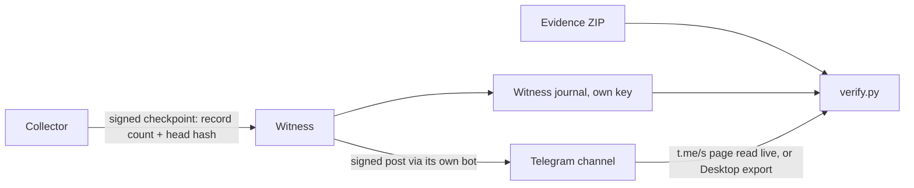

[TgWitness](../../README.md) / [Документация](../README.md) / [Папка](README.md) · [Доказательства и проверка](../EVIDENCE.md)


# Независимый свидетель

[Экспорт и проверка](../EVIDENCE.md) · [Повышенная доказуемость](HIGH-ASSURANCE.md) · [Руководство по панели](../PANEL.md#extras)

Свидетель хранит подписанные контрольные точки отдельно от коллектора. Он проверяет подпись
коллектора и непрерывность журнала, подписывает результат собственным ключом и публикует его
в канале Telegram. Запускайте его на отдельном сервере с доступом только на чтение к конечной
точке свидетеля на коллекторе.

Технический результат включает сохранённые префиксы журнала, ответы на вызовы,
проверки подписей, проверки включения и согласованности Merkle и подписанные результаты проверки
непрерывности. Если свидетеля ведёт другой хранитель, сохраните запись о хранителе и о том,
кто контролирует ключ, вместе с отпечатком ключа. Раздельные ключи и раздельное хранение описывают
разные стороны схемы. Верификатор сообщает, что второй ключ сохранил заголовок журнала,
и до какой записи; кто контролирует этот ключ — факт хранения, который он проверить не может,
поэтому журнал свидетеля — вспомогательная проверка, а не часть минимальных требований
к доказательствам. Публикации в канале добавляют внешнее время: Telegram датирует каждую
публичную публикацию, и верификатор сам читает эти даты.



<details>
<summary>На этой странице</summary>

- [Что получает свидетель и чего он не получает](#что-получает-свидетель-и-чего-он-не-получает)
- [Что он проверяет и записывает](#что-он-проверяет-и-записывает)
- [Запуск свидетеля](#запуск-свидетеля)
- [Публичная страница подтверждений для нескольких рабочих пространств](#публичная-страница-подтверждений-для-нескольких-рабочих-пространств)
- [Проверка](#проверка)

</details>

## Что получает свидетель и чего он не получает

| У свидетеля есть | У свидетеля никогда нет |
| --- | --- |
| **Токен свидетеля** с доступом только на чтение для одного рабочего пространства | Сессии Telegram или учётных данных API коллектора |
| Собственный ключ Ed25519 и журнал | Хранилища, ключа подписи или токена панели коллектора |
| Собственный токен Telegram-бота | Содержимого сообщений: заголовок — это число записей и хеш |

Токен создаётся в разделе **Инструменты → Дополнительно → Независимый свидетель**, показывается
один раз и хранится только в виде SHA-256. Он открывает ровно одну конечную точку,
`GET /api/witness/head`, которая возвращает только что подписанную контрольную точку, а также
подписанные счётчики сбора без содержимого и сведения о работоспособности.
Он не может открыть панель, прочитать содержимое сообщений или изменить настройки, а токен
панели на этой конечной точке не принимается. Отозвать токен можно на той же странице.
Коллектор записывает, когда новый ключ свидетеля начинает проверки (`witness.seen`), и показывает
последнюю проверку по каждому токену; свидетель, не выполнивший проверку в течение
2,5 интервала, помечается как просроченный.

Новые версии свидетеля при каждом опросе отправляют случайный вызов; заявление о сборе
возвращает его под подписью коллектора. Счётчики привязаны к конкретной контрольной точке
и включаются в подписанные публикации свидетеля. Автономный свидетель по-прежнему принимает
заголовки старого формата. Рост журнала сам по себе никогда не засчитывается как новое сообщение.

## Что он проверяет и записывает

Каждый интервал (по умолчанию 10 минут) свидетель:

1. сам запрашивает заголовок (коллектор не может навязать или пропустить его);
2. проверяет подпись коллектора, закреплённый ключ коллектора (`--collector-fingerprint`
   или первый увиденный ключ), неубывание числа записей и неизменность заголовка
   при неизменном числе. Доказательства включения и согласованности Merkle подтверждают,
   что растущий журнал продолжает сохранённую контрольную точку. Если доказательства
   непрерывности уже использовались, их исчезновение отклоняется;
3. добавляет подписанную запись в свой журнал: `witness.anchor` со статусом `ok`,
   `key_changed`, `rollback` (записей меньше, чем раньше), `fork` (та же длина, другой
   заголовок) или `invalid` (ответ не прошёл проверку) либо `witness.no_response`, если
   коллектор не ответил;
4. публикует подписанный результат в канал, включая «нет ответа», пока свидетель работает
   и может обратиться к Bot API. ID публикации записывается (`witness.posted`), как и неудачная
   попытка публикации (`witness.post_failed`).

Публикация выглядит так; последняя строка содержит подписанное заявление:

```text
TgWitness witness #42 · journal head
Collector 3fa9c2d1e0b4a7f6: 18234 records
Head 9b1f…c07e
2026-10-28T19:40:00.123+00:00
TGW1.eyJhdCI6…<statement>.<signature>
```

## Запуск свидетеля

Нужны бот Telegram (создайте его через @BotFather), канал, в котором этот бот — администратор,
и адрес коллектора, доступный со стороны свидетеля, — по HTTPS, если свидетель находится вне
частной сети (см. профиль HTTPS в разделе [«Развёртывание»](DEPLOYMENT.md)).

Откройте в панели **Инструменты → Дополнительно → Независимый свидетель → Настройте**. Три шага
охватывают доступ только на чтение, ваш канал и интервал, затем запуск свидетеля. Политика
публикации, необязательный HTTP/SOCKS5-прокси и собственный адрес Bot API находятся в разделе
**Расширенные настройки · публикация и сеть**. Форма скачивает `witness.json` с закреплённым
ключом коллектора этого рабочего пространства. Скачайте только что созданный токен только для чтения
кнопкой **Сохраните файл доступа** как `witness-token.txt`; положите его и созданный на хосте
свидетеля `bot-token.txt` рядом с этим JSON. Коллектор никогда не получает токен бота.
Скачивание не запускает службу и не публикует сообщений. Никакой размещённый проектом
свидетель неявно не подключается.

```sh
python -m tgwitness.witness run --config witness.json --check-config
python -m tgwitness.witness run --config witness.json
python -m tgwitness.witness fingerprint --config witness.json
```

Первая команда проверяет конфигурацию и файлы секретов без сетевых запросов и без создания
ключа. Пути в JSON указываются относительно этого файла; пути в командной строке и переменных
окружения — относительно рабочего каталога. Храните отпечаток свидетеля вне его хоста.
Индикатор последнего опроса на коллекторе подтверждает только запрос; публикацию показывает
Proof, либо её проверяют в журнале свидетеля и в канале.

Если панель остаётся доступной только через SSH-туннель, откройте лишь ограниченную конечную
точку свидетеля на отдельном HTTPS-имени хоста по [этому примеру Caddy](../../deploy/Caddyfile.witness.example).
Тогда основное рабочее пространство использует `https://witness.example.org`, а остальные —
`https://witness.example.org/profiles/ID`. Токены по-прежнему обязательны; панель и другие
маршруты её API через этот виртуальный хост не передаются.

Для регулярно публикуемых контрольных точек выберите `all`. Интервал в пять минут даёт около 288
публикаций в сутки на рабочее пространство. `changes`/`problems` намеренно оставляют часть проверок
неопубликованными. MTProxy предназначен для клиента Telegram коллектора. HTTP-опрос свидетеля
и HTTPS Bot API Telegram используют собственный маршрут: прямой, HTTP или SOCKS5
([Bot API](https://core.telegram.org/bots/api)).

**Рядом с коллектором, в Docker** (тот же хост — отдельный процесс и ключ, но тот же
оператор): укажите значения в `.env` и запустите профиль.

```sh
TGWITNESS_WITNESS_TOKEN=tgww_...
TGWITNESS_WITNESS_BOT_TOKEN=123456:ABC...
TGWITNESS_WITNESS_CHANNEL=@your_witness_channel
# another workspace: TGWITNESS_WITNESS_COLLECTOR=http://tgwitness:8787/profiles/<workspace ID>

docker compose --profile witness up -d
docker compose logs witness     # prints the witness key fingerprint
```

С опубликованным образом используйте `docker compose --project-directory . -f deploy/compose/compose.image.yaml --profile witness up -d`.

**На чужом сервере** (раздельное хранение): скопируйте туда репозиторий, укажите в `.env`
`TGWITNESS_WITNESS_COLLECTOR=https://your-collector.example.org` и три значения выше,
затем выполните

```sh
docker compose --project-directory . -f deploy/compose/compose.witness.yaml up -d
```

или без Docker:

```sh
python -m tgwitness.witness run --collector https://your-collector.example.org \
    --token-file witness-token.txt --bot-token-file bot-token.txt --channel @your_witness_channel
```

### Публикация в Discord

Свидетель может публиковать в канал Discord вместо Telegram. В Discord откройте
**Edit Channel → Integrations → Webhooks**, создайте веб-хук и скопируйте его URL. В панели
на шаге 2 выберите **Discord webhook · ваш канал**. На хосте свидетеля сохраните URL в файл
`discord-webhook.txt` рядом с `witness.json`; к коллектору он никогда не попадает.

```sh
python -m tgwitness.witness run --collector https://your-collector.example.org \
    --token-file witness-token.txt --discord-webhook-file discord-webhook.txt
```

У свидетеля одно место публикации: канал Telegram или веб-хук Discord, но не оба сразу.
Публикации содержат то же подписанное заявление и не могут никого упомянуть с уведомлением.
Публикация длиннее лимита Discord в 2 000 символов заменяется короткой строкой, а полная
проверка прикладывается файлом `witness-check.txt`. ID каждой публикации записывается как
`witness.posted`. `verify.py --channel` читает только каналы Telegram, поэтому для Discord
сохраняйте журнал свидетеля: в нём есть каждая проверка. Публикации в Discord не дают верификатору
внешнего времени.

### Параметры

| Параметр | Переменная окружения | По умолчанию | Назначение |
| --- | --- | --- | --- |
| `--interval` | `TGWITNESS_WITNESS_INTERVAL` | 10 | Минуты между проверками, 1–1440 |
| `--timeout` | `_TIMEOUT` | 30 | Секунды ожидания коллектора и Bot API, 5–600 |
| `--post` | `_POST` | `all` | `all`: каждая проверка; `changes`: новый заголовок или проблема; `problems`: только проблемы и отсутствие ответа |
| `--title` | `_TITLE` | `TgWitness witness` | Первые слова каждой публикации в канале |
| `--collector-fingerprint` | `_COLLECTOR_FINGERPRINT` | – | Закрепить ключ коллектора вместо доверия первому ответу |
| `--proxy` | `_PROXY` | напрямую | `socks5://host:port` или `http://host:port` |
| `--bot-api` | `_BOT_API` | `https://api.telegram.org` | Адрес Bot API, например локального сервера Bot API |
| `--data-dir` | `_DATA` | `witness-data` | Ключ и журнал свидетеля |
| `--config` | `_CONFIG` | – | JSON-файл с любыми из параметров выше |

Адрес коллектора, токены и канал задаются через `--collector`, `--token` или
`--token-file`, `--bot-token` или `--bot-token-file`, `--discord-webhook-file` и `--channel`
либо через `_COLLECTOR`, `_TOKEN`, `_TOKEN_FILE`, `_BOT_TOKEN`, `_BOT_TOKEN_FILE`,
`_DISCORD_WEBHOOK_FILE` и `_CHANNEL` — так секреты не попадают в список процессов.

Файл конфигурации использует имена параметров с подчёркиваниями, а также `texts`, который
заменяет слова в публикациях канала:

```json
{"collector": "https://your-collector.example.org", "token_file": "witness-token.txt",
 "bot_token_file": "bot-token.txt", "channel": "@your_witness_channel",
 "interval": 5, "timeout": 30, "post": "changes", "title": "Partner witness",
 "texts": {"ok": "journal head", "no_response": "no answer from the collector", "records": "records"}}
```

Ключи `texts`: `ok`, `key_changed`, `rollback`, `fork`, `invalid`, `no_response`, `collector`,
`records`, `head`. Командная строка имеет приоритет над переменными окружения, переменные
окружения — над файлом. Неизвестные параметры или ключи текстов останавливают свидетеля
с сообщением, а не игнорируются. Формулировки никогда не влияют на проверку: verify.py проверяет
подписанный токен в конце каждой публикации. При `--post changes` или `problems` неопубликованные
проверки всё равно остаются в журнале свидетеля, и `verify.py` перечисляет их как неопубликованные;
запись о запуске указывает политику. Каждая проверка всё равно попадает в журнал, поэтому меньше
публикаций означает меньше моментов, датированных Telegram, а не меньше проверок.

Без канала свидетель всё равно ведёт свой журнал. Храните отпечаток ключа свидетеля
(`python -m tgwitness.witness fingerprint`) в другом месте.

<a name="public-proof-page-for-several-workspaces"></a>

## Публичная страница подтверждений для нескольких рабочих пространств

`python -m tgwitness.proof` одновременно выступает свидетелем не более чем для 32 рабочих пространств и отдаёт
страницу только для чтения с последней подписанной проверкой каждого. Каждое рабочее
пространство получает собственный ключ и журнал свидетеля в папке данных и закреплённый ключ
коллектора; публикация в канал Telegram для каждого рабочего пространства необязательна.
Начните с [proof.config.example](../../deploy/proof.config.example):

| Поле | Назначение |
| --- | --- |
| `title` | Заголовок страницы, 1–100 символов |
| `data_dir` | Ключи и журналы свидетеля относительно файла; по умолчанию `proof-data` |
| `interval`, `timeout` | Минуты между проверками (1–1440, по умолчанию 5); секунды ожидания (5–600, по умолчанию 20) |
| `workspaces[].id`, `label` | Короткий псевдоним строчными буквами и отображаемое название |
| `workspaces[].collector` | Адрес коллектора; для других рабочих пространств заканчивается на `/profiles/<workspace ID>` |
| `workspaces[].collector_fingerprint` | Обязателен, свой для каждого рабочего пространства |
| `workspaces[].token_file` | Файл с токеном свидетеля этого рабочего пространства (только чтение) |
| `workspaces[].channel`, `bot_token_file` | Необязательны, задаются вместе: публиковать каждую проверку в канал |
| `workspaces[].proxy`, `bot_api` | Необязательные маршрут и адрес Bot API |

```sh
python -m tgwitness.proof --config proof.json --check-config
python -m tgwitness.proof --config proof.json --host 127.0.0.1 --port 8790
```

Первая команда проверяет файл и файлы токенов, не открывая соединений.
Страница отвечает только на GET и HEAD:

- `/` показывает все рабочие пространства; рабочее пространство без проверки в течение
  2,5 интервала помечается как устаревшее.
- `/api/proof` возвращает то же в формате JSON.
- `/api/proof/<id>` скачивает последнее подписанное заявление (`tgwitness-public-proof-v1`):
  номер и хеш записи свидетеля, статус, закреплённый ключ коллектора, контрольную точку,
  счётчики сбора и признак успешной публикации в канале — с подписью ключом свидетеля этого
  рабочего пространства.
- `/healthz` отвечает 503, если монитор какого-либо рабочего пространства остановился.

Выделите странице отдельное имя хоста, как в
[Caddyfile.proof.example](../../deploy/Caddyfile.proof.example). Для проверки экспортируйте
журнал свидетеля рабочего пространства командой
`python -m tgwitness.witness export --data-dir proof-data/<id> --out witness.zip` и используйте
его, как описано ниже.

## Проверка

На стороне свидетеля экспортируйте его журнал:

```sh
python -m tgwitness.witness export --out witness.zip
# Docker (add -f deploy/compose/compose.witness.yaml on a witness server):
docker compose exec witness python -m tgwitness.witness export --out /witness/witness.zip
docker compose cp witness:/witness/witness.zip .
```

Затем где угодно, имея подписанный ZIP коллектора и адрес публичного канала, выполните:

```sh
python verify.py tgwitness-evidence.zip --fingerprint COLLECTOR_SHA256 \
    --witness witness.zip --witness-fingerprint WITNESS_SHA256 --channel https://t.me/s/your_witness_channel
```

`--channel` также принимает экспорт Telegram Desktop (*Экспорт истории чата* → JSON даёт
`result.json`) или сохранённую копию страницы; они позволяют проверить содержимое публикаций,
но не дают внешнего времени.

`verify.py` проверяет журнал свидетеля (цепочку и подписи), а затем то, что **каждый заголовок,
который видел свидетель, входит в экспортированный журнал**: запись с этим номером должна иметь
ровно этот хеш. Несовпадающий заголовок проваливает проверку — значит, журнал изменили после того,
как свидетель его видел. Также выводятся заголовки, увиденные после экспорта, аномалии, записанные
свидетелем, неудачные ответы, периоды, для которых соответствующие контрольные точки есть в этом
экспорте («Witnessed from X to Y»), и пропуски. Более поздние контрольные точки не продлевают
эти периоды. Результат включает номер последней совпавшей записи и число записей в конце
без соответствующей контрольной точки. Засчитываются только ответы, подписанные ключом самого
экспорта: экспорт, подписанный ключом, которого свидетель никогда не видел, отмечается как
не засвидетельствованный, а без `--fingerprint` его подписант остаётся незакреплённым.
С `--channel` каждая подписанная публикация должна совпадать с журналом свидетеля запись
за записью: изменённые публикации проваливают проверку, отсутствующие перечисляются. Совпадение
токена подтверждает подлинность содержимого; дата находится вне подписанного токена.

При живом адресе `https://t.me/s/…` или `https://telegram.me/s/…` верификатор во время проверки
читает со страницы дату каждой публикации. Эту дату устанавливает Telegram; даты отредактированных
публикаций не используются. Самая ранняя такая дата публикации, заголовок в которой совпадает
с концом экспорта, служит внешним временем для последней записи, что выполняет это условие
минимальных требований к доказательствам. Даты из любого другого источника, например
из предоставленного `result.json`, сохранённой страницы или другого веб-адреса, — это
предоставленные метаданные, а не независимое время; в результате указано, откуда взяты даты
публикаций (`post_date_verification`).

### Обязательная засвидетельствованная граница экспорта

Если передаваемый архив должен содержать засвидетельствованную последнюю запись, добавьте
`--require-witness`:

```sh
python verify.py tgwitness-evidence.zip --fingerprint COLLECTOR_SHA256 \
    --witness witness.zip --witness-fingerprint WITNESS_SHA256 --require-witness
```

Для этого нужны независимо сохранённый отпечаток свидетеля, ключ, отличный от ключа
коллектора, и совпадающая контрольная точка ровно на конце этого экспорта. Контрольной точки,
охватывающей только более ранний префикс, недостаточно. Приостановите сбор, дайте свидетелю
зафиксировать итоговое состояние и сделайте экспорт до новых записей в журнал; если журнал
изменился, сохраните ещё одну контрольную точку и экспортируйте это состояние. Одна лишь более
поздняя контрольная точка не позволяет проверить конечный хеш более короткого экспорта.
Если указан также `--channel`, отсутствие заявленных публикаций или пустой набор совпадений
проваливают эту строгую проверку. Без флага обычные проверки целостности всё равно сообщают
о незасвидетельствованных записях, не отклоняя в остальном целый архив.

Храните журнал свидетеля и его закреплённый ключ отдельно. Онлайн-проверки подтверждают
непрерывность между контрольными точками; автономная проверка сравнивает каждую сохранённую
контрольную точку с экспортом. Для заголовков старого формата без доказательств непрерывности
сохраняется автономное сравнение, и в отчёте они указываются без отметки об онлайн-проверке
непрерывности. Отчёт перечисляет простои свидетеля и неудачные публикации по интервалам.

### Ежедневные печати и недоступные календари меток времени

Свидетель запечатывает границу журнала за предыдущие сутки UTC и отправляет хеш этой
подписанной печати в OpenTimestamps. Отправка в календарь — лишь свидетельство, ожидающее
подтверждения; подтверждение в верификаторе получают только независимо проверенные
обязательства в Bitcoin.

Если отправка не удалась ни в один календарь, подписанная печать и неудачная попытка остаются
в журнале. Ежечасный проход обслуживания повторяет отправку этой исходной записи, в том числе
после перезапуска или смены даты. За один проход он просматривает не более 32 печатей,
выполняет не более двух недостающих отправок и тратит на повторы не более 60 секунд.
Сохраняемый курсор поочерёдно перебирает более старые печати. Сохранённые отправки проходят
обычный путь обновления доказательств.

Повторная попытка не переписывает печать, не меняет её исходную дату и не утверждает, что
календарь получил её раньше. Более позднее обязательство в Bitcoin остаётся более поздним
внешним подтверждением. Отсутствующие доказательства остаются `none`, ожидающие — `pending`,
пока верификатор не проверит их независимо.
