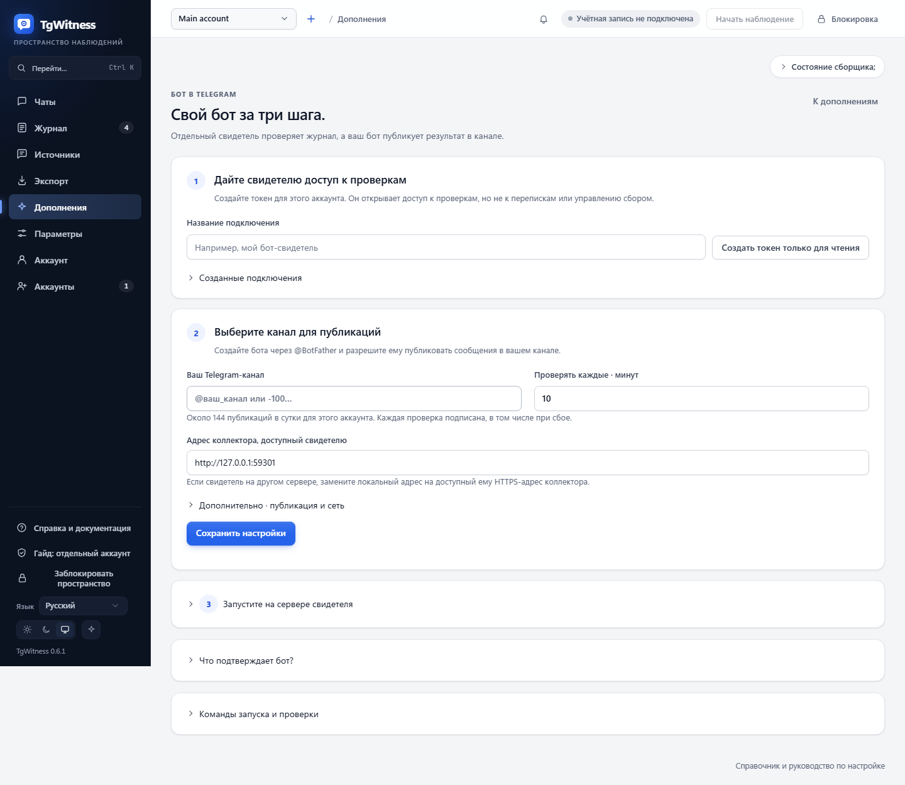
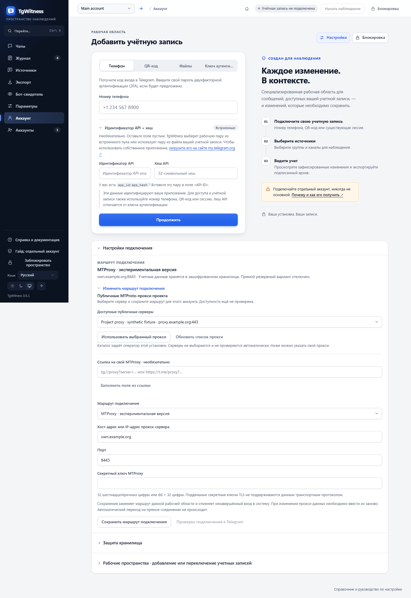

# Бот-свидетель и свои прокси

В боковом меню откройте **Дополнения → Бот в Telegram → Настроить бота**.
Короткий обзор всех возможностей — в [дополнениях](EXTRAS.md).
Свидетель — отдельный процесс с собственным ключом:
он сам запрашивает подписанную контрольную точку коллектора, проверяет её, сохраняет
результат в своём журнале и отправляет подписанный пруф через вашего Telegram-бота.
Бот служит для публикации; проверку делает процесс свидетеля.



## Настроить своего бота

1. Создайте бота через `@BotFather` и дайте ему право публиковать в вашем канале.
2. В первом шаге настройки бота создайте токен чтения для нужного аккаунта.
   Нажмите **Сохранить файл доступа**, чтобы скачать
   `witness-token.txt`; он показывается только при создании и не даёт доступа к переписке.
3. В форме укажите адрес коллектора, доступный с сервера свидетеля, канал и интервал.
   Для другого аккаунта адрес заканчивается на `/profiles/ID`. Форма подставляет текущее
   пространство и закрепляет его отпечаток ключа в конфигурации.
4. Нажмите **Сохранить настройки**, чтобы скачать `witness.json` и открыть третий шаг.
   На сервере свидетеля положите рядом файл `bot-token.txt`
   с токеном от BotFather и файл `witness-token.txt`. Токен бота в коллектор не передаётся.
5. На сервере свидетеля в установленном окружении TgWitness выполните:

```sh
python -m tgwitness.witness run --config witness.json --check-config
python -m tgwitness.witness run --config witness.json
```

Если панель открывается только через SSH-туннель, для внешнего свидетеля можно выделить
HTTPS-домен по [этому конфигу Caddy](../../deploy/Caddyfile.witness.example). Он пропускает
только `/api/witness/head` и его вариант для отдельных аккаунтов. Токен чтения по-прежнему
обязателен; панель управления через этот домен не публикуется.

Первая команда проверяет файлы и параметры без сетевых обращений, публикаций и создания
ключа. Вторая запускает реальные проверки и публикации. Пути в JSON считаются относительно
его расположения. Отпечаток ключа свидетеля сохраните отдельно:

```sh
python -m tgwitness.witness fingerprint --config witness.json
```

Лучше запускать свидетеля на другом хосте, у другого оператора. На одном VPS ключи и
процессы разделены, но отключение сервера остановит их оба. Готовый публичный бот проекта
в коде не зарегистрирован: его развёртывание, канал и независимый оператор нужны отдельно.

В **Дополнительно · публикация и сеть** выберите **Каждую проверку**, чтобы публиковать регулярные контрольные точки, включая
отсутствие ответа коллектора. Каждые пять минут — около 288 постов в сутки на аккаунт.
Другие режимы оставляют часть проверок только в локальном журнале. Последнее обращение
на странице коллектора ещё не подтверждает публикацию: её результат виден в Proof,
журнале свидетеля и самом канале.

## Публичный MTProto от проекта или свой



Откройте **Аккаунт → Настройки → Параметры подключения → Изменить маршрут подключения**.
В верхней части уже есть список совместимых публичных прокси из открытых источников.
Выберите сервер, сохраните маршрут и проверьте соединение с Telegram — это доступно
до входа в аккаунт. Кнопка **Обновить из интернета** загружает свежие списки; при сбое
источника его прежние записи сохраняются. Маршрут аккаунта сам не меняется.
[Подробнее о публичных списках и своих прокси](PROXIES.md).

Ниже можно вставить свою ссылку `tg://proxy?...` или `https://t.me/proxy?...`, нажать
**Заполнить поля из ссылки**, проверить адрес и сохранить. Ручной ввод адреса, порта и
секрета тоже доступен. Поддерживаются секреты из 32 шестнадцатеричных знаков и `dd` + 32
знака. Fake TLS `ee` этот транспорт не поддерживает. Перед сменой маршрута остановите
сбор; автоматического переключения на прямое подключение нет.

При необходимости оператор заменяет публичные списки своим каталогом в `proxy-config/proxies.json` по
[этому примеру](../../deploy/proxies.config.example). Для запуска без Docker нужен путь
в `TGWITNESS_PROXY_CATALOG`, для Docker —
[deploy/compose/compose.proxies.yaml](../../deploy/compose/compose.proxies.yaml). Формат записей и команды описаны
в [инструкции подключения](../CONNECTION-SECURITY.md#public-proxies-supplied-by-your-installation).

У бота отдельная сеть: Bot API работает по HTTPS. В форме свидетеля можно задать свой
HTTP/SOCKS5-прокси и адрес собственного Bot API. MTProxy аккаунта на него не распространяется.
Для общего Proof-монитора эти же настройки доступны как `proxy` и `bot_api` в записи аккаунта.

## Что проверяется в цепочке доказательств

В момент опроса проверяются подпись, закреплённый ключ, отсутствие уменьшения журнала
и неизменный хеш при прежней длине. Чтобы доказать, что история сохранилась при росте
журнала, нужно сверить **каждый ранее опубликованный хеш** с соответствующим префиксом
полного экспорта. Это делает автономный verifier:

```sh
python -m tgwitness.witness export --config witness.json --out witness.zip
python tgwitness/verify.py tgwitness-evidence.zip --fingerprint COLLECTOR_SHA256 \
  --witness witness.zip --witness-fingerprint WITNESS_SHA256 --channel result.json
```

`result.json` — экспорт канала из Telegram Desktop. Проверка выявляет несовпадения
истории, недействительные подписи и отсутствующие публикации относительно сохранённого
журнала свидетеля. Засчитываются только ответы, подписанные ключом самого экспорта: экспорт
с ключом, которого свидетель не видел, помечается как не засвидетельствованный, а без
`--fingerprint` его подписант остаётся непривязанным. Простой свидетеля и ошибки отправки оставляют интервалы без внешней
фиксации. Регулярные подписи не доказывают, что получены абсолютно все события Telegram;
для проверки самого сбора используйте [контрольные сообщения](PROOF.md).
