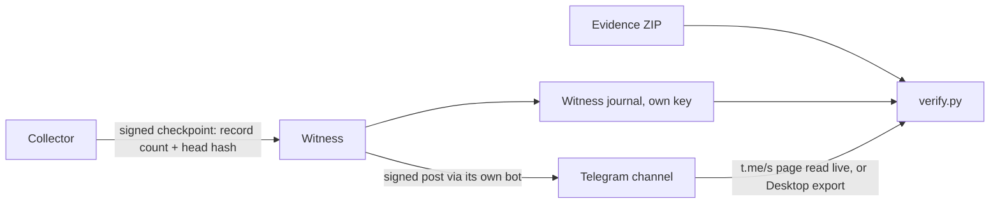

[TgWitness](../../README.md) / [Документация](../README.md) / [Папка](README.md) · [Доказательства и проверка](EVIDENCE.md)


<a id="independent-witness"></a>
# Независимый свидетель

[Экспорт и проверка](EVIDENCE.md) · [Высокая степень достоверности](HIGH-ASSURANCE.md) · [Руководство по панели](PANEL.md#extras)

Свидетель хранит подписанные контрольные точки отдельно от сборщика. Он проверяет подпись сборщика и непрерывность журнала, подписывает результат собственным ключом и публикует его в канале Telegram. Запускайте его на отдельном сервере с доступом только для чтения к конечной точке свидетеля сборщика.

Технический результат включает сохраненные префиксы журнала, ответы на запросы, проверки подписей, проверки включения/согласованности по алгоритму Меркла и подписанные результаты проверки непрерывности. В случае свидетеля, управляемого другим хранителем, сохраняйте запись о хранителе и контроле над ключами с его отпечатком. Разделение ключей и раздельное хранение описывают различные части конфигурации. Верификатор сообщает, что второй ключ сохранил вершину журнала и указал, до какой записи; запись о контроле ключей хранителя показывает, кто владеет этим ключом. Журнал свидетеля служит вспомогательной проверкой; минимальным требованием для подтверждения является время, зафиксированное третьей стороной. Сообщения в канале добавляют внешнее время: Telegram проставляет дату на каждом публичном сообщении, и верификатор самостоятельно считывает эти даты.



<details>
<summary>На этой странице</summary>

- [Что хранит свидетель](#what-the-witness-holds)
- [Что проверяется и регистрируется](#what-it-checks-and-records)
- [Запуск свидетеля](#run-a-witness)
- [Публичная страница с доказательствами для нескольких рабочих областей](#public-proof-page-for-several-workspaces)
- [Проверка](#verify)
</details>

<a id="what-the-witness-holds"></a>
## Что хранит свидетель

| Свидетель имеет | Свидетель никогда не имеет |
| --- | --- |
| **Токен свидетеля** только для чтения для одной рабочей области | Сеанс Telegram сборщика или учетные данные API |
| Собственный ключ Ed25519 и журнал | Хранилище, ключ подписи или токен панели сборщика |
| Своим собственным токеном бота в Telegram | Содержимое сообщения: заголовок состоит из количества записей и хеша |

Токен создаётся в разделе **Дополнительные инструменты → Дополнительные функции → Независимый свидетель**, отображается однократно и хранится исключительно в виде SHA-256. Он открывает ровно одну конечную точку — `GET /api/witness/head`, которая возвращает свежеподписанную контрольную точку, а также подписанные счётчики коллекций без содержимого и информацию о работоспособности системы. Он не может открывать панель, считывать содержание сообщений или изменять настройки, а токен панели там не принимается. Отзыв токена осуществляется на той же странице. Сборщик фиксирует момент начала проверки нового ключа свидетеля (`witness.seen`) и отображает последнюю проверку для каждого токена; свидетель, не прошедший проверку в течение 2,5 интервалов, помечается как просроченный.

Новые свидетели отправляют случайный запрос при каждом опросе; оператор записи повторяет его под подписью сборщика. Счётчики привязаны к конкретной контрольной точке и включаются в подписанные сообщения свидетелей. Старые заголовки по-прежнему принимаются автономным свидетелем. Рост журнала сам по себе никогда не считается новым сообщением.

<a id="what-it-checks-and-records"></a>
## Что проверяется и регистрируется

Каждый интервал (по умолчанию — 10 минут) свидетель:

1. загружает саму головку (сборщик не может ни отправлять, ни пропускать её);
2. проверяет подпись сборщика, закреплённый ключ сборщика (параметр `--collector-fingerprint` или первый обнаруженный ключ), неубывающий счётчик и неизменную головку при неизменном счётчике. Доказательства включения по алгоритму Меркла и доказательства согласованности подтверждают, что растущий журнал расширяет сохраненную контрольную точку. После использования доказательств непрерывности их удаление отклоняется;
3. добавляет подписанную запись в свой собственный журнал: `witness.anchor` со статусом `ok`, `key_changed`, `rollback` (меньше записей, чем ранее), `fork` (та же длина, другая головка) или `invalid` (ответ не прошел проверку), либо `witness.no_response`, если сборщик не ответил;
4. отправляет результат в канал с подписью, включая сообщение «no answer», пока свидетель находится в рабочем состоянии и имеет доступ к Bot API. Идентификатор публикации фиксируется (`witness.posted`), равно как и неудачная публикация (`witness.post_failed`).

Сообщение выглядит следующим образом; в последней строке содержится подписанное утверждение:

```text
TgWitness witness #42 · journal head
Collector 3fa9c2d1e0b4a7f6: 18234 records
Head 9b1f…c07e
2026-10-28T19:40:00.123+00:00
TGW1.eyJhdCI6…<statement>.<signature>
```

<a id="run-a-witness"></a>
## Запуск свидетеля

Вам понадобится бот в Telegram (создайте его с помощью @BotFather), канал, администратором которого является этот бот, а также адрес сборщика, доступный для свидетеля — по протоколу HTTPS за пределами частной сети (см. раздел «Профиль HTTPS» в [разделе Развертывание](DEPLOYMENT.md)).

Откройте в панели **Дополнительные инструменты → Дополнительные функции → Независимый свидетель → Настроить**. Три шага охватывают настройку доступа только для чтения, ваш канал и интервал, а затем запуск свидетеля. Политика публикации, опциональный прокси HTTP/SOCKS5 и пользовательский адрес Bot API находятся в разделе **Расширенные настройки**. Форма загружает файл `witness.json` с закреплённым ключом сборщика данной рабочей области. Загрузите вновь созданный токен только для чтения, выбрав **«Сохранить файл доступа** как `witness-token.txt`»; поместите его и файл `bot-token.txt`, созданный на хосте свидетеля, рядом с этим файлом JSON. Сборщик никогда не получает токен бота. Загрузка не запускает службу и не публикует сообщение. Ни один свидетель размещённого проекта не регистрируется неявно.

```sh
python -m tgwitness.witness run --config witness.json --check-config
python -m tgwitness.witness run --config witness.json
python -m tgwitness.witness fingerprint --config witness.json
```

Первая команда проверяет файлы конфигурации и секретные данные без сетевых запросов и создания ключей. Пути в файле JSON являются относительными по отношению к этому файлу; пути CLI/среды — относительными по отношению к рабочему каталогу. Храните отпечаток свидетеля за пределами его хоста. Индикатор «Последний опрос» сборщика подтверждает лишь наличие запроса; о публикации сообщается с помощью Proof или проверяется в журнале свидетеля и канале.

Если панель находится за SSH-туннелем, открывайте доступ только к конечной точке свидетеля с ограниченной областью действия на отдельном HTTPS-хосте с помощью [этого примера Caddy](../../deploy/Caddyfile.witness.example). Рабочая область по умолчанию будет использовать `https://witness.example.org`, другие рабочие области — `https://witness.example.org/profiles/ID`. Токены по-прежнему требуются; панель и другие маршруты API не перенаправляются этим виртуальным хостом.

Выберите вариант `all` для регулярно публикуемых контрольных точек. Пятиминутный интервал означает около 288 записей на рабочую область в день. Из-за изменений (`changes`) и проблем (`problems`) некоторые проверки намеренно остаются неопубликованными. MTProxy предназначен для клиента Telegram сборщика. HTTP-опрос свидетеля и HTTPS-API бота Telegram используют собственный маршрут direct/HTTP/SOCKS5 ([API бота](https://core.telegram.org/bots/api)).

**Рядом с сборщиком, с использованием Docker** (тот же хост — независимый процесс и ключ, но тот же оператор): внесите значения в файл `.env` и запустите профиль.

```sh
TGWITNESS_WITNESS_TOKEN=tgww_...
TGWITNESS_WITNESS_BOT_TOKEN=123456:ABC...
TGWITNESS_WITNESS_CHANNEL=@your_witness_channel
# another workspace: TGWITNESS_WITNESS_COLLECTOR=http://tgwitness:8787/profiles/<workspace ID>

docker compose --profile witness up -d
docker compose logs witness     # prints the witness key fingerprint
```

При использовании опубликованного образа выполните команду `docker compose --project-directory . -f deploy/compose/compose.image.yaml --profile witness up -d`.

**На чужом сервере** (отдельное хранение): скопируйте туда репозиторий, установите `TGWITNESS_WITNESS_COLLECTOR=https://your-collector.example.org`, а также три указанных выше значения в файле `.env`, затем

```sh
docker compose --project-directory . -f deploy/compose/compose.witness.yaml up -d
```

или без использования Docker:

```sh
python -m tgwitness.witness run --collector https://your-collector.example.org \
    --token-file witness-token.txt --bot-token-file bot-token.txt --channel @your_witness_channel
```

<a id="publish-to-discord"></a>
### Публикация в Discord

Свидетель может публиковать сообщения в канале Discord вместо Telegram. В Discord откройте **Редактировать канал → Интеграции → Веб-хуки**, создайте веб-хук и скопируйте его URL-адрес. На панели в шаге 2 выберите **Веб-хук Discord · ваш канал**. На хосте свидетеля сохраните URL-адрес как `discord-webhook.txt` рядом с файлом `witness.json`; он никогда не попадает в сборщика.

```sh
python -m tgwitness.witness run --collector https://your-collector.example.org \
    --token-file witness-token.txt --discord-webhook-file discord-webhook.txt
```

У свидетеля может быть только один канал публикации: канал Telegram или веб-хук Discord, но не оба одновременно. Сообщения содержат одно и то же подписанное заявление и не могут отправлять уведомления кому-либо. Сообщение, превышающее ограничение Discord в 2 000 символов, заменяется короткой строкой с полной проверкой, вложенной в файл `witness-check.txt`. Каждый идентификатор сообщения записывается в файл `witness.posted`. Скрипт `verify.py --channel` считывает только каналы Telegram, поэтому для Discord ведите журнал свидетеля: в нём хранятся все проверки. Сообщения Discord не предоставляют верификатору внешнего времени.

<a id="options"></a>
### Параметры

| Параметр | Среда | По умолчанию | Значение |
| --- | --- | --- | --- |
| `--interval` | `TGWITNESS_WITNESS_INTERVAL` | 10 | Интервал между проверками в минутах, 1–1440 |
| `--timeout` | `_TIMEOUT` | 30 | Секунд ожидания ответа от сборщика и Bot API, 5–600 |
| `--post` | `_POST` | `all` | `all`: каждая проверка; `changes`: новая вершина или проблема; `problems`: только проблемы и отсутствующие ответы |
| `--title` | `_TITLE` | `TgWitness witness` | Первые слова каждого сообщения в канале |
| `--collector-fingerprint` | `_COLLECTOR_FINGERPRINT` | – | Закрепите ключ сборщика вместо того, чтобы доверять первому ответу |
| `--proxy` | `_PROXY` | прямой | `socks5://host:port` или `http://host:port` |
| `--bot-api` | `_BOT_API` | `https://api.telegram.org` | Адрес Bot API, например, локальный сервер Bot API |
| `--data-dir` | `_DATA` | `witness-data` | Ключ свидетеля и журнал |
| `--config` | `_CONFIG` | – | Файл JSON с любым из перечисленных выше параметров |

Адрес сборщика, токены и канал получаются из параметров `--collector`, `--token` или `--token-file`, `--bot-token` или `--bot-token-file`, `--discord-webhook-file` и `--channel`, либо из `_COLLECTOR`, `_TOKEN`, `_TOKEN_FILE`, `_BOT_TOKEN`, `_BOT_TOKEN_FILE`, `_DISCORD_WEBHOOK_FILE` и `_CHANNEL`, что позволяет не раскрывать секретные данные в списке процессов.

В файле конфигурации используются названия опций с подчеркиваниями, а также тексты (`texts`), которые заменяют слова в сообщениях канала:

```json
{"collector": "https://your-collector.example.org", "token_file": "witness-token.txt",
 "bot_token_file": "bot-token.txt", "channel": "@your_witness_channel",
 "interval": 5, "timeout": 30, "post": "changes", "title": "Partner witness",
 "texts": {"ok": "journal head", "no_response": "no answer from the collector", "records": "records"}}
```

`texts`: `ok`, `key_changed`, `rollback`, `fork`, `invalid`, `no_response`, `collector`, `records`, `head`. Параметры командной строки имеют приоритет над переменными среды, а переменные среды — над файлом. Неизвестные параметры или текстовые ключи приводят к остановке работы свидетеля с выводом сообщения, а не игнорируются. Формулировка никогда не влияет на проверку: verify.py проверяет подписанный токен в конце каждого сообщения. При использовании параметров `--post changes` или `problems` проверки, которые не были опубликованы, по-прежнему остаются в журнале свидетеля, и `verify.py` указывает их как никогда не опубликованные; начальная запись определяет политику. Каждая проверка по-прежнему появляется в журнале, поэтому меньшее количество сообщений означает меньшее количество записей с датой от Telegram, а не меньшее количество проверок.

Даже без канала свидетель продолжает вести свой журнал. Сохраните отпечаток ключа свидетеля (`python -m tgwitness.witness fingerprint`) в другом месте.

<a id="public-proof-page-for-several-workspaces"></a>
## Публичная страница с доказательствами для нескольких рабочих областей

Команда `python -m tgwitness.proof` одновременно обслуживает до 32 рабочих областей и предоставляет страницу только для чтения с последней подписанной проверкой для каждого из них. Каждая рабочая область получает собственный ключ свидетеля и журнал в папке data, а также закреплённый ключ сборщика; публикация в канале Telegram является опциональной для каждой рабочей области. Начните с [файла proof.config.example](../../deploy/proof.config.example):

| Поле | Значение |
| --- | --- |
| `title` | Заголовок страницы, 1–100 символов |
| `data_dir` | Ключи свидетелей и журналы, относительно файла; по умолчанию — `proof-data` |
| `interval`, `timeout` | Интервал между проверками в минутах (1–1440, по умолчанию 5); время ожидания в секундах (5–600, по умолчанию 20) |
| `workspaces[].id`, `label` | Краткий псевдоним строчными буквами и отображаемое имя |
| `workspaces[].collector` | Адрес сборщика; другие рабочие области заканчиваются на `/profiles/<workspace ID>` |
| `workspaces[].collector_fingerprint` | Обязательно, отличается для каждой рабочей области |
| `workspaces[].token_file` | Файл с токеном свидетеля данной рабочей области, доступным только для чтения |
| `workspaces[].channel`, `bot_token_file` | Необязательно, в совокупности: публиковать результаты каждой проверки в канале |
| `workspaces[].proxy`, `bot_api` | Необязательный маршрут и адрес API бота |

```sh
python -m tgwitness.proof --config proof.json --check-config
python -m tgwitness.proof --config proof.json --host 127.0.0.1 --port 8790
```

Первая команда проверяет файл и файлы токенов без установления соединения. Страница отвечает только на запросы GET и HEAD:

- `/` отображает все рабочие области; рабочая область, для которой в течение 2,5 интервалов не было проверок, помечается как устаревшая.
- `/api/proof` возвращает те же данные в формате JSON.
- `/api/proof/<id>` загружает последнюю подписанную отчётную запись (`tgwitness-public-proof-v1`): номер и хеш записи свидетеля, статус, закреплённый ключ сборщика, контрольная точка, счётчики сбора данных и информацию об успешности публикации в канале, подписанную ключом свидетеля данной рабочей области.
- `/healthz` возвращает код 503, если монитор рабочей области прекратил работу.

Присвойте странице собственное имя хоста, например [Caddyfile.proof.example](../../deploy/Caddyfile.proof.example). Для проверки экспортируйте журнал свидетеля рабочей области с помощью команды ``python -m tgwitness.witness export --data-dir proof-data/<id> --out witness.zip`` и используйте его, как описано ниже.

<a id="verify"></a>
## Проверка

Со стороны свидетеля экспортируйте его журнал:

```sh
python -m tgwitness.witness export --out witness.zip
# Docker (add -f deploy/compose/compose.witness.yaml on a witness server):
docker compose exec witness python -m tgwitness.witness export --out /witness/witness.zip
docker compose cp witness:/witness/witness.zip .
```

Затем в любом месте, используя подписанный ZIP-файл сборщика и адрес общедоступного канала:

```sh
python verify.py tgwitness-evidence.zip --fingerprint COLLECTOR_SHA256 \
    --witness witness.zip --witness-fingerprint WITNESS_SHA256 --channel https://t.me/s/your_witness_channel
```

`--channel` также принимает экспорт из Telegram Desktop (*Экспорт истории чата* → JSON даёт файл `result.json`) или сохраненную копию страницы; эти варианты проверяют содержание сообщения, но не предоставляют внешнего времени.

Скрипт `verify.py` проверяет журнал свидетеля (цепочку и подписи), а затем убеждается, что **каждая вершина, которую видел свидетель, входит в экспортированный журнал**: запись с данным номером должна иметь именно этот хеш. Несоответствующий «head» приводит к сбою проверки — журнал был изменен после того, как свидетель его увидел. Программа также сообщает о «head», увиденных после экспорта, аномалиях, зафиксированных свидетелем, неудачных ответах, периодах, соответствующие контрольные точки которых присутствуют в данном экспорте («Свидетельствовал с X по Y»), а также о пробелах. Более поздние контрольные точки не продлевают эти периоды. Результат включает номер последней совпавшей записи и количество последующих записей без соответствующей контрольной точки. Учитываются только ответы, подписанные собственным ключом экспорта: экспорт, подписанный ключом, который свидетель никогда не видел, указывается как не засвидетельствованный, а без параметра `--fingerprint` его подписант остаётся незакреплённым. При использовании параметра ``--channel`` каждое подписанное сообщение должно совпадать с журналом свидетеля запись за записью: измененные сообщения не проходят проверку, отсутствующие сообщения включаются в список. Совпадение токена подтверждает подлинность содержимого; дата не входит в состав подписанного токена.

При использовании активного адреса `https://t.me/s/…` или `https://telegram.me/s/…` верификатор считывает дату каждой записи со страницы в момент проверки. Эту дату устанавливает Telegram; даты отредактированных записей не используются. Самая ранняя такая дата сообщения в начале экспорта является внешним временем для последней записи, которая удовлетворяет условию минимального объёма доказательств. Даты из любого другого источника, такого как предоставленный файл `result.json`, сохраненная страница или другой веб-адрес, являются предоставленными метаданными, а не независимым временем; в результате указывается, откуда взяты даты сообщений (`post_date_verification`).

<a id="require-a-witnessed-export-boundary"></a>
### Требование о наличии свидетеля на границе экспорта

Для передачи данных, которая должна включать заверенную конечную запись, добавьте параметр `--require-witness`:

```sh
python verify.py tgwitness-evidence.zip --fingerprint COLLECTOR_SHA256 \
    --witness witness.zip --witness-fingerprint WITNESS_SHA256 --require-witness
```

Для этого требуется независимо сохраненный отпечаток свидетеля, ключ, отличный от ключа сборщика, а также соответствующая контрольная точка, точно совпадающая с концом данного экспорта. Контрольной точки, охватывающей только более ранний префикс, недостаточно. Приостановите сбор данных, позвольте свидетелю наблюдать за конечным состоянием и выполните экспорт до дальнейших записей в журнал; если журнал изменится, сохраните ещё одну контрольную точку и экспортируйте это состояние. Один только более поздний контрольная точка не может подтвердить окончательный хеш более короткого экспорта. Если также указан флаг ``--channel``, отсутствие заявленных записей или пустой набор совпадений приводят к сбою этой строгой проверки. Без этого флага обычные проверки целостности по-прежнему сообщают о записях без свидетеля, не отклоняя при этом архив, который в остальном является целостным.

Храните журнал свидетеля и его закреплённый ключ отдельно. Онлайн-проверки подтверждают непрерывность между контрольными точками; офлайн-проверка сравнивает каждую сохраненную контрольную точку с экспортом. Устаревшие головные узлы без доказательств непрерывности сохраняют результаты офлайн-сравнения и отражаются в отчёте без онлайн-проверки непрерывности. В отчёте перечисляются время простоя свидетеля и неудачные публикации с разбивкой по интервалам.

<a id="daily-seals-and-unavailable-timestamp-calendars"></a>
### Ежедневные печати и недоступные календари временных меток

Свидетель опечатывает границу журнала предыдущего дня по UTC и отправляет хеш этой подписанной печати в OpenTimestamps. Отправка календаря является ожидающим подтверждением; только независимо проверенные обязательства Bitcoin получают подтверждение в верификаторе.

Если все календари завершаются сбоем, подписанная печать и неудачная попытка остаются в журнале. В ходе ежечасного цикла обслуживания производится повторная попытка обработки этой исходной записи, в том числе после перезапуска или смены даты. При этом сканируется не более 32 печатей, отправляется не более двух отсутствующих отчётов, а на повторные попытки в рамках одного цикла уходит не более 60 секунд. Постоянный курсор поочерёдно просматривает более старые печати. Сохраненные отправки следуют существующему пути обновления доказательств.

Повторная попытка не перезаписывает печать, не изменяет её первоначальную дату и не утверждает, что календарь получил её ранее. Более позднее обязательство Bitcoin остаётся более поздним внешним подтверждением. Отсутствующие доказательства остаются в состоянии `none`; ожидающие доказательства остаются в состоянии `pending` до тех пор, пока верификатор не проверит их независимо.
