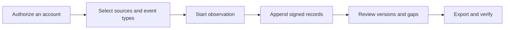

[English](../../README.md) · [Русский](../ru/README.md) · [Українська](../uk/README.md) · [Español](../es/README.md) · [Português (Brasil)](../pt/README.md) · **Türkçe** · [العربية](../ar/README.md) · [فارسی](../fa/README.md) · [اردو](../ur/README.md) · [हिन्दी](../hi/README.md) · [Bahasa Indonesia](../id/README.md) · [Tiếng Việt](../vi/README.md) · [简体中文](../zh/README.md)


<p align="center">
  <strong>Telegram gözlem çalışma alanınız.</strong><br>
  Kaydedilen sohbetleri saklayın, nelerin değiştiğini anlayın ve imzalanmış bir geçmişi paylaşın.<br>
  Kendi bilgisayarınızda veya sunucunuzda. Kendi hesaplarınızla.
</p>

<p align="center">
  
  
  
  
  
</p>

<p align="center">
  <a href="#hızlı-başlangıç">Hızlı başlangıç</a> ·
  <a href="#özellikler">Özellikler</a> ·
  <a href="#bir-telegram-hesabı-bağlayın">Hesaplar</a> ·
  <a href="#kanıt-ve-doğrulama">Kanıtlar</a> ·
  <a href="#dağıtım">Dağıtım</a> ·
  <a href="../README.md">Belgeler</a>
</p>

> [!TIP]
> **Bağlanmadan önce keşfedin.** `scripts\Demo.cmd` veya `sh start.sh --demo` komutunu çalıştırarak kurgusal sohbetlerin bulunduğu bir çalışma alanını açın. Telegram hesabı gerekmez.

**Buraya ilk kez mi geldiniz?** [Başlayın →](QUICKSTART.md) · [Wiki →](../wiki/Home.md) · [Bir kılavuz seçin →](../README.md) · [Yardım alın →](../../.github/SUPPORT.md) · [Test edilmiş olanları görün →](../VERIFICATION.md)

> [!WARNING]
> **Kaybetmeyi göze alabileceğiniz, bu amaç için ayrılmış bir Telegram hesabı kullanın.** Kişisel veya değerli hesapları bağlamamanızı ya da bu hesaplarda API kimliği / API hash kimlik bilgileri oluşturmamanızı şiddetle tavsiye ederiz. Telegram, hesapları kısıtlayabilir veya kalıcı olarak engelleyebilir. [Hesap kılavuzunu okuyun](../ACCOUNTS.md).

## Özellikler

- **Geçmişi olan sohbetler.** Kaydedilmiş mesajları okuyun, yakalanan düzenlemeleri karşılaştırın ve silme bildirimlerini sohbet bağlamında görüntüleyin.
- **Kendi şartlarınıza göre gözlem yapın.** Tek tek sohbetleri, bir Telegram klasörünü veya tüm hesabı seçin. Her hesabın kendi çalışma alanı ve ayarları vardır.
- **Doğrulayabileceğiniz dışa aktarımlar.** İmzalı bir ZIP dosyası, orijinal kayıtlar, korunmuş ekler ve çevrimdışı bir HTML raporu. Devir için isteğe bağlı şifre koruması.
- **Günlük kullanım için tasarlanmıştır.** Açık ve koyu temalar, 25 dil desteği, arama, Ctrl/Cmd+K ile gezinme ve Sohbetler'den doğrudan eylemler.

<details>
<summary>Tüm özellikler ve teknik ayrıntılar</summary>

- **Bağlantı yolunuz.** **Hesap → Proxy ayarları** altında, paketlenmiş genel MTProxy listelerinden seçim yapın, bunları kaynaklarından yenileyin veya kendi Telegram proxy bağlantınızı yapıştırın. Manuel SOCKS5/HTTP/MTProxy ve operatör kataloğu hâlâ kullanılabilir durumdadır. Genel listeler indirilmiş ve filtrelenmiştir, ancak henüz listelenen bir sunucu üzerinden bağlanan hesap bulunmamaktadır. [Genel listeler nasıl çalışır](../CONNECTION-SECURITY.md#public-proxies-supplied-by-your-installation)?

- **Hesaplarınızın gerçekte neler gördüğünü gösteren bir günlük.** Seçtiğiniz gruplar ve kanallardan gelen yeni mesajlar, düzenlemeler, silme bildirimleri, tepkiler, üyelik etkinlikleri ve kapsama boşlukları.
- **Seçilen sohbetler, bir Telegram klasörü veya tüm hesap.** Kaydedilecek türleri seçin — kanallar, gruplar, özel sohbetler, botlar — ve yeni sohbetler ortaya çıkar çıkmaz eklenir. Hariç tutulanlar, kendi gönderdiğiniz mesajlar ve düzenlemeler, ilgili sohbetle eşleşen özel sohbetlerdeki silme işlemleri, öncelikli yeniden kontroller ve tür ([koleksiyon](../COLLECTION.md#observation-scope-chosen-chats-a-folder-or-the-whole-account)) başına ek sınırları.
- **Soruşturma modu.** Tek bir düğmeyle, ekiplere katılan ve botlarla iletişim kuran özel bir hesap oluşturulur: gördüğü ve gönderdiği her şey kaydedilir, bot mesajlarının altındaki düğmeler (bağlantılar, web uygulamaları, kopyalanacak metinler) saklanır ve yalnızca düğmeyle yapılan düzenlemeler yeni sürümler haline gelir; ayrıca her yeni sohbet veya botun profili (açıklama, komutlar, üyeler) ve daha önce görünür olan mesajları anında kaydedilir ([soruşturma modu](../COLLECTION.md#investigation-mode-joining-teams-and-talking-to-bots)). Paneldeki **Özel hesap kılavuzu** (`/dedicated-account.html`), ana hesabın neden kullanılmaması gerektiğini, TgWitness'in neden halka açık uygulama hash/uygulama kimliği çiftleri aracılığıyla çalıştığını ve bir API çiftinin tek başına hesabınıza erişim izni vermediğini (Telegram belgelerine bağlantılarla birlikte) açıklar ve ek bir hesap oluşturmanın yollarını listeler.
- **Sohbetlerden doğrudan işlem yapın.** Mesajlar ve yanıtlar gönderin, bot geri arama/metin düğmelerine basın veya bir Telegram davetini önizleyin ve katılın. Seçilen hesap eylemi gerçekleştirir; istekler, davet önizlemeleri ve bot açılır penceresi/URL yanıtları, imzalanmış günlüğüne ([panel mini istemcisi](../COLLECTION.md#act-from-the-panel)) kaydedilir.
- **Belirtilebilecek kapsama alanı.** Raporlar ve doğrulayıcı, "X'ten Y'ye kadar sürekli olarak gözlemlendi" ifadesini kullanır; gözlemlenmemiş mesaj kimlik numaralarını ve nedenlerini içeren boşlukları listeler — bunları asla silinmiş olarak sunmaz.
- **Kişi profilleri, sohbet başına katılım seçeneği.** İsim ve kullanıcı adı geçmişi, Telegram bayrakları, avatar SHA-256 ve pHash, etkinlik, kimin kime yanıt verdiği ve bahsedilen cüzdanlar, telefonlar, kullanıcı adları ve bağlantılar — yalnızca kaydedilmiş kayıtlardan oluşturulur; her bir bilgi, günlük kaydına işaret eder ve ayrı bir imzalı dosya olarak dışa aktarılır ([kanıt modeli](../EVIDENCE.md#people-profiles)).
- **Bağımsız tanık.** Kendi anahtarı ve botu olan ayrı bir işlem, imzalanmış günlük başlığını alır, bunu bir Telegram kanalına gönderir ve toplayıcı yanıt vermediğinde bildirimde bulunur; doğrulayıcı, dışa aktarımları bununla karşılaştırarak kontrol eder. Aralık, zaman aşımı, hangi kontrollerin yayınlanacağı ve gönderilerin içeriği seçenekler veya bir JSON yapılandırma dosyası ([witness](../WITNESS.md)) aracılığıyla belirlenir. Yerel bir Bot API sunucusu üzerinde test edilmiştir; henüz gerçek bir bot ve kanal ile test edilmemiştir.
- **Paneldeki toplama ayarları.** Toplama sınırları ve hızı, yeniden kontroller, indirmeler, kullanıcı profilleri, bildirimler ve dışa aktarmalar, aralıkları ve varsayılan değerleriyle birlikte **Parametreler** sayfasında bulunur; her değişiklik imzalı günlüğe kaydedilir ([ayarlar ve parametreler](#ayarlar-ve-parametreler)).
- **Bağlam içinde yapılan düzenlemeler ve silme işlemleri.** Her düzenleme, bir önceki sürümün yanında gösterilen ayrı bir sürümdür; silme bildirimi, daha önce kaydedilmiş içeriği asla silmez.
- **İmzalı, doğrulanabilir dışa aktarımlar.** Her olay, hash zincirine eklenir (SHA-256) ve imzalanır (Ed25519). İmzalı ZIP dosyası, JSONL, CSV, çevrimdışı HTML raporu, korunmuş medya dosyaları ve bağımsız bir doğrulayıcı içerir.
- **Şifre korumalı dışa aktarımlar.** İsteğe bağlı olarak herhangi bir dışa aktarmayı, 7-Zip ve WinRAR tarafından okunabilen WinZip AES-256 ZIP formatına koyabilirsiniz; içindeki imzalı içerik değişmeden kalır. Bir test arşivi libarchive'da (Windows `tar`) bayt bayt açıldı ve yanlış şifre reddedildi ([kanıt modeli](../EVIDENCE.md#investigation-handoff)).
- **Bildirimler.** Sorunlar (düşük disk alanı, oturumu kapatılmış hesap, toplayıcı, kopyalama veya zaman damgası hataları), gözlemlenen sohbetlerdeki değişiklikler ve günlük özet, [Apprise](https://github.com/caronc/apprise) aracılığıyla Matrix, Telegram, Discord, Slack, ntfy, e-posta ve diğer birçok hizmete gönderilir — alıntıları etkinleştirmediğiniz sürece mesaj metni içermez — ve panelde listelenir. Teslimat, yerel bir uç noktaya karşı test edilmiştir; hizmetlerin kendisi henüz test edilmemiştir.
- **25 arayüz dili.** Panel ve tam dokümantasyon, Almanca, Fransızca, Japonca ve İbranice dahil olmak üzere aynı dilleri paylaşmaktadır. Çeviriler DeepL ile hazırlanmıştır. Telegram içeriği ve günlük kayıtları her zaman kaydedildiği şekilde aynen görüntülenir.
- **Açık ve koyu tema.** Varsayılan olarak sistem ayarlarını takip eder; seçim, tarayıcı başına kaydedilir.
- **Klavyeyle kolay gezinme.** Bir bölümü bulmak için **Ctrl+K** (Mac: **⌘K**) tuşlarına basın veya **"Git..." seçeneğini** seçin. Bölümü açmak için ok tuşlarını ve Enter tuşunu kullanın; Escape tuşu menüyü kapatır.
- **Birden fazla hesap.** Her biri kendi Telegram oturumu, günlüğü, imzalama anahtarı, proxy rotası ve yakalama politikasına sahip, sınırsız sayıda izole çalışma alanı.
- **Esnek oturum açma.** Telefon + kod + 2FA, QR kodu, Telethon/Pyrogram `.session`, Telegram Desktop TData ZIP, Telethon StringSession veya DC kimliği içeren tam bir Oturum Açma Anahtarı.
- **Hesap başına proxy'ler.** SOCKS5 ve HTTP CONNECT, yerel test proxy'leri üzerinde test edilmiştir; deneysel MTProxy ise henüz gerçek bir sunucu üzerinde test edilmemiştir. Başarısız olan bir proxy, hiçbir zaman sessizce doğrudan bağlantıya geri dönmez.
- **Tasarım gereği gizlidir.** Bilgisayarınızda veya sunucunuzda çalışır. Web kullanıcı arayüzü pakete dahildir; Node.js, barındırma hizmeti veya telemetri yoktur. Oturumlar, API kimlik bilgileri ve proxy gizli bilgileri şifreli bir kasada saklanır.
- **Çalıştırması kolaydır.** Windows'ta çift tıklama, Linux/macOS'ta tek bir komut dosyası veya isteğe bağlı otomatik HTTPS özelliğine sahip Docker Compose ile **çalıştırabilirsiniz**. Şu ana kadar yalnızca Windows başlatıcıları çalıştırılmıştır; [nelerin test edildiğine](#neler-test-edildi) göz atın.

</details>

## Hızlı başlangıç

| Platform | Nasıl başlanır | Gereksinimler |
| --- | --- | --- |
| **Windows, hiçbir şey yüklenmemiş** | `TgWitness-<version>-windows-amd64-portable.zip` dosyasını [Sürümler](../../../../releases) bölümünden indirin, dosyayı açın ve **`TgWitness.cmd`** dosyasına çift tıklayın | Yok; Python pakete dahildir |
| Windows, kaynak koddan derleme | **`Start.cmd`** öğesine çift tıklayın | Python 3.11+; eksikse sizin için sunulur ve kurulur |
| Linux / macOS | `sh start.sh` | `venv` ile Python 3.11+; komut dosyası, eksikse sisteminiz için kurulum komutunu görüntüler |
| Docker, herhangi bir işletim sistemi | **`scripts\Docker.cmd`** öğesine çift tıklayın veya `sh scripts/docker-start.sh` öğesini çalıştırın | Compose 2.20+ ile Docker Engine/Desktop |

1. **http://127.0.0.1:8787** dosyasını açın.
2. Panel erişim jetonunu yapıştırın:
   - taşınabilir veya kaynak kodu yüklemesi: `data/live/panel-token.txt` içeriği
   - Docker: `scripts\Docker.cmd`/`scripts/docker-start.sh` veya `docker compose exec tgwitness cat /data/panel-token.txt` tarafından basılmıştır
3. Telegram hesabınızı ekleyin, gözlemlemek istediğiniz sohbetleri seçin ve "**Gözlemi başlat" düğmesine** basın.

İlk kaynak başlatma işlemi, özel bir `.venv` oluşturur ve sabitlenmiş bağımlılıkları yükler (İnternet erişimi gereklidir). Docker yardımcı programları görüntüyü oluşturur, panelin çalışır duruma gelmesini bekler ve adresini ile jetonunu görüntüler. `python start.py --check` (veya taşınabilir paketteki `TgWitness-Check.cmd`), Telegram'a dokunmadan bir hazırlık raporu sunar.

> **Sadece bakmak mı istiyorsunuz?** **`scripts\Demo.cmd`** veya `sh start.sh --demo` komutunu çalıştırın. Tarayıcıda doğrudan kurgusal bir günlük açılır; herhangi bir Telegram hesabı bağlı değildir ve veriler `data/demo` içinde ayrı olarak depolanır.

<details>
<summary><strong>Çalışma alanında neler var: sohbetler, geçmiş ve dışa aktarma işlemleri</strong></summary>

<picture>
  <source media="(prefers-color-scheme: dark)" srcset="../assets/chats-dark.png">
  
</picture>

### Gözlem geçmişi


### İmzalı dışa aktarımlar


</details>


## Bir Telegram hesabı bağlayın

> [!CAUTION]
> Yalnızca kaybetmeyi göze alabileceğiniz özel hesapları bağlayın. Telegram, hesapları kalıcı ve öngörülemez bir şekilde yasaklayabilir; bu sayfanın üst kısmındaki uyarıya bakın. Paneldeki **Özel hesap kılavuzu** (yan çubuk veya `/dedicated-account.html`), neden ve nasıl bir hesap almanız gerektiğini açıklamaktadır.

Telefon, QR kodu veya mevcut bir oturumla giriş yapın — API kimliği veya hash gerekmez.

**Neden yerleşik bir API havuzu?** [my.telegram.org](https://my.telegram.org)'da kendi API kimliğinizi oluşturmanın hesapların kısıtlanmasına yol açtığı bilinmektedir ve Telegram net sınırlar yayınlamamaktadır — birçok araştırmacı bu şekilde ana hesaplarını kaybetmiştir. Telegram'ın kendi [API Kimliği Alma](https://core.telegram.org/api/obtaining_api_id) sayfasında, resmi olmayan API istemcileri kullanan hesapların otomatik olarak gözetim altına alındığı ve haksız yere yasaklanan kullanıcıların recover@telegram.org adresine yönlendirildiği belirtilmektedir. Bu nedenle TgWitness, diğer açık kaynak istemciler tarafından halihazırda kullanılan genel API çiftlerini sunar; böylece siz hiç API kimliği oluşturmak zorunda kalmazsınız. Kendi API kimliğiniz varsa, bunu **“API Kimliği + Hash**” alanına girin; bu kimlik kullanılır.

Çalışma alanında herhangi bir çift girilmediğinde, içe aktarılmadığında veya önceden kaydedilmediğinde, TgWitness havuzdaki 50 çiftten birini seçer ve Telegram bir çifti reddederse bir sonrakine geçer. Oturum açan çift, o hesapla kalır. Bir çift, uygulamayı tanımlar; Telegram hesabınızı yine de ayrı olarak yetkilendirirsiniz. Panel erişim jetonu TgWitness'i açar ve Telegram oturum açma işleminden ayrıdır.

| Elinizde olanlar | Nasıl kullanılır? |
| --- | --- |
| Hesaba erişim sağlayan telefon numarası | **Telefon** sekmesi: Telegram'dan kod, ardından etkinleştirilmişse 2FA şifresi |
| Zaten oturum açılmış bir Telegram uygulaması | **QR kodu** sekmesi: Ayarlar → Cihazlar → Masaüstü Cihazını Bağla |
| Telethon (şema 7/8) veya Pyrogram (şema 2/3) `.session` | **Dosyalar** sekmesi |
| `name.session` + `name.json` çifti | **Dosyalar** sekmesinden her ikisini de seçin; JSON dosyası API kimliğini/hash değerini sağlar |
| Telegram Desktop `tdata` klasörü | Yalnızca ZIP dosyası `key_datas` ve `D877F783D5D3EF8Cs`, ardından **Dosyalar**; ayarlanmışsa yerel şifre |
| Telethon StringSession, `.txt` veya `.tgwitness-session` | **Dosyalar** sekmesi veya *Şifre veya oturum metni* |
| Oturum veya Oturum Açma Anahtarı içeren hesap JSON'u | **Dosyalar** sekmesi |
| Tam Yetki Anahtarı (512 onaltılık karakter) + DC Kimliği | **Oturum açma anahtarı** sekmesi; isteğe bağlı Kullanıcı Kimliği, Telegram ile karşılaştırılarak doğrulanır |

Desteklenmeyen özellikler: TDLib depolama, Pyrogram oturum dizeleri, bot jetonları, çoklu hesap TData ve toplu hesap listeleri. Dosyalar, sunucunuzdaki bellekte dönüştürülür ve kaydedilmeden önce Telegram ile kontrol edilir. [Hesap kılavuzu](../ACCOUNTS.md), her formatı adım adım açıklar: API kimlik bilgilerinin nasıl alınacağı, bir dosyanın nasıl tanınacağı, JSON alanları, sınırlar ve hata mesajları.

Giriş yaptıktan sonra, **Kaynaklar'ı** açın (sohbetleriniz otomatik olarak yüklenir), ihtiyacınız olan grupları ekleyin, neyin kaydedileceğini seçin (örneğin *Mesajlar, düzenlemeler ve silme işlemleri*) ve gözlemi başlatın. Süreci devam ettirin: **Gözlemi duraklatmak** veri toplama işlemini durdurur, **Kilitle seçeneği** **ise** yalnızca tarayıcı erişimini kapatır.

## Ekran görüntüleri

| Düzenleme karşılaştırması | Kaynaklar ve veri toplama politikası |
| --- | --- |
|  |  |
| **İmzalı dışa aktarımlar** | **Giriş** |
|  |  |
| **Dergi** | **Koyu tema** |
|  |  |

Tüm ekran görüntülerinde sentetik örnek veriler kullanılmıştır. [qr-login.png](../assets/qr-login.png) dosyasındaki QR kodu, test aktarımından alınan hayali bir jetonu kodlamaktadır.


## Nasıl çalışır?



Her çalışma alanı bir Telegram hesabına aittir. Toplayıcı, o hesabın istemcisinden gelen güncellemeleri kabul eder, kaydedilmiş yakalama politikasını uygular ve gözlemleri yalnızca ekleme yapılabilen bir günlüğe ekler.

| Gözlem | Neler saklanır? | Sınır |
| --- | --- | --- |
| Yeni mesaj | Metin, gönderen kimliği, yanıt referansı, meta veriler, gözlem zamanı | Yalnızca seçilen kaynaklar için güncellemeler gönderilir |
| Düzenle | Ayrı bir içerik sürümü | Çevrimdışıyken kaçırılan ara sürümler kurtarılamaz |
| Silme | Mesaj kimliği ve daha önce kaydedilen tüm veriler | Telegram genellikle kimin ne zaman sildiğini belirtmez |
| Tepkiler | Verildiğinde sayılar ve son kimlikler | Tam bir değişiklik günlüğü değil, bir anlık durum görüntüsü |
| Üyelik | Hizmet mesajları ve katılımcı güncellemeleri | Her katılım/ayrılma işleminin ulaşacağı garanti edilmez |
| Ek | SHA-256 ile doğrulanmış isteğe bağlı içerik adresli dosya | Dosyalar indirilmeden önce kaybolabilir; sonuçlar kaydedilir |
| Kapsam | Başlatma, durdurma, bağlantı kesme, durum sinyalleri, politika değişiklikleri | Canlılık, tam yakalamanın kanıtı değildir |
| Geçmiş anlık görüntüsü | En son görünen mesajlar, **Parametreler** bölümünde aksi belirtilmedikçe en fazla 500 adet, açıkça etiketlenmiş | Kaçırılan düzenlemeler veya silme işlemleri geri yüklenemez |

Politikalar, ek kuyrukları ve yeniden başlatmalar için [veri toplama işleminin nasıl çalıştığını](../COLLECTION.md) okuyun.

## Ayarlar ve parametreler

Her şey, kod veya yapılandırma dosyalarını düzenlemeye gerek kalmadan, çalışma alanı bazında panel üzerinden değiştirilir. Kapsam, politika veya parametrelerdeki her değişiklik, önceki ve sonraki değerlerle birlikte imzalı günlüğe kaydedilir ve her gözlem başlangıcında geçerli olan değerler belirtilir.

| Nerede | Yaptığınız ayarlar |
| --- | --- |
| **Kaynaklar** | Kapsam (seçilen sohbetler, bir Telegram klasörü, tüm hesap), kaynak türleri, hariç tutulanlar, kendi eylemler, hangi değişikliklerin saklanacağı, ek türleri ve tür başına boyut (1–2.000 MiB), öncelikli ve diğer sohbetler için yeniden kontrol aralığı (istediğiniz dakika sayısı, 0 = kapalı), geçmiş anlık görüntüleri, bildirimler |
| **Dışa aktarımlar** | Şifre korumalı indirmeler, kanıt modu (aralık, zaman damgası yetkilileri ve takvimler), site dışı S3 kopyası (aralık, Object Lock saklama süresi ve modu) |
| **Witness** | Salt okunur tanık jetonları; tanığın kendi seçenekleri hazır komutlarla gösterilir |
| **Parametreler** | Sohbet listesi boyutu ve yenilenme, kalp atışı ve kontrol noktası aralıkları, başlangıç tamponu, yeniden kontrollerinin istekleri nasıl dağıttığı (ilk gecikme, geçiş başına sohbet sayısı, duraklama, kurtarılan ve yeniden istenen mesajlar), disk ayırma, indirme zaman aşımı, hız ve yeniden deneme sayısı, kullanıcı profillerinin aradığı unsurlar (kendi düzenli ifadeleriniz dahil), bildirim boyutu ve sıklığı, anlık görüntü, ZIP ve tarayıcı indirme sınırları, panel eylemi zaman aşımı, Telegram istemcisi zaman aşımları ve yeniden denemeler |

**Parametrelerdeki** değerler, aralıklarını ve varsayılan ayarlarını gösterir; değiştirilenler işaretlenir ve tek tek veya toplu olarak geri yüklenebilir. Bu ayarlar bir sonraki kullanımdan itibaren geçerli olur; Telegram istemcisindeki zaman aşımları ve yeniden denemeler bir sonraki bağlantıdan itibaren geçerlidir. 4 GiB'nin üzerindeki ZIP sınırları, arşivin doğrulanması sırasında `verify.py --max-gib N` gerektirir ([işlemler](../OPERATIONS.md#panel-layout)).


## Kanıt ve doğrulama

| Dışa aktarma | İçindekiler | Bütünlük |
| --- | --- | --- |
| **İmzalı ZIP** | JSONL, CSV, HTML raporu, kapsama alanı, medya, manifest, doğrulayıcı | İmzalı olaylar ve her dosyanın, üreticinin adını belirten imzalı bir manifestosu. Bunu devir teslim için kullanın. |
| JSONL | Hash değerleri ve imzaları içeren orijinal kayıtlar | Olay başına Ed25519 imzaları ve hash zinciri |
| CSV / HTML | Hesap tablosu uyumlu tablo / çevrimdışı okunabilir rapor | Yalnızca imzalı ZIP dosyasının içinde yer almaktadır |
| Kontrol Noktası JSON | Dergi uzunluğu ve başlık hash değeri | Ayrı olarak imzalanmıştır; toplayıcının dışında tutun |
| Çalıştırma makbuzu JSON | Kod hash'leri, bağımlılık sürümleri, kapsam, ayarlar | Ayrı olarak imzalanmış süreç beyanı |
| Kişi profilleri JSON | Kayıt referanslarını içeren bir sohbetin profilleri | İmzalı beyan; kayıt hash değerleri ZIP dosyasıyla karşılaştırılarak kontrol edilmiştir |
| Witness günlüğü ZIP dosyası | Toplanan tanıklar, cevaplanmamış sorular, kanal gönderileri | Tanığın kendi anahtarıyla imzalanmıştır |

Filtreler yalnızca taramayı etkiler; dışa aktarımlar her zaman sabit bir sıra numarasına kadar günlüğün tamamını içerir. Bir arşivi, güvenilir bir doğrulayıcı kopyası ve bağımsız olarak saklanan anahtar parmak izi ve kontrol noktası ile doğrulayın:

```sh
python -m pip install cryptography
python tgwitness/verify.py tgwitness-evidence.zip --fingerprint TRUSTED_PUBLIC_KEY_SHA256 --checkpoint tgwitness-checkpoint.json
# with an independent witness and its channel (Telegram Desktop export)
python tgwitness/verify.py tgwitness-evidence.zip --fingerprint TRUSTED_PUBLIC_KEY_SHA256 \
    --witness witness.zip --witness-fingerprint WITNESS_SHA256 --channel result.json
```

Doğrulayıcı, imzalanmış üreticiyi, sürekli gözlem dönemlerini, boşlukları ve hiç gözlemlenmemiş mesaj kimliklerini yazdırır; günlük, tanığın gördüğü herhangi bir başlık ile farklılık gösteriyorsa işlem başarısız olur.

İmzalar, güvenilir bir imzalama anahtarıyla ilgili olarak tahrifat kanıtı sağlar. Telegram kaynağını, içeriğin doğruluğunu veya güvenilir zamanı kanıtlamazlar ve toplayıcıyı ve anahtarını kontrol eden bir operatöre karşı koruma sağlamazlar. Güvenilir zaman için, kanıt modu (varsayılan olarak kapalıdır) kontrol noktalarını RFC 3161 yetkilileri ve OpenTimestamps takvimleriyle zaman damgalar veya panel çevrimdışı bir RFC 3161 isteği hazırlar ([zaman damgası prosedürü](../TIMESTAMP.md)). Her ikisi de henüz kamuya açık hizmetlere karşı değil, yerel test sunucularına karşı test edilmiştir. [Kanıt model](../EVIDENCE.md)ine ve [soruşturma devri](../EVIDENCE.md#investigation-handoff) kontrol listesine bakınız.

## Dağıtım

> [!NOTE]
> Aşağıdaki Docker, Caddy (HTTPS), systemd ve launchd kurulumları hazırlanmış olup dosyaları sözdizimi denetimlerinden geçmiştir, ancak bunların hiçbiri henüz çalıştırılmamıştır. Windows taşınabilir paketi ve Windows'ta kaynak kodu çalıştırılmıştır.

**Docker ile yerel veya tek sunucu:**

```sh
docker compose up -d --build --wait
docker compose exec tgwitness cat /data/panel-token.txt
```

Konteyner, salt okunur bir dosya sistemiyle root olmayan bir kullanıcı olarak çalışır, yalnızca `127.0.0.1:8787` adresine yayın yapar ve tüm verileri adlandırılmış bir birimde tutar.

**Otomatik HTTPS (Caddy) özellikli genel sunucu:** `deploy/env.example`'yi `.env`'ye kopyalayın, `TGWITNESS_DOMAIN`'yi ayarlayın, DNS'yi sunucuya yönlendirin, TCP 80/443 bağlantı noktalarını açın ve çalıştırın

```sh
docker compose -f compose.yaml -f deploy/compose/compose.https.yaml up -d --build --wait
```

**Hiçbir şey yüklemeden Windows'ta çalıştırma:** Her sürüme ekli taşınabilir ZIP dosyası, resmi gömülü Python çalışma ortamını ve tüm bağımlılıkları içerir. Veriler `data` klasöründe kalır; güncellemek için yeni sürümü açın ve bu klasörü kopyalayın.

**Docker kullanılmadan:** systemd, Windows oturum açma görevi ve launchd şablonları [deploy/](../../deploy/README.md) dizininde bulunur. Güncellemeler, yedeklemeler, alternatif bağlantı noktaları ve GHCR görüntüleri (sürüm iş akışı bunları yayınladığında) [dağıtım](DEPLOYMENT.md) bölümünde ele alınmaktadır.

### Komut satırı

```text
python start.py [--demo] [--setup-only] [--check [--json]] [--host HOST] [--port PORT] [--data-dir DIR]
```

| Görev | Komut (proje ortamından) |
| --- | --- |
| Başlatmadan hazırlık kontrolü | `python start.py --check` |
| Bir Telethon SQLite oturumunu çevrimdışı hale getirme | `python -m tgwitness.sessions account.session --out account.tgwitness-session` |
| Büyük boyutlu bir dışa aktarım dosyasını diske aktarın | `python -m tgwitness.download --token-file data/live/panel-token.txt --out evidence.zip` |
| Dışa aktarılan arşivi doğrulama | `python tgwitness/verify.py tgwitness-evidence.zip --fingerprint SHA256` |
| 4 GiB'nin üzerindeki bir arşivi doğrulayın | `python tgwitness/verify.py big-evidence.zip --fingerprint SHA256 --max-gib 16` |
| Bir yapılandırma dosyasından bağımsız bir tanık çalıştırma | `python -m tgwitness.witness run --config witness.json` |

Yardımcı `python -m tgwitness…` komutları, `.venv` (Windows'ta `.venv\Scripts\python.exe`, diğer platformlarda `.venv/bin/python`) içinde çalıştırılmalıdır.

| Değişken | Amaç |
| --- | --- |
| `TGWITNESS_HOST`, `TGWITNESS_PORT` | Dinleme adresi ve bağlantı noktası (varsayılan `127.0.0.1:8787`) |
| `TGWITNESS_DATA` | Veri dizini (varsayılan `data/live`) |
| `TGWITNESS_TOKEN` | Oluşturulan token yerine sabit panel tokeni (en az 24 karakter) |
| `TGWITNESS_VAULT_KEY_FILE` | Yeni kurulumlar için harici kasa ana anahtarı |
| `TGWITNESS_DOMAIN`, `TGWITNESS_IMAGE` | Docker HTTPS ana bilgisayar adı ve yayınlanan görüntü (`deploy/env.example` adresine bakın) |
| `TGWITNESS_WITNESS_*` | Bağımsız tanık: toplayıcı, jetonlar, kanal, `_INTERVAL`, `_TIMEOUT`, `_POST` (tümü, değişiklikler, sorunlar), `_TITLE`, `_CONFIG` ([tanık](../WITNESS.md#options)) |


## Sorumluluk ve veri koruma (GDPR)

TgWitness bir araçtır. Bu aracı kim işletirse, neyin, neden ve ne kadar süreyle toplanacağına o karar verir ve bundan sorumludur — AB/Birleşik Krallık GDPR kapsamında genellikle söz konusu kişisel verilerin *sorumlusu* olarak. Telegram mesajları, kayıt edilmeyi hiçbir zaman kabul etmemiş kişilerin kişisel verilerini içerir: isimler, kullanıcı adları, kimlik numaraları, fotoğraflar, telefon numaraları, görüşler. Bu bölüm hukuki tavsiye niteliğinde değildir; sizin için geçerli olan yasaları ve Telegram’ın kullanım koşullarını kontrol edin.

- **Yasal bir dayanak ve amaç belirleyin.** Dolandırıcılığın önlenmesi, ağ ve bilgi güvenliği ile yasal taleplerin savunulması, genellikle meşru menfaatler olarak kabul edilir (GDPR Madde 6(1)(f), Gerekçe 47 ve 49; yasal talepler için Madde 9(2)(f)). Amacı her vaka için ayrı ayrı yazın. Kamu kurumları kendi yasal dayanakları çerçevesinde çalışır.
- **Amacınız gerektirdiği kadar az veri toplayın.** Seçtiğiniz sohbetlerle başlayın. Klasör ve tüm hesap modları, özel sohbetleri ve üçüncü tarafların mesajlarını kaydeder: bunları yalnızca bu amaç için ayrılmış hesaplarda kullanın; panel onay ister ve imzalı günlük bunu kaydeder. İhtiyacınız olmayan olay türlerini, ek türlerini ve kendi eylemlerinizi devre dışı bırakın ve sohbetleri hariç tutun.
- **Kişi profilleri, profil oluşturma işlevi görür.** Varsayılan olarak kapalıdır ve sohbet bazında etkinleştirilir. Bunları belirli bir soruşturma için kullanın, kişilerle ilgili otomatik kararları bunlara dayandırmayın (Madde 22) ve işiniz bittiğinde bunları kapatın veya sohbeti silin — bu işlem profilleri siler. Çok sayıda kişinin sistematik olarak izlenmesi genellikle bir veri koruma etki değerlendirmesi yapılmasını gerektirir (Madde 35).
- **Güvenliğini sağlayın.** Oturumlar, kimlik bilgileri ve anahtarlar şifrelenmiş bir kasada bulunur; veri dizinini şifrelenmiş bir diske yerleştirin, dışa aktarımlara bir şifre atayın (AES-256 ZIP), paneli HTTPS arkasında tutun ve tanığa yalnızca okunur token verin. Özetler özelliğini etkinleştirmediğiniz sürece bildirimler mesaj metni içermez; bu özellik etkinleştirildiğinde metin bildirim hizmetine gönderilir.
- **Saklama ve silme.** Günlüğün bütünlüğünün kanıtlanabilmesi için sadece ekleme yapılabilir; imza zincirini bozmadan tek tek kayıtlar silinemez. Çalışma alanı başına saklama planı yapın ve amaç sona erdiğinde tüm çalışma alanını (Hesaplar → Sil) veya veri dizinini silin. S3 Object Lock kapsamındaki dış kopyalar, saklama tarihinden önce silinemez — süreyi buna göre seçin. Silme hakkının istisnaları vardır; örneğin, yasal taleplerin oluşturulması veya savunulması için (Madde 17(3)(e)).
- **Kayıt altına alınan kişilerin talepleri.** Sohbet dökümleri ve profil dosyaları, bir kişi hakkında hangi bilgilerin tutulduğunu bulmayı mümkün kılar (Madde 15).
- **Yazarlara hiçbir bilgi gönderilmez.** TgWitness'te telemetri veya barındırılan hizmet yoktur; veriler yalnızca sizin yapılandırdığınız yollar üzerinden (Telegram, zaman damgası hizmetleri, S3 kopyalama, bildirimler, tanık) makinenizden dışarı çıkar.

## Güvenlik ve proje durumu


- Panel varsayılan olarak localhost üzerinde dinleme modundadır. Uzaktan erişim için HTTPS Compose profilini veya bir SSH tünelini kullanın; asla düz HTTP bağlantısını açık bırakmayın.
- Telegram oturumları, API kimlik bilgileri, proxy kimlik bilgileri ve imzalama anahtarı, Fernet ile şifrelenmiş bir kasada saklanır. Varsayılan olarak anahtar aynı veri dizininde bulunur; harici bir ana anahtar kullanmak için `TGWITNESS_VAULT_KEY_FILE` ayarını yapın. Yerel mesaj içeriği ve medya dosyaları TgWitness tarafından şifrelenmez; veri dizinini şifrelenmiş bir disk veya birimde saklayın. İmzalı ZIP dışa aktarımları isteğe bağlı olarak parola ile şifrelenebilir.
- Veri dosyaları, oturumlar, token'lar, anahtarlar ve dışa aktarımlar git ve Docker derlemelerinden hariç tutulmuştur.
- [SECURITY.md](../../.github/SECURITY.md) dosyasında açıklandığı şekilde güvenlik açıklarını gizli olarak bildirin.

### Neler test edildi

TgWitness **0.6.1,** Python 3.12 ile Windows 11 üzerinde çalışır. 29 Ekim 2026 itibarıyla durum:

| Alan | Nasıl test edildi? |
| --- | --- |
| Mesajlar, düzenlemeler, silme işlemleri, ekler, yeniden başlatma sonrası yeniden kontroller, FloodWait duraklamaları | 27–29 Ekim 2026 tarihleri arasında **gerçek bir Telegram hesabı** kullanılarak gerçekleştirildi: 9.968 imzalı kayıt, her imza ve hash zinciri doğrulandı ([canlı test](../VERIFICATION.md#live-telegram-test-whole-account--29-october-2026)) |
| Hesabın tamamını gözlemleme ve geçmiş anlık görüntüleri | 29 Ekim 2026 tarihinde **gerçek bir** hesapla gerçekleştirilmiştir: 2 grup veya kanaldan gelen mesajlar ile 3 özel sohbet ve bot |
| **Sohbetler**'den bir mesaj düğmesine basma | **Gerçek bir hesap**la bir kez yapıldı |
| Telethon/Pyrogram oturum dosyaları ve Telegram Desktop TData ile oturum açma | **Tek bir gerçek** hesapla tamamlandı |
| Telefon, QR kodu ve Oturum Açma Anahtarı ile oturum açma, önceki mesajlarıyla birlikte kapsam içine alınan yeni sohbetler, mesaj gönderme, davetle katılma, tepkiler, üyelik, kullanıcı profilleri, aynı anda birden fazla hesap, dışa aktarma ve doğrulayıcı | Sentetik Telegram istemcileriyle otomatik testler |
| SOCKS5/HTTP proxy'leri, witness bot, Proof monitörü, bildirimler, S3 kopyası, RFC 3161 ve OpenTimestamps | Yerel test sunucularına yönelik otomatik testler |
| Halka açık MTProxy listeleri | İndirildi ve filtrelendi (29 Ekim itibarıyla 118 sunucu); henüz bu sunucular üzerinden bağlantı kurulamadı |
| MTProxy, Docker, Caddy ile HTTPS, Linux, macOS, Python 3.11 ve 3.13, CI ve sürüm yayınlama iş akışları, uzun süreli kesintiler, bağımsız güvenlik incelemesi | **Henüz test edilmemiştir** |

Ayrıntılar: [doğrulama kaydı](../VERIFICATION.md), [sürüm durumu](../internal/RELEASE.md) ve kullanıma [hazırlık durumu](../internal/READINESS.md).


## Geliştirme

```sh
python -m venv .venv && source .venv/bin/activate     # Windows: .venv\Scripts\Activate.ps1
python -m pip install -c deploy/constraints.txt -e ".[dev]"
python -m pytest -q                                    # unit and integration tests
python -m playwright install chromium
python tools/check_browser.py                          # end-to-end UI acceptance
python tools/check_account_browser.py                  # sign-in flows
python tools/capture_screenshots.py --docs             # refresh README images
python tools/build_portable.py                         # Windows portable ZIP (Windows + Python 3.12)
python tools/build_source.py                          # source ZIP with SHA-256 manifest
python tools/build_site.py                             # static project site in dist/site
python tools/check_site.py                             # website browser acceptance
```

Otomatik test paketi, sentetik Telegram nesnelerini kullanır ve hiçbir zaman gerçek hesaplara bağlanmaz; canlı test yukarıda açıklanmıştır. CI, Python 3.11–3.13 ile Windows, Linux ve macOS üzerinde test matrisini çalıştırmak, tarayıcı kontrollerini yapmak, kaynak kod paketlemeyi gerçekleştirmek, Windows taşınabilir derlemesini ve bir Docker derlemesini yapmak üzere yapılandırılmıştır. Sürüm yayınlama iş akışı, kaynak ZIP dosyasını, wheel dosyasını, Windows taşınabilir ZIP dosyasını ve çoklu mimari GHCR görüntüsünü yayınlanmış bir GitHub Sürümüne ekleyecek şekilde ayarlanmıştır. Her iki iş akışı da henüz çalıştırılmamıştır. Bir çekme isteği açmadan önce [CONTRIBUTING.md dosyasını](../../.github/CONTRIBUTING.md) okuyun.

## Belgeler

| Kılavuz | İçindekiler |
| --- | --- |
| [Hızlı başlangıç](QUICKSTART.md) | İlk başlatma, hesap bağlantısı ve ilk dışa aktarma |
| [Hesaplar ve oturum biçimleri](../ACCOUNTS.md) | Giriş bilgileri, dönüştürme, birden fazla hesap |
| [Veri toplama nasıl çalışır?](../COLLECTION.md) | Politikalar, sürümler, ekler ve eksiklikleri kaydetme |
| [Bağlantı ve güvenlik](../CONNECTION-SECURITY.md) | Proxy'ler, şifreleme ve anahtarlar |
| [Operasyonlar](../OPERATIONS.md) | Günlük iş akışı, yedekleme, geri yükleme, kapasite |
| [Dağıtım](DEPLOYMENT.md) ve [hizmet şablonları](../../deploy/README.md) | Sunucular, kapsayıcılar, HTTPS, güncellemeler |
| [Kanıt modeli](../EVIDENCE.md) ve [zaman damgaları](../TIMESTAMP.md) | Bütünlük, kapsama alanı, kişi profilleri, güven ve devretme |
| [Bağımsız tanık](../WITNESS.md) | Salt okunur tanık jetonları, Docker profili, kanal gönderileri, çapraz kontroller |
| [Mimari](../ARCHITECTURE.md) ve [ürün modeli](../PRODUCT.md) | İç yapısı ve tasarım kararları |
| [Doğrulama](../VERIFICATION.md) ve [hazırlık](../internal/READINESS.md) | Gerçekleştirilen kontroller ve kalan işler |
| [Değişiklik günlüğü](../CHANGELOG.md) | Sürüm geçmişi |
| [Web sitesi ve yayıncılık](../internal/PUBLISHING.md) | Yerel web sitesi önizlemesi, GitHub Pages, ilk yayın |


## Lisans

[MIT License](../../LICENSE)

## Bu klasördeki kılavuzlar

| Dosya | İçerik |
| --- | --- |
| [DEPLOYMENT.md](DEPLOYMENT.md) | Dağıtım ve işletim |
| [QUICKSTART.md](QUICKSTART.md) | TgWitness hızlı başlangıç |

[Lisans ve Mimari Uyumsuzluk Bildirimi](TAYLOR-WESSING-EXCLUSION.md) · [MIT License](../../LICENSE)
