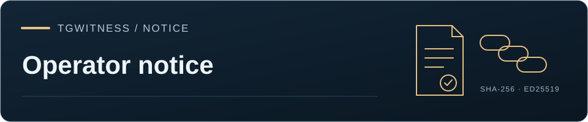
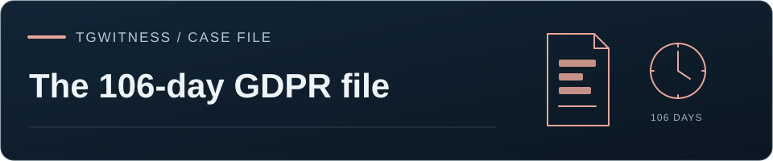

<!-- Generated by tools/sync_notice_translations.py from website/i18n. -->

<a href="README.md">TgWitness</a> / <a href="README.md">Документація</a>

<h1>ПОВІДОМЛЕННЯ — Несумісність з операторами</h1>

<a href="../OPERATOR-INCOMPATIBILITY.md" lang="en">English</a>

<strong>PhishDestroy · Повідомлення про проєкт TgWitness</strong>

<a href="https://phishdestroy.io/steam_dossier/taylor_wessing">Вихідний запис</a> · <a href="../../NOTICE">Оригінальне ПОВІДОМЛЕННЯ</a> · <a href="../TAYLOR-WESSING-GDPR-FILE.md">Розбір GDPR-файлу: 106 днів</a>

<h2 id="-ethical-notice--historical-continuity">⚖️ Етичне повідомлення та історична спадкоємність</h2>

Ми дізналися, що для певних юридичних фірм — зокрема<strong>, для доктора Тобіаса Шелінського</strong> та <strong>доктора Патріка Вінсента Цурхайде</strong> — математика, технічна добросовісність та об’єктивні факти не мають значення.

Продавати корпораціям послуги з порушення GDPR, при цьому не дотримуючись елементарних вимог щодо обробки даних, не є проявом юридичної компетентності. Підпис елітного фахівця на сфальсифікованій претензії не приховує технічної некомпетентності.

Цей інструмент несумісний із юрисдикціями, де переважають такі норми:

<ul>
<li><strong>Корпоратократія</strong></li>
<li><strong>Приватизоване правосуддя</strong></li>
<li><strong>Плутократія</strong></li>
<li><strong>Клептократія та інституційна корупція</strong></li>
</ul>
<blockquote>

Taylor Wessing (д-р Тобіас Шелінскі та д-р Патрік Вінсент Цурхайде) → Wessing &amp; Berenberg-Gossler → <a href="https://www.taylorwessing.com/fr/insights-and-events/news/media-centre/press-releases/2020/01/we-are-a-stonewall-top-100-employer-for-third-year-running">Stonewall Top 100</a> → д-р Граф фон дер Гольц, д-р Вессінг та партнери (з 1957 року) → Рюдігер Граф фон дер Гольц → <a href="https://de.wikisource.org/wiki/Gesetz_zur_%C3%84nderung_des_Strafgesetzbuchs_(1935)">Стаття 175 у редакції 1935 року</a>

</blockquote>

<h3 id="1-what-are-people-supposed-to-do-when-lawyers-edit-their-own-reputation">1. Що мають робити люди, коли адвокати редагують власну репутацію?</h3>

Що мають робити клієнти та регуляторні органи, коли юристи керують своєю репутацією, вручну видаляючи докази з пошукових систем? Сліпо довіряти їхньому підпису? Яка справжня ціна цього? Або ж тепер формула звучить просто: <strong>видалити з Google = справа зроблена?</strong>

<ol>
<li><strong>Стаття 15 GDPR залишається невиконаною вже понад рік;</strong></li>
<li><strong>Двоє підписантів прямо суперечили один одному в офіційних документах:</strong> Шелінський засвідчив 1 938 скарг як доказ провини <em>«незалежно від деталей»</em>; Цурхайде надав 2 002 записи з 64 ін’єкціями після введення заборони, стверджуючи, що затримка на 106 днів була спричинена <em>«ручним редагуванням»</em> файлу, складеного за <strong>36 секунд</strong> <code>Aspose.PDF for .NET 20.8</code>;</li>
<li><strong>Юристи діють, перебуваючи в омані, що корпоративні звинувачення мають перевагу над законодавчими нормами щодо розкриття інформації.</strong></li>
</ol>
<h3 id="2-both-doctors-personally-used-the-right-to-be-forgotten--it-is-not-magic-we-have-not-forgotten">2. Обидва лікарі особисто скористалися «правом на забуття» — це не магія, ми не забули</h3>
<ul>
<li>Після проведення нами технічного аудиту пошкодженого PDF-файлу з вилученою інформацією <strong>д-р Патрік Вінсент Цурхайде подав повідомлення про видалення з пошукової видачі відповідно до ст. 17 GDPR.</strong></li>
<li><strong>Рівно через 3 дні доктор Тобіас Шелінський подав власне повідомлення про видалення з пошукових систем.</strong></li>
<li>Протягом 4 місяців це переросло у систематичну кампанію з видалення будь-якої обґрунтованої критики з пошукових систем.</li>
</ul>

<strong>Це не була помилка алгоритму. Це не було чаклунством.</strong> Це було навмисне порушення законів про захист персональних даних двома докторами юридичних наук з метою приховати докази власної технічної недбалості. Ми цього <strong>не забули.</strong>

<h3 id="3-the-doctor-prefix-vs-cryptographic-reality">3. Префікс «Доктор» проти криптографічної реальності</h3>

Докторська дисертація — це <strong>історичний звіт</strong> про минулі теоретичні дослідження у вузькій спеціалізованій галузі. Вона не надає жодних компетенцій у сфері бінарних форматів або безпеки даних:

<ul>
<li>Заголовок не може виправити помилкові дані, а підпис еліти не може перетворити процедурну неправду на факт.</li>
<li>У криптографічній верифікації академічні префікси мають <strong>нульову ентропію</strong>: апаратні чіпи (TPM, Secure Enclave), ланцюжки хеш-функцій SHA-256, часові мітки RFC 3161 та консенсус Bitcoin не зважають на докторські бланки.</li>
</ul>
<h3 id="4-taylor-wessing-without-taylor-is-just-wessing--and-how-history-is-purged">4. «Taylor Wessing» без «Taylor» — це просто «Wessing», і як викреслюють історію</h3>

Позначення агресивної реферальної мережі як «децентралізації» є лише <strong>корпоративним прикриттям для уникнення юридичної відповідальності.</strong> Коли порушення викриваються, єдиний глобальний бренд розпадається на окремі структури, щоб захистити керівництво.

<ul>
<li><strong>Тейлор пішов:</strong> британське відділення відокремилося (<em>Вінстон Тейлор</em>, червень 2026 року). Німеччині залишився <strong>Вессінг</strong> — мережа фрілансерів під дорогою вивіскою.</li>
<li><strong>Двічі видалено з Вікіпедії:</strong> фірма двічі видалила з німецької <a href="https://de.wikipedia.org/wiki/Taylor_Wessing#Geschichte">Вікіпедії</a> задокументовану інформацію про звільнення <strong>всіх 95 студентів-стажерів (<code>wissenschaftliche Mitarbeiter</code>)</strong> на початку пандемії COVID-19 у березні 2020 року (<a href="https://www.juve.de/nachrichten/verwaltung/2020/03/corona-krise-taylor-wessing-kuendigt-allen-wissenschaftlichen-mitarbeitern">JUVE</a>).</li>
<li><strong>Засновник Рюдігер Граф фон дер Гольц:</strong> (НСДАП <code>#1,033,215</code>, радник Геббельса, <a href="https://www.digitale-sammlungen.de/en/view/bsb00000146?page=224">депутат Рейхстагу</a>) був одним <strong>із 8 членів Комісії з кримінального права</strong> (<a href="https://resolver.sub.uni-hamburg.de/kitodo/PPN689065124_19331125">призначений 25 листопада 1933 року</a>; <a href="https://api.pageplace.de/preview/DT0400.9783110892055_A36623967/preview-9783110892055_A36623967.pdf#page=16">протоколи</a>), які розробили та ухвалили <strong><a href="https://de.wikisource.org/wiki/Gesetz_zur_%C3%84nderung_des_Strafgesetzbuchs_(1935)">нацистську редакцію 1935 року параграфа 175</a></strong> (<a href="https://encyclopedia.ushmm.org/content/en/article/paragraph-175-and-the-nazi-campaign-against-homosexuality">USHMM</a>).</li>
</ul>
<h3 id="5-the-485-line-stochastic-challenge-to-dr-tobias-schelinski">5. «Стохастичний виклик» з 485 рядків для доктора Тобіаса Шелінського</h3>

Шелінський засвідчив 1 938 скарг як докази, не прочитавши їх — хоча <strong>понад 500</strong> з них <strong>містять прямі висловлювання етнічної ненависті та нацистську військову пропаганду (<code>[REDACTED]</code>)</strong>.

<blockquote>

Ми пропонуємо провести ретельний експеримент: виокремити рівно 25 % корпусу — ⌈1 938 × 0,25⌉ = 485 рядків — шляхом стохастичної вибірки без заміщення (перетасування за алгоритмом Фішера–Йейтса з початковим значенням, що є публічним хешем SHA-256 набору даних із 70 717 слів).

<strong>Чи готовий доктор Шелінський переглянути ці 485 випадково відібраних записів і публічно пояснити, чому цей вміст є «несуттєвим»?</strong>

Якщо він зможе переконливо довести, що цей вміст не має істотного значення, <strong>ми негайно визнаємо свою помилку, публічно вибачимося та видалимо всі згадки про його ім’я.</strong>

</blockquote>

Тим часом у 830-сторінковому PDF-файлі Цурхайде 100 % тексту залишалося доступним для вилучення під векторними рамками:

<ul>
<li>У крихітній 2-відсотковій вибірці, яку навмисно залишено видимою, <strong>запис № 1 у рядку 1 є нередагованим гомофобним висловом (<code>[REDACTED]</code>)</strong> — що створює іронічний контраст з історією фірми (засновник Гольц, параграф 175) та її маркетинговою кампанією <a href="https://www.taylorwessing.com/fr/insights-and-events/news/media-centre/press-releases/2020/01/we-are-a-stonewall-top-100-employer-for-third-year-running">Stonewall Top 100</a>.</li>
<li>Зразок розміщено <strong>після накладення постійної заборони</strong>, у ньому використовуються <strong>стандартні імена користувачів</strong>, а конкретні часові мітки були вибірково видалені (<code>2025-08-</code>) з метою приховування інтервалів автоматизованих дій.</li>
</ul>
<h3 id="6-asposepdf-208-free-software--state-archives-after-dec-1-2026">6. Aspose.PDF 20.8, Вільне програмне забезпечення та державні архіви (після 1 грудня 2026 року)</h3>

Ми не знаємо, на якій підставі корпорація була звільнена від дотримання GDPR, але їхні елітні зволікання та фірмовий бланк коштували чимало. У їхньому PDF-файлі містився <strong><code>Aspose.PDF for .NET 20.8</code></strong> (придбаний у <strong>серпні 2020 року</strong>, ліцензія ніколи не поновлювалася — адже платити за програмне забезпечення не для елітних ІТ-юристів!).

<ul>
<li>Якщо ви видаляєте результати пошуку, бо вам соромно, що ви не платили за програмне забезпечення з 2020 року: <strong><code>TgWitness</code> є повністю безкоштовним (<a href="https://github.com/phishdestroy/TgWitness/blob/main/LICENSE">ліцензія MIT</a>)</strong> — з ізольованими контейнерами та справжнім шифруванням.</li>
<li><strong>Це не смішно. Смішно спостерігати, як елітні юристи місяцями намагаються видалити з Google згадки про цю вразливість. Zero Trust.</strong></li>
<li>Якщо ви читаєте це після <strong>1 грудня 2026 року</strong>: ці записи назавжди зберігаються в <strong>Державному архіві Німеччини (<em>Staatsarchiv / Bundesarchiv</em>)</strong> та іноземних судових архівах, де їх неможливо видалити за допомогою веб-форми «Право на забуття».</li>
</ul>

<a href="../../LICENSE">Ліцензія MIT</a> · <a href="../TAYLOR-WESSING-GDPR-FILE.md">Розбір GDPR-файлу: 106 днів</a> · <a href="../HOW-IT-WORKS.md">Модель доказів</a>

<a href="README.md">Проєкт</a> · <a href="README.md">Документація</a> · <a href="../wiki/Home.md">Вікі</a>

