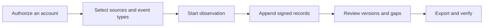

[English](../../README.md) · [Русский](../ru/README.md) · **Українська** · [Español](../es/README.md) · [Português (Brasil)](../pt/README.md) · [Türkçe](../tr/README.md) · [العربية](../ar/README.md) · [فارسی](../fa/README.md) · [اردو](../ur/README.md) · [हिन्दी](../hi/README.md) · [Bahasa Indonesia](../id/README.md) · [Tiếng Việt](../vi/README.md) · [简体中文](../zh/README.md)


<p align="center">
  <strong>Ваш робочий простір для спостереження за Telegram.</strong><br>
  Зберігайте записані розмови, відстежуйте зміни та діліться підписаною історією.<br>
  На вашому власному комп’ютері або сервері. З вашими власними акаунтами.
</p>

<p align="center">
  
  
  
  
  
</p>

<p align="center">
  <a href="#швидкий-старт">Швидкий старт</a> ·
  <a href="#функції">Функції</a> ·
  <a href="#підключіть-обліковий-запис-telegram">Акаунти</a> ·
  <a href="#докази-та-перевірка">Докази</a> ·
  <a href="#розгортання">Розгортання</a> ·
  <a href="../README.md">Документація</a>
</p>

> [!TIP]
> **Ознайомтеся з проектом, перш ніж підключатися.** Запустіть `scripts\Demo.cmd` або `sh start.sh --demo`, щоб відкрити робочу область з вигаданими діалогами. Акаунт у Telegram не потрібен.

**Новий користувач?** [Почати →](QUICKSTART.md) · [Вікі →](../wiki/Home.md) · [Обрати посібник →](../README.md) · [Отримати допомогу →](../../.github/SUPPORT.md) · [Переглянути, що вже перевірено →](../VERIFICATION.md)

> [!WARNING]
> **Використовуйте спеціальний акаунт у Telegram, втрату якого ви зможете собі дозволити.** Ми настійно не рекомендуємо підключати особисті або цінні акаунти, а також створювати на них облікові дані API ID / API hash. Telegram може обмежити доступ до акаунтів або назавжди заблокувати їх. [Ознайомтеся з інструкцією щодо акаунтів](../ACCOUNTS.md).

## Функції

- **Історія розмов.** Переглядайте збережені повідомлення, порівнюйте зафіксовані редагування та переглядайте повідомлення про видалення в контексті розмови.
- **Спостереження на ваших умовах.** Обирайте окремі чати, папку Telegram або весь акаунт. Кожен акаунт має власний робочий простір та налаштування.
- **Експортні дані, які можна перевірити.** Підписаний ZIP-файл, оригінальні записи, збережені вкладення та офлайн-звіт у форматі HTML. Опціональний захист паролем для передачі даних.
- **Створено для щоденного використання.** Світла та темна теми, 13 мов, пошук, навігація за допомогою Ctrl/Cmd+K та дії безпосередньо з чатів.

<details>
<summary>Усі можливості та технічні деталі</summary>

- **Ваш маршрут підключення.** У розділі **«Акаунт» → «Налаштування проксі**» виберіть один із вбудованих публічних списків MTProxy, оновіть їх із джерел або вставте власне посилання на проксі Telegram. Ручне налаштування SOCKS5/HTTP/MTProxy та каталог операторів залишаються доступними. Публічні списки завантажено та відфільтровано, але жоден акаунт ще не підключався через сервер із цього списку. [Як працюють публічні списки](../CONNECTION-SECURITY.md#public-proxies-supplied-by-your-installation).

- **Журнал того, що насправді бачать ваші акаунти.** Нові повідомлення, редагування, повідомлення про видалення, реакції, події, пов’язані з членством, та прогалини у висвітленні з груп та каналів, які ви обираєте.
- **Вибрані чати, папка Telegram або весь акаунт.** Виберіть типи для запису — канали, групи, приватні чати, боти — і нові чати додаватимуться одразу після їх появи. Виключення: власні вихідні повідомлення та редагування, видалення у приватних чатах із відповідним чатом, пріоритетні повторні перевірки та обмеження на вкладення за типом ([колекція](../COLLECTION.md#observation-scope-chosen-chats-a-folder-or-the-whole-account)).
- **Режим розслідування.** Одне натискання кнопки створює спеціальний обліковий запис, який приєднується до команд та спілкується з ботами: усе, що він бачить і надсилає, записується; кнопки під повідомленнями ботів (посилання, веб-додатки, тексти для копіювання) зберігаються, а редагування за допомогою кнопок створюють нові версії; кожен новий чат або бот одразу отримує свій профіль (опис, команди, учасники) та збережені попередні видимі повідомлення ([режим розслідування](../COLLECTION.md#investigation-mode-joining-teams-and-talking-to-bots)). У **посібнику** панелі **«Спеціальний обліковий запис**» (`/dedicated-account.html`) пояснюється, чому не можна використовувати основний обліковий запис, чому TgWitness працює через пари хеш/ID публічних додатків і чому сама по собі пара API не надає доступу до вашого облікового запису (з посиланнями на документацію Telegram), а також наведено способи створення додаткового облікового запису.
- **Дійте безпосередньо з чатів.** Надсилайте повідомлення та відповіді, натискайте кнопки зворотного виклику/текстового повідомлення бота або переглядайте запрошення в Telegram і приєднуйтесь. Вибраний обліковий запис виконує дію; запити, попередній перегляд запрошень та спливаючі вікна бота/відповіді з URL-адресами потрапляють до його підписаного журналу ([міні-клієнт панелі](../COLLECTION.md#act-from-the-panel)).
- **Покриття, яке можна вказати.** У звітах та верифікаторі зазначається «постійно спостерігалося з X до Y», перелічуються прогалини з їхніми причинами та ідентифікаторами повідомлень, які ніколи не спостерігалися — при цьому вони ніколи не подаються як видалені.
- **Профілі користувачів, можливість підписки в кожному чаті.** Історія імен та імен користувачів, прапорці Telegram, SHA-256 та pHash аватарів, активність, хто кому відповідає, а також згадані гаманці, номери телефонів, імена користувачів та посилання — все це побудовано виключно на основі збережених записів, кожен факт має відповідний запис у журналі, експортований як окремий підписаний файл ([модель доказів](../EVIDENCE.md#people-profiles)).
- **Незалежний свідок.** Окремий процес із власним ключем та ботом отримує підписану заголовну частину журналу, публікує її у каналі Telegram та повідомляє, коли колектор не відповідає; верифікатор перевіряє експортовані дані на відповідність цій заголовній частині. Інтервал, час очікування, які перевірки публікуються та формулювання публікацій — це параметри або файл конфігурації у форматі JSON ([witness](../WITNESS.md)). Тестування проводилося на локальному сервері Bot API, поки що без використання реального бота та каналу.
- **Налаштування збору даних у панелі.** Обмеження та темп збору, повторні перевірки, завантаження, профілі користувачів, сповіщення та експорт знаходяться на сторінці **«Параметри»** разом із діапазонами значень та значеннями за замовчуванням; кожна зміна фіксується у підписаному журналі ([налаштування та параметри](#налаштування-та-параметри)).
- **Редагування та видалення в контексті.** Кожне редагування — це окрема версія, що відображається поруч із попередньою; повідомлення про видалення ніколи не стирає вміст, який вже було збережено.
- **Підписані, перевіряємі експортні файли.** Кожна подія має хеш-ланцюжок (SHA-256) та підпис (Ed25519). Підписаний ZIP-архів містить файли у форматах JSONL, CSV, офлайн-звіт у форматі HTML, збережені медіафайли та автономний верифікатор.
- **Експорт даних із захистом паролем.** За бажанням будь-який експорт можна упакувати у ZIP-архів із шифруванням AES-256 за допомогою WinZip; цей формат підтримують 7-Zip та WinRAR; підписаний вміст залишається незмінним. Тестовий архів відкривався байт за байтом у libarchive (Windows `tar`), а при введенні неправильного пароля доступ було відхилено ([модель доказу](../EVIDENCE.md#investigation-handoff)).
- **Повідомлення.** Проблеми (недостатньо місця на диску, вихід з облікового запису, помилки колектора, копіювання або часових міток), зміни в спостережуваних чатах та щоденний звіт, що надсилаються через [Apprise](https://github.com/caronc/apprise) до Matrix, Telegram, Discord, Slack, ntfy, електронної пошти та багатьох інших сервісів — без тексту повідомлень, якщо ви не увімкнете витяги — та відображаються на панелі. Доставка перевіряється на локальному кінцевому пункті; самі сервіси ще не тестувалися.
- **13 мов інтерфейсу:** англійська, російська, українська, іспанська, португальська (Бразилія), турецька, арабська, перська, урду, хінді, індонезійська, в’єтнамська та спрощена китайська, перекладені за допомогою DeepL. У новіших розділах використовується чітко каталогізований запасний текст англійською мовою; елементи керування міні-клієнтом залишаються англійськими. Вміст Telegram та записи журналу завжди відображаються саме так, як були збережені.
- **Світла та темна теми.** За замовчуванням використовуються системні налаштування; вибір теми запам'ятовується для кожного браузера окремо.
- **Навігація за допомогою клавіатури.** Натисніть **Ctrl+K** (Mac: **⌘K**) або виберіть **«Перейти до…»**, щоб знайти розділ. Використовуйте клавіші зі стрілками та Enter, щоб відкрити його; клавіша Escape закриває меню.
- **Кілька облікових записів.** Необмежена кількість ізольованих робочих просторів, кожен із яких має власну сесію Telegram, журнал, ключ підпису, маршрут проксі та політику збору даних.
- **Гнучкі способи входу:** номер телефону + код + двофакторна автентифікація (2FA), QR-код, Telethon/Pyrogram `.session`, Telegram Desktop TData ZIP, Telethon StringSession або повний ключ автентифікації з його DC ID.
- **Проксі-сервери для кожного облікового запису.** SOCKS5 та HTTP CONNECT, протестовані на локальних тестових проксі-серверах, а також експериментальний MTProxy, який ще не тестувався на реальному сервері. У разі збою проксі-сервер ніколи не переходить у тихому режимі на пряме з’єднання.
- **Приватність за замовчуванням.** Працює на вашому комп’ютері або сервері. Вбудований веб-інтерфейс, без Node.js, без хостингових сервісів, без телеметрії. Сесії, облікові дані API та секретні дані проксі зберігаються у зашифрованому сховищі.
- **Простота у використанні.** Двічі клацніть у Windows, запустіть один скрипт у Linux/macOS або скористайтеся Docker Compose з опціональним автоматичним HTTPS. Наразі тестувалися лише запускачі для Windows; перегляньте, [що вже було перевірено](#що-було-протестовано).

</details>

## Швидкий старт

| Платформа | Як розпочати | Необхідні вимоги |
| --- | --- | --- |
| **Windows, нічого не встановлено** | Завантажте `TgWitness-<version>-windows-amd64-portable.zip` з [розділу «Випуски»](../../../../releases), розпакуйте, двічі клацніть **`TgWitness.cmd`** | Нічого; Python входить до комплекту |
| Windows, зі вихідного коду | Двічі клацніть на **`Start.cmd`** | Python 3.11+; пропонується та встановлюється автоматично, якщо його немає |
| Linux / macOS | `sh start.sh` | Python 3.11+ з `venv`; якщо скрипт відсутній, він виведе команду встановлення для вашої системи |
| Docker, будь-яка ОС | Двічі клацніть на **`scripts\Docker.cmd`** або запустіть `sh scripts/docker-start.sh` | Docker Engine/Desktop із Compose 2.20+ |

1. Відкрити **http://127.0.0.1:8787**.
2. Вставте токен доступу до панелі:
   - портативна версія або установка з вихідного коду: вміст `data/live/panel-token.txt`
   - Docker: надруковано за допомогою `scripts\Docker.cmd`/`scripts/docker-start.sh` або `docker compose exec tgwitness cat /data/panel-token.txt`
3. Додайте свій акаунт у Telegram, виберіть чати для спостереження та натисніть **«Почати спостереження**».

Перший запуск вихідного коду створює приватний `.venv` та встановлює закріплені залежності (потрібен доступ до Інтернету). Допоміжні програми Docker створюють образ, чекають, поки панель не запрацює належним чином, і виводять її адресу та токен. `python start.py --check` (або `TgWitness-Check.cmd` у портативному пакеті) надає звіт про готовність, не зачіпаючи Telegram.

> **Просто хочете подивитися?** Запустіть **`scripts\Demo.cmd`** або `sh start.sh --demo`. Вигаданий журнал відкриється безпосередньо в браузері; обліковий запис Telegram не підключається, а дані зберігаються окремо в `data/demo`.

<details>
<summary><strong>Всередині робочого простору: чати, історія та експорт даних</strong></summary>

<picture>
  <source media="(prefers-color-scheme: dark)" srcset="../assets/chats-dark.png">
  
</picture>

### Історія спостережень


### Підписані експортовані дані


</details>


## Підключіть обліковий запис Telegram

> [!CAUTION]
> Підключайте лише спеціальні акаунти, втрату яких ви можете собі дозволити. Telegram може назавжди та непередбачувано заблокувати акаунти; див. попередження у верхній частині цієї сторінки. У **посібнику** **щодо** **спеціальних акаунтів** на панелі (бічна панель або `/dedicated-account.html`) пояснюється, чому та як їх створити.

Увійдіть за допомогою телефону, QR-коду або існуючої сесії — API-ідентифікатор чи хеш не потрібні.

**Навіщо вбудований пул API?** Відомо, що створення власного API-ідентифікатора на [my.telegram.org](https://my.telegram.org) призводить до обмеження доступу до облікових записів, а Telegram не оприлюднює чітких обмежень — багато дослідників втратили свої основні облікові записи саме таким чином. На власній сторінці Telegram [«Отримання API-ідентифікатора»](https://core.telegram.org/api/obtaining_api_id) зазначено, що акаунти, які використовують неофіційні API-клієнти, автоматично потрапляють під спостереження, а помилково заблокованих користувачів перенаправляють на recover@telegram.org. Тому TgWitness надає загальнодоступні пари API, які вже використовуються іншими клієнтами з відкритим кодом, тож вам ніколи не доведеться створювати власний. Якщо у вас є власний API-ідентифікатор, введіть його в поле **«API ID + Hash»,** і він буде використаний замість стандартного.

Якщо пара не введена, не імпортована або ще не збережена в робочому просторі, TgWitness вибирає одну з 50 пар у пулі та переходить до наступної, якщо Telegram відхиляє одну з них. Пара, яка увійшла в систему, залишається прив’язаною до цього облікового запису. Пара ідентифікує додаток; ви все одно авторизуєте свій обліковий запис Telegram окремо. Токен доступу до панелі відкриває TgWitness і не пов’язаний із входом у Telegram.

| Що у вас є | Як ним користуватися |
| --- | --- |
| Номер телефону з доступом до облікового запису | Вкладка **«Телефон**»: код із Telegram, а потім пароль 2FA, якщо ця функція увімкнена |
| Додаток Telegram, у якому вже здійснено вхід | Вкладка **«QR-код**»: Налаштування → Пристрої → Підключити настільний пристрій |
| Telethon (схема 7/8) або Pyrogram (схема 2/3) `.session` | Вкладка **«Файли»** |
| Пара `name.session` + `name.json` | На вкладці **«Файли**» виберіть обидва; у файлі JSON вказано ідентифікатор API та хеш |
| Папка Telegram Desktop `tdata` | Тільки ZIP-файли `key_datas` та `D877F783D5D3EF8Cs`, потім **«Файли»**; локальний пароль, якщо встановлено |
| Telethon StringSession, `.txt` або `.tgwitness-session` | Вкладка **«Файли»**, *«Пароль» або текст сеансу* |
| JSON-файл облікового запису із сесією або ключем автентифікації | Вкладка **«Файли»** |
| Повний ключ автентифікації (512 шестнадцяткових символів) + DC ID | Вкладка **«Ключ автентифікації»**; опціональний ідентифікатор користувача перевіряється у Telegram |

Не підтримується: сховище TDLib, рядки сеансів Pyrogram, токени ботів, TData для кількох облікових записів та масові списки облікових записів. Файли конвертуються в пам’яті на вашому сервері та перевіряються Telegram перед збереженням. У посібнику з облікових записів ([посібник з облікових записів](../ACCOUNTS.md)) крок за кроком пояснюється кожен формат: як отримати облікові дані API, як розпізнати файл, поля JSON, обмеження та повідомлення про помилки.

Після входу відкрийте **розділ «Джерела»** (ваші чати завантажуються автоматично), додайте потрібні групи, виберіть, що потрібно фіксувати (наприклад, *повідомлення, редагування та видалення*), і розпочніть спостереження. Не зупиняйте процес: **пауза спостереження** зупиняє збір даних, а **блокування** лише закриває доступ через браузер.

## Знімки екрана

| Порівняння редагувань | Джерела та політика збору даних |
| --- | --- |
|  |  |
| **Підписані експортовані дані** | **Увійти** |
|  |  |
| **Журнал** | **Темна тема** |
|  |  |

Усі знімки екрана містять синтетичні демонстраційні дані. QR-код у [файлі qr-login.png](../assets/qr-login.png) кодує вигаданий токен із тестового каналу.


## Як це працює



Кожен робочий простір належить одному обліковому запису Telegram. Колектор приймає оновлення від клієнта цього облікового запису, застосовує збережену політику збору даних та додає спостереження до журналу, який можна лише доповнювати.

| Спостереження | Що зберігається | Межі |
| --- | --- | --- |
| Нове повідомлення | Текст, ідентифікатор відправника, посилання на відповідь, метадані, час спостереження | Оновлення надсилаються лише для вибраних джерел |
| Редагувати | Окрема версія вмісту | Проміжні версії, пропущені під час відсутності підключення до мережі, не можна відновити |
| Видалення | Ідентифікатор повідомлення та всі раніше записані дані | Telegram зазвичай не вказує, хто і коли видалив повідомлення |
| Реакції | Кількість та останні ідентифікаційні дані, якщо вони надані | Це лише знімок, а не повний журнал змін |
| Членство | Сервісні повідомлення та оновлення для учасників | Не кожне повідомлення про приєднання/вихід гарантовано буде отримано |
| Вкладення | Додатковий файл з адресацією за змістом із SHA-256 | Файли можуть зникнути до завантаження; результати зберігаються |
| Охоплення | Запуск, зупинка, відключення, сигнали активності, зміни політики | Наявність активності не є доказом повного захоплення |
| Знімок історії | Останні видимі повідомлення, до 500, якщо інше не вказано в **параметрах**, з явною позначкою | Неможливо відновити пропущені редагування або видалення |

Дізнайтеся, [як працює збір даних](../COLLECTION.md) щодо політик, черг вкладень та перезапусків.

## Налаштування та параметри

Усі зміни здійснюються в панелі управління для кожного робочого простору окремо, без редагування коду чи файлів конфігурації. Кожна зміна області дії, політики чи параметра фіксується у підписаному журналі із зазначенням значень до та після зміни, а на початку кожного спостереження вказуються діючі значення.

| Де | Що потрібно налаштувати |
| --- | --- |
| **Джерела** | Область застосування (вибрані чати, папка Telegram, весь акаунт), типи джерел, виключення, власні дії, які зміни зберігати, типи вкладень та їх розмір за типом (1–2 000 МіБ), інтервал повторної перевірки для пріоритетних та інших чатів (будь-яка кількість хвилин, 0 = вимкнено), знімки історії, сповіщення |
| **Експорт** | Захищені паролем завантаження, режим доказів (інтервал, авторитети часових міток та календарі), зовнішня копія на S3 (інтервал, зберігання та режим Object Lock) |
| **Witness** | Токени свідків, доступні лише для читання; власні параметри свідка відображаються за допомогою готових команд |
| **Параметри** | Розмір списку чатів та його оновлення, інтервали пульсу та контрольних точок, буфер запуску, як повторні перевірки розподіляють запити (перша затримка, кількість чатів за прохід, пауза, відновлені та повторно запитані повідомлення), резерв дискового простору, тайм-аут завантаження, швидкість та кількість повторних спроб, що шукають профілі користувачів, включаючи ваші власні регулярні вирази, розмір та частота сповіщень, знімок, обмеження на ZIP-файли та завантаження через браузер, тайм-аут дій на панелі, тайм-аути та повторні спроби клієнта Telegram |

Значення **параметрів** показують їх діапазон та значення за замовчуванням; змінені параметри позначені та можуть бути відновлені поодинці або всі одразу. Вони застосовуються з наступного використання; тайм-аути та повторні спроби клієнта Telegram — з наступного підключення. Обмеження розміру ZIP-архіву понад 4 ГіБ вимагає `verify.py --max-gib N` під час перевірки архіву ([операції](../OPERATIONS.md#panel-layout)).


## Докази та перевірка

| Експорт | Зміст | Цілісність |
| --- | --- | --- |
| **Підписаний ZIP-файл** | JSONL, CSV, HTML-звіт, охоплення, медіа, маніфест, верифікатор | Підписані події та підписаний маніфест кожного файлу із зазначенням автора. Використовуйте це для передачі даних. |
| JSONL | Оригінальні записи з хешами та підписами | Підписи Ed25519 та ланцюжок хешів для кожної події |
| CSV / HTML | Таблиця, сумісна з електронними таблицями / звіт, доступний для перегляду в автономному режимі | Міститься виключно у підписаному ZIP-файлі |
| JSON-файл контрольної точки | Довжина журналу та хеш заголовка | Підписано окремо; зберігайте його поза колектором |
| JSON-файл з квитанцією про запуск | Хеші коду, версії залежностей, сфера застосування, налаштування | Окремо підписана заява про процес |
| Профілі користувачів у форматі JSON | Профілі одного чату з посиланнями на записи | Підписана заява; хеші записів перевірено щодо ZIP-архіву |
| Журнал «Witness» у форматі ZIP | Кількість отриманих свідчень, пропущених відповідей, публікацій у каналі | Підписано власним ключем свідка |

Фільтри впливають лише на перегляд; експортовані дані завжди містять повний журнал аж до заданого порядкового номера. Перевірте архів за допомогою надійної копії верифікатора та незалежно збереженого відбитка ключа й контрольної точки:

```sh
python -m pip install cryptography
python tgwitness/verify.py tgwitness-evidence.zip --fingerprint TRUSTED_PUBLIC_KEY_SHA256 --checkpoint tgwitness-checkpoint.json
# with an independent witness and its channel (Telegram Desktop export)
python tgwitness/verify.py tgwitness-evidence.zip --fingerprint TRUSTED_PUBLIC_KEY_SHA256 \
    --witness witness.zip --witness-fingerprint WITNESS_SHA256 --channel result.json
```

Верифікатор виводить підписаного виробника, періоди безперервного спостереження, пропуски та ідентифікатори повідомлень, які ніколи не спостерігалися, і видає помилку, якщо журнал відрізняється від будь-якого заголовка, який бачив свідок.

Підписи забезпечують захист від несанкціонованого втручання щодо надійного ключа підпису. Вони **не** підтверджують походження з Telegram, достовірність вмісту чи надійний час, а також не захищають від оператора, який контролює колектор та його ключ. Для забезпечення надійного часу режим «timestamp procedure» (за замовчуванням вимкнений) порівнює контрольні точки з авторитетними джерелами RFC 3161 та календарями OpenTimestamps, або панель готує офлайн-запит за стандартом RFC 3161 ([процедура фіксації часових міток](../TIMESTAMP.md)). Обидва варіанти тестуються на локальних тестових серверах, але поки що не на публічних сервісах. Дивіться модель доказів ([модель доказів](../EVIDENCE.md)) та контрольний список передачі розслідування ([передача розслідування](../EVIDENCE.md#investigation-handoff)).

## Розгортання

> [!NOTE]
> Наведені нижче налаштування Docker, Caddy (HTTPS), systemd та launchd підготовлені, а їхні файли пройшли перевірку на синтаксис, але жодне з них ще не запускалося. Портативний пакет для Windows та запуск з вихідного коду в Windows вже запускалися.

**Локальний або одиночний сервер із Docker:**

```sh
docker compose up -d --build --wait
docker compose exec tgwitness cat /data/panel-token.txt
```

Контейнер працює під обліковим записом користувача без прав суперкористувача з файловою системою, доступною лише для читання, публікує дані лише за адресою `127.0.0.1:8787` та зберігає всі дані в іменованому томі.

**Публічний сервер з автоматичним HTTPS (Caddy):** скопіюйте `deploy/env.example` у `.env`, налаштуйте `TGWITNESS_DOMAIN`, вкажіть DNS на сервер, відкрийте порти TCP 80/443 та запустіть

```sh
docker compose -f compose.yaml -f deploy/compose/compose.https.yaml up -d --build --wait
```

**Windows без встановлення додаткових програм:** портативний ZIP-файл, що додається до кожного випуску, містить офіційне вбудоване середовище виконання Python та всі необхідні залежності. Дані зберігаються у папці `data`; для оновлення розпакуйте нову версію та скопіюйте цю папку.

**Без Docker:** шаблони для systemd, завдання входу в систему Windows та launchd знаходяться в [папці deploy/.](../../deploy/README.md) Оновлення, резервні копії, альтернативні порти та образи GHCR (як тільки їх опублікує робочий процес випуску) описані в [розділі розгортання](DEPLOYMENT.md).

### Командний рядок

```text
python start.py [--demo] [--setup-only] [--check [--json]] [--host HOST] [--port PORT] [--data-dir DIR]
```

| Завдання | Команда (з середовища проекту) |
| --- | --- |
| Перевірка готовності без запуску | `python start.py --check` |
| Перетворення сеансу Telethon SQLite в автономний режим | `python -m tgwitness.sessions account.session --out account.tgwitness-session` |
| Потокове передавання великого експорту на диск | `python -m tgwitness.download --token-file data/live/panel-token.txt --out evidence.zip` |
| Перевірка експортованого архіву | `python tgwitness/verify.py tgwitness-evidence.zip --fingerprint SHA256` |
| Перевірка архіву розміром понад 4 ГіБ | `python tgwitness/verify.py big-evidence.zip --fingerprint SHA256 --max-gib 16` |
| Запуск незалежного свідка з конфігураційного файлу | `python -m tgwitness.witness run --config witness.json` |

Допоміжні команди `python -m tgwitness…` повинні виконуватися всередині `.venv` (`.venv\Scripts\python.exe` у Windows, `.venv/bin/python` в інших системах).

| Змінна | Мета |
| --- | --- |
| `TGWITNESS_HOST`, `TGWITNESS_PORT` | Адреса та порт для прослуховування (за замовчуванням `127.0.0.1:8787`) |
| `TGWITNESS_DATA` | Каталог даних (за замовчуванням `data/live`) |
| `TGWITNESS_TOKEN` | Фіксований токен панелі замість згенерованого (щонайменше 24 символи) |
| `TGWITNESS_VAULT_KEY_FILE` | Зовнішній головний ключ сховища для нових інсталяцій |
| `TGWITNESS_DOMAIN`, `TGWITNESS_IMAGE` | Ім’я хосту Docker HTTPS та опублікований образ (див. `deploy/env.example`) |
| `TGWITNESS_WITNESS_*` | Незалежний свідок: колектор, токени, канал, `_INTERVAL`, `_TIMEOUT`, `_POST` (усе, зміни, проблеми), `_TITLE`, `_CONFIG` ([свідок](../WITNESS.md#options)) |


## Відповідальність та захист даних (GDPR)

TgWitness — це інструмент. Той, хто його використовує, вирішує, що збирати, чому та як довго, і несе за це відповідальність — згідно з GDPR ЄС/Великої Британії, зазвичай як *контролер* цих персональних даних. Повідомлення в Telegram містять персональні дані людей, які ніколи не давали згоди на їхнє збирання: імена, імена користувачів, ідентифікатори, фотографії, номери телефонів, думки. Цей розділ не є юридичною порадою; ознайомтеся з законодавством, яке застосовується до вас, та умовами використання Telegram.

- **Майте правову підставу та мету.** Запобігання шахрайству, мережева та інформаційна безпека, а також захист від юридичних претензій зазвичай вважаються законними інтересами (GDPR, ст. 6(1)(f), преамбули 47 та 49; ст. 9(2)(f) щодо юридичних претензій). Запишіть мету для кожного окремого випадку. Державні органи діють на підставі власних правових підстав.
- **Збирайте лише ту інформацію, яка необхідна для досягнення мети.** Почніть з обраних чатів. Режими «папка» та «весь акаунт» фіксують приватні чати та повідомлення третіх осіб: використовуйте їх лише на спеціальних акаунтах; панель запитує підтвердження, а підписаний журнал фіксує це. Вимкніть типи подій, типи вкладень та власні дії, які вам не потрібні, а також виключіть чати.
- **Профілі користувачів — це профілювання.** За замовчуванням вони вимкнені й увімкняються окремо для кожного чату. Використовуйте їх для конкретного розслідування, не базуйте на них автоматизовані рішення щодо осіб (ст. 22) та вимикайте їх або видаляйте чат після завершення роботи — це призведе до їхнього видалення. Систематичний моніторинг великої кількості осіб зазвичай вимагає проведення оцінки впливу на захист даних (ст. 35).
- **Забезпечте безпеку.** Сесії, облікові дані та ключі зберігаються у зашифрованому сховищі; розмістіть каталог даних на зашифрованому диску, захистіть експортовані дані паролем (AES-256 ZIP), забезпечте доступ до панелі через HTTPS та надайте свідку лише його токен для читання. Повідомлення не містять тексту, якщо ви не увімкнете функцію витягів, яка надсилає текст до служби сповіщень.
- **Зберігання та видалення.** Журнал працює у режимі «лише додавання», що дозволяє підтвердити його цілісність; окремі записи не можна видалити без порушення ланцюжка підписів. Плануйте термін зберігання для кожного робочого простору та видаляйте весь робочий простір (Облікові записи → Видалити) або його каталог даних після завершення мети використання. Зовнішні копії, захищені за допомогою S3 Object Lock, не можна видалити до закінчення терміну їх зберігання — вибирайте період відповідно. Право на видалення має винятки, наприклад, для встановлення або захисту правових вимог (ст. 17(3)(e)).
- **Запишіть запити від людей.** Експорт чатів та файли профілів дають змогу дізнатися, яка інформація зберігається про особу (ст. 15).
- **Нічого не надсилається авторам.** TgWitness не має телеметрії та не використовує хостингові сервіси; дані залишають ваш пристрій лише через налаштовані вами канали (Telegram, сервіси часових міток, копіювання в S3, сповіщення, witness).

## Безпека та стан проєкту


- За замовчуванням панель приймає з'єднання на localhost. Для віддаленого доступу використовуйте профіль HTTPS Compose або SSH-тунель; ніколи не використовуйте звичайний HTTP.
- Сесії Telegram, облікові дані API, облікові дані проксі та ключ підпису зберігаються у сховищі, зашифрованому за алгоритмом Fernet. За замовчуванням ключ знаходиться в тому самому каталозі даних; для використання зовнішнього головного ключа вкажіть `TGWITNESS_VAULT_KEY_FILE`. Місцевий вміст повідомлень та мультимедіа **не** шифруються TgWitness; зберігайте каталог даних на зашифрованому диску або томі. Підписані ZIP-архіви для експорту можна додатково зашифрувати паролем.
- Файли даних, сесії, токени, ключі та експортовані дані не включені до збірки git та Docker.
- Повідомляйте про вразливості конфіденційно, як описано у файлі [SECURITY.md](../../.github/SECURITY.md).

### Що було протестовано

TgWitness **0.6.1** працює на Windows 11 з Python 3.12. Стан на 29 жовтня 2026 року:

| Область | Як проводилося тестування |
| --- | --- |
| Повідомлення, редагування, видалення, вкладення, повторні перевірки після перезапуску, паузи FloodWait | Виконано за допомогою **реального облікового запису Telegram**, 27–29 жовтня 2026 року: 9 968 підписаних записів, кожна підпис та ланцюжок хешів перевірені ([тест у реальному часі](../VERIFICATION.md#live-telegram-test-whole-account--29-october-2026)) |
| Спостереження за всім акаунтом та знімки історії | Виконано за допомогою **реального облікового запису** 29 жовтня 2026 року: повідомлення з 2 груп або каналів та 3 приватних чатів і ботів |
| Натискання кнопки повідомлення в розділі **«Чати»** | Зроблено один раз із використанням **реального облікового запису** |
| Вхід за допомогою файлів сеансів Telethon/Pyrogram та TData для Telegram Desktop | Зроблено за допомогою **одного реального облікового запису** |
| Вхід за допомогою телефону, QR-коду та ключа автентифікації, додавання нових чатів до списку разом із їхніми попередніми повідомленнями, надсилання повідомлень, приєднання за запрошенням, реакції, членство, профілі користувачів, одночасне використання кількох облікових записів, експорт даних та верифікатор | Автоматизовані тести з використанням синтетичних клієнтів Telegram |
| Проксі-сервери SOCKS5/HTTP, бот-свідок, монітор Proof, сповіщення, копія на S3, RFC 3161 та OpenTimestamps | Автоматизовані тести на локальних тестових серверах |
| Публічні списки MTProxy | Завантажено та відфільтровано (118 серверів станом на 29 жовтня); зв’язок через них поки що відсутній |
| MTProxy, Docker, HTTPS із Caddy, Linux, macOS, Python 3.11 та 3.13, робочі процеси CI та релізів, тривалі перебої в роботі, незалежний аналіз безпеки | **Ще не тестовано** |

Деталі: [запис про верифікацію](../VERIFICATION.md), [статус випуску](../internal/RELEASE.md) та [готовність до використання](../internal/READINESS.md).


## Розробка

```sh
python -m venv .venv && source .venv/bin/activate     # Windows: .venv\Scripts\Activate.ps1
python -m pip install -c deploy/constraints.txt -e ".[dev]"
python -m pytest -q                                    # unit and integration tests
python -m playwright install chromium
python tools/check_browser.py                          # end-to-end UI acceptance
python tools/check_account_browser.py                  # sign-in flows
python tools/capture_screenshots.py --docs             # refresh README images
python tools/build_portable.py                         # Windows portable ZIP (Windows + Python 3.12)
python tools/build_source.py                          # source ZIP with SHA-256 manifest
python tools/build_site.py                             # static project site in dist/site
python tools/check_site.py                             # website browser acceptance
```

Набір автоматизованих тестів використовує синтетичні об’єкти Telegram і ніколи не підключається до реальних акаунтів; тестування в реальному середовищі описано вище. CI налаштовано для виконання матриці тестів на Windows, Linux та macOS із Python 3.11–3.13, перевірок браузера, пакування вихідного коду, портативної збірки для Windows та збірки Docker. Робочий процес релізу налаштований так, щоб додавати ZIP-архів із вихідним кодом, файл wheel, портативний ZIP-архів для Windows та багатоархітектурний образ GHCR до опублікованого релізу на GitHub. Жоден із цих робочих процесів ще не запускався. Перед тим, як відкривати pull-запит, прочитайте [файл CONTRIBUTING.md](../../.github/CONTRIBUTING.md).

## Документація

| Посібник | Зміст |
| --- | --- |
| [Швидкий старт](QUICKSTART.md) | Перший запуск, підключення облікового запису та перший експорт |
| [Облікові записи та формати сеансів](../ACCOUNTS.md) | Введення даних для входу, перетворення, кілька облікових записів |
| [Як працює збір даних](../COLLECTION.md) | Збирання політик, версій, вкладень, прогалин |
| [Підключення та безпека](../CONNECTION-SECURITY.md) | Проксі-сервери, шифрування та ключі |
| [Операції](../OPERATIONS.md) | Щоденний робочий процес, резервне копіювання, відновлення, ємність |
| [Розгортання](DEPLOYMENT.md) та [шаблони сервісів](../../deploy/README.md) | Сервери, контейнери, HTTPS, оновлення |
| [Модель доказів](../EVIDENCE.md) та [часові мітки](../TIMESTAMP.md) | Цілісність, охоплення, профілі користувачів, довіра та передача даних |
| [Незалежний свідок](../WITNESS.md) | Токени свідків тільки для читання, профіль Docker, публікації в каналах, перехресні перевірки |
| [Архітектура](../ARCHITECTURE.md) та [модель продукту](../PRODUCT.md) | Внутрішня структура та проектні рішення |
| [Перевірка](../VERIFICATION.md) та [готовність до роботи](../internal/READINESS.md) | Виконані перевірки та робота, що залишилася |
| [Журнал змін](../CHANGELOG.md) | Історія випусків |
| [Веб-сайт та публікації](../internal/PUBLISHING.md) | Попередній перегляд локального веб-сайту, GitHub Pages, перша публікація |


## Ліцензія

[MIT License](../../LICENSE)

## Інструкції в цій папці

| Файл | Зміст |
| --- | --- |
| [DEPLOYMENT.md](DEPLOYMENT.md) | Розгортання та експлуатація |
| [QUICKSTART.md](QUICKSTART.md) | Швидкий старт TgWitness |

[Повідомлення про несумісність ліцензії та архітектури](TAYLOR-WESSING-EXCLUSION.md) · [MIT License](../../LICENSE)
