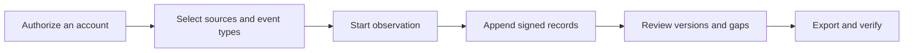

[English](../../README.md) · [Русский](../ru/README.md) · [Українська](../uk/README.md) · [Español](../es/README.md) · [Português (Brasil)](../pt/README.md) · [Türkçe](../tr/README.md) · [العربية](../ar/README.md) · [فارسی](../fa/README.md) · **اردو** · [हिन्दी](../hi/README.md) · [Bahasa Indonesia](../id/README.md) · [Tiếng Việt](../vi/README.md) · [简体中文](../zh/README.md)


<p align="center">
  <strong>آپ کا ٹیلیگرام مشاہداتی ورک اسپیس۔</strong><br>
  <strong>  </strong>
  محفوظ کردہ گفتگو کو محفوظ کریں، سمجھیں کہ کیا تبدیل ہوا، اور ایک دستخط شدہ تاریخ شیئر کریں۔<br>
     اپنے کمپیوٹر یا سرور پر۔   اپنے اکاؤنٹس کے ساتھ۔
</p>

<p align="center">
  
  
  
  
  
</p>

<p align="center">
  <a href="#تیز-آغاز">تیز آغاز</a> ·
  <a href="#خصوصیات">خصوصیات</a> ·
  <a href="#ٹیلیگرام-اکاؤنٹ-منسلک-کریں">اکاؤنٹس</a> ·
  <a href="#شواہد-اور-تصدیق">شواہد</a> ·
  <a href="#نفاذ">نفاذ</a> ·
  <a href="../README.md">دستاویزات</a>
</p>

> [!TIP]
> **جڑنے سے پہلے دریافت کریں۔** `scripts\Demo.cmd` یا `sh start.sh --demo` چلائیں تاکہ فرضی گفتگو کے ساتھ ایک ورک اسپیس کھل جائے۔ ٹیلیگرام اکاؤنٹ کی ضرورت نہیں۔

**یہاں نئے ہیں؟** [شروع کریں →](QUICKSTART.md) · [ویکی →](../wiki/Home.md) · [رہنما منتخب کریں →](../README.md) · [مدد حاصل کریں →](../../.github/SUPPORT.md) · [دیکھیں کہ کیا جانچا گیا ہے →](../VERIFICATION.md)

> [!WARNING]
> **ایک مخصوص ٹیلیگرام اکاؤنٹ استعمال کریں جسے آپ کھونے کا متحمل ہو سکتے ہیں۔** ہم سختی سے مشورہ دیتے ہیں کہ ذاتی یا قیمتی اکاؤنٹس کو منسلک نہ کریں، یا ان پر API ID/API ہیش کی کریڈینشلز نہ بنائیں۔ ٹیلیگرام اکاؤنٹس کو محدود یا مستقل طور پر بلاک کر سکتا ہے۔ [اکاؤنٹ گائیڈ پڑھ](../ACCOUNTS.md)یں۔

## خصوصیات

- **ایک تاریخ کے ساتھ گفتگو۔** محفوظ شدہ پیغامات پڑھیں، کیپچر کی گئی ترامیم کا موازنہ کریں، اور گفتگو کے سیاق و سباق میں حذف کرنے کے نوٹس دیکھیں۔
- **اپنی شرائط پر مشاہدہ۔** انفرادی چیٹس، ٹیلیگرام فولڈر، یا پورا اکاؤنٹ منتخب کریں۔ ہر اکاؤنٹ کا اپنا ورک اسپیس اور ترتیبات ہیں۔
- **ایکسپورٹس جن کی آپ تصدیق کر سکتے ہیں:** ایک دستخط شدہ ZIP، اصل ریکارڈز، محفوظ شدہ منسلکات، اور ایک آف لائن HTML رپورٹ۔ حوالگی کے لیے اختیاری پاس ورڈ تحفظ۔
- **روزمرہ استعمال کے لیے تیار۔** ہلکے اور گہرے تھیمز، 13 زبانیں، تلاش، Ctrl/Cmd+K نیویگیشن، اور چیٹس سے براہِ راست ایکشنز۔

<details>
<summary>تمام صلاحیتیں اور تکنیکی تفصیلات</summary>

- **آپ کا کنکشن راستہ۔** **اکاؤنٹ → پراکسی سیٹنگز** کے تحت، بنڈل شدہ عوامی MTProxy فہرستوں میں سے انتخاب کریں، انہیں ان کے ذرائع سے ریفریش کریں، یا اپنا Telegram پراکسی لنک پیسٹ کریں۔ دستی SOCKS5/HTTP/MTProxy اور آپریٹر کیٹلاگ دستیاب ہیں۔ عوامی فہرستیں ڈاؤن لوڈ اور فلٹر کی جاتی ہیں، لیکن ابھی تک کسی اکاؤنٹ کو فہرست شدہ سرور کے ذریعے کنیکٹ نہیں کیا گیا۔ [عوامی فہرستیں کیسے کام کرتی](../CONNECTION-SECURITY.md#public-proxies-supplied-by-your-installation) ہیں۔

- **ایک جریدہ جو آپ کے اکاؤنٹس حقیقتاً کیا دیکھتے ہیں:** نئے پیغامات، ترامیم، حذف کرنے کے نوٹس، ردعمل، رکنیت کے واقعات اور آپ کے منتخب کردہ گروپس اور چینلز کی کوریج میں خلا۔
- **منتخب کی گئی چیٹس، ایک ٹیلیگرام فولڈر یا پورا اکاؤنٹ۔** ریکارڈ کرنے کے لیے اقسام منتخب کریں — چینلز، گروپس، نجی چیٹس، بوٹس — اور نئی چیٹس نمودار ہوتے ہی شامل ہو جاتی ہیں۔ استثنا، اپنے بھیجے گئے پیغامات اور ترامیم، نجی چیٹس میں حذف شدہ مواد کو متعلقہ چیٹ کے مطابق، ترجیحی دوبارہ جانچ اور ہر قسم ([جمع](../COLLECTION.md#observation-scope-chosen-chats-a-folder-or-the-whole-account)) کے لیے منسلکات کی حدیں۔
- **تفتیشی موڈ۔** ایک بٹن ایک مخصوص اکاؤنٹ تیار کرتا ہے جو ٹیموں میں شامل ہوتا ہے اور بوٹس سے بات کرتا ہے: جو کچھ بھی یہ دیکھتا اور بھیجتا ہے ریکارڈ ہو جاتا ہے، بوٹ پیغامات کے نیچے موجود بٹن (لِنکس، ویب ایپس، کاپی کے لیے ٹیکسٹ) محفوظ کیے جاتے ہیں اور صرف بٹن کے ذریعے کی جانے والی ترامیم نئے ورژن بن جاتی ہیں، اور ہر نئی چیٹ یا بوٹ کو اپنا پروفائل (تفصیل، کمانڈز، ارکان) ملتا ہے اور پہلے دکھائی دینے والے پیغامات فوری طور پر محفوظ ہو جاتے ہیں ([تحقیقی موڈ](../COLLECTION.md#investigation-mode-joining-teams-and-talking-to-bots))۔ پینل کی **مخصوص اکاؤنٹ گائیڈ** (`/dedicated-account.html`) بتاتی ہے کہ مرکزی اکاؤنٹ کیوں استعمال نہیں کرنا چاہیے، TgWitness عوامی ایپ ہیش/ایپ آئی ڈی جوڑوں کے ذریعے کیوں کام کرتا ہے اور ایک API جوڑا بذاتِ خود آپ کے اکاؤنٹ تک رسائی کیوں فراہم نہیں کرتا (Telegram کی دستاویزات کے لنکس کے ساتھ)، اور اضافی اکاؤنٹ بنانے کے طریقے بھی درج ہیں۔
- **چٹس سے براہِ راست کارروائی کریں۔** پیغامات بھیجیں اور جوابات دیں، بوٹ کال بیک/ٹیکسٹ بٹنز دبائیں، یا ٹیلیگرام دعوت نامے کا پیش نظارہ کریں اور شامل ہوں۔ منتخب اکاؤنٹ یہ عمل انجام دیتا ہے؛ درخواستیں، دعوت ناموں کا پیش نظارہ اور بوٹ پاپ اپ/URL جوابات اس کے دستخط شدہ جرنل ([پینل منی کلائنٹ](../COLLECTION.md#act-from-the-panel)) میں درج ہوتے ہیں۔
- **ایسی کوریج جسے آپ بیان کر سکتے ہیں۔** رپورٹس اور ویریفائر کہتے ہیں "مسلسل X سے Y تک مشاہدہ کیا گیا"، خالوں کی فہرست ان کی وجوہات کے ساتھ اور ان میسج IDs کے ساتھ جو کبھی مشاہدہ نہیں ہوئے — انہیں کبھی حذف شدہ کے طور پر پیش نہیں کیا گیا۔
- **افراد کے پروفائلز، ہر چیٹ کے لیے رضامندی۔** نام اور صارف نام کی تاریخ، ٹیلیگرام کے جھنڈے، اوتار کا SHA-256 اور pHash، سرگرمی، کون کس کو جواب دیتا ہے اور ذکر کیے گئے والیٹس، فونز، صارف نام اور لنکس — صرف محفوظ شدہ ریکارڈز سے تیار، ہر حقیقت اپنے جرنل ریکارڈ کی طرف اشارہ کرتی ہے، ایک الگ دستخط شدہ فائل ([ثبوت ماڈل](../EVIDENCE.md#people-profiles)) کے طور پر برآمد کی گئی۔
- **آزاد شاہد۔** ایک الگ عمل اپنی مخصوص کلید اور بوٹ کے ساتھ دستخط شدہ جرنل ہیڈ حاصل کرتا ہے، اسے ٹیلیگرام چینل پر پوسٹ کرتا ہے اور جب کلیکٹر جواب نہیں دیتا تو اطلاع دیتا ہے؛ مصدق اس کے خلاف ایکسپورٹس کی جانچ کرتا ہے۔ وقفہ، ٹائم آؤٹ، کون سی چیکس پوسٹ کی جائیں اور پوسٹس کے الفاظ کے اختیارات یا ایک JSON کنفیگ فائل ([witness](../WITNESS.md))۔ مقامی Bot API سرور کے خلاف آزمایا گیا، ابھی تک حقیقی بوٹ اور چینل کے ساتھ نہیں۔
- **پینل میں کلیکشن کی ترتیبات۔** کلیکشن کی حدیں اور رفتار، دوبارہ چیک، ڈاؤن لوڈز، صارفین کے پروفائلز، نوٹیفیکیشنز اور ایکسپورٹس **پیرامیٹرز** صفحے پر ان کی حدود اور ڈیفالٹ قدروں کے ساتھ موجود ہیں؛ ہر تبدیلی دستخط شدہ جرنل ([ترتیبات اور پیرامیٹرز](#سیٹنگز-اور-پیرامیٹرز)) میں ریکارڈ کی جاتی ہے۔
- **سیاق و سباق میں ترامیم اور حذف۔** ہر ترمیم ایک الگ ورژن ہے جو پچھلے ورژن کے ساتھ دکھائی جاتی ہے؛ حذف کرنے کا نوٹس کبھی بھی پہلے سے محفوظ شدہ مواد کو مٹا نہیں سکتا۔
- **دستخط شدہ، قابل تصدیق برآمدات۔** ہر واقعہ SHA-256 سے ہیش چین کیا گیا ہے اور Ed25519 سے دستخط شدہ ہے۔ دستخط شدہ ZIP بنڈلز میں JSONL، CSV، ایک آف لائن HTML رپورٹ، محفوظ شدہ میڈیا اور ایک خود مختار تصدیق کنندہ شامل ہیں۔
- **پاس ورڈ سے محفوظ شدہ ایکسپورٹس۔** اختیاری طور پر کسی بھی ایکسپورٹ کو WinZip AES-256 ZIP میں محفوظ کریں، یہ وہ فارمیٹ ہے جو 7-Zip اور WinRAR پڑھتے ہیں؛ اندر موجود دستخط شدہ مواد بغیر تبدیلی کے رہتا ہے۔ ایک ٹیسٹ آرکائیو کو libarchive (Windows `tar`) میں بائٹ بہ بائٹ کھولا گیا اور غلط پاس ورڈ مسترد کر دیا گیا ([ثبوت ماڈل](../EVIDENCE.md#investigation-handoff))۔
- **اطلاعات۔** مسائل (ڈسک کی کم جگہ، سائن آؤٹ شدہ اکاؤنٹ، کلیکٹر، کاپی یا ٹائم اسٹیمپ کی غلطیاں)، مشاہدہ شدہ چیٹس میں تبدیلیاں اور ایک روزانہ کا خلاصہ، جو [Apprise](https://github.com/caronc/apprise) کے ذریعے Matrix، Telegram، Discord، Slack، ntfy، ای میل اور دیگر کئی خدمات کو بھیجا جاتا ہے — جب تک آپ اقتباسات آن نہ کریں پیغام کا متن شامل نہیں ہوتا — اور پینل میں درج کیا جاتا ہے۔ ڈیلیوری کو ایک مقامی اینڈ پوائنٹ کے خلاف آزمایا گیا ہے؛ خود خدمات کا ابھی تک تجربہ نہیں کیا گیا۔
- **13 انٹرفیس زبانیں:** انگریزی، روسی، یوکرینی، ہسپانوی، پرتگالی (برازیل)، ترکی، عربی، فارسی، اردو، ہندی، انڈونیشیائی، ویتنامی اور سادہ چینی، DeepL کے ذریعے مشینی ترجمہ شدہ۔ نئے حصے واضح طور پر درج کردہ انگریزی متبادل متن استعمال کرتے ہیں؛ منی کلائنٹ کنٹرولز انگریزی ہی میں رہتے ہیں۔ Telegram کا مواد اور جرنل کے ریکارڈ ہمیشہ بالکل ویسے ہی دکھائے جاتے ہیں جیسے محفوظ کیے گئے تھے۔
- **ہلکی اور گہری تھیم۔** بطورِ ڈیفالٹ سسٹم کی ترتیبات کی پیروی کرتی ہے؛ انتخاب ہر براؤزر میں یاد رکھا جاتا ہے۔
- **کی بورڈ کے موافق نیویگیشن۔** **Ctrl+K** (Mac: **⌘K**) دبائیں یا **Go to…** منتخب کریں تاکہ کوئی سیکشن تلاش کیا جا سکے۔ اسے کھولنے کے لیے تیر کے بٹن اور Enter استعمال کریں؛ Escape مینو بند کر دیتا ہے۔
- **متعدد اکاؤنٹس۔** کسی بھی تعداد میں الگ الگ ورک اسپیسز، ہر ایک کے اپنے ٹیلیگرام سیشن، جرنل، دستخطی کلید، پروکسی راستہ اور کیپچر پالیسی کے ساتھ۔
- **لچکدار سائن ان۔** فون + کوڈ + 2FA، QR کوڈ، Telethon/Pyrogram `.session`، Telegram Desktop TData ZIP، Telethon StringSession، یا مکمل Auth Key اپنے DC ID کے ساتھ۔
- **ہر اکاؤنٹ کے لیے پروکسیز۔** SOCKS5 اور HTTP CONNECT، مقامی ٹیسٹ پروکسیز کے خلاف آزمایا گیا، اور تجرباتی MTProxy، جو ابھی تک کسی حقیقی سرور کے ساتھ آزمایا نہیں گیا۔ ایک ناکام پروکسی خاموشی سے براہِ راست کنکشن پر واپس نہیں جاتی۔
- **ڈیزائن کے اعتبار سے نجی۔** آپ کے کمپیوٹر یا سرور پر چلتا ہے۔ مربوط ویب UI، Node.js نہیں، کوئی ہوسٹڈ سروس نہیں، کوئی ٹیلی میٹری نہیں۔ سیشنز، API کی تفصیلات اور پروکسی سیکرٹس ایک خفیہ کردہ والٹ میں محفوظ ہیں۔
- **چلانے میں آسان۔** ونڈوز پر ڈبل کلک کریں، لینکس/macOS پر ایک اسکرپٹ، یا اختیاری خودکار HTTPS کے ساتھ Docker Compose۔ اب تک صرف ونڈوز لانچرز چلائے گئے ہیں؛ دیکھیں [کہ کیا ٹیسٹ کیا گیا](#کیا-جانچا-گیا-ہے) ہے۔

</details>

## تیز آغاز

| پلیٹ فارم | کیسے شروع کریں | درکار |
| --- | --- | --- |
| **ونڈوز، کچھ بھی انسٹال نہیں** | `TgWitness-<version>-windows-amd64-portable.zip` کو [ریلیزز](../../../../releases) سے ڈاؤن لوڈ کریں، نکالیں، پھر **`TgWitness.cmd`** پر ڈبل کلک کریں۔ | کچھ نہیں؛ پائتھن شامل ہے |
| ونڈوز، ماخذ سے | **`Start.cmd`** پر ڈبل کلک کریں | Python 3.11+؛ اگر دستیاب نہ ہو تو آپ کے لیے فراہم اور انسٹال کیا گیا۔ |
| لینکس / میک او ایس | `sh start.sh` | Python 3.11+ کے ساتھ `venv`؛ اگر آپ کے سسٹم میں موجود نہ ہو تو یہ اسکرپٹ انسٹال کمانڈ پرنٹ کرتی ہے۔ |
| ڈاکر، کسی بھی آپریٹنگ سسٹم پر | **`scripts\Docker.cmd`** پر ڈبل کلک کریں یا `sh scripts/docker-start.sh` چلائیں | Docker Engine/Desktop Compose 2.20+ کے ساتھ |

1. **http://127.0.0.1:8787** کھولیں۔
2. پینل رسائی ٹوکن چسپاں کریں:
   - پورٹیبل یا سورس انسٹال: `data/live/panel-token.txt` کے مندرجات
   - Docker: `scripts\Docker.cmd`/`scripts/docker-start.sh` یا `docker compose exec tgwitness cat /data/panel-token.txt` کے ذریعے پرنٹ کیا گیا۔
3. اپنا ٹیلیگرام اکاؤنٹ شامل کریں، مشاہدہ کے لیے چیٹس منتخب کریں اور **'مشاہدہ شروع کریں**' پر کلک کریں۔

پہلا سورس لانچ ایک نجی `.venv` بناتا ہے اور پن کی گئی ڈیپنڈنسیز انسٹال کرتا ہے (انٹرنیٹ کنکشن ضروری ہے)۔ ڈوکر ہیلپرز امیج بناتے ہیں، پینل کے صحت مند ہونے تک انتظار کرتے ہیں اور اس کا ایڈریس اور ٹوکن پرنٹ کرتے ہیں۔ `python start.py --check` (یا پورٹیبل پیکج میں `TgWitness-Check.cmd`) ٹیلیگرام کو چھوئے بغیر تیاری کی رپورٹ دیتا ہے۔

> **صرف دیکھنا چاہتے ہیں؟** **`scripts\Demo.cmd`** یا `sh start.sh --demo` چلائیں۔ ایک فرضی جریدہ براہِ راست براؤزر میں کھل جائے گا؛ کوئی ٹیلیگرام اکاؤنٹ منسلک نہیں ہے اور ڈیٹا `data/demo` میں علیحدہ محفوظ رہتا ہے۔

<details>
<summary><strong>ورک اسپیس کے اندر: چیٹس، تاریخ، اور برآمدات</strong></summary>

<picture>
  <source media="(prefers-color-scheme: dark)" srcset="../assets/chats-dark.png">
  
</picture>

### مشاہدے کی تاریخ


### دستخط شدہ برآمدات


</details>


## ٹیلیگرام اکاؤنٹ منسلک کریں

> [!CAUTION]
> صرف وہ مخصوص اکاؤنٹس منسلک کریں جنہیں آپ کھونے کا متحمل ہو سکتے ہیں۔ ٹیلیگرام اکاؤنٹس کو مستقل اور غیر متوقع طور پر بلاک کر سکتا ہے؛ اس صفحے کے اوپر دی گئی انتباہ دیکھیں۔ پینل کی **مخصوص اکاؤنٹ گائیڈ** (سائیڈبار، یا `/dedicated-account.html`) بتاتی ہے کہ کیوں اور کیسے ایک حاصل کیا جائے۔

فون، QR کوڈ یا موجودہ سیشن کے ذریعے سائن ان کریں — کسی API ID یا ہیش کی ضرورت نہیں۔

**بلٹ ان API پول کیوں؟** [my.telegram.org](https://my.telegram.org) پر اپنا API ID بنانے سے اکاؤنٹس محدود ہو جاتے ہیں، اور Telegram واضح حدیں شائع نہیں کرتا — بہت سے محققین نے اس طرح اپنے مرکزی اکاؤنٹس کھو دیے ہیں۔ Telegram کے اپنے [Obtaining API ID](https://core.telegram.org/api/obtaining_api_id) صفحے کے مطابق غیر سرکاری API کلائنٹس استعمال کرنے والے اکاؤنٹس خودکار طور پر نگرانی میں رکھے جاتے ہیں اور غلط طور پر پابندی لگائے گئے صارفین کو recover@telegram.org پر بھیجا جاتا ہے۔ لہٰذا TgWitness دیگر اوپن سورس کلائنٹس کے استعمال شدہ عوامی API جوڑے فراہم کرتا ہے، تاکہ آپ کو نیا API بنانے کی ضرورت نہ پڑے۔ اگر آپ کے پاس اپنا API ID ہے تو اسے **API ID + Hash** کے تحت درج کریں اور یہی استعمال ہوگا۔

جب ورک اسپیس میں کوئی جوڑا درج، درآمد یا پہلے سے محفوظ نہ ہو، تو TgWitness پول میں موجود 50 جوڑوں میں سے ایک منتخب کرتا ہے اور اگر Telegram اسے مسترد کر دے تو اگلے جوڑے کی طرف بڑھ جاتا ہے۔ جو جوڑا سائن ان کرتا ہے وہ اسی اکاؤنٹ کے ساتھ رہتا ہے۔ ایک جوڑا ایپلیکیشن کی شناخت کرتا ہے؛ آپ پھر بھی اپنے ٹیلیگرام اکاؤنٹ کو علیحدہ طور پر مجاز کرتے ہیں۔ پینل ایکسس ٹوکن TgWitness کو کھولتا ہے اور یہ ٹیلیگرام لاگ ان سے الگ ہے۔

| آپ کے پاس کیا ہے | اسے کیسے استعمال کریں |
| --- | --- |
| فون نمبر جس کے ذریعے اکاؤنٹ تک رسائی ممکن ہے | **فون** ٹیب: ٹیلیگرام سے کوڈ، پھر اگر 2FA فعال ہو تو پاس ورڈ |
| ایک پہلے سے سائن ان شدہ ٹیلیگرام ایپ | **QR کوڈ** ٹیب: ترتیبات → ڈیوائسز → ڈیسک ٹاپ ڈیوائس سے منسلک کریں |
| Telethon (سکیمہ 7/8) یا Pyrogram (سکیمہ 2/3) `.session` | **فائلز** ٹیب |
| `name.session` + `name.json` جوڑی | **فائلز** ٹیب میں دونوں کو منتخب کریں؛ JSON API ID/ہیش فراہم کرتا ہے۔ |
| ٹیلیگرام ڈیسک ٹاپ `tdata` فولڈر | صرف ZIP `key_datas` اور `D877F783D5D3EF8Cs`، پھر **Files**؛ اگر سیٹ کیا گیا ہو تو مقامی پاس کوڈ |
| Telethon StringSession، `.txt` یا `.tgwitness-session` | **فائلز** ٹیب یا *پاس کوڈ یا سیشن ٹیکسٹ* |
| اکاؤنٹ JSON سیشن یا آتھ کی کے ساتھ | **فائلز** ٹیب |
| مکمل آتھ کی (512 ہیکس حروف) + ڈی سی آئی ڈی | **آتھ کی** ٹیب؛ اختیاری یوزر آئی ڈی کو ٹیلیگرام کے خلاف چیک کیا جاتا ہے |

سپورٹ نہیں کیا جاتا: TDLib اسٹوریج، Pyrogram سیشن سٹرنگز، بوٹ ٹوکنز، ملٹی اکاؤنٹ TData اور اکاؤنٹس کی بڑی فہرستیں۔ فائلیں آپ کے سرور کی میموری میں تبدیل کی جاتی ہیں اور محفوظ کرنے سے پہلے ٹیلیگرام کے ساتھ چیک کی جاتی ہیں۔ [اکاؤنٹس گائیڈ](../ACCOUNTS.md) ہر فارمیٹ کے مرحلہ وار وضاحت کرتی ہے: API کی کریڈینشلز کیسے حاصل کریں، فائل کو کیسے پہچانیں، JSON فیلڈز، حدود اور ایرر پیغامات۔

سائن ان کے بعد **Sources** کھولیں (آپ کی چیٹس خود بخود لوڈ ہو جاتی ہیں)، مطلوبہ گروپس شامل کریں، منتخب کریں کہ کیا ریکارڈ کرنا ہے (مثلاً *پیغامات، ترامیم اور حذف شدہ آئٹمز*) اور مشاہدہ شروع کریں۔ عمل کو جاری رکھیں: **مشاہدہ کو معطل کرنے سے** جمع‌آوری رک جاتی ہے، **لاک** صرف براؤزر کی رسائی بند کرتا ہے۔

## اسکرین شاٹس

| موازنہ میں ترمیم | ذرائع اور گرفتاری کی پالیسی |
| --- | --- |
|  |  |
| **دستخط شدہ برآمدات** | **سائن ان** |
|  |  |
| **جرنل** | **گہری تھیم** |
|  |  |

تمام اسکرین شاٹس میں مصنوعی مظاہرہ ڈیٹا استعمال کیا گیا ہے۔ [qr-login.png](../assets/qr-login.png) میں موجود QR کوڈ ٹیسٹ ٹرانسپورٹ کے ایک فرضی ٹوکن کو انکوڈ کرتا ہے۔


## یہ کیسے کام کرتا ہے



ہر ورک اسپیس ایک ٹیلیگرام اکاؤنٹ سے منسلک ہوتا ہے۔ کلیکٹر اس اکاؤنٹ کے کلائنٹ سے اپ ڈیٹس قبول کرتا ہے، محفوظ شدہ کیپچر پالیسی لاگو کرتا ہے اور مشاہدات کو صرف اضافے والی جرنل میں شامل کرتا ہے۔

| مشاہدہ | کیا محفوظ رکھا گیا ہے | حد |
| --- | --- | --- |
| نیا پیغام | متن، بھیجنے والے کی شناخت، جواب کا حوالہ، میٹا ڈیٹا، مشاہدے کا وقت | صرف منتخب ذرائع کے لیے اپ ڈیٹس فراہم کیے جاتے ہیں۔ |
| ترمیم | محتویات کا ایک علیحدہ ورژن | آف لائن رہنے کے دوران رہ جانے والی درمیانی ورژنز بازیافت نہیں کی جا سکتیں |
| مٹانا | میسج آئی ڈی اور پہلے ریکارڈ کی گئی تمام معلومات | ٹیلیگرام عموماً یہ نہیں بتاتا کہ کس نے اور کب حذف کیا |
| ردعمل | جب فراہم کیا جائے تو گنتی اور حالیہ شناختیں | ایک اسنیپ شاٹ، مکمل تبدیلیوں کا ریکارڈ نہیں |
| رکنیت | سروس پیغامات اور شرکاء کی تازہ کاریاں | ہر جوائن/لیو کے پہنچنے کی ضمانت نہیں ہوتی۔ |
| منسلک | اختیاری مواد پر مبنی فائل SHA-256 کے ساتھ | فائلیں ڈاؤن لوڈ سے پہلے غائب ہو سکتی ہیں؛ نتائج ریکارڈ کیے جاتے ہیں |
| کوریج | شروع کرنا، روکنا، منقطع کرنا، دل کی دھڑکنیں، پالیسی میں تبدیلیاں | زندہ رہنا مکمل گرفتاری کا ثبوت نہیں ہے |
| تاریخ کا خلاصہ | تازہ ترین دکھائی دینے والے پیغامات، زیادہ سے زیادہ 500 جب تک **پیرامیٹرز** میں حد بڑھائی نہ جائے، واضح طور پر لیبل کیے گئے | چھوٹی گئی ترامیم یا حذف شدہ مواد کو دوبارہ بحال نہیں کیا جا سکتا۔ |

پالیسیوں، منسلکات کی قطاروں اور دوبارہ آغاز کے لیے [کلیکشن کیسے کام کرتی ہے](../COLLECTION.md) پڑھیں۔

## سیٹنگز اور پیرامیٹرز

پینل میں ہر چیز، ہر ورک اسپیس کے لیے، کوڈ یا کنفیگریشن فائلز میں ترمیم کیے بغیر تبدیل کی جاتی ہے۔ دائرہ کار، پالیسی یا پیرامیٹر کی ہر تبدیلی کو دستخط شدہ جرنل میں پہلے اور بعد کے اقدار کے ساتھ ریکارڈ کیا جاتا ہے، اور ہر مشاہدے کے آغاز میں نافذ العمل اقدار کا ذکر کیا جاتا ہے۔

| جہاں | آپ نے جو سیٹ کیا |
| --- | --- |
| **ماخذ** | دائرہ (منتخب چیٹس، ایک ٹیلیگرام فولڈر، پورا اکاؤنٹ)، ماخذ کی اقسام، استثنا، اپنی کاروائیاں، کون سی تبدیلیاں محفوظ کی جائیں، منسلکات کی اقسام اور ہر قسم کا سائز (1–2,000 MiB)، ترجیحی اور دیگر چیٹس کے لیے دوبارہ جانچ کا وقفہ (کسی بھی تعداد میں منٹ، 0 = بند)، ہسٹری کے اسنیپ شاٹس، نوٹیفیکیشنز |
| **ایکسپورٹس** | پاس ورڈ سے محفوظ شدہ ڈاؤن لوڈز، ثبوت موڈ (وقفہ، ٹائم اسٹیمپ اتھارٹیز اور کیلنڈرز)، آف سائٹ S3 کاپی (وقفہ، آبجیکٹ لاک برقرار رکھنے کی مدت اور موڈ) |
| **گواہ** | صرف پڑھنے کے قابل وِٹنس ٹوکنز؛ وِٹنس کے اپنے اختیارات تیار کردہ کمانڈز کے ساتھ دکھائے جاتے ہیں۔ |
| **پیرامیٹرز** | چٹ لسٹ کا سائز اور ریفریش، ہارٹ بیٹ اور چیک پوائنٹ وقفے، اسٹارٹ اپ بفر، ریچیکس کی درخواستوں کی تقسیم کا طریقہ (پہلی تاخیر، فی پاس چیٹس، وقفہ، بازیافت شدہ اور دوبارہ درخواست کیے گئے پیغامات)، ڈسک ریزرو، ڈاؤن لوڈ ٹائم آؤٹ، رفتار اور دوبارہ کوششیں، لوگ پروفائلز میں کیا تلاش کرتے ہیں، بشمول آپ کے اپنے ریگولر ایکسپریشنز، نوٹیفیکیشن کا سائز اور رفتار، اسنیپ شاٹ، ZIP اور براؤزر ڈاؤن لوڈ کی حدیں، پینل ایکشن ٹائم آؤٹ، ٹیلیگرام کلائنٹ ٹائم آؤٹس اور دوبارہ کوششیں |

**پیرامیٹرز** پر موجود اقدار اپنی حد اور ڈیفالٹ دکھاتی ہیں؛ تبدیل شدہ اقدار نشان زد ہیں اور انہیں ایک ایک کر کے یا ایک ساتھ بحال کیا جا سکتا ہے۔ یہ اگلی بار استعمال ہونے پر لاگو ہوتی ہیں؛ ٹیلیگرام کلائنٹ کے ٹائم آؤٹس اور دوبارہ کوششیں اگلے کنکشن سے۔ 4 GiB سے زیادہ کے ZIP آرکائیو کے لیے جب آرکائیو کی تصدیق ہوتی ہے تو `verify.py --max-gib N` درکار ہوتا ہے ([عملیات](../OPERATIONS.md#panel-layout))۔


## شواہد اور تصدیق

| ایکسپورٹ | فہرست | سالمیت |
| --- | --- | --- |
| **دستخط شدہ ZIP** | JSONL، CSV، HTML رپورٹ، کوریج، میڈیا، مینفیسٹ، ویریفائر | دستخط شدہ واقعات کے ساتھ ہر فائل کا دستخط شدہ مینیفیسٹ، جس میں پروڈیوسر کا نام درج ہے۔ اسے حوالگی کے لیے استعمال کریں۔ |
| JSONL | اصل ریکارڈز ہیشز اور دستخطوں کے ساتھ | ہر واقعے کے لیے Ed25519 دستخط اور ہیش چین |
| CSV / HTML | اسپریڈشیٹ محفوظ جدول / آف لائن پڑھنے کے قابل رپورٹ | صرف دستخط شدہ ZIP کے اندر شامل |
| چیک پوائنٹ JSON | جرنل کی لمبائی اور ہیڈ ہیش | الگ سے دستخط شدہ؛ اسے کلیکٹر کے باہر رکھیں |
| رن رسید JSON | کوڈ ہیشز، انحصار ورژنز، دائرہ کار، ترتیبات | الگ سے دستخط شدہ عمل کا بیان |
| افراد کے پروفائلز JSON | ایک چیٹ کے پروفائلز ریکارڈ حوالہ جات کے ساتھ | دستخط شدہ بیان؛ ریکارڈ ہیشز کو ZIP کے خلاف چیک کیا گیا |
| شہادت جرنل کا زپ | شہادت کے لیے حاصل کردہ سرخیاں، جوابات جو رہ گئے، چینل پوسٹس | گواہ کی اپنی کلید سے دستخط شدہ |

فلٹرز صرف براؤزنگ کو متاثر کرتے ہیں؛ ایکسپورٹس ہمیشہ ایک مقررہ ترتیب نمبر تک مکمل جرنل پر مشتمل ہوتی ہیں۔ ایک آرکائیو کی تصدیق ایک قابلِ اعتماد ویریفائر کی کاپی اور ایک آزادانہ طور پر محفوظ کردہ کلید فنگر پرنٹ اور چیک پوائنٹ کے ساتھ کریں:

```sh
python -m pip install cryptography
python tgwitness/verify.py tgwitness-evidence.zip --fingerprint TRUSTED_PUBLIC_KEY_SHA256 --checkpoint tgwitness-checkpoint.json
# with an independent witness and its channel (Telegram Desktop export)
python tgwitness/verify.py tgwitness-evidence.zip --fingerprint TRUSTED_PUBLIC_KEY_SHA256 \
    --witness witness.zip --witness-fingerprint WITNESS_SHA256 --channel result.json
```

ویریفائر دستخط شدہ پروڈیوسر، مسلسل مشاہداتی ادوار، وقفے اور وہ میسج آئی ڈیز جو کبھی مشاہدہ نہیں ہوئے، پرنٹ کرتا ہے، اور اگر جرنل کسی بھی ہیڈ سے مختلف ہو جو گواہ نے دیکھا ہو تو ناکام ہو جاتا ہے۔

دستخط ایک معتبر دستخطی کلید کے حوالے سے چھیڑ چھاڑ کے ثبوت فراہم کرتے ہیں۔ یہ ٹیلیگرام کے ماخذ، سچے مواد یا معتبر وقت کا ثبوت **نہیں** دیتے، اور یہ ایسے آپریٹر کے خلاف تحفظ نہیں دیتے جو کلیکٹر اور اس کی کلید پر قابو رکھتا ہو۔ معتبر وقت کے لیے، ایویڈنس موڈ (ڈیفالٹ طور پر بند) چیک پوائنٹس کو RFC 3161 اتھارٹیز اور OpenTimestamps کیلنڈرز کے ساتھ ٹائم اسٹیمپ کرتا ہے، یا پینل ایک آف لائن RFC 3161 درخواست ([ٹائم اسٹیمپ کا طریقہ کار](../TIMESTAMP.md)) تیار کرتا ہے۔ دونوں کو مقامی ٹیسٹ سرورز پر آزمایا گیا ہے، ابھی تک عوامی خدمات پر نہیں۔ [شواہد کا ماڈل](../EVIDENCE.md) اور [تحقیقات کی حوالگی](../EVIDENCE.md#investigation-handoff) چیک لسٹ دیکھیں۔

## نفاذ

> [!NOTE]
> نیچے دیے گئے Docker، Caddy (HTTPS)، systemd اور launchd کے سیٹ اپ تیار ہیں اور ان کی فائلیں نحو کی جانچ پاس کر چکی ہیں، لیکن ان میں سے کوئی بھی ابھی تک چلایا نہیں گیا۔ Windows کا پورٹیبل پیکج اور Windows پر سورس لانچ کر دیے گئے ہیں۔

**مقامی یا واحد سرور ڈاکر کے ساتھ:**

```sh
docker compose up -d --build --wait
docker compose exec tgwitness cat /data/panel-token.txt
```

کنٹینر ایک غیر روٹ صارف کے طور پر چلتا ہے، ریڈ-اونلی فائل سسٹم کے ساتھ، صرف `127.0.0.1:8787` پر شائع کرتا ہے اور تمام ڈیٹا کو ایک نامزد والیوم میں محفوظ رکھتا ہے۔

**خودکار HTTPS (Caddy) کے ساتھ عوامی سرور:** `deploy/env.example` کو `.env` میں کاپی کریں، `TGWITNESS_DOMAIN` سیٹ کریں، سرور کی طرف DNS پوائنٹ کریں، TCP پورٹ 80/443 کھولیں اور چلائیں

```sh
docker compose -f compose.yaml -f deploy/compose/compose.https.yaml up -d --build --wait
```

**Windows پر کچھ بھی انسٹال کیے بغیر:** ہر ریلیز کے ساتھ منسلک پورٹیبل ZIP میں سرکاری ایمبیڈڈ Python رن ٹائم اور تمام ڈیپنڈنسیز شامل ہیں۔ ڈیٹا اپنے ``data`` فولڈر میں رہتا ہے؛ اپ ڈیٹ کرنے کے لیے نئے ورژن کو نکالیں اور اس فولڈر کو منتقل کر دیں۔

**بغیر ڈاکر کے:** systemd، Windows logon task اور launchd کے ٹیمپلیٹس [deploy/](../../deploy/README.md) میں موجود ہیں۔ اپ ڈیٹس، بیک اپس، متبادل پورٹس اور GHCR امیجز (جب ریلیز ورک فلو انہیں شائع کرے) [ڈیپلائمنٹ](DEPLOYMENT.md) میں شامل ہیں۔

### کمانڈ لائن

```text
python start.py [--demo] [--setup-only] [--check [--json]] [--host HOST] [--port PORT] [--data-dir DIR]
```

| ٹاسک | کمانڈ (پروجیکٹ کے ماحول سے) |
| --- | --- |
| شروع کیے بغیر تیاری کی جانچ | `python start.py --check` |
| ٹیلی تھون SQLite سیشن کو آف لائن میں تبدیل کریں | `python -m tgwitness.sessions account.session --out account.tgwitness-session` |
| ڈسک پر بڑے ایکسپورٹ کو اسٹریم کریں | `python -m tgwitness.download --token-file data/live/panel-token.txt --out evidence.zip` |
| ایک برآمد شدہ آرکائیو کی تصدیق کریں | `python tgwitness/verify.py tgwitness-evidence.zip --fingerprint SHA256` |
| 4 GB سے زیادہ کے آرکائیو کی تصدیق کریں | `python tgwitness/verify.py big-evidence.zip --fingerprint SHA256 --max-gib 16` |
| کنفیگ فائل سے ایک آزاد وِٹنس چلائیں | `python -m tgwitness.witness run --config witness.json` |

مددگار `python -m tgwitness…` کمانڈز کو `.venv` کے اندر چلانا ضروری ہے (Windows پر `.venv\Scripts\python.exe`، دیگر جگہوں پر `.venv/bin/python`).

| متغیر | مقصد |
| --- | --- |
| `TGWITNESS_HOST`, `TGWITNESS_PORT` | سننے کا پتہ اور پورٹ (ڈیفالٹ `127.0.0.1:8787`) |
| `TGWITNESS_DATA` | ڈیٹا ڈائریکٹری (ڈیفالٹ `data/live`) |
| `TGWITNESS_TOKEN` | پیدا شدہ ٹوکن کی بجائے مقررہ پینل ٹوکن (کم از کم 24 حروف) |
| `TGWITNESS_VAULT_KEY_FILE` | نئی تنصیبات کے لیے بیرونی والٹ ماسٹر کلید |
| `TGWITNESS_DOMAIN`, `TGWITNESS_IMAGE` | Docker HTTPS ہوسٹ نیم اور شائع شدہ امیج (دیکھیں `deploy/env.example`) |
| `TGWITNESS_WITNESS_*` | آزاد شاہد: کلیکٹر، ٹوکنز، چینل، `_INTERVAL`، `_TIMEOUT`، `_POST` (تمام، تبدیلیاں، مسائل)، `_TITLE`، `_CONFIG` ([شاہد](../WITNESS.md#options)) |


## ذمہ داری اور ڈیٹا کی حفاظت (GDPR)

TgWitness ایک آلہ ہے۔ جو بھی اسے چلاتا ہے وہ فیصلہ کرتا ہے کہ کیا جمع کیا جائے، کیوں اور کتنی دیر کے لیے، اور اس کا ذمہ دار ہوتا ہے — EU/UK GDPR کے تحت عموماً اس ذاتی ڈیٹا کے *کنٹرولر* کے طور پر۔ ٹیلیگرام کے پیغامات میں ایسے افراد کا ذاتی ڈیٹا شامل ہوتا ہے جنہوں نے کبھی ریکارڈ کیے جانے پر رضامندی نہیں دی: نام، صارف نام، شناختی نمبر، تصاویر، فون نمبر، آراء۔ یہ سیکشن قانونی مشورہ نہیں ہے؛ آپ پر لاگو ہونے والا قانون اور ٹیلیگرام کی شرائط و ضوابط چیک کریں۔

- **قانونی بنیاد اور مقصد رکھیں۔** فراڈ کی روک تھام، نیٹ ورک اور معلوماتی سکیورٹی اور قانونی دعوؤں کا دفاع عام طور پر جائز مفادات کے طور پر استعمال ہوتے ہیں (GDPR آرٹیکل 6(1)(f)، ریسیٹلز 47 اور 49؛ آرٹیکل 9(2)(f) قانونی دعوؤں کے لیے). ہر کیس کے لیے مقصد لکھیں۔ عوامی حکام اپنے قانونی بنیادوں کے تحت کام کرتے ہیں۔
- **صرف اتنا جمع کریں جتنا مقصد کے لیے ضروری ہو۔** منتخب کردہ چیٹس سے آغاز کریں۔ فولڈر اور پورے اکاؤنٹ کے موڈز نجی چیٹس اور تیسری پارٹی کے پیغامات ریکارڈ کرتے ہیں: انہیں صرف مخصوص اکاؤنٹس پر استعمال کریں؛ پینل تصدیق طلب کرتا ہے اور دستخط شدہ جرنل اسے ریکارڈ کرتا ہے۔ غیر ضروری ایونٹ اقسام، اٹیچمنٹ اقسام اور اپنی کارروائیاں بند کریں، اور چیٹس کو خارج کریں۔
- **لوگوں کے پروفائلز پروفائلنگ ہیں۔** یہ ڈیفالٹ طور پر بند رہتے ہیں اور ہر چیٹ کے لیے علیحدہ طور پر فعال کیے جاتے ہیں۔ انہیں کسی مخصوص تفتیش کے لیے استعمال کریں، لوگوں کے بارے میں خودکار فیصلے ان کی بنیاد پر نہ کریں (آرٹیکل 22)، اور کام مکمل ہونے پر انہیں بند کر دیں یا چیٹ حذف کر دیں — اس سے وہ حذف ہو جاتے ہیں۔ بہت سے افراد کی منظم نگرانی کے لیے عموماً ڈیٹا پروٹیکشن کے اثرات کا جائزہ (آرٹیکل 35) ضروری ہوتا ہے۔
- **اسے محفوظ رکھیں۔** سیشنز، کریڈینشلز اور کیز ایک انکرپٹڈ والٹ میں محفوظ ہیں؛ ڈیٹا ڈائریکٹری کو انکرپٹڈ ڈسک پر رکھیں، ایکسپورٹس کو پاس ورڈ (AES-256 ZIP) دیں، پینل کو HTTPS کے پیچھے رکھیں، اور گواہ کو صرف اس کا ریڈ-اونلی ٹوکن دیں۔ نوٹیفیکیشنز میں کوئی پیغاماتی متن شامل نہیں ہوتا جب تک آپ اقتباسات آن نہ کریں، جو نوٹیفیکیشن سروس کو متن بھیجتا ہے۔
- **محفوظ رکھنے اور مٹانے کا عمل۔** یہ جرنل صرف ضمیمہ پذیر ہے تاکہ اس کی سالمیت ثابت کی جا سکے؛ ایک بھی ریکارڈ دستخطی زنجیر کو توڑے بغیر حذف نہیں کیا جا سکتا۔ ہر ورک اسپیس کے لیے محفوظ رکھنے کا منصوبہ بنائیں اور جب مقصد ختم ہو جائے تو پورے ورک اسپیس (اکاؤنٹس → حذف کریں) یا اس کے ڈیٹا ڈائریکٹری کو حذف کر دیں۔ S3 Object Lock کے تحت آف سائٹ نقول کو ان کی برقرار رکھنے کی تاریخ سے پہلے حذف نہیں کیا جا سکتا — مناسب مدت منتخب کریں۔ حذف کرنے کے حق میں استثنا ہیں، مثال کے طور پر قانونی دعوؤں کے قیام یا دفاع کے لیے (آرٹیکل 17(3)(e)).
- **لوگوں کی درخواستیں ریکارڈ کی گئی ہیں۔** چیٹ ایکسپورٹس اور پروفائل فائلز اس بات کا امکان پیدا کرتی ہیں کہ کسی شخص کے بارے میں کیا معلومات محفوظ ہیں (آرٹیکل 15)۔
- **مصنفین کو کچھ بھی بھیجا نہیں جاتا۔** TgWitness میں کوئی ٹیلی میٹری یا ہوسٹڈ سروس نہیں ہے؛ ڈیٹا آپ کی مشین سے صرف آپ کے متعین کردہ راستوں (Telegram، ٹائم اسٹیمپ سروسز، S3 کاپی، نوٹیفیکیشنز، witness) کے ذریعے نکلتا ہے۔

## سیکیورٹی اور پروجیکٹ کی حیثیت


- پینل بطورِ ڈیفالٹ لوکل ہوسٹ پر سنتا ہے۔ دور دراز رسائی کے لیے HTTPS Compose پروفائل یا SSH ٹنل استعمال کریں؛ کبھی بھی سادہ HTTP کو ظاہر نہ کریں۔
- Telegram سیشنز، API کی کریڈینشلز، پروکسی کی کریڈینشلز اور سائننگ کی ایک Fernet-انکرپٹڈ والٹ میں محفوظ کی جاتی ہیں۔ ڈیفالٹ کے طور پر اس کی کلید اسی ڈیٹا ڈائریکٹری میں رکھی جاتی ہے؛ بیرونی ماسٹر کی کے لیے ``TGWITNESS_VAULT_KEY_FILE`` سیٹ کریں۔ مقامی پیغامات کا مواد اور میڈیا TgWitness کے ذریعے خفیہ **نہیں** کیے جاتے؛ ڈیٹا ڈائریکٹری کو ایک خفیہ شدہ ڈسک یا والیوم پر محفوظ رکھیں۔ دستخط شدہ ZIP ایکسپورٹس کو اختیاری طور پر پاس ورڈ کے ذریعے خفیہ کیا جا سکتا ہے۔
- ڈیٹا فائلز، سیشنز، ٹوکنز، کیز اور ایکسپورٹس کو git اور Docker بلڈز سے خارج کیا گیا ہے۔
- [SECURITY.md](../../.github/SECURITY.md) میں بیان کردہ طریقہ کار کے مطابق کمزوریوں کی نجی طور پر رپورٹ کریں۔

### کیا جانچا گیا ہے

TgWitness **0.6.1** ونڈوز 11 پر پائتھن 3.12 کے ساتھ چلتا ہے۔ 29 اکتوبر 2026 کی صورتحال:

| علاقہ | اس کا کیسے تجربہ کیا گیا |
| --- | --- |
| پیغامات، ترامیم، حذف، منسلکات، دوبارہ شروع کرنے کے بعد دوبارہ جانچ، FloodWait وقفے | **ایک حقیقی ٹیلیگرام اکاؤنٹ** کے ساتھ انجام دیا گیا، 27–29 اکتوبر 2026: 9,968 دستخط شدہ ریکارڈز، ہر دستخط اور ہیش چین کی تصدیق ([لائو ٹیسٹ](../VERIFICATION.md#live-telegram-test-whole-account--29-october-2026)) |
| پورے اکاؤنٹ اور تاریخ کے سنپ شاٹس کا مشاہدہ | 29 اکتوبر 2026 کو **ایک حقیقی اکاؤنٹ** کے ساتھ مکمل: دو گروپس یا چینلز اور تین نجی چیٹس اور بوٹس کے پیغامات |
| **چٹس** سے میسج بٹن دبانا | **ایک حقیقی اکاؤنٹ** کے ساتھ ایک بار مکمل کیا گیا |
| Telethon/Pyrogram سیشن فائلز اور Telegram Desktop TData کے ساتھ سائن ان کریں | **ایک حقیقی اکاؤنٹ** کے ساتھ مکمل کیا گیا |
| فون، QR کوڈ اور Auth Key سے سائن ان، نئے چیٹس کا اپنے سابقہ پیغامات کے ساتھ دائرہ کار میں شامل ہونا، پیغامات بھیجنا، دعوت نامے کے ذریعے شمولیت، ردعمل، رکنیت، لوگوں کے پروفائلز، ایک ساتھ متعدد اکاؤنٹس، ایکسپورٹس اور ویریفائر | مصنوعی ٹیلیگرام کلائنٹس کے ساتھ خودکار ٹیسٹ |
| SOCKS5/HTTP پراکسیز، ویٹنس بوٹ، پروف مانیٹر، نوٹیفیکیشنز، S3 کاپی، RFC 3161 اور OpenTimestamps | مقامی ٹیسٹ سرورز کے خلاف خودکار ٹیسٹ |
| پبلک MTProxy فہرستیں | ڈاؤن لوڈ اور فلٹر کیا گیا (29 اکتوبر کو 118 سرورز)؛ ابھی تک ان کے ذریعے کوئی کنکشن نہیں ہوا۔ |
| MTProxy، Docker، Caddy کے ساتھ HTTPS، لینکس، macOS، Python 3.11 اور 3.13، CI اور ریلیز ورک فلو، طویل بندشیں، آزادانہ سیکیورٹی جائزہ | **ابھی تک آزمایا نہیں گیا** |

تفصیلات: [تصدیقی ریکارڈ](../VERIFICATION.md)، [ریلیز کی حیثیت](../internal/RELEASE.md) اور [تیاری](../internal/READINESS.md)۔


## ترقی

```sh
python -m venv .venv && source .venv/bin/activate     # Windows: .venv\Scripts\Activate.ps1
python -m pip install -c deploy/constraints.txt -e ".[dev]"
python -m pytest -q                                    # unit and integration tests
python -m playwright install chromium
python tools/check_browser.py                          # end-to-end UI acceptance
python tools/check_account_browser.py                  # sign-in flows
python tools/capture_screenshots.py --docs             # refresh README images
python tools/build_portable.py                         # Windows portable ZIP (Windows + Python 3.12)
python tools/build_source.py                          # source ZIP with SHA-256 manifest
python tools/build_site.py                             # static project site in dist/site
python tools/check_site.py                             # website browser acceptance
```

خودکار ٹیسٹ سوئٹ مصنوعی ٹیلیگرام آبجیکٹس استعمال کرتی ہے اور کبھی بھی حقیقی اکاؤنٹس سے کنکٹ نہیں ہوتی؛ لائیو ٹیسٹ کا ذکر اوپر کیا گیا ہے۔ CI کو ونڈوز، لینکس اور macOS پر Python 3.11–3.13 کے ساتھ ٹیسٹ میٹرکس چلانے کے لیے ترتیب دیا گیا ہے، جس میں براؤزر چیکس، سورس پیکجنگ، ونڈوز پورٹیبل بلڈ اور Docker بلڈ شامل ہیں۔ ریلیز کا ورک فلو اس طرح ترتیب دیا گیا ہے کہ سورس ZIP، WHEEL، Windows Portable ZIP اور ملٹی آرکیٹیکچر GHCR امیج کو شائع شدہ GitHub ریلیز کے ساتھ منسلک کیا جائے۔ ابھی تک کوئی بھی ورک فلو چلایا نہیں گیا ہے۔ پُل ریکویسٹ کھولنے سے پہلے [CONTRIBUTING.md](../../.github/CONTRIBUTING.md) پڑھیں۔

## دستاویزات

| رہنما | شامل ہیں |
| --- | --- |
| [تیز آغاز](QUICKSTART.md) | پہلی لانچ، اکاؤنٹ کنکشن اور پہلی برآمد |
| [اکاؤنٹس اور سیشن فارمیٹس](../ACCOUNTS.md) | سائن ان ان پٹس، کنورژن، متعدد اکاؤنٹس |
| [جمع کرنے کا طریقہ](../COLLECTION.md) | پالیسیاں، ورژنز، منسلکات، خلا |
| [کنیکشن اور سیکیورٹی](../CONNECTION-SECURITY.md) | پراکسیز، انکرپشن اور کیز |
| [عملیات](../OPERATIONS.md) | روزانہ کا کام کرنے کا بہاؤ، بیک اپ، بحالی، گنجائش |
| [نشر](DEPLOYMENT.md) اور [سروس کے سانچے](../../deploy/README.md) | سرورز، کنٹینرز، HTTPS، اپ ڈیٹس |
| [شواہد کا ماڈل](../EVIDENCE.md) اور [ٹائم اسٹیمپس](../TIMESTAMP.md) | دیانتداری، کوریج، افراد کے پروفائلز، اعتماد اور حوالگی |
| [آزاد شاہد](../WITNESS.md) | صرف پڑھنے کے قابل گواہ ٹوکنز، ڈاکر پروفائل، چینل پوسٹس، کراس-چیکس |
| [آرکیٹیکچر](../ARCHITECTURE.md) اور [پروڈکٹ ماڈل](../PRODUCT.md) | داخلی ساخت اور ڈیزائن کے فیصلے |
| [تصدیق](../VERIFICATION.md) اور [تیاری](../internal/READINESS.md) | انجام دیے گئے چیکس اور باقی ماندہ کام |
| [تبدیلیوں کا ریکارڈ](../CHANGELOG.md) | ریلیز کی تاریخ |
| [ویب سائٹ اور اشاعت](../internal/PUBLISHING.md) | مقامی ویب سائٹ کا پیش نظارہ، گٹ ہب پیجز، پہلی اشاعت |


## لائسنس

[ایم آئی ٹی](../../LICENSE)

## اس فولڈر میں رہنما

| فائل | مواد |
| --- | --- |
| [DEPLOYMENT.md](DEPLOYMENT.md) | تیناری اور آپریشنز |
| [QUICKSTART.md](QUICKSTART.md) | TgWitness فوری آغاز |

[لائسنس اور فنِ تعمیر کی عدم مطابقت کا نوٹس](TAYLOR-WESSING-EXCLUSION.md) · [MIT License](../../LICENSE)
