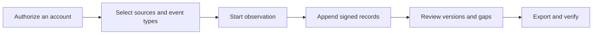

[English](../../README.md) · [Русский](../ru/README.md) · [Українська](../uk/README.md) · [Español](../es/README.md) · [Português (Brasil)](../pt/README.md) · [Türkçe](../tr/README.md) · [العربية](../ar/README.md) · [فارسی](../fa/README.md) · [اردو](../ur/README.md) · [हिन्दी](../hi/README.md) · [Bahasa Indonesia](../id/README.md) · **Tiếng Việt** · [简体中文](../zh/README.md)


<p align="center">
  <strong>Không gian làm việc quan sát Telegram của quý vị.</strong><br>
  Lưu trữ các cuộc trò chuyện đã ghi lại, nắm bắt những thay đổi và chia sẻ lịch sử đã được ký xác thực.<br>
  Trên máy tính hoặc máy chủ riêng của quý vị. Sử dụng các tài khoản của chính quý vị.
</p>

<p align="center">
  
  
  
  
  
</p>

<p align="center">
  <a href="#hướng-dẫn-bắt-đầu-nhanh">Hướng dẫn bắt đầu nhanh</a> ·
  <a href="#các-tính-năng">Các tính năng</a> ·
  <a href="#kết-nối-tài-khoản-telegram">Tài khoản</a> ·
  <a href="#bằng-chứng-và-xác-minh">Bằng chứng</a> ·
  <a href="#triển-khai">Triển khai</a> ·
  <a href="../README.md">Tài liệu hướng dẫn</a>
</p>

> [!TIP]
> **Hãy khám phá trước khi kết nối.** Vui lòng chạy `scripts\Demo.cmd` hoặc `sh start.sh --demo` để mở không gian làm việc với các cuộc trò chuyện giả định. Không cần tài khoản Telegram.

**Lần đầu ghé thăm?** [Bắt đầu →](QUICKSTART.md) · [Wiki →](../wiki/Home.md) · [Chọn hướng dẫn →](../README.md) · [Nhận trợ giúp →](../../.github/SUPPORT.md) · [Xem những gì đã được kiểm thử →](../VERIFICATION.md)

> [!WARNING]
> **Vui lòng sử dụng một tài khoản Telegram chuyên dụng mà quý vị có thể chấp nhận rủi ro mất mát.** Chúng tôi khuyến cáo mạnh mẽ không nên kết nối các tài khoản cá nhân hoặc có giá trị, cũng như không nên tạo thông tin đăng nhập API ID / API hash trên các tài khoản đó. Telegram có thể hạn chế hoặc cấm vĩnh viễn các tài khoản. [Vui lòng tham khảo hướng dẫn về tài khoản](../ACCOUNTS.md).

## Các tính năng

- **Các cuộc trò chuyện có lịch sử.** Đọc các tin nhắn đã lưu, so sánh các bản chỉnh sửa đã ghi lại và xem thông báo xóa trong bối cảnh của cuộc trò chuyện.
- **Theo dõi theo cách của quý vị. Quý vị** có thể chọn các cuộc trò chuyện riêng lẻ, một thư mục trên Telegram hoặc toàn bộ tài khoản. Mỗi tài khoản đều có không gian làm việc và cài đặt riêng.
- **Các tệp xuất mà quý vị có thể xác minh.** Một tệp ZIP đã được ký số, các bản ghi gốc, các tệp đính kèm được lưu giữ nguyên vẹn và một báo cáo HTML ngoại tuyến. Tính năng bảo vệ bằng mật khẩu tùy chọn khi chuyển giao.
- **Được thiết kế dành cho việc sử dụng hàng ngày. Hỗ trợ** chế độ sáng và tối, 13 ngôn ngữ, tính năng tìm kiếm, điều hướng bằng phím tắt Ctrl/Cmd+K, cùng các thao tác trực tiếp từ mục Trò chuyện.
- **Các tính năng bổ sung khi quý vị cần.** Một [chứng nhân Telegram chỉ trong ba bước](../WITNESS.md), một [trang Chứng minh công khai](../PROOF.md) riêng biệt và các hướng dẫn thiết lập rõ ràng. Mở **phần Tính năng bổ sung** để lựa chọn; các cài đặt nâng cao sẽ được ẩn đi.

<details>
<summary>Tất cả các tính năng và chi tiết kỹ thuật</summary></details>

- **Tuyến kết nối của quý vị.** Trong **phần** **Tài khoản → Cài đặt proxy**, quý vị có thể chọn từ các danh sách MTProxy công khai được tích hợp sẵn, làm mới chúng từ nguồn gốc hoặc dán liên kết proxy Telegram của riêng quý vị. Tính năng cấu hình thủ công SOCKS5/HTTP/MTProxy và danh mục nhà cung cấp vẫn được duy trì. Các danh sách công khai đã được tải xuống và lọc sẵn, nhưng hiện tại vẫn chưa có tài khoản nào kết nối qua máy chủ nào trong danh sách này. [Cách thức hoạt động của các danh sách công khai](../CONNECTION-SECURITY.md#public-proxies-supplied-by-your-installation).

- **Một nhật ký ghi lại những gì các tài khoản của quý vị thực sự quan sát được. Bao gồm** các tin nhắn mới, các chỉnh sửa, thông báo xóa, phản hồi, các sự kiện liên quan đến thành viên cũng như những khoảng trống trong phạm vi theo dõi từ các nhóm và kênh mà quý vị lựa chọn.
- **Các cuộc trò chuyện đã chọn, một thư mục trên Telegram hoặc toàn bộ tài khoản.** Chọn các loại nội dung cần ghi lại — kênh, nhóm, cuộc trò chuyện riêng tư, bot — và các cuộc trò chuyện mới sẽ được thêm vào ngay khi chúng xuất hiện. Các trường hợp loại trừ, tin nhắn gửi đi và các chỉnh sửa của chính người dùng, các nội dung bị xóa trong các cuộc trò chuyện riêng tư sẽ được khớp với cuộc trò chuyện tương ứng, việc kiểm tra lại theo mức độ ưu tiên và giới hạn tệp đính kèm cho từng loại ([bộ sưu tập](../COLLECTION.md#observation-scope-chosen-chats-a-folder-or-the-whole-account)).
- **Chế độ điều tra.** Chỉ với một nút bấm, hệ thống sẽ tạo sẵn một tài khoản chuyên dụng để tham gia các nhóm và tương tác với các bot: mọi thứ tài khoản này nhìn thấy và gửi đi đều được ghi lại, các nút dưới tin nhắn của bot (liên kết, ứng dụng web, văn bản cần sao chép) được lưu giữ và các chỉnh sửa chỉ bằng nút sẽ trở thành phiên bản mới, đồng thời mọi cuộc trò chuyện hoặc bot mới đều có hồ sơ riêng (mô tả, lệnh, thành viên) và các tin nhắn hiển thị trước đó được lưu lại ngay lập tức ([chế độ điều tra](../COLLECTION.md#investigation-mode-joining-teams-and-talking-to-bots)). **Hướng dẫn** **về Tài khoản chuyên dụng** trên bảng điều khiển (`/dedicated-account.html`) giải thích lý do tại sao không được sử dụng tài khoản chính, lý do tại sao TgWitness hoạt động thông qua các cặp băm ứng dụng công khai/ID ứng dụng và lý do tại sao một cặp API tự thân không cấp quyền truy cập vào tài khoản của quý vị (kèm theo các liên kết đến tài liệu hướng dẫn của Telegram), đồng thời liệt kê các cách để tạo một tài khoản bổ sung.
- **Thực hiện trực tiếp từ mục Trò chuyện.** Gửi tin nhắn và trả lời, nhấn các nút gọi lại/nhắn tin của bot, hoặc xem trước lời mời Telegram và tham gia. Tài khoản được chọn sẽ thực hiện hành động; các yêu cầu, bản xem trước lời mời và phản hồi dưới dạng cửa sổ bật lên/URL từ bot sẽ được ghi vào nhật ký đã ký của tài khoản đó ([khách hàng thu nhỏ trên bảng điều khiển](../COLLECTION.md#act-from-the-panel)).
- **Phạm vi bao quát mà quý vị có thể nêu rõ.** Các báo cáo và công cụ xác minh sẽ ghi rõ “được theo dõi liên tục từ X đến Y”, liệt kê các khoảng trống kèm theo lý do và ID tin nhắn chưa từng được ghi nhận — đồng thời tuyệt đối không trình bày chúng như những tin nhắn đã bị xóa.
- **Hồ sơ cá nhân, tùy chọn tham gia theo từng cuộc trò chuyện.** Lịch sử tên và tên người dùng, các cờ cảnh báo trên Telegram, mã SHA-256 và pHash của ảnh đại diện, hoạt động, ai trả lời ai cùng các ví, số điện thoại, tên người dùng và liên kết được đề cập — được xây dựng hoàn toàn từ các bản ghi đã lưu trữ, mỗi sự kiện đều trỏ đến bản ghi tương ứng trong nhật ký, được xuất dưới dạng một tệp riêng biệt có chữ ký ([mô hình bằng chứng](../EVIDENCE.md#people-profiles)).
- **Nhân chứng độc lập.** Một tiến trình riêng biệt với khóa và bot riêng sẽ truy xuất phần đầu nhật ký đã được ký, đăng nó lên một kênh Telegram và báo cáo khi bộ thu thập không phản hồi; người xác minh sẽ đối chiếu các bản xuất với phần nhật ký này. Khoảng thời gian, thời gian chờ, các kiểm tra nào được đăng và nội dung của các bài đăng đều là các tùy chọn hoặc được định nghĩa trong tệp cấu hình JSON ([witness](../WITNESS.md)). Đã được thử nghiệm trên máy chủ Bot API cục bộ, chưa thử nghiệm với bot và kênh thực tế.
- **Các thiết lập thu thập dữ liệu trong bảng điều khiển.** Các giới hạn và tốc độ thu thập, kiểm tra lại, tải xuống, hồ sơ cá nhân, thông báo và xuất dữ liệu được hiển thị trên trang **Thông** **số** cùng với phạm vi và giá trị mặc định tương ứng; mọi thay đổi đều được ghi lại trong nhật ký có chữ ký ([cài đặt và thông số](#cài-đặt-và-tham-số)).
- **Các thao tác chỉnh sửa và xóa được hiển thị trong bối cảnh cụ thể.** Mỗi lần chỉnh sửa sẽ tạo thành một phiên bản riêng biệt được hiển thị bên cạnh phiên bản trước đó; thông báo xóa sẽ không bao giờ xóa bỏ nội dung đã được lưu lại trước đó.
- **Các tệp xuất có chữ ký và có thể xác minh.** Mỗi sự kiện đều được liên kết bằng hàm băm (SHA-256) và ký số (Ed25519). Gói ZIP có chữ ký này bao gồm các tệp JSONL, CSV, báo cáo HTML ngoại tuyến, các tệp phương tiện được lưu giữ nguyên vẹn và một công cụ xác minh độc lập.
- **Các tệp xuất được bảo vệ bằng mật khẩu.** Tùy chọn, quý vị có thể nén bất kỳ tệp xuất nào thành tệp ZIP được mã hóa bằng AES-256 bằng WinZip – định dạng này có thể được 7-Zip và WinRAR đọc được; nội dung đã được ký số bên trong vẫn được giữ nguyên. Một tệp lưu trữ thử nghiệm đã được mở theo từng byte trong libarchive (Windows `tar`) và hệ thống đã từ chối khi nhập mật khẩu sai ([mô hình bằng chứng](../EVIDENCE.md#investigation-handoff)).
- **Thông báo.** Các sự cố (dung lượng đĩa thấp, tài khoản đã đăng xuất, lỗi thu thập dữ liệu, lỗi sao chép hoặc lỗi dấu thời gian), những thay đổi trong các cuộc trò chuyện được theo dõi và bản tóm tắt hàng ngày, được gửi qua [Apprise](https://github.com/caronc/apprise) đến Matrix, Telegram, Discord, Slack, ntfy, email và nhiều dịch vụ khác — không kèm theo nội dung tin nhắn trừ khi quý vị bật tính năng trích đoạn — và được liệt kê trong bảng điều khiển. Việc gửi thông báo đã được kiểm tra trên một điểm cuối cục bộ; các dịch vụ này vẫn chưa được kiểm tra.
- **13 ngôn ngữ giao diện.** Tiếng Anh, tiếng Nga, tiếng Ukraina, tiếng Tây Ban Nha, tiếng Bồ Đào Nha (Brazil), tiếng Thổ Nhĩ Kỳ, tiếng Ả Rập, tiếng Ba Tư, tiếng Urdu, tiếng Hindi, tiếng Indonesia, tiếng Việt và tiếng Trung giản thể, được dịch tự động bằng DeepL. Các phần mới hơn sử dụng văn bản dự phòng bằng tiếng Anh được liệt kê rõ ràng; các điều khiển của ứng dụng khách nhỏ vẫn giữ nguyên bằng tiếng Anh. Nội dung Telegram và các bản ghi nhật ký luôn được hiển thị chính xác như khi được lưu trữ.
- **Chế độ giao diện sáng và tối.** Theo mặc định, ứng dụng sẽ tuân theo cài đặt hệ thống; lựa chọn này sẽ được lưu lại cho từng trình duyệt.
- **Điều hướng thuận tiện bằng bàn phím.** Nhấn **Ctrl+K** (Mac: **⌘K**) hoặc chọn **“Đi đến…”** để tìm một phần. Sử dụng các phím mũi tên và phím Enter để mở phần đó; nhấn phím Escape để đóng menu.
- **Hỗ trợ nhiều tài khoản. Có thể tạo** bất kỳ số lượng không gian làm việc độc lập nào, mỗi không gian đều có phiên Telegram, nhật ký, khóa ký, đường dẫn proxy và chính sách ghi lại riêng biệt.
- **Các phương thức đăng nhập linh hoạt.** Số điện thoại + mã xác thực + xác thực hai yếu tố (2FA), mã QR, Telethon/Pyrogram `.session`, tệp ZIP TData của Telegram Desktop, Telethon StringSession hoặc Khóa xác thực đầy đủ kèm theo ID DC của nó.
- **Các proxy dành riêng cho từng tài khoản.** SOCKS5 và HTTP CONNECT, đã được kiểm thử trên các proxy thử nghiệm cục bộ, cùng với MTProxy đang trong giai đoạn thử nghiệm, chưa được kiểm thử trên máy chủ thực tế. Trong trường hợp proxy gặp sự cố, hệ thống sẽ không tự động chuyển sang kết nối trực tiếp mà không có thông báo.
- **Được thiết kế để bảo mật riêng tư.** Hoạt động trên máy tính hoặc máy chủ của quý vị. Giao diện người dùng web được tích hợp sẵn, không cần Node.js, không cần dịch vụ lưu trữ bên ngoài, không có dữ liệu theo dõi. Các phiên làm việc, thông tin đăng nhập API và khóa bí mật proxy được lưu trữ trong kho dữ liệu được mã hóa.
- **Dễ dàng vận hành.** Chỉ cần nhấp đúp trên Windows, chạy một tập lệnh trên Linux/macOS, hoặc sử dụng Docker Compose với tùy chọn HTTPS tự động. Cho đến nay, chỉ có trình khởi chạy trên Windows được thử nghiệm; vui lòng tham khảo [danh sách các tính năng đã được kiểm thử](#những-nội-dung-đã-được-kiểm-thử).

</details>

## Hướng dẫn bắt đầu nhanh

| Nền tảng | Cách bắt đầu | Yêu cầu |
| --- | --- | --- |
| **Hệ điều hành Windows, chưa cài đặt bất kỳ phần mềm nào** | Tải xuống `TgWitness-<version>-windows-amd64-portable.zip` từ [mục Phát hành](../../../../releases), giải nén, nhấp đúp vào **`TgWitness.cmd`** | Không có gì; Python đã được tích hợp sẵn |
| Windows, từ mã nguồn | Nhấp đúp vào **`Start.cmd`** | Python 3.11 trở lên; sẽ được cung cấp và cài đặt sẵn cho quý vị nếu chưa có |
| Linux / macOS | `sh start.sh` | Yêu cầu Python 3.11 trở lên cùng với `venv`; nếu thiếu, tập lệnh sẽ hiển thị lệnh cài đặt phù hợp với hệ thống của quý vị |
| Docker, mọi hệ điều hành | Nhấp đúp vào **`scripts\Docker.cmd`** hoặc chạy `sh scripts/docker-start.sh` | Docker Engine/Desktop với Compose phiên bản 2.20 trở lên |

1. Mở **http://127.0.0.1:8787**.
2. Dán mã thông báo truy cập bảng điều khiển vào đây:
   - Cài đặt phiên bản di động hoặc từ mã nguồn: nội dung của `data/live/panel-token.txt`
   - Docker: được in bởi `scripts\Docker.cmd`/`scripts/docker-start.sh`, hoặc `docker compose exec tgwitness cat /data/panel-token.txt`
3. Thêm tài khoản Telegram của quý vị, chọn các cuộc trò chuyện cần theo dõi và nhấn **“Bắt đầu theo dõi**”.

Lần khởi chạy nguồn đầu tiên sẽ tạo ra một tài khoản riêng tư `.venv` và cài đặt các phụ thuộc bắt buộc (yêu cầu kết nối Internet). Các công cụ hỗ trợ Docker sẽ xây dựng hình ảnh, chờ cho đến khi bảng điều khiển hoạt động ổn định và hiển thị địa chỉ cùng mã thông báo của nó. `python start.py --check` (hoặc `TgWitness-Check.cmd` trong gói di động) sẽ cung cấp báo cáo sẵn sàng mà không cần tương tác với Telegram.

> **Chỉ muốn xem thử?** Vui lòng truy cập **`scripts\Demo.cmd`** hoặc `sh start.sh --demo`. Một nhật ký giả định sẽ mở trực tiếp trên trình duyệt; không có tài khoản Telegram nào được kết nối và dữ liệu được lưu trữ riêng biệt tại `data/demo`.

<details>
<summary><strong>Bên trong không gian làm việc: các cuộc trò chuyện, lịch sử và tính năng xuất dữ liệu</strong></summary></details>

<picture>
  <source media="(prefers-color-scheme: dark)" srcset="../assets/chats-dark.png">
  
</picture>

### Lịch sử quan sát


### Các tệp xuất có chữ ký


</details>


## Kết nối tài khoản Telegram

> [!CAUTION]
> Chỉ nên kết nối các tài khoản chuyên dụng mà quý vị có thể chấp nhận rủi ro mất đi. Telegram có thể khóa vĩnh viễn các tài khoản một cách bất ngờ; xin vui lòng tham khảo cảnh báo ở đầu trang này. **Hướng dẫn** **về tài khoản chuyên dụng** trên bảng điều khiển (ở thanh bên hoặc `/dedicated-account.html`) sẽ giải thích lý do cũng như cách thức để tạo một tài khoản như vậy.

Đăng nhập bằng số điện thoại, mã QR hoặc phiên đăng nhập hiện có — không cần ID API hay mã băm.

**Tại sao lại cần một nhóm API tích hợp sẵn?** Việc tạo ID API riêng trên [my.telegram.org](https://my.telegram.org) được biết là nguyên nhân dẫn đến việc tài khoản bị hạn chế, và Telegram không công bố các giới hạn rõ ràng — nhiều nhà nghiên cứu đã mất tài khoản chính của mình vì lý do này. Trang [“Cách lấy ID API”](https://core.telegram.org/api/obtaining_api_id) của chính Telegram cho biết các tài khoản sử dụng các ứng dụng khách API không chính thức sẽ tự động bị đưa vào diện giám sát và chuyển những người dùng bị cấm oan sang địa chỉ recover@telegram.org. Do đó, TgWitness cung cấp sẵn các cặp API công khai đã được các ứng dụng khách mã nguồn mở khác sử dụng, nhờ đó quý vị sẽ không bao giờ phải tạo ID API mới. Nếu quý vị có ID API riêng, vui lòng nhập vào mục **“API ID + Hash”** và hệ thống sẽ sử dụng ID đó thay thế.

Khi không có cặp thông tin nào được nhập, nhập khẩu hoặc đã được lưu sẵn trong không gian làm việc, TgWitness sẽ chọn một trong 50 cặp có sẵn trong danh sách và chuyển sang cặp tiếp theo nếu Telegram từ chối cặp đó. Cặp thông tin đã đăng nhập sẽ được liên kết với tài khoản đó. Một cặp thông tin dùng để xác định ứng dụng; quý vị vẫn phải ủy quyền cho tài khoản Telegram của mình một cách riêng biệt. Mã thông báo truy cập bảng điều khiển sẽ mở TgWitness và hoàn toàn tách biệt với quá trình đăng nhập Telegram.

| Những gì quý vị có | Cách sử dụng |
| --- | --- |
| Số điện thoại có quyền truy cập vào tài khoản | Tab **Điện thoại**: mã từ Telegram, sau đó là mật khẩu xác thực hai yếu tố (2FA) nếu tính năng này đã được kích hoạt |
| Ứng dụng Telegram đã đăng nhập sẵn | Tab **mã QR**: Cài đặt → Thiết bị → Kết nối thiết bị máy tính để bàn |
| Telethon (sơ đồ 7/8) hoặc Pyrogram (sơ đồ 2/3) `.session` | Tab **Tệp** |
| Cặp hình ảnh `name.session` + `name.json` | Tại tab **Tệp**, hãy chọn cả hai; tệp JSON cung cấp ID API/mã băm |
| Thư mục Telegram Desktop `tdata` | Chỉ ZIP `key_datas` và `D877F783D5D3EF8Cs`, sau đó là **Tệp**; mã thông báo cục bộ (nếu đã được thiết lập) |
| Telethon StringSession, `.txt` hoặc `.tgwitness-session` | Tab **Tệp** hoặc *Mã thông báo hoặc nội dung phiên làm việc* |
| Tệp JSON tài khoản kèm theo khóa phiên hoặc khóa xác thực | Tab **Tệp** |
| Khóa xác thực đầy đủ (512 ký tự hex) + DC ID | Tab **Khóa xác thực**; ID người dùng (tùy chọn) sẽ được đối chiếu với hệ thống Telegram |

Không được hỗ trợ: bộ nhớ TDLib, chuỗi phiên Pyrogram, mã thông báo bot, TData đa tài khoản và danh sách tài khoản hàng loạt. Các tệp sẽ được chuyển đổi trong bộ nhớ trên máy chủ của quý vị và được kiểm tra với Telegram trước khi được lưu lại. Hướng dẫn về tài khoản ([hướng dẫn về tài khoản](../ACCOUNTS.md)) giải thích từng định dạng một cách chi tiết từng bước: cách lấy thông tin đăng nhập API, cách nhận diện tệp, các trường JSON, giới hạn và thông báo lỗi.

Sau khi đăng nhập, hãy mở **mục Nguồn** (các cuộc trò chuyện của quý vị sẽ tự động tải), thêm các nhóm cần thiết, chọn nội dung cần ghi lại (ví dụ: *Tin nhắn, các thao tác chỉnh sửa và xóa*) rồi bắt đầu quá trình quan sát. Hãy duy trì quá trình này hoạt động: **Tạm dừng quan sát** sẽ ngừng thu thập dữ liệu, trong khi **Khóa** chỉ đóng quyền truy cập trên trình duyệt.

## Hình ảnh minh họa

| So sánh các phiên bản | Nguồn và chính sách thu thập dữ liệu |
| --- | --- |
|  |  |
| **Các tệp xuất có chữ ký** | **Đăng nhập** |
|  |  |
| **Tạp chí** | **Chế độ giao diện tối** |
|  |  |

Tất cả các ảnh chụp màn hình đều sử dụng dữ liệu minh họa tổng hợp. Mã QR trong [tệp qr-login.png](../assets/qr-login.png) mã hóa một mã thông báo hư cấu từ kênh thử nghiệm.


## Cách thức hoạt động



Mỗi không gian làm việc thuộc về một tài khoản Telegram. Bộ thu thập dữ liệu sẽ tiếp nhận các bản cập nhật từ ứng dụng khách của tài khoản đó, áp dụng chính sách ghi lại đã lưu và thêm các quan sát vào một nhật ký chỉ ghi thêm.

| Quan sát | Những nội dung được lưu giữ | Phạm vi |
| --- | --- | --- |
| Tin nhắn mới | Nội dung tin nhắn, ID người gửi, mã tham chiếu trả lời, siêu dữ liệu, thời gian quan sát | Chỉ cung cấp các bản cập nhật cho các nguồn được chọn lọc |
| Chỉnh sửa | Một phiên bản nội dung riêng biệt | Các phiên bản trung gian bị bỏ lỡ trong thời gian ngoại tuyến sẽ không thể khôi phục được |
| Xóa | ID tin nhắn cùng toàn bộ dữ liệu đã được ghi lại trước đó | Telegram thường không hiển thị thông tin về người đã xóa và thời điểm xóa |
| Phản hồi | Số liệu thống kê và danh tính gần đây khi được cung cấp | Đây là bản tóm tắt, không phải là nhật ký thay đổi đầy đủ |
| Thành viên | Thông báo dịch vụ và cập nhật dành cho người tham gia | Không phải mọi thao tác tham gia/rời khỏi đều được đảm bảo sẽ được gửi đi |
| Tệp đính kèm | Tệp chứa nội dung tùy chọn kèm mã SHA-256 | Các tệp có thể biến mất trước khi được tải xuống; kết quả sẽ được ghi lại |
| Phạm vi bao quát | Khởi động, dừng, ngắt kết nối, tín hiệu kiểm tra trạng thái, thay đổi chính sách | Tính hoạt động không phải là bằng chứng cho việc ghi lại đầy đủ |
| Bản chụp lịch sử | Các tin nhắn hiển thị mới nhất, tối đa 500 tin nhắn trừ khi được điều chỉnh trong **phần Thông số**, được gắn nhãn rõ ràng | Không thể khôi phục các chỉnh sửa hoặc xóa bỏ đã bị bỏ sót |

Tìm hiểu [cách thức hoạt động của quá trình thu thập dữ liệu](../COLLECTION.md) liên quan đến các chính sách, hàng đợi tệp đính kèm và quá trình khởi động lại.

## Cài đặt và tham số

Mọi thay đổi đều được thực hiện trực tiếp trên bảng điều khiển, theo từng không gian làm việc, mà không cần chỉnh sửa mã nguồn hay tệp cấu hình. Mỗi thay đổi về phạm vi, chính sách hoặc tham số đều được ghi lại trong nhật ký đã được ký số kèm theo các giá trị trước và sau khi thay đổi, đồng thời mỗi lần bắt đầu quan sát đều ghi rõ các giá trị hiện hành.

| Tại đâu | Những gì quý vị cần thiết lập |
| --- | --- |
| **Nguồn** | Phạm vi (các cuộc trò chuyện đã chọn, một thư mục Telegram, toàn bộ tài khoản), các loại nguồn, các trường hợp loại trừ, các hành động tự thực hiện, những thay đổi cần lưu giữ, các loại tệp đính kèm và kích thước theo từng loại (1–2.000 MiB), khoảng thời gian kiểm tra lại đối với các cuộc trò chuyện ưu tiên và các cuộc trò chuyện khác (bất kỳ số phút nào, 0 = tắt), ảnh chụp nhanh lịch sử, thông báo |
| **Tệp xuất** | Tải xuống được bảo vệ bằng mật khẩu, chế độ bằng chứng (khoảng thời gian, cơ quan xác nhận dấu thời gian và lịch), bản sao lưu ngoài trang web trên S3 (khoảng thời gian, chế độ lưu giữ và chế độ Object Lock) |
| **Witness** | Mã thông báo chứng thực chỉ đọc; các tùy chọn của chính người chứng thực được hiển thị kèm theo các lệnh đã được chuẩn bị sẵn |
| **Các tham số** | Kích thước danh sách trò chuyện và tần suất làm mới, khoảng thời gian kiểm tra trạng thái và điểm kiểm tra, bộ đệm khởi động, cách thức kiểm tra lại phân bổ các yêu cầu (thời gian trễ ban đầu, số cuộc trò chuyện mỗi lượt, thời gian tạm dừng, số tin nhắn được khôi phục và yêu cầu lại), dung lượng đĩa dự trữ, thời gian chờ tải xuống, tốc độ và số lần thử lại, các tiêu chí mà hồ sơ người dùng tìm kiếm (bao gồm cả biểu thức chính quy do quý vị tự định nghĩa), kích thước và tần suất thông báo, ảnh chụp nhanh, giới hạn tệp ZIP và tải xuống qua trình duyệt, thời gian chờ thao tác trên bảng điều khiển, thời gian chờ và số lần thử lại của ứng dụng Telegram |

Các giá trị của **các tham số** hiển thị phạm vi và giá trị mặc định của chúng; các tham số đã được thay đổi sẽ được đánh dấu và có thể khôi phục từng tham số một hoặc tất cả cùng một lúc. Các thay đổi này sẽ có hiệu lực từ lần sử dụng tiếp theo; thời gian chờ và số lần thử lại của ứng dụng Telegram sẽ được áp dụng từ lần kết nối tiếp theo. Giới hạn kích thước tệp ZIP trên 4 GiB yêu cầu `verify.py --max-gib N` khi xác minh tệp lưu trữ ([các thao tác](../OPERATIONS.md#panel-layout)).


## Bằng chứng và xác minh

| Xuất | Mục lục | Tính toàn vẹn |
| --- | --- | --- |
| **Tệp ZIP đã được ký** | JSONL, CSV, báo cáo HTML, phạm vi bao phủ, phương tiện truyền thông, tệp manifest, công cụ xác minh | Các sự kiện được ký điện tử kèm theo bản kê khai được ký điện tử của từng tệp, trong đó nêu rõ tên người tạo. Vui lòng sử dụng tài liệu này cho quá trình bàn giao. |
| JSONL | Các bản ghi gốc kèm theo mã băm và chữ ký | Chữ ký Ed25519 cho từng sự kiện và chuỗi băm |
| CSV / HTML | Bảng tính an toàn / báo cáo có thể đọc ngoại tuyến | Chỉ có trong tệp ZIP đã được ký điện tử |
| Tệp JSON điểm kiểm tra | Độ dài nhật ký và mã băm đầu | Được ký riêng biệt; vui lòng lưu trữ tệp này bên ngoài bộ thu thập dữ liệu |
| Tệp JSON biên lai thực thi | Băm mã nguồn, phiên bản các thư viện phụ thuộc, phạm vi, cài đặt | Tuyên bố quy trình được ký riêng biệt |
| Tệp JSON chứa hồ sơ cá nhân | Hồ sơ của một cuộc trò chuyện kèm theo các tham chiếu ghi chép | Tuyên bố đã được ký; các giá trị băm của tệp đã được đối chiếu với tệp ZIP |
| Tệp ZIP của nhật ký Witness | Danh sách các nhân chứng đã thu thập, các câu trả lời bị bỏ lỡ, các bài đăng trên kênh | Được ký bằng chính khóa riêng của người làm chứng |

Các bộ lọc chỉ ảnh hưởng đến quá trình duyệt; các tệp xuất luôn chứa toàn bộ nhật ký cho đến một số thứ tự cố định. Vui lòng xác minh tệp lưu trữ bằng bản sao đáng tin cậy của công cụ xác minh cùng với dấu vân tay khóa và điểm kiểm tra được lưu giữ độc lập:

```sh
python -m pip install cryptography
python tgwitness/verify.py tgwitness-evidence.zip --fingerprint TRUSTED_PUBLIC_KEY_SHA256 --checkpoint tgwitness-checkpoint.json
# with an independent witness and its channel (Telegram Desktop export)
python tgwitness/verify.py tgwitness-evidence.zip --fingerprint TRUSTED_PUBLIC_KEY_SHA256 \
    --witness witness.zip --witness-fingerprint WITNESS_SHA256 --channel result.json
```

Trình xác minh sẽ hiển thị thông tin về nhà sản xuất đã được ký tên, các khoảng thời gian quan sát liên tục, các khoảng trống và các ID tin nhắn chưa từng được ghi nhận; đồng thời sẽ báo lỗi nếu nhật ký này có sự khác biệt so với bất kỳ bản gốc nào mà nhân chứng đã quan sát được.

Chữ ký cung cấp bằng chứng chống giả mạo liên quan đến khóa ký đáng tin cậy. Chúng **không** chứng minh nguồn gốc từ Telegram, tính xác thực của nội dung hay thời gian đáng tin cậy, và cũng không bảo vệ trước một nhà điều hành kiểm soát bộ thu thập dữ liệu cùng khóa của nó. Đối với thời gian đáng tin cậy, chế độ bằng chứng (tắt theo mặc định) sẽ đóng dấu thời gian các điểm kiểm tra bằng các cơ quan có thẩm quyền theo RFC 3161 và lịch OpenTimestamps, hoặc ban điều hành sẽ chuẩn bị một yêu cầu RFC 3161 ngoại tuyến ([quy trình đóng dấu thời gian](../TIMESTAMP.md)). Cả hai phương án này đều đã được kiểm thử trên các máy chủ thử nghiệm nội bộ, nhưng chưa được kiểm thử trên các dịch vụ công cộng. Xin tham khảo [mô hình bằng chứng](../EVIDENCE.md) và danh sách kiểm tra [bàn giao điều tra](../EVIDENCE.md#investigation-handoff).

## Triển khai

> [!NOTE]
> Các cấu hình Docker, Caddy (HTTPS), systemd và launchd dưới đây đã được chuẩn bị sẵn và các tệp liên quan đã vượt qua kiểm tra cú pháp, nhưng chưa có cấu hình nào trong số đó được chạy thử. Trong khi đó, gói phần mềm di động dành cho Windows và bản nguồn chạy trên Windows thì đã được thử nghiệm.

**Máy chủ cục bộ hoặc máy chủ đơn lẻ sử dụng Docker:**

```sh
docker compose up -d --build --wait
docker compose exec tgwitness cat /data/panel-token.txt
```

Container này chạy dưới quyền người dùng không phải root với hệ thống tệp chỉ đọc, chỉ đăng tải lên `127.0.0.1:8787` và lưu trữ toàn bộ dữ liệu trong một khối lượng có tên.

**Máy chủ công khai với HTTPS tự động (Caddy):** sao chép `.env.example` vào `.env`, thiết lập `TGWITNESS_DOMAIN`, trỏ DNS đến máy chủ, mở cổng TCP 80/443 và khởi chạy

```sh
docker compose -f compose.yaml -f deploy/compose/compose.https.yaml up -d --build --wait
```

**Trên Windows mà không cần cài đặt bất kỳ phần mềm nào:** tệp ZIP di động đính kèm trong mỗi bản phát hành đã chứa sẵn môi trường chạy Python chính thức cùng tất cả các thành phần phụ thuộc. Dữ liệu được lưu trữ trong thư mục `data`; để cập nhật, quý vị chỉ cần giải nén phiên bản mới và sao chép thư mục đó vào vị trí tương ứng.

**Trong trường hợp không sử dụng Docker:** các mẫu systemd, tác vụ đăng nhập Windows và launchd được đặt trong [thư mục deploy/. Các nội dung liên quan đến](../../deploy/README.md) cập nhật, sao lưu, cổng thay thế và hình ảnh GHCR (sau khi quy trình phát hành hoàn tất việc công bố) được đề cập chi tiết trong [phần triển khai](DEPLOYMENT.md).

### Dòng lệnh

```text
python start.py [--demo] [--setup-only] [--check [--json]] [--host HOST] [--port PORT] [--data-dir DIR]
```

| Nhiệm vụ | Lệnh (từ môi trường dự án) |
| --- | --- |
| Kiểm tra tình trạng sẵn sàng mà không cần khởi động | `python start.py --check` |
| Chuyển đổi phiên làm việc Telethon SQLite sang chế độ ngoại tuyến | `python -m tgwitness.sessions account.session --out account.tgwitness-session` |
| Truyền một tệp xuất có dung lượng lớn sang đĩa | `python -m tgwitness.download --token-file data/live/panel-token.txt --out evidence.zip` |
| Xác minh tệp lưu trữ đã xuất | `python tgwitness/verify.py tgwitness-evidence.zip --fingerprint SHA256` |
| Xác minh tệp lưu trữ có dung lượng trên 4 GiB | `python tgwitness/verify.py big-evidence.zip --fingerprint SHA256 --max-gib 16` |
| Chạy một máy chủ chứng kiến độc lập từ tệp cấu hình | `python -m tgwitness.witness run --config witness.json` |

Các lệnh phụ trợ `python -m tgwitness…` phải được thực thi bên trong `.venv` (`.venv\Scripts\python.exe` trên Windows, `.venv/bin/python` trên các hệ điều hành khác).

| Biến | Mục đích |
| --- | --- |
| `TGWITNESS_HOST`, `TGWITNESS_PORT` | Địa chỉ và cổng lắng nghe (mặc định `127.0.0.1:8787`) |
| `TGWITNESS_DATA` | Thư mục dữ liệu (mặc định `data/live`) |
| `TGWITNESS_TOKEN` | Đã sửa mã thông báo bảng điều khiển thay vì mã được tạo tự động (ít nhất 24 ký tự) |
| `TGWITNESS_VAULT_KEY_FILE` | Khóa chính kho lưu trữ bên ngoài dành cho các cài đặt mới |
| `TGWITNESS_DOMAIN`, `TGWITNESS_IMAGE` | Tên máy chủ HTTPS của Docker và hình ảnh đã được công bố (xem `.env.example`) |
| `TGWITNESS_WITNESS_*` | Nhân chứng độc lập: trình thu thập, mã thông báo, kênh, `_INTERVAL`, `_TIMEOUT`, `_POST` (tất cả, thay đổi, sự cố), `_TITLE`, `_CONFIG` ([nhân chứng](../WITNESS.md#options)) |


## Trách nhiệm và bảo vệ dữ liệu (GDPR)

TgWitness là một công cụ. Bất kỳ ai vận hành công cụ này đều quyết định những thông tin nào sẽ được thu thập, lý do và thời gian lưu trữ, đồng thời chịu trách nhiệm về việc đó — theo Quy định chung về bảo vệ dữ liệu (GDPR) của EU/Vương quốc Anh, người đó thường đóng vai trò là bên *kiểm* *soát* dữ liệu cá nhân đó. Các tin nhắn trên Telegram chứa dữ liệu cá nhân của những người chưa bao giờ đồng ý được ghi lại: tên, tên người dùng, ID, ảnh, số điện thoại, ý kiến. Phần này không phải là tư vấn pháp lý; quý vị vui lòng kiểm tra luật pháp áp dụng đối với quý vị cũng như các điều khoản của Telegram.

- **Phải có cơ sở pháp lý và mục đích rõ ràng.** Phòng chống gian lận, an ninh mạng và thông tin, cũng như việc bảo vệ các khiếu nại pháp lý thường được coi là các lợi ích hợp pháp (Điều 6(1)(f) của GDPR, Phần Giải thích 47 và 49; Điều 9(2)(f) đối với các khiếu nại pháp lý). Vui lòng ghi rõ mục đích cho từng trường hợp cụ thể. Các cơ quan công quyền hoạt động dựa trên các cơ sở pháp lý riêng của mình.
- **Chỉ thu thập dữ liệu ở mức tối thiểu cần thiết cho mục đích sử dụng.** Hãy bắt đầu với các cuộc trò chuyện đã chọn. Chế độ theo thư mục và toàn bộ tài khoản sẽ ghi lại các cuộc trò chuyện riêng tư cũng như tin nhắn từ bên thứ ba: chỉ nên sử dụng các chế độ này trên các tài khoản chuyên dụng; bảng điều khiển sẽ yêu cầu xác nhận và nhật ký đã được ký điện tử sẽ ghi lại thông tin này. Vui lòng tắt các loại sự kiện, loại tệp đính kèm và các hành động cá nhân mà quý vị không cần đến, đồng thời loại trừ các cuộc trò chuyện không mong muốn.
- **Tính năng lập hồ sơ người dùng đang được kích hoạt.** Tính năng này mặc định bị tắt và chỉ được bật theo từng cuộc trò chuyện. Quý vị hãy sử dụng tính năng này cho các cuộc điều tra cụ thể, không nên dựa vào đó để đưa ra các quyết định tự động liên quan đến người dùng (Điều 22), và hãy tắt tính năng này hoặc xóa cuộc trò chuyện khi hoàn tất — việc này sẽ xóa các hồ sơ đó. Việc giám sát có hệ thống đối với nhiều người thường đòi hỏi phải thực hiện đánh giá tác động về bảo vệ dữ liệu (Điều 35).
- **Hãy đảm bảo an toàn.** Các phiên làm việc, thông tin đăng nhập và khóa được lưu trữ trong kho dữ liệu được mã hóa; hãy đặt thư mục dữ liệu trên ổ đĩa được mã hóa, đặt mật khẩu cho các tệp xuất (ZIP mã hóa AES-256), duy trì bảng điều khiển qua kết nối HTTPS và chỉ cấp cho người chứng kiến mã thông báo chỉ đọc. Các thông báo sẽ không chứa nội dung tin nhắn trừ khi quý vị bật tính năng trích dẫn, khi đó văn bản sẽ được gửi đến dịch vụ thông báo.
- **Lưu trữ và xóa dữ liệu.** Nhật ký này chỉ cho phép ghi thêm để đảm bảo tính toàn vẹn của dữ liệu; không thể xóa các bản ghi riêng lẻ mà không làm đứt chuỗi chữ ký. Hãy lập kế hoạch lưu trữ cho từng không gian làm việc và xóa toàn bộ không gian làm việc (Tài khoản → Xóa) hoặc thư mục dữ liệu của nó khi mục đích sử dụng kết thúc. Các bản sao ngoài trang web được bảo vệ bởi S3 Object Lock không thể bị xóa trước ngày hết hạn lưu trữ — quý vị hãy lựa chọn khoảng thời gian phù hợp. Quyền xóa dữ liệu có các trường hợp ngoại lệ, ví dụ như để thiết lập hoặc bảo vệ các khiếu nại pháp lý (Điều 17(3)(e)).
- **Các yêu cầu từ người dân đã được ghi lại.** Các tệp xuất dữ liệu trò chuyện và tệp hồ sơ cho phép xác định thông tin nào được lưu trữ về một cá nhân (Điều 15).
- **Không có bất kỳ dữ liệu nào được gửi đến các tác giả.** TgWitness không có tính năng thu thập dữ liệu từ xa và không sử dụng dịch vụ lưu trữ bên ngoài; dữ liệu chỉ rời khỏi máy tính của quý vị thông qua các kênh mà quý vị đã cấu hình (Telegram, dịch vụ ghi thời gian, sao chép lên S3, thông báo, chứng thực).

## An ninh và tình trạng dự án

Đối với chương trình thử nghiệm thu thập dữ liệu đa tài khoản công khai, công cụ [giám sát Proof](../PROOF.md) hiển thị số lần ghi lại đã được ký, tình trạng hoạt động và các giá trị băm của nhật ký mà không bao gồm nội dung tin nhắn. Công cụ này có thể phát các lệnh kiểm tra tới một kênh Telegram; một công cụ xác minh canary riêng biệt sẽ kiểm tra chuỗi thao tác gửi/chỉnh sửa/xóa được kiểm soát trên các bản xuất tài khoản. Công cụ này hiện mới chỉ được thử nghiệm với các không gian làm việc tổng hợp.

- Theo mặc định, bảng điều khiển sẽ lắng nghe trên localhost. Để truy cập từ xa, quý vị hãy sử dụng cấu hình HTTPS Compose hoặc đường hầm SSH; tuyệt đối không được để lộ kết nối HTTP thuần túy.
- Các phiên Telegram, thông tin đăng nhập API, thông tin đăng nhập proxy và khóa ký được lưu trữ trong một kho dữ liệu được mã hóa bằng Fernet. Theo mặc định, khóa này nằm trong cùng thư mục dữ liệu; hãy thiết lập `TGWITNESS_VAULT_KEY_FILE` để sử dụng khóa chính bên ngoài. Nội dung tin nhắn và tệp đa phương tiện cục bộ **không** được TgWitness mã hóa; quý vị nên lưu trữ thư mục dữ liệu trên một đĩa hoặc phân vùng đã được mã hóa. Các tệp ZIP xuất ra đã được ký có thể được mã hóa bằng mật khẩu (tùy chọn).
- Các tệp dữ liệu, phiên làm việc, mã thông báo, khóa và tệp xuất dữ liệu không được bao gồm trong các bản dựng git và Docker.
- Vui lòng báo cáo các lỗ hổng bảo mật một cách riêng tư theo hướng dẫn trong [tệp SECURITY.md](../../.github/SECURITY.md).

### Những nội dung đã được kiểm thử

TgWitness phiên bản **0.6.1** hoạt động trên hệ điều hành Windows 11 với Python 3.12. Tình trạng cập nhật vào ngày 29 tháng 10 năm 2026:

| Lĩnh vực | Quá trình thử nghiệm |
| --- | --- |
| Tin nhắn, chỉnh sửa, xóa, tệp đính kèm, kiểm tra lại sau khi khởi động lại, tạm dừng FloodWait | Được thực hiện bằng **một tài khoản Telegram thực tế**, từ ngày 27 đến 29 tháng 10 năm 2026: 9.968 bản ghi đã được ký, mọi chữ ký và chuỗi băm đều đã được xác minh ([thử nghiệm trực tiếp](../VERIFICATION.md#live-telegram-test-whole-account--29-october-2026)) |
| Theo dõi toàn bộ tài khoản và các bản chụp lịch sử | Đã thực hiện bằng **tài khoản thực** vào ngày 29 tháng 10 năm 2026: các tin nhắn từ 2 nhóm hoặc kênh, cùng 3 cuộc trò chuyện riêng tư và các bot |
| Nhấn vào nút tin nhắn trong **phần Trò chuyện** | Đã thực hiện một lần bằng **tài khoản thật** |
| Đăng nhập bằng tệp phiên Telethon/Pyrogram và TData của Telegram Desktop | Đã hoàn tất với **một tài khoản thực** |
| Đăng nhập bằng số điện thoại, mã QR và Khóa xác thực; các cuộc trò chuyện mới sẽ được đưa vào phạm vi theo dõi cùng với các tin nhắn trước đó; gửi tin nhắn; tham gia qua lời mời; phản hồi; tư cách thành viên; hồ sơ cá nhân; sử dụng nhiều tài khoản cùng lúc; xuất dữ liệu và công cụ xác minh | Các bài kiểm thử tự động với các ứng dụng khách Telegram mô phỏng |
| Proxy SOCKS5/HTTP, bot chứng thực, công cụ giám sát Proof, thông báo, bản sao S3, RFC 3161 và OpenTimestamps | Các bài kiểm thử tự động trên các máy chủ thử nghiệm cục bộ |
| Danh sách MTProxy công khai | Đã tải xuống và lọc dữ liệu (118 máy chủ vào ngày 29 tháng 10); hiện vẫn chưa thể kết nối qua các máy chủ này |
| MTProxy, Docker, HTTPS với Caddy, Linux, macOS, Python 3.11 và 3.13, quy trình CI và phát hành, các sự cố ngừng hoạt động kéo dài, đánh giá bảo mật độc lập | **Chưa được kiểm thử** |

Chi tiết: [bản ghi xác minh](../VERIFICATION.md), [tình trạng phát hành](../internal/RELEASE.md) và [mức độ sẵn sàng](../internal/READINESS.md).


## Phát triển

```sh
python -m venv .venv && source .venv/bin/activate     # Windows: .venv\Scripts\Activate.ps1
python -m pip install -c constraints.txt -e ".[dev]"
python -m pytest -q                                    # unit and integration tests
python -m playwright install chromium
python tools/check_browser.py                          # end-to-end UI acceptance
python tools/check_account_browser.py                  # sign-in flows
python tools/capture_screenshots.py --docs             # refresh README images
python tools/build_portable.py                         # Windows portable ZIP (Windows + Python 3.12)
python tools/build_source.py                          # source ZIP with SHA-256 manifest
python tools/build_site.py                             # static project site in dist/site
python tools/check_site.py                             # website browser acceptance
```

Bộ kiểm thử tự động sử dụng các đối tượng Telegram tổng hợp và tuyệt đối không kết nối với các tài khoản thực; quy trình kiểm thử trực tiếp đã được mô tả ở phần trên. Hệ thống CI được cấu hình để chạy ma trận kiểm thử trên Windows, Linux và macOS với Python phiên bản 3.11–3.13, bao gồm các kiểm tra trình duyệt, đóng gói mã nguồn, bản dựng di động cho Windows và bản dựng Docker. Quy trình phát hành được thiết lập để đính kèm tệp ZIP mã nguồn, tệp wheel, tệp ZIP di động dành cho Windows và hình ảnh GHCR đa kiến trúc vào bản phát hành GitHub đã được công bố. Cả hai quy trình này đều chưa được thực thi. Vui lòng đọc [tệp CONTRIBUTING.md](../../.github/CONTRIBUTING.md) trước khi gửi yêu cầu pull.

## Tài liệu hướng dẫn

| Hướng dẫn | Nội dung bao gồm |
| --- | --- |
| [Hướng dẫn bắt đầu nhanh](QUICKSTART.md) | Khởi chạy lần đầu, kết nối tài khoản và xuất dữ liệu lần đầu |
| [Các tài khoản và định dạng phiên làm việc](../ACCOUNTS.md) | Thông tin đăng nhập, chuyển đổi, quản lý nhiều tài khoản |
| [Cách thức thu thập dữ liệu hoạt động như thế nào](../COLLECTION.md) | Chính sách thu thập, phiên bản, tệp đính kèm, các lỗ hổng |
| [Kết nối và bảo mật](../CONNECTION-SECURITY.md) | Máy chủ proxy, mã hóa và khóa |
| [Hoạt động](../OPERATIONS.md) | Quy trình làm việc hàng ngày, sao lưu, khôi phục, dung lượng |
| [Triển khai](DEPLOYMENT.md) và [các mẫu dịch vụ](../../deploy/README.md) | Máy chủ, container, HTTPS, các bản cập nhật |
| [Mô hình bằng chứng](../EVIDENCE.md) và [dấu thời gian](../TIMESTAMP.md) | Tính toàn vẹn, phạm vi bao quát, hồ sơ cá nhân, mức độ tin cậy và việc chuyển giao |
| [Nhân chứng độc lập](../WITNESS.md) | Mã thông báo chứng thực chỉ đọc, cấu hình Docker, bài đăng trên kênh, kiểm tra chéo |
| [Kiến trúc](../ARCHITECTURE.md) và [mô hình sản phẩm](../PRODUCT.md) | Cơ chế hoạt động và các quyết định thiết kế |
| [Xác minh](../VERIFICATION.md) và [sự sẵn sàng](../internal/READINESS.md) | Các kiểm tra đã thực hiện và công việc còn lại |
| [Nhật ký thay đổi](../CHANGELOG.md) | Lịch sử phát hành |
| [Trang web và xuất bản](../internal/PUBLISHING.md) | Xem trước trang web cục bộ, GitHub Pages, bài đăng đầu tiên |


## Giấy phép

[MIT](../../LICENSE)

## Hướng dẫn trong thư mục này

| Tệp | Nội dung |
| --- | --- |
| [DEPLOYMENT.md](DEPLOYMENT.md) | Triển khai và vận hành |
| [QUICKSTART.md](QUICKSTART.md) | Hướng dẫn bắt đầu nhanh với TgWitness |
