<picture>
  <source media="(max-width: 640px) and (prefers-reduced-motion: reduce)" srcset="../assets/presentation/wiki-accounts-mobile-static.svg">
  <source media="(prefers-reduced-motion: reduce)" srcset="../assets/presentation/wiki-accounts-static.svg">
  <source media="(max-width: 640px)" srcset="../assets/presentation/wiki-accounts-mobile.svg">
  
</picture>

# Accounts and workspaces

**01 · CONNECT AND CAPTURE** · [All guides](Home.md) · [Get help](../../.github/SUPPORT.md)

On this page

- [Choose a sign-in method](#choose-a-sign-in-method)
- [Connect and confirm](#connect-and-confirm)
- [Add or remove a workspace](#add-or-remove-a-workspace)

Use a dedicated Telegram user account. Each workspace keeps its own authorization, journal, signing key, sources, proxy settings and attachment queue. One panel token controls all workspaces; they are not separate user roles.

## Choose a sign-in method

| You have | Use |
| --- | --- |
| Phone number and access to login codes | **Account → Phone**; complete code and 2FA if requested |
| An account already open in a Telegram app | **Account → QR code**; approve the displayed code in that app |
| A supported saved session | **Account → Files**; select the session and companion JSON together |
| A complete authorization key | **Account → Auth key**; provide the 512 hex characters and its DC ID |

Supported imports include Telethon StringSession, reviewed Telethon/Pyrogram SQLite formats, documented account JSON and modern single-account TData ZIP. TDLib directories and bulk account lists are unsupported. JSON metadata alone may require phone or QR login.

API ID and API hash identify an application; they are not an account login. TgWitness can reuse saved/imported credentials or a pair from its built-in pool. You may supply your own pair under **API ID + Hash**.

## Connect and confirm

1. Select the intended workspace.
2. If needed, set its [proxy route](Proxies.md) before login.
3. Complete a sign-in method.
4. Check the displayed Telegram account ID.
5. Open **Sources**, select a controlled chat and start observation.
6. Confirm a new message arrives in the journal.

A connection test checks transport. Authorization and access to a particular chat are separate checks.

<picture><source media="(prefers-reduced-motion: reduce)" srcset="../assets/presentation/readme-divider-static.svg"></picture>

## Add or remove a workspace

Use the **+** beside the account selector or **Accounts → Add account**. There is no fixed workspace cap; all collectors share one process and the machine's resources. An account cannot be assigned to two workspaces in this installation.

Switching the selected workspace leaves the other collectors running. **Lock** clears browser access; **Pause** stops observation.

Deleting an additional workspace stops its collector and removes local sessions, journal and keys. If deletion fails, the workspace remains unavailable with **Deletion incomplete**; close programs holding its files and retry. The main workspace cannot be deleted through the panel. Separately exported or backed-up material is not removed with a workspace.

**Next:** [Collection](Collection.md) · [Session formats and limits](../ACCOUNTS.md) · [Backup](Backup-and-Recovery.md)
