<picture>
  <source media="(max-width: 640px) and (prefers-reduced-motion: reduce)" srcset="../assets/presentation/wiki-accounts-mobile-static.svg">
  <source media="(prefers-reduced-motion: reduce)" srcset="../assets/presentation/wiki-accounts-static.svg">
  <source media="(max-width: 640px)" srcset="../assets/presentation/wiki-accounts-mobile.svg">
  
</picture>

# Accounts and workspaces

**01 · CONNECT AND CAPTURE** · [All guides](Home.md) · [Get help](../../.github/SUPPORT.md)

On this page

- [Choose a sign-in method](#choose-a-sign-in-method)
- [Connect and confirm](#connect-and-confirm)
- [Add or remove a workspace](#add-or-remove-a-workspace)
- [Import accounts and share settings](#import-accounts-and-share-settings)

Use a separate Telegram account for this. Each workspace has its own login, journal, key,
sources, proxy and download queue. You can [give other people access](Access.md) to just
some workspaces and chats.

## Choose a sign-in method

| You have | Use |
| --- | --- |
| Phone and access to login codes | **Account → Phone**, then code and 2FA |
| The account open in a Telegram app | **Account → QR code**, approve it in the app |
| A saved session | **Account → Files**, pick the session and its JSON together |
| A full auth key | **Account → Auth key**, 512 hex characters + DC ID |

Works with Telethon StringSession, Telethon/Pyrogram SQLite, account JSON and single-account
TData ZIPs. Not TDLib folders or CSV account lists. JSON with only metadata will still need
phone or QR.

API ID and hash identify the app, not your account. TgWitness uses saved ones or its built-in
pool, or yours under **API ID + Hash**.

## Connect and confirm

1. Pick the workspace.
2. Set its [proxy route](Proxies.md) first if you need one.
3. Sign in.
4. Check the Telegram account ID shown.
5. In **Sources** pick a chat you control and start observation.
6. Send a message and see it land in the journal.

A connection test only checks the network. Being logged in and seeing a given chat are separate things.

<picture><source media="(prefers-reduced-motion: reduce)" srcset="../assets/presentation/readme-divider-static.svg"></picture>

## Add or remove a workspace

**+** next to the account picker or **Accounts → Add account**. No hard limit, but they all
share one process and your machine's resources. One account can't sit in two workspaces.

Switching workspaces doesn't stop the others. **Lock** closes the browser panel, **Pause** stops observing.

Deleting an extra workspace stops it and removes its session, journal and keys. If it fails
you'll see **Deletion incomplete**, close whatever holds the files and retry. The main
workspace can't be deleted from the panel. Exports and backups you made elsewhere stay.

## Import accounts and share settings

**Accounts → Import accounts** takes a bunch at once. Companion files pair up by name
(`alpha.session` + `alpha.json`). Pick a group and start. Up to four files and 8 MiB per
account, one account per TData ZIP. Each gets its own workspace, failed logins are rolled
back, duplicates refused. Locking or switching stops the queue.

Groups share settings: **Accounts → Groups and shared settings → Shared settings** covers
goal, files, protection, notification rules, rechecks, reports, parameters and route.
Members follow the group, Settings shows 🔗 (group) or ✏️ (own) next to each value, and you
get asked before an own value is overwritten. Sessions, keys, evidence, notification
targets and proxy logins stay per account. Deleting a group keeps the accounts.

**Open group** gives you members with **Start all** / **Pause all**, problems, shared chats
and **Export group**. More: [shared settings](../SETTINGS.md#account-groups),
[account groups](../ACCOUNTS.md#bulk-import-and-account-groups).

**Next:** [Collection](Collection.md) · [Session formats and limits](../ACCOUNTS.md) · [Backup](Backup-and-Recovery.md)
