<picture>
  <source media="(max-width: 640px) and (prefers-reduced-motion: reduce)" srcset="../assets/presentation/wiki-backup-and-recovery-mobile-static.svg">
  <source media="(prefers-reduced-motion: reduce)" srcset="../assets/presentation/wiki-backup-and-recovery-static.svg">
  <source media="(max-width: 640px)" srcset="../assets/presentation/wiki-backup-and-recovery-mobile.svg">
  
</picture>

# Backup, updates and recovery

**04 · RUN AND PROTECT** · [All guides](Home.md) · [Get help](../../.github/SUPPORT.md)

On this page

- [What to preserve](#what-to-preserve)
- [Make a consistent backup](#make-a-consistent-backup)
- [Restore deliberately](#restore-deliberately)
- [Update the application](#update-the-application)
- [Retention and deletion](#retention-and-deletion)

An evidence export is for handing over. A backup you can restore from also needs the logins, keys and config.

## What to preserve

| Installation | Data to preserve |
| --- | --- |
| Source / portable | The whole `data/live` directory |
| Custom data directory | That whole directory |
| Docker | The whole `/data` volume, same Compose project |
| External vault key | The original key file, kept separately |
| Witness | Its own data directory, keys, config and secret files |

That means everything: all `profiles/`, media, databases, checkpoints, hidden files, vault
key and metadata, plus `.env`, custom config and certificate volumes. Treat the backup like
the account password, because it is one.

## Make a consistent backup

1. Pause observation and stop the process properly.
2. Copy the whole data directory somewhere private, outside the repo.
3. Copy the external vault key separately if you use one.
4. Note the version and time.
5. Start it again and check observation and coverage.

Default Docker setup:

~~~sh
docker compose stop
docker compose cp tgwitness:/data ../tgwitness-backup-before-update
~~~

Use a fresh destination every time. With overlays or `deploy/compose/compose.image.yaml`, pass the same files.

<picture><source media="(prefers-reduced-motion: reduce)" srcset="../assets/presentation/readme-divider-static.svg"></picture>

## Restore deliberately

1. Leave the original backup alone.
2. Restore into a separate directory with the app stopped.
3. Bring the original external key if you had one, a new key won't open old secrets.
4. Start one instance on the restored directory.
5. Check workspace and account, verify the journal, look at media and gaps, then resume.

Never run the original and the restored copy at the same time with the same Telegram session.

## Update the application

Native install: stop, back up, replace the source, run `python start.py --setup-only`, start.
Don't carry a venv across OSes or Python versions.

Docker from source, after backing up and pulling the new code:

~~~sh
docker compose up -d --build --wait
~~~

Same project name and volume. Afterwards check the panel, the account and that new events
come in. Whatever happened during downtime isn't fully recoverable.

<picture><source media="(prefers-reduced-motion: reduce)" srcset="../assets/presentation/readme-divider-static.svg"></picture>

## Retention and deletion

Nothing gets deleted automatically. Editing signed records breaks verification. Removing a
workspace doesn't remove exports, off-site copies or witness records you keep elsewhere.

**Deletion incomplete**? Close whatever holds the files and retry from **Accounts**. The
workspace stays stopped until then.

**Next:** [Operations reference](../OPERATIONS.md) · [Deployment and updates](../DEPLOYMENT.md) · [Troubleshooting](Troubleshooting.md)
