# Backup, updates and recovery

[Project](../../README.md) · [Documentation](../README.md) · [Wiki](Home.md) · [Support](../../SUPPORT.md)

A signed evidence export is a handoff artifact. A restorable service backup must also retain authorizations, private keys and configuration.

## What to preserve

| Installation | Data to preserve |
| --- | --- |
| Source / portable, default live mode | The complete `data/live` directory |
| Custom data directory | The entire configured directory |
| Docker | The entire `/data` volume, using the same Compose project |
| External vault key | The original master-key file, separately protected |
| Witness / Proof | Their separate data directories, keys, configuration and required secret files |

Include every workspace under `profiles/`, media, databases, checkpoints, hidden files, vault keys and vault metadata. Preserve `.env`, custom configuration and HTTPS certificate volumes as appropriate. Protect the backup as account-access material.

## Make a consistent backup

1. Pause observation and stop the process cleanly.
2. Copy the full data directory to a new, private destination outside the repository.
3. Preserve the external master key separately if configured.
4. Record the version and backup time.
5. Start the original collector again and check observation and coverage.

For the default source-based Docker deployment:

~~~sh
docker compose stop
docker compose cp tgwitness:/data ../tgwitness-backup-before-update
~~~

Choose a new backup destination each time. If your deployment uses overlays or `compose.image.yaml`, use those same files for the backup commands.

## Restore deliberately

1. Keep the original backup unchanged.
2. Restore to a separate directory while the destination application is stopped.
3. Supply the original external key if used. A newly generated key cannot unlock old secrets.
4. Start a single instance against the restored directory.
5. Check workspace and account identity, verify the journal, inspect media and review gaps before resuming observation.

Avoid running the original and restored collectors concurrently with copies of the same Telegram authorization.

## Update the application

For a native source installation, stop the application, back up its data, replace the source files, then run `python start.py --setup-only` before launching. Do not move a virtual environment between operating systems or Python versions.

For a Docker source build, after backing up and obtaining the new source:

~~~sh
docker compose up -d --build --wait
~~~

Keep the same project name and volume. Check panel access, account identity and new events after the update. A restart does not reconstruct every event during downtime.

## Retention and deletion

There is no automatic retention deletion. Editing individual signed records breaks verification. Removing a workspace does not remove separately retained exports, off-site copies or witness records.

If an account deletion reports **Deletion incomplete**, close programs holding its files and retry from **Accounts**. The pending workspace remains stopped across restarts.

**Next:** [Operations reference](../OPERATIONS.md) · [Deployment and updates](../DEPLOYMENT.md) · [Troubleshooting](Troubleshooting.md)
