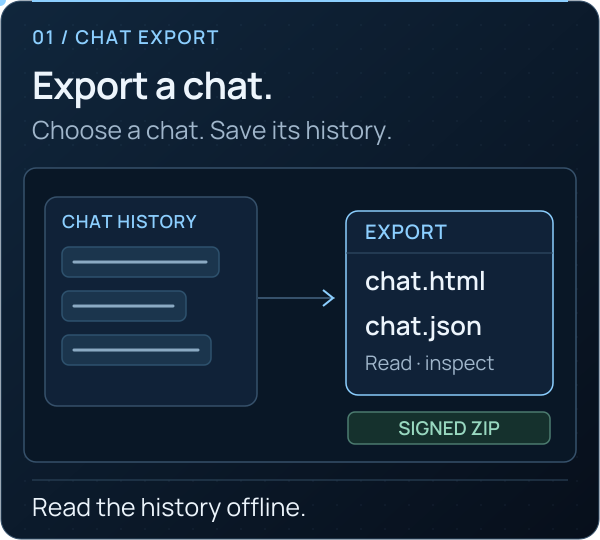

<picture>
  <source media="(max-width: 640px) and (prefers-reduced-motion: reduce)" srcset="../assets/presentation/wiki-chat-export-mobile-static.svg">
  <source media="(prefers-reduced-motion: reduce)" srcset="../assets/presentation/wiki-chat-export-static.svg">
  <source media="(max-width: 640px)" srcset="../assets/presentation/wiki-chat-export-mobile.svg">
  
</picture>

# Export one chat

**02 · INVESTIGATE AND EXPORT** · [All guides](Home.md) · [Get help](../../.github/SUPPORT.md)

On this page

- [Choose and export](#choose-and-export)
- [Choose the right kind of history](#choose-the-right-kind-of-history)
- [Verify and hand over](#verify-and-hand-over)

Saves what your account can see in a chat as a signed archive, with a readable
`chat.html` and a `chat.json` for tools.

<picture><source media="(prefers-reduced-motion: reduce)" srcset="../assets/presentation/readme-feature-export-static.svg"></picture>

## Choose and export

1. Pick the workspace and open **Chats**.
2. Open the chat, **Export chat** (or **Sources → Full chat export → Export full chat**).
3. Wait for it to finish and save the archive.
4. Keep the original. Unpack a copy, `chat.html` to read offline, `chat.json` for analysis.

The account needs access to the chat, private chats work too. One export per chat; for a
whole account use [account export](../ACCOUNT-EXPORT.md).

## Choose the right kind of history

| Your task | Use |
| --- | --- |
| Read a chat offline | **Full chat export** |
| Pull history of enabled sources into the journal | **Sources → Load full history** ([guide](../HISTORY.md)) |
| Grab recent messages into the journal | **History snapshot** |
| Catch edits and deletions as they happen | **Start observation** |
| Hand over observations, media and verification data | **Signed evidence ZIP** in Exports |

A chat export doesn't fill the journal or people profiles, and it can't bring back
messages or versions Telegram no longer returns.

## Verify and hand over

Use a verifier you trust and a key fingerprint you kept separately. Details in
[export and verification](Exports-and-Verification.md).

For a multi-chat case keep each export next to your source register and timeline, and keep
"sent at" and "collected at" apart.

**Continue:** [Work a case](Investigations.md) · [Verify a handoff](Exports-and-Verification.md)
