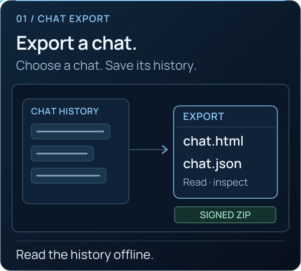

<picture>
  <source media="(max-width: 640px) and (prefers-reduced-motion: reduce)" srcset="../assets/presentation/wiki-chat-export-mobile-static.svg">
  <source media="(prefers-reduced-motion: reduce)" srcset="../assets/presentation/wiki-chat-export-static.svg">
  <source media="(max-width: 640px)" srcset="../assets/presentation/wiki-chat-export-mobile.svg">
  
</picture>

# Export one chat

**02 · INVESTIGATE AND EXPORT** · [All guides](Home.md) · [Get help](../../.github/SUPPORT.md)

On this page

- [Choose and export](#choose-and-export)
- [Choose the right kind of history](#choose-the-right-kind-of-history)
- [Verify and hand over](#verify-and-hand-over)

Save the history currently visible to your account as a signed archive with a
readable `chat.html` and a structured `chat.json`.

<picture><source media="(prefers-reduced-motion: reduce)" srcset="../assets/presentation/readme-feature-export-static.svg"></picture>

## Choose and export

1. Select the intended account workspace and open **Chats**.
2. Open the conversation and choose **Export chat**. The same task is available
   under **Sources → Full chat export → Export full chat**.
3. Wait for acquisition to finish and save the resulting archive.
4. Keep the original signed archive. Extract a copy and open `chat.html` to read
   the conversation offline; use `chat.json` for analysis.

The connected account must have access to the conversation. Private chats are
supported when visible to that account. Repeat the export for each source you
need; there is no single whole-account historical export.

## Choose the right kind of history

| Your task | Use |
| --- | --- |
| Read a chat's currently visible history offline | **Full chat export** |
| Bring earlier visible messages into the workspace journal | **History snapshot** |
| Keep edits and deletion notices as they arrive | **Start observation** |
| Hand over captured observations, preserved media and verification data | **Signed evidence ZIP** in Exports |

A full chat export does not populate the journal or people profiles with all
exported messages. It also cannot reconstruct messages or earlier versions that
Telegram no longer returns.

## Verify and hand over

Use a trusted copy of the verifier and an independently retained signing-key
fingerprint. The [export and verification guide](Exports-and-Verification.md)
explains the checks, trusted inputs and coverage limits.

For a case spanning several chats, retain each source's export alongside your
source register and timeline. Keep source time and acquisition time distinct.

**Continue:** [Work a case](Investigations.md) · [Verify a handoff](Exports-and-Verification.md)
