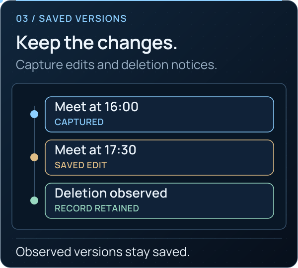

<picture>
  <source media="(max-width: 640px) and (prefers-reduced-motion: reduce)" srcset="../assets/presentation/wiki-collection-mobile-static.svg">
  <source media="(prefers-reduced-motion: reduce)" srcset="../assets/presentation/wiki-collection-static.svg">
  <source media="(max-width: 640px)" srcset="../assets/presentation/wiki-collection-mobile.svg">
  
</picture>

# Collection and coverage

**01 · CONNECT AND CAPTURE** · [All guides](Home.md) · [Get help](../../.github/SUPPORT.md)

On this page

- [Select the scope](#select-the-scope)
- [Check capture with a controlled conversation](#check-capture-with-a-controlled-conversation)
- [Understand the record](#understand-the-record)
- [Pause, lock and restart](#pause-lock-and-restart)

Observation records updates available to the connected account. TgWitness cannot read chats the account cannot access or reconstruct content that disappeared before it was observed.

<picture><source media="(prefers-reduced-motion: reduce)" srcset="../assets/presentation/readme-feature-history-static.svg"></picture>

## Select the scope

| Scope | Appropriate starting point |
| --- | --- |
| Chosen chats | A small, explicit source list |
| Telegram folder | Follow the supported chat types in a selected folder |
| Whole account | A dedicated investigation account, including new matching chats |

Open **Sources** and choose the scope. Review chat types, exclusions and whether to collect the account's own outgoing messages. Broad scopes can include private conversations and bots; confirm that these belong to your intended collection.

Select event categories separately: messages, edits, deletion notices, reactions and membership activity. Configure attachments by type and size. Press the relevant **Save** buttons, then **Start observation**.

## Check capture with a controlled conversation

1. From another account you control, send a distinct test message into a selected chat.
2. Wait until it is visible in **Chats** and **Journal**.
3. Edit it and confirm a separate captured version.
4. Delete it and inspect the deletion notice and previously captured text.
5. If testing attachments, wait for a completed media receipt; queued is not saved.
6. [Export and verify](Exports-and-Verification.md) the result.

Keep this controlled test separate from real case material.

<picture><source media="(prefers-reduced-motion: reduce)" srcset="../assets/presentation/readme-divider-static.svg"></picture>

## Understand the record

| Record | Meaning |
| --- | --- |
| New message / edit | A version the account observed |
| Deletion notice | Telegram delivered a deletion update; the earlier content may be unknown |
| Missing at recheck | A later query did not return a message; this is not the same as a deletion notice |
| History snapshot | The history currently visible to the account |
| Coverage gap | A recorded interruption or uncertainty |

Rechecks recover some missed current messages and changes. They cannot guarantee all intermediate edits or deletions. Priority and ordinary chats have different recheck schedules; see **Parameters** and the [collection reference](../COLLECTION.md).

## Pause, lock and restart

**Pause observation** stops collection. **Lock** and closing the browser leave the collector running. Stopping the application creates an interval without collection. After restarting, check account identity, observation state, gaps and attachment queues.

**Next:** [Investigations](Investigations.md) · [Exports](Exports-and-Verification.md) · [Collection reference](../COLLECTION.md)
