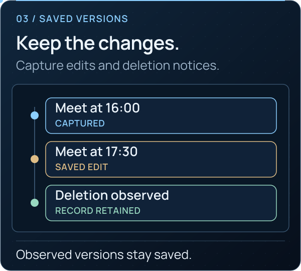

<picture>
  <source media="(max-width: 640px) and (prefers-reduced-motion: reduce)" srcset="../assets/presentation/wiki-collection-mobile-static.svg">
  <source media="(prefers-reduced-motion: reduce)" srcset="../assets/presentation/wiki-collection-static.svg">
  <source media="(max-width: 640px)" srcset="../assets/presentation/wiki-collection-mobile.svg">
  
</picture>

# Collection and coverage

**01 · CONNECT AND CAPTURE** · [All guides](Home.md) · [Get help](../../.github/SUPPORT.md)

On this page

- [Select the scope](#select-the-scope)
- [Check capture with a controlled conversation](#check-capture-with-a-controlled-conversation)
- [Understand the record](#understand-the-record)
- [Pause, lock and restart](#pause-lock-and-restart)

It records what the connected account gets.

<picture><source media="(prefers-reduced-motion: reduce)" srcset="../assets/presentation/readme-feature-history-static.svg"></picture>

## Select the scope

| Scope | Appropriate starting point |
| --- | --- |
| Chosen chats | A short, explicit list |
| Telegram folder | Everything in one folder |
| Whole account | A dedicated account, new chats included |

Pick the scope in **More tools → Sources → Scope**, then chat types, exclusions and whether to keep your own
outgoing messages. Broad scopes pull in private chats and bots, make sure you want that.

Event types are separate switches: messages, edits, deletions, reactions, joins/leaves.
Attachments by type and size. Hit **Save**, then **Start observation**.

## Check capture with a controlled conversation

1. From another account of yours, send a recognizable test message into a selected chat.
2. Wait for it in **Chats** and **Journal**.
3. Edit it, you should get a second version.
4. Delete it, the old text should still be there next to the deletion.
5. For attachments wait for the finished receipt, queued isn't saved.
6. [Export and verify](Exports-and-Verification.md).

Keep test material away from real case stuff.

<picture><source media="(prefers-reduced-motion: reduce)" srcset="../assets/presentation/readme-divider-static.svg"></picture>

## Understand the record

| Record | Meaning |
| --- | --- |
| New message / edit | A version the account saw |
| Deletion notice | Telegram said it was deleted, earlier content may be unknown |
| Missing at recheck | A later query didn't return it. Not the same as a deletion |
| History snapshot | What the account can see right now |
| Coverage gap | A recorded break or uncertainty |

Rechecks catch some of what was missed, never all in-between edits or deletions. Priority
chats get rechecked more often, see **More tools → Sources → Recording → Recheck** and the [collection reference](../COLLECTION.md).

## Pause, lock and restart

**Pause observation** stops collecting. **Lock** and closing the browser don't. While the app
is stopped nothing is collected. After a restart check the account, observation state, gaps
and download queues.

## Load older messages

**More tools → Sources → Chats in scope → Load full history** pulls the history of enabled sources, with pause/resume and
a signed progress report. Attachments finish separately. See [history acquisition](../HISTORY.md).

**Next:** [Investigations](Investigations.md) · [Exports](Exports-and-Verification.md) · [Collection reference](../COLLECTION.md)
