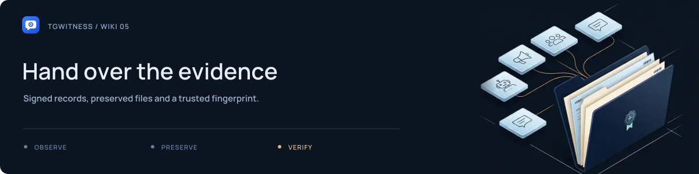

<picture>
  <source media="(max-width: 640px) and (prefers-reduced-motion: reduce)" srcset="../assets/presentation/wiki-exports-and-verification-mobile-static.svg">
  <source media="(prefers-reduced-motion: reduce)" srcset="../assets/presentation/wiki-exports-and-verification-static.svg">
  <source media="(max-width: 640px)" srcset="../assets/presentation/wiki-exports-and-verification-mobile.svg">
  
</picture>

# Exports and verification

**02 · INVESTIGATE AND EXPORT** · [All guides](Home.md) · [Get help](../../.github/SUPPORT.md)

On this page

- [See why the checks fit together](#see-why-the-checks-fit-together)
- [Choose the right output](#choose-the-right-output)
- [Make a handoff](#make-a-handoff)
- [Verify independently](#verify-independently)
- [Download a large export](#download-a-large-export)

## See why the checks fit together

<picture>
  <source media="(max-width: 640px) and (prefers-reduced-motion: reduce)" srcset="../assets/presentation/casework-chain-mobile-static.svg">
  <source media="(prefers-reduced-motion: reduce)" srcset="../assets/presentation/casework-chain-static.svg">
  <source media="(max-width: 640px)" srcset="../assets/presentation/casework-chain-mobile.svg">
  
</picture>

1. **Encode.** Nine fields including the previous hash become one canonical JSON value.
2. **Hash and sign.** SHA-256 over those bytes, Ed25519 over the digest.
3. **Verify.** Recompute hashes, check signatures, compare the fingerprint and checkpoint.

[Full-size animation](../assets/presentation/casework-chain.svg) · [Static diagram](../assets/presentation/casework-chain-static.svg) · [Formulas](../HOW-IT-WORKS.md)

## Choose the right output

| Output | Use |
| --- | --- |
| Signed evidence ZIP | Journal, signatures, manifest, media, offline report. The one to hand over |
| JSONL / CSV / HTML | For reading and analysis, keep the ZIP for verification |
| Full chat export | Chat history as visible right now |
| [Account export](../ACCOUNT-EXPORT.md) | Resumable account export with filters and signed coverage |
| [Minimized disclosure](../ACCOUNT-EXPORT.md#prepare-a-disclosure-for-a-lawyer-or-another-recipient) | Separate signed copy for one recipient, pseudonyms, text/files optional |
| People profile export | Derived facts with record references |
| Checkpoint | Signed journal boundary, keep it elsewhere |
| Run receipt | Program and version info for that run |

A chat export is a snapshot, it can't bring back old edits or deletions. An evidence ZIP
has no login secrets and isn't a backup.

### What a signed archive carries

| File | Purpose |
| --- | --- |
| `events.jsonl` / `chat.json` | The actual records |
| `report.html` / `chat.html` | Readable sealed report in your language |
| `custody.json` | Acquisition, export, case details, standards |
| `SHA256SUMS` | Hashes for `sha256sum -c`, no Python needed |
| `manifest.json` + `manifest.sig` | Signed list of every file |
| `README.txt` | How to verify, in the report language and English |

Report language, case title/ID, examiner and notes go under **Exports → Report settings**
and get signed in. Every report ends with an Ed25519 seal. Check it by dropping the file
onto the report in a browser, or with
`python -m tgwitness.verify report.html --fingerprint TRUSTED_SHA256 --evidence evidence.zip`.
It prints nicely to PDF, with a blank custody table.

<picture><source media="(prefers-reduced-motion: reduce)" srcset="../assets/presentation/readme-divider-static.svg"></picture>

## Make a handoff

1. Pick the workspace and note its key fingerprint.
2. In **Exports**, verify the journal.
3. Save the signed ZIP, a checkpoint and any history/profile exports.
4. Need a password? Use the encrypted option and send the password separately.
5. Send the fingerprint through a different channel than the archive.

A password-protected wrapper has to be unpacked first. The password protects access,
the signatures protect the content.

## Verify independently

From a trusted copy of the project:

~~~sh
python -m tgwitness.verify evidence.zip --fingerprint TRUSTED_SHA256
~~~

For the minimum for evidence, add time from a third party for the last record. With
evidence mode on, the ZIP carries RFC 3161 timestamps; check them with the timestamp
authority's root certificate:

~~~sh
python -m tgwitness.verify evidence.zip --fingerprint TRUSTED_SHA256 --tsa-ca TSA-ROOT.pem --require evidence
~~~

A checkpoint you kept (`--checkpoint checkpoint.json`) is checked too, but it is signed with
the collector key, so on its own it does not meet the minimum.

A pass means nothing covered by signatures, chain and manifest changed. Read the coverage
and gaps too. In a terminal you get a coloured summary (`--lang en|ru|uk`), `--json` for scripts.

<picture><source media="(prefers-reduced-motion: reduce)" srcset="../assets/presentation/readme-divider-static.svg"></picture>

## Download a large export

In the project environment, with a new filename:

~~~sh
python -m tgwitness.download --token-file data/live/panel-token.txt --out evidence.zip
~~~

Other workspace: `--profile ID` (ID is in **Exports**). Remote install: `--url https://your-server`.
The transfer checksum doesn't replace signature verification.

Browser fallback is capped at 128 MiB, the CLI at 5 GiB by default. Bigger limits:
[quick start](../QUICKSTART.md).

**Next:** [Trust and limitations](FAQ.md) · [Evidence reference](../EVIDENCE.md) · [External timestamps](../TIMESTAMP.md)
