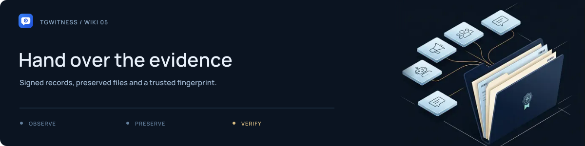

<picture>
  <source media="(max-width: 640px) and (prefers-reduced-motion: reduce)" srcset="../assets/presentation/wiki-exports-and-verification-mobile-static.svg">
  <source media="(prefers-reduced-motion: reduce)" srcset="../assets/presentation/wiki-exports-and-verification-static.svg">
  <source media="(max-width: 640px)" srcset="../assets/presentation/wiki-exports-and-verification-mobile.svg">
  
</picture>

# Exports and verification

**02 · INVESTIGATE AND EXPORT** · [All guides](Home.md) · [Get help](../../.github/SUPPORT.md)

On this page

- [See why the checks fit together](#see-why-the-checks-fit-together)
- [Choose the right output](#choose-the-right-output)
- [Make a handoff](#make-a-handoff)
- [Verify independently](#verify-independently)
- [Download a large export](#download-a-large-export)

## See why the checks fit together

<picture>
  <source media="(max-width: 640px) and (prefers-reduced-motion: reduce)" srcset="../assets/presentation/casework-chain-mobile-static.svg">
  <source media="(prefers-reduced-motion: reduce)" srcset="../assets/presentation/casework-chain-static.svg">
  <source media="(max-width: 640px)" srcset="../assets/presentation/casework-chain-mobile.svg">
  
</picture>

1. **Encode the event.** Nine fields, including the previous hash, become one canonical UTF-8 JSON value.
2. **Hash and sign.** SHA-256 describes those bytes; Ed25519 signs the 32 raw digest bytes.
3. **Verify the handoff.** Recompute every hash, check every signature and compare the key fingerprint and retained checkpoint.

[Open the full-size animation](../assets/presentation/casework-chain.svg) · [Static diagram](../assets/presentation/casework-chain-static.svg) · [Formulas and change scenarios](../HOW-IT-WORKS.md)

## Choose the right output

| Output | Use |
| --- | --- |
| Signed evidence ZIP | Captured journal, signatures, manifest, retained media and an offline report |
| JSONL / CSV / HTML | Analysis or reading; retain the signed ZIP for verification |
| Full chat export | The chat history visible at acquisition time |
| People profile export | Derived observations with record references |
| Checkpoint | A signed journal boundary to retain separately |
| Run receipt | The collector's program/version information for that run |

A full chat export is a snapshot of current visible history. It cannot recreate every earlier edit or deletion. An evidence ZIP excludes login secrets and is not a full application backup.

<picture><source media="(prefers-reduced-motion: reduce)" srcset="../assets/presentation/readme-divider-static.svg"></picture>

## Make a handoff

1. Select the intended workspace and note its public-key fingerprint.
2. Open **Exports** and verify the journal.
3. Save the signed ZIP, a checkpoint and any relevant history/profile exports.
4. If you need password protection, choose the encrypted export option and transfer the password separately.
5. Give the recipient the expected fingerprint through a trusted channel separate from the archive.

For a password-protected wrapper, decrypt it first to obtain the inner signed archive. Encryption protects access to the file; signatures verify its signed content.

## Verify independently

Use a trusted copy of the project and its installed Python environment:

~~~sh
python -m tgwitness.verify evidence.zip --fingerprint TRUSTED_SHA256
~~~

With a previously retained checkpoint:

~~~sh
python -m tgwitness.verify evidence.zip --fingerprint TRUSTED_SHA256 --checkpoint checkpoint.json
~~~

Replace the placeholders with the actual files and trusted fingerprint. A successful check detects changes covered by the signatures, hash chain and manifest. Read the reported coverage and gaps too.

<picture><source media="(prefers-reduced-motion: reduce)" srcset="../assets/presentation/readme-divider-static.svg"></picture>

## Download a large export

Activate the project environment and use a new output filename:

~~~sh
python -m tgwitness.download --token-file data/live/panel-token.txt --out evidence.zip
~~~

For another workspace add `--profile ID`; obtain its ID from **Exports**. For a remote installation add `--url https://your-server`. The transfer checksum does not replace signature verification.

The browser fallback is limited to 128 MiB; supported browsers can stream to a chosen file. The download CLI defaults to a 5 GiB transfer limit. Larger verification limits and per-workspace settings are described in the [quick start](../QUICKSTART.md).

**Next:** [Trust and limitations](FAQ.md) · [Evidence reference](../EVIDENCE.md) · [External timestamps](../TIMESTAMP.md)
