<picture>
  <source media="(max-width: 640px) and (prefers-reduced-motion: reduce)" srcset="../assets/presentation/wiki-faq-mobile-static.svg">
  <source media="(prefers-reduced-motion: reduce)" srcset="../assets/presentation/wiki-faq-static.svg">
  <source media="(max-width: 640px)" srcset="../assets/presentation/wiki-faq-mobile.svg">
  
</picture>

# Frequently asked questions

**05 · FIND AN ANSWER** · [All guides](Home.md) · [Get help](../../.github/SUPPORT.md)

On this page

- [Does TgWitness recover messages deleted before it started?](#does-tgwitness-recover-messages-deleted-before-it-started)
- [Does a valid signature prove Telegram sent the message?](#does-a-valid-signature-prove-telegram-sent-the-message)
- [Is every Telegram event guaranteed to arrive?](#is-every-telegram-event-guaranteed-to-arrive)
- [Can I use a bot token instead of a user account?](#can-i-use-a-bot-token-instead-of-a-user-account)
- [Do I need my own API ID and API hash?](#do-i-need-my-own-api-id-and-api-hash)
- [Can several people have separate access permissions?](#can-several-people-have-separate-access-permissions)
- [Are messages and attachments encrypted on disk?](#are-messages-and-attachments-encrypted-on-disk)
- [Does Lock stop collection?](#does-lock-stop-collection)
- [Why can two accounts show different histories?](#why-can-two-accounts-show-different-histories)
- [Does a public proxy failure switch me to a direct connection?](#does-a-public-proxy-failure-switch-me-to-a-direct-connection)
- [Are an evidence export and a backup interchangeable?](#are-an-evidence-export-and-a-backup-interchangeable)
- [Is a witness on my server independent?](#is-a-witness-on-my-server-independent)
- [Is Linux, macOS or Docker support already fully qualified?](#is-linux-macos-or-docker-support-already-fully-qualified)
- [How do I report a problem or contribute?](#how-do-i-report-a-problem-or-contribute)

## Does TgWitness recover messages deleted before it started?

No. A deletion notice may be recorded without prior content. History acquisition returns what is currently visible to the account, not a reconstruction of all earlier versions.

## Does a valid signature prove Telegram sent the message?

No. It verifies integrity relative to a signing key. An operator controlling the collector and key can fabricate a journal. Separately retained checkpoints and independent witnesses constrain later rewriting, but do not establish Telegram origin by themselves.

<picture><source media="(prefers-reduced-motion: reduce)" srcset="../assets/presentation/readme-divider-static.svg"></picture>

## Is every Telegram event guaranteed to arrive?

No. Account permissions, connection failures, service behavior and process interruptions affect visibility. Rechecks and saved update state help recovery, but coverage reports and controlled delivery tests still matter.

## Can I use a bot token instead of a user account?

The collector uses a Telegram user authorization through MTProto. A bot token is used separately by the optional witness.

<picture><source media="(prefers-reduced-motion: reduce)" srcset="../assets/presentation/readme-divider-static.svg"></picture>

## Do I need my own API ID and API hash?

They are optional in the normal sign-in flow. The workspace can reuse saved/imported credentials or use the built-in pool. They identify an application; they do not provide account access without authorization.

## Can several people have separate access permissions?

Yes. Issue a token under **Access**, choose its workspaces/chats and permissions, then set limits if needed. The main panel token remains unrestricted; a witness token is separate. See [access and permissions](Access.md).

<picture><source media="(prefers-reduced-motion: reduce)" srcset="../assets/presentation/readme-divider-static.svg"></picture>

## Are messages and attachments encrypted on disk?

The vault encrypts sessions, credentials and signing secrets. The local journal and attachments are not encrypted by TgWitness. Use disk encryption and restrictive permissions. Exports can optionally be wrapped in a password-protected ZIP.

## Does Lock stop collection?

No. Lock clears browser access; the running collector continues. Pause observation stops collection. Closing the tab also leaves the process running.

<picture><source media="(prefers-reduced-motion: reduce)" srcset="../assets/presentation/readme-divider-static.svg"></picture>

## Why can two accounts show different histories?

They may have different access, membership dates and visibility. Each workspace preserves its own observations and signing identity. Compare records with their original workspace attached.

## Does a public proxy failure switch me to a direct connection?

Hide IP mode does not fall back to Direct. The explicitly selected fallback mode can connect directly after its configured delay; tunnel/VPN mode permits direct routes. External HTTP requests and the independent witness have their own routing rules. See [connection routes](Proxies.md).

<picture><source media="(prefers-reduced-motion: reduce)" srcset="../assets/presentation/readme-divider-static.svg"></picture>

## Are an evidence export and a backup interchangeable?

No. An evidence export deliberately excludes login and signing secrets. A service backup must preserve the entire stopped data directory and any external master key.

## Is a witness on my server independent?

It has a separate process and key, but the same operator still controls that server. Independent custody requires a separate operator or system outside that control.

<picture><source media="(prefers-reduced-motion: reduce)" srcset="../assets/presentation/readme-divider-static.svg"></picture>

## Is Linux, macOS or Docker support already fully qualified?

Consult the current [verification record](../VERIFICATION.md). Implemented launchers and CI definitions are not evidence that every platform and live-service scenario has been executed.

## How do I report a problem or contribute?

Use [Support](../../.github/SUPPORT.md) for help and bug reports, [Contributing](../../.github/CONTRIBUTING.md) for development, and [Security](../../.github/SECURITY.md) for vulnerabilities.
