<picture>
  <source media="(max-width: 640px) and (prefers-reduced-motion: reduce)" srcset="../assets/presentation/wiki-faq-mobile-static.svg">
  <source media="(prefers-reduced-motion: reduce)" srcset="../assets/presentation/wiki-faq-static.svg">
  <source media="(max-width: 640px)" srcset="../assets/presentation/wiki-faq-mobile.svg">
  
</picture>

# Frequently asked questions

**05 · FIND AN ANSWER** · [All guides](Home.md) · [Get help](../../.github/SUPPORT.md)

On this page

- [What happens to messages deleted before collection started?](#what-happens-to-messages-deleted-before-collection-started)
- [How is a message's Telegram origin established?](#how-is-a-messages-telegram-origin-established)
- [What does archive verification check?](#what-does-archive-verification-check)
- [How does TgWitness track event delivery?](#how-does-tgwitness-track-event-delivery)
- [Which account does the collector use?](#which-account-does-the-collector-use)
- [Do I need my own API ID and API hash?](#do-i-need-my-own-api-id-and-api-hash)
- [Where are my Telegram sessions stored?](#where-are-my-telegram-sessions-stored)
- [How do I verify the installer before running it?](#how-do-i-verify-the-installer-before-running-it)
- [Can several people have separate access permissions?](#can-several-people-have-separate-access-permissions)
- [Are messages and attachments encrypted on disk?](#are-messages-and-attachments-encrypted-on-disk)
- [Does Lock stop collection?](#does-lock-stop-collection)
- [Why can two accounts show different histories?](#why-can-two-accounts-show-different-histories)
- [Does a public proxy failure switch me to a direct connection?](#does-a-public-proxy-failure-switch-me-to-a-direct-connection)
- [How do an evidence export and a backup differ?](#how-do-an-evidence-export-and-a-backup-differ)
- [How independent is a witness?](#how-independent-is-a-witness)
- [Which platforms are tested?](#which-platforms-are-tested)
- [How do I report a problem or contribute?](#how-do-i-report-a-problem-or-contribute)

## What happens to messages deleted before collection started?

Collection starts with what the account can see at that moment. History loading saves
the current version of every visible message, a deletion notice for an earlier message
is kept as a notice, and live observation keeps every later edit and deletion.

## How is a message's Telegram origin established?

Through the session it arrives on. Telegram delivers messages to every client, official
apps included, over an MTProto session rather than with per-message signatures. The
session key is negotiated against Telegram's pinned server key, and every update arrives
encrypted and integrity-checked under it. TgWitness signs each observation into its
journal as it arrives. [GitHub Actions capture](../SEALED-ACTIONS.md) and
[Intel TDX deployments](../HIGH-ASSURANCE.md) add attestation of the collector that
received it. [Where the messages come from](../EVIDENCE.md#where-the-messages-come-from)

## What does archive verification check?

Record signatures, the journal chain, the file manifest and attachment hashes. Give it a
key fingerprint and checkpoint kept elsewhere and it also checks the expected key and an
earlier journal state. The minimum for evidence also needs time from a third party for
the last record: a verified RFC 3161 or OpenTimestamps receipt, or a witness post read
from t.me. A checkpoint alone is not enough, because the collector key signs it. A
witness adds more checkpoints, and
[GitHub Actions capture](../SEALED-ACTIONS.md) also checks the archive's provenance against
the approved workflow and collector version.

[Verification steps](Exports-and-Verification.md) · [Technical trust model](../SECURITY-MODEL.md)

<picture><source media="(prefers-reduced-motion: reduce)" srcset="../assets/presentation/readme-divider-static.svg"></picture>

## How does TgWitness track event delivery?

Each workspace records coverage: when observation ran, gaps after restarts or network
drops, and their recovery. After a restart, missed updates are requested from the saved
update position, and rechecks confirm saved messages. The coverage report shows exactly
which periods the record speaks for.

## Which account does the collector use?

A Telegram user account, which receives the same messages you see in the app. Bot tokens
serve the optional witness.

<picture><source media="(prefers-reduced-motion: reduce)" srcset="../assets/presentation/readme-divider-static.svg"></picture>

## Do I need my own API ID and API hash?

The built-in pool works, and saved or imported credentials are reused. An API pair
identifies the app; account access comes from the login.

## Where are my Telegram sessions stored?

In the workspace's encrypted vault on your own computer or server. The panel listens on
localhost by default, and the application has no telemetry. Observe with a
[dedicated account](../ACCOUNTS.md).

## How do I verify the installer before running it?

Download the script with its signature and check both against the release key
fingerprint with the [verify-first commands](../INSTALLATION.md#verify-before-running).
The download site is built by the public
[Installer workflow](../../.github/workflows/installer.yml) from the exact `main`
revision, and the installer checks the SHA-256 and RSA signature of the package and
dependency lock before installing.

## Can several people have separate access permissions?

Yes. Create a token under **Access**, pick workspaces, chats and permissions, add limits
if you want. The main panel token stays unrestricted. See [access and permissions](Access.md).

<picture><source media="(prefers-reduced-motion: reduce)" srcset="../assets/presentation/readme-divider-static.svg"></picture>

## Are messages and attachments encrypted on disk?

Sessions, credentials and keys are encrypted in the vault. Protect the journal and files
with disk encryption such as BitLocker, LUKS or FileVault; exports can carry an AES-256
password.

## Does Lock stop collection?

Lock closes the browser panel, and collection keeps running. **Pause observation** stops
collecting; closing the tab leaves it running too.

<picture><source media="(prefers-reduced-motion: reduce)" srcset="../assets/presentation/readme-divider-static.svg"></picture>

## Why can two accounts show different histories?

Different access, join dates, visibility. Each workspace keeps its own observations and
key, so always say which workspace a record came from.

## Does a public proxy failure switch me to a direct connection?

With **Hide the address**, collection waits for a working proxy. **Direct as a last
resort** goes direct after a delay, and **Server behind a tunnel or VPN** allows direct.
Outside requests and the witness have their own rules. See [connection routes](Proxies.md).

<picture><source media="(prefers-reduced-motion: reduce)" srcset="../assets/presentation/readme-divider-static.svg"></picture>

## How do an evidence export and a backup differ?

An export carries the records and verification material for a recipient and leaves out
login and signing secrets. A backup is the whole stopped data directory plus any external
vault key, for restoring the installation.

## How independent is a witness?

A witness has its own process and key and records checkpoints and rollback on any host.
Run it on another host under another operator for full independence. The verifier sees
only a second key; who controls it is a custody fact you record. External time comes
from Telegram's dates on the witness posts, read live from the public t.me page.

<picture><source media="(prefers-reduced-motion: reduce)" srcset="../assets/presentation/readme-divider-static.svg"></picture>

## Which platforms are tested?

CI tests the Linux and Windows installers on changes to `main`. The
[verification record](../VERIFICATION.md) lists live runs per platform and revision.

## How do I report a problem or contribute?

[Support](../../.github/SUPPORT.md) for help and bugs, [Contributing](../../.github/CONTRIBUTING.md)
for code, [Security](../../.github/SECURITY.md) for vulnerabilities.
