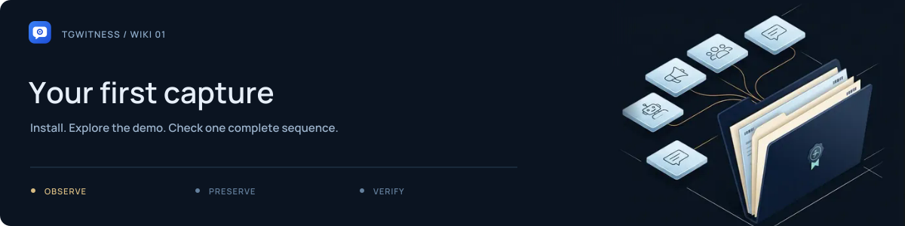

# Getting started

[Project](../../README.md) · [Documentation](../README.md) · [Wiki](Home.md) · [Support](../../.github/SUPPORT.md)

## 1. Choose an installation

Download and extract the source archive or clone the project. Portable packages become available after a release has been published.

| Method | Start | Requirements |
| --- | --- | --- |
| Windows source | Double-click `Start.cmd` | Python 3.11+; the launcher offers installation if missing |
| Linux / macOS source | `sh start.sh` | Python 3.11+ with `venv` |
| Windows portable | Extract the entire ZIP; open `TgWitness.cmd` | Embedded Python is included |
| Docker | `scripts\Docker.cmd` on Windows; `sh scripts/docker-start.sh` elsewhere | Docker with Compose 2.20+ |

The source launcher creates a private `.venv` and installs dependencies. Keep the native application's console open while collecting. Docker runs in the background.

## 2. Explore without an account

For source installations, run `scripts\Demo.cmd` on Windows or:

~~~sh
sh start.sh --demo
~~~

The portable equivalent is `TgWitness-Demo.cmd`. Open **http://127.0.0.1:8787**. Direct local access to this isolated demo opens automatically with fictional conversations.

Look at **Chats**, **Journal** and **Exports**. Try the language and theme controls. Press **Ctrl+K** or **⌘K** to find a section.

<picture><source media="(prefers-reduced-motion: reduce)" srcset="../assets/presentation/readme-divider-static.svg"></picture>

## 3. Start your real workspace

Stop the demo before starting the live application on the same port. Run `Start.cmd`, `sh start.sh` or `TgWitness.cmd`.

| Installation | Panel token |
| --- | --- |
| Source or portable, default live directory | `data/live/panel-token.txt` |
| Source or portable with a custom data directory | `panel-token.txt` inside that directory |
| Docker | `docker compose exec tgwitness cat /data/panel-token.txt` |

Open the panel and enter its token. Follow [Accounts](Accounts.md), then [Collection](Collection.md). Native and Docker installations use separate data stores.

## 4. Check your installation

From the source folder:

~~~sh
python start.py --check --json
~~~

This checks local prerequisites without connecting to Telegram. If the environment has not been created, run `python start.py --setup-only` first. To test another port, add `--port 8791`.

Commands elsewhere in this wiki that begin with `python -m tgwitness` require the installed project environment. Activate `.venv`, or use `.venv\Scripts\python.exe` on Windows / `.venv/bin/python` on Linux and macOS.

**Next:** [Connect an account](Accounts.md) · [Troubleshooting](Troubleshooting.md) · [Complete quick start](../QUICKSTART.md)
