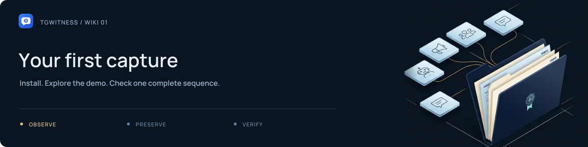

<picture>
  <source media="(max-width: 640px) and (prefers-reduced-motion: reduce)" srcset="../assets/presentation/wiki-getting-started-mobile-static.svg">
  <source media="(prefers-reduced-motion: reduce)" srcset="../assets/presentation/wiki-getting-started-static.svg">
  <source media="(max-width: 640px)" srcset="../assets/presentation/wiki-getting-started-mobile.svg">
  
</picture>

# Getting started

**01 · START HERE** · [All guides](Home.md) · [Get help](../../.github/SUPPORT.md)

On this page

- [1. Choose an installation](#1-choose-an-installation)
- [2. Explore without an account](#2-explore-without-an-account)
- [3. Start your real workspace](#3-start-your-real-workspace)
- [4. Check your installation](#4-check-your-installation)

## 1. Choose an installation

Easiest is the [one-line installer](../INSTALLATION.md). Otherwise grab a release ZIP or clone the repo.

| Method | Start | Requirements |
| --- | --- | --- |
| Windows source | Double-click `Start.cmd` | Python 3.11+, the launcher offers to install it |
| Linux / macOS source | `sh start.sh` | Python 3.11+ with `venv` |
| Windows portable | Unpack the whole ZIP, open `TgWitness.cmd` | Python is inside |
| Docker | `scripts\Docker.cmd` or `sh scripts/docker-start.sh` | Docker with Compose 2.20+ |

The launcher makes its own `.venv`. Leave the console window open while it collects. Docker runs in the background.

## 2. Explore without an account

For source installations, run `scripts\Demo.cmd` on Windows or:

~~~sh
sh start.sh --demo
~~~

Portable: `TgWitness-Demo.cmd`. Open **http://127.0.0.1:8787**, the demo opens straight away with made-up chats.

Poke around **Chats**, **Journal** and **Exports**, switch language and theme, try **Ctrl+K** / **⌘K**.

<picture><source media="(prefers-reduced-motion: reduce)" srcset="../assets/presentation/readme-divider-static.svg"></picture>

## 3. Start your real workspace

Stop the demo first (same port), then run `Start.cmd`, `sh start.sh` or `TgWitness.cmd`.

| Installation | Panel token |
| --- | --- |
| One-line installer | Printed by the installer; `tgwitness open` shows it again |
| Source or portable, default live directory | `data/live/panel-token.txt` |
| Source or portable with a custom data directory | `panel-token.txt` inside that directory |
| Docker | `docker compose exec tgwitness cat /data/panel-token.txt` |

Open the panel, paste the token, then go to [Accounts](Accounts.md) and [Collection](Collection.md). Native and Docker installs don't share data.

## 4. Check your installation

From the source folder:

~~~sh
python start.py --check --json
~~~

Checks prerequisites without touching Telegram. No environment yet? `python start.py --setup-only` first. Other port: `--port 8791`.

`python -m tgwitness…` commands in this wiki need the project environment: activate `.venv` or call `.venv\Scripts\python.exe` / `.venv/bin/python`.

**Next:** [Connect an account](Accounts.md) · [Troubleshooting](Troubleshooting.md) · [Complete quick start](../QUICKSTART.md)
