<picture>
  <source media="(max-width: 640px) and (prefers-reduced-motion: reduce)" srcset="../assets/presentation/wiki-glossary-mobile-static.svg">
  <source media="(prefers-reduced-motion: reduce)" srcset="../assets/presentation/wiki-glossary-static.svg">
  <source media="(max-width: 640px)" srcset="../assets/presentation/wiki-glossary-mobile.svg">
  
</picture>

# Glossary

**05 · FIND AN ANSWER** · [All guides](Home.md) · [Get help](../../.github/SUPPORT.md)

On this page

| Term | Meaning in TgWitness |
| --- | --- |
| Workspace | One account's local session, journal, signing identity, sources and settings |
| Collector | The process component that observes updates available to an account |
| Source | A chat, group, channel or bot conversation selected by the collection scope |
| Scope | Which chats and chat types are eligible for collection |
| Observation | A record of what the collector saw at a particular time |
| Source time | A timestamp supplied by the source, where available |
| Observation time | When the collector recorded the observation |
| Journal | The append-only sequence of signed observations |
| Sequence number | A record's position within one journal |
| Captured version | One observed state of a message, including its relevant content |
| Deletion notice | An update indicating deletion; it may refer to content never captured |
| Missing at recheck | A message was absent from a later query; it is not automatically a deletion notice |
| Snapshot | History visible at the time of acquisition |
| Coverage gap | A recorded interruption or uncertainty in observation |
| Hash chain | Each record incorporates the preceding record's hash |
| Signature | A cryptographic check tied to a signing key; not a Telegram signature |
| Fingerprint | A compact hash identifying a public key, retained separately for trust decisions |
| Checkpoint | A signed journal boundary with its record count and head hash |
| Manifest | The file inventory and hashes covered by a signed export |
| Run receipt | Information about the collector program and a particular run |
| Vault | Encrypted storage for sessions, credentials and signing secrets |
| Panel token | The secret granting control of all workspaces through the panel |
| Witness token | A scoped secret for reading signed boundaries, counters and health |
| Witness | A separately keyed observer of the collector's signed statements |
| Proof monitor | A read-only dashboard of signed capture counters and health |
| People profile | Derived observations about a Telegram ID, with references to saved records |
| FloodWait | A Telegram instruction to wait before making further requests |
| MTProxy | A Telegram transport proxy; not a general HTTPS proxy |

For the cryptographic format, see [Evidence](../EVIDENCE.md). For a worked explanation of versions, hashes and checkpoints, see [How it works](../HOW-IT-WORKS.md).
