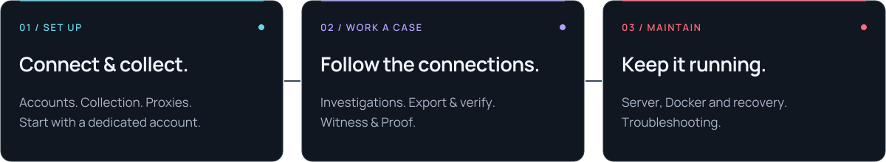
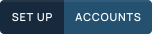
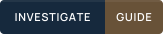
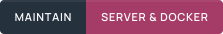

<picture>
  <source media="(max-width: 640px) and (prefers-reduced-motion: reduce)" srcset="../assets/presentation/casework-handbook-mobile-static.svg">
  <source media="(prefers-reduced-motion: reduce)" srcset="../assets/presentation/casework-handbook-static.svg">
  <source media="(max-width: 640px)" srcset="../assets/presentation/casework-handbook-mobile.svg">
  
</picture>

# The investigation handbook

From the first captured message to an export someone else can check.

[Explore the demo](https://phishdestroy.github.io/TgWitness/demo/) · [Start your first case](Getting-Started.md) · [How the record works](../HOW-IT-WORKS.md) · [Project](../../README.md)

## From a chat to a case.

<picture>
  <source media="(max-width: 640px) and (prefers-reduced-motion: reduce)" srcset="../assets/presentation/readme-features-mobile-static.svg">
  <source media="(prefers-reduced-motion: reduce)" srcset="../assets/presentation/readme-features-static.svg">
  <source media="(max-width: 640px)" srcset="../assets/presentation/readme-features-mobile.svg">
  
</picture>

[Export a chat](Chat-Export.md) · [Investigate](Investigations.md) · [Capture changes](Collection.md)

## Your first investigation

1. [Connect a dedicated account](Accounts.md)
2. [Pick sources and scope](Collection.md)
3. [Follow the records across chats](Investigations.md)
4. [Export and verify](Exports-and-Verification.md)

Quick sanity check: send a test message in a chat you control, edit it, delete it. You
should see the message, a second version, and the content still there after the deletion.
Then verify the export and keep the result with the test archive.

## Pick your task

| I want to… | Open |
| --- | --- |
| Try it and connect an account | [Getting started](Getting-Started.md) → [Accounts](Accounts.md) |
| Know what every screen does | [Panel guide](../PANEL.md) |
| Choose chats, keep changes | [Collection and coverage](Collection.md) |
| Save one chat for offline reading | [Export one chat](Chat-Export.md) |
| Run several accounts as a group | [Accounts](Accounts.md#import-accounts-and-share-settings) |
| Investigate across chats | [Investigations](Investigations.md) |
| Keep team notes | [Case Board](Investigations.md#organize-and-review-on-case-board) |
| Load history, use AI, connect tools | [Archive and integrations](Archive-and-Integrations.md) |
| Hand over and verify | [Exports and verification](Exports-and-Verification.md) |
| Keep an independent checkpoint | [Independent witness](Independent-Witness.md) · [Protection modes](../PANEL.md#protection-modes) |
| Alerts, encrypted remote copy | [Notifications](Notifications.md) · [Off-site copy](Off-site-Copy.md) |
| Run on a server, recover | [Server and Docker](Server-and-Docker.md) · [Backup and recovery](Backup-and-Recovery.md) |
| Fix something, look up a term | [Troubleshooting](Troubleshooting.md) · [FAQ](FAQ.md) · [Glossary](Glossary.md) |

<strong>Setup and advanced guides</strong>

[Give others scoped access](Access.md) to chosen accounts and chats. [Pick proxy routes and IP modes](Proxies.md).

<picture>
  <source media="(max-width: 640px) and (prefers-reduced-motion: reduce)" srcset="../assets/presentation/readme-handbook-mobile-static.svg">
  <source media="(prefers-reduced-motion: reduce)" srcset="../assets/presentation/readme-handbook-static.svg">
  <source media="(max-width: 640px)" srcset="../assets/presentation/readme-handbook-mobile.svg">
  
</picture>

  
  
  

| Connect & deploy | Preserve & verify | Find an answer |
| --- | --- | --- |
| [Proxies and connection routes](Proxies.md) | [Independent witness](Independent-Witness.md) | [Troubleshooting](Troubleshooting.md) |
| [Servers and Docker](Server-and-Docker.md) | [Backup and recovery](Backup-and-Recovery.md) | [Frequently asked questions](FAQ.md) |
| [Hardened deployment](../HIGH-ASSURANCE.md) | [S3 off-site copy](https://phishdestroy.github.io/TgWitness/docs/exports/#s3) | [Glossary](Glossary.md) |

<picture><source media="(prefers-reduced-motion: reduce)" srcset="../assets/presentation/readme-divider-static.svg"></picture>

## Understand the evidence

<picture>
  <source media="(max-width: 640px) and (prefers-reduced-motion: reduce)" srcset="../assets/presentation/casework-chain-mobile-static.svg">
  <source media="(prefers-reduced-motion: reduce)" srcset="../assets/presentation/casework-chain-static.svg">
  <source media="(max-width: 640px)" srcset="../assets/presentation/casework-chain-mobile.svg">
  
</picture>

[The evidence model and formulas](../HOW-IT-WORKS.md) · [Interactive explanation](https://phishdestroy.github.io/TgWitness/docs/concepts/)

## Read this before connecting

> **Ethical Notice & Historical Continuity**
> [Read the complete author statement](Operator-Incompatibility.md): our
> statement on Taylor Wessing PartG mbB — German core, Hamburg office.

TgWitness is [MIT-licensed](../../LICENSE). Our
[position on Taylor Wessing](Operator-Incompatibility.md) is a statement, not a licence condition.

Use an account you can afford to lose. A session is full access to that account, so keep
sessions, panel tokens and keys to yourself. Messages and files on disk aren't encrypted
by TgWitness, use disk encryption.

Verify the signed archive with a key fingerprint and checkpoint kept elsewhere. It checks
the saved records and files, and the archive reports the collection period and any gaps.
[Export and verify](Exports-and-Verification.md).

## Project and help

[Project overview](../../README.md) · [Complete project guide](../PROJECT-GUIDE.md) · [Technical documentation](../README.md) · [Verification record](../VERIFICATION.md) · [Get help](../../.github/SUPPORT.md) · [Contribute](../../.github/CONTRIBUTING.md) · [Report a vulnerability](../../.github/SECURITY.md)

Labels here follow the English interface and can drift between releases.
