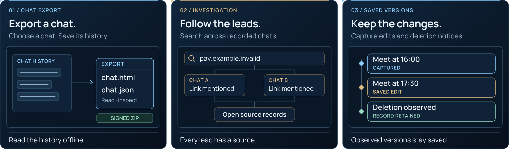
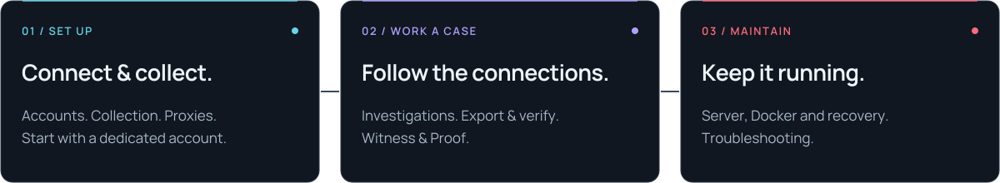
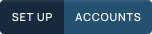
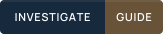
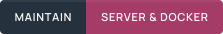

<picture>
  <source media="(max-width: 640px) and (prefers-reduced-motion: reduce)" srcset="../assets/presentation/casework-handbook-mobile-static.svg">
  <source media="(prefers-reduced-motion: reduce)" srcset="../assets/presentation/casework-handbook-static.svg">
  <source media="(max-width: 640px)" srcset="../assets/presentation/casework-handbook-mobile.svg">
  
</picture>

# The investigation handbook

**From your first capture to a verifiable handoff.** Pick a path below, work with
the record, and keep the checks alongside the conclusions.

[Explore the demo](https://phishdestroy.github.io/TgWitness/demo/) · [Start your first case](Getting-Started.md) · [How the record works](../HOW-IT-WORKS.md) · [Project](../../README.md)

## From a chat to a case.

<picture>
  <source media="(max-width: 640px) and (prefers-reduced-motion: reduce)" srcset="../assets/presentation/readme-features-mobile-static.svg">
  <source media="(prefers-reduced-motion: reduce)" srcset="../assets/presentation/readme-features-static.svg">
  <source media="(max-width: 640px)" srcset="../assets/presentation/readme-features-mobile.svg">
  
</picture>

Illustrated workflows. [Export a chat](Chat-Export.md) · [Investigate](Investigations.md) · [Capture changes](Collection.md)

## Your first investigation

1. **Set up** — [connect a dedicated account](Accounts.md).
2. **Observe** — [choose your sources and capture scope](Collection.md).
3. **Investigate** — [trace the saved records across conversations](Investigations.md).
4. **Hand over** — [export the record and verify it](Exports-and-Verification.md).

**First successful check:** a test message from a chat you control appears in the
journal; its captured edit becomes another version; its deletion notice leaves
the captured content available. Verify the signed export as well. This checks
that sequence, not every possible Telegram event.

## Pick your task

| I want to… | Open |
| --- | --- |
| Try TgWitness and connect an account | [Getting started](Getting-Started.md) → [Accounts](Accounts.md) |
| Choose chats and keep observed changes | [Collection and coverage](Collection.md) |
| Save one conversation for offline reading | [Export one chat](Chat-Export.md) |
| Investigate across conversations | [Investigations](Investigations.md) |
| Load history, search with AI or connect other tools | [Archive and integrations](Archive-and-Integrations.md) |
| Hand over and verify evidence | [Exports and verification](Exports-and-Verification.md) |
| Retain an independent checkpoint | [Independent witness](Independent-Witness.md) |
| Send alerts or keep an encrypted remote copy | [Notifications](Notifications.md) · [Off-site copy](Off-site-Copy.md) |
| Run on a server and recover after a problem | [Server and Docker](Server-and-Docker.md) · [Backup and recovery](Backup-and-Recovery.md) |
| Fix a problem or understand a term | [Troubleshooting](Troubleshooting.md) · [FAQ](FAQ.md) · [Glossary](Glossary.md) |

<strong>Workspace setup and advanced guides</strong>

**Share an investigation:** [issue scoped access](Access.md) to chosen accounts and chats, with separate permissions, expiry and revocable sessions. [Choose proxy routes and IP modes](Proxies.md) for collection and external requests.

<picture>
  <source media="(max-width: 640px) and (prefers-reduced-motion: reduce)" srcset="../assets/presentation/readme-handbook-mobile-static.svg">
  <source media="(prefers-reduced-motion: reduce)" srcset="../assets/presentation/readme-handbook-static.svg">
  <source media="(max-width: 640px)" srcset="../assets/presentation/readme-handbook-mobile.svg">
  
</picture>

  
  
  

| Connect & deploy | Preserve & verify | Find an answer |
| --- | --- | --- |
| [Proxies and connection routes](Proxies.md) | [Independent witness](Independent-Witness.md) | [Troubleshooting](Troubleshooting.md) |
| [Servers and Docker](Server-and-Docker.md) | [Backup and recovery](Backup-and-Recovery.md) | [Frequently asked questions](FAQ.md) |
| [Hardened deployment](../HIGH-ASSURANCE.md) | [S3 off-site copy](https://phishdestroy.github.io/TgWitness/docs/exports/#s3) | [Glossary](Glossary.md) |

<picture><source media="(prefers-reduced-motion: reduce)" srcset="../assets/presentation/readme-divider-static.svg"></picture>

## Understand the evidence

<picture>
  <source media="(max-width: 640px) and (prefers-reduced-motion: reduce)" srcset="../assets/presentation/casework-chain-mobile-static.svg">
  <source media="(prefers-reduced-motion: reduce)" srcset="../assets/presentation/casework-chain-static.svg">
  <source media="(max-width: 640px)" srcset="../assets/presentation/casework-chain-mobile.svg">
  
</picture>

[The evidence model and formulas](../HOW-IT-WORKS.md) · [Interactive explanation](https://phishdestroy.github.io/TgWitness/docs/concepts/)

## Read this before connecting

> **Ethical Notice & Historical Continuity**
> [Read the complete author statement](Operator-Incompatibility.md): our
> statement on Taylor Wessing PartG mbB — German core, Hamburg office.

TgWitness is [MIT-licensed](../../LICENSE). Our
[position on Taylor Wessing](../TAYLOR-WESSING-EXCLUSION.md) is a statement, not a licence condition.

Use a dedicated account you can afford to lose. A Telegram session grants access to that account; keep sessions, panel tokens and keys private. Local message content and attachments need disk encryption if you require protection at rest.

A signature establishes integrity relative to a trusted key. It does not prove that Telegram created a message, that collection was complete, or that an operator could not fabricate a journal.

## Project and help

[Project overview](../../README.md) · [Complete project guide](../PROJECT-GUIDE.md) · [Technical documentation](../README.md) · [Verification record](../VERIFICATION.md) · [Get help](../../.github/SUPPORT.md) · [Contribute](../../.github/CONTRIBUTING.md) · [Report a vulnerability](../../.github/SECURITY.md)

UI labels in this wiki follow the English interface. Labels may differ between releases.
