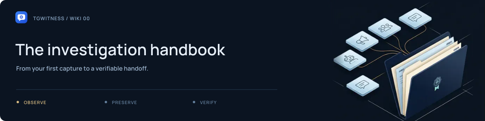

# TgWitness Wiki

[Project](../../README.md) · [Documentation](../README.md) · [Wiki](Home.md) · [Support](../../.github/SUPPORT.md)

**From your first demo to a verifiable handoff.** Practical guides for observing
Telegram, reviewing captured changes and running your own workspace.

[Get started](Getting-Started.md) · [Find an answer](FAQ.md) · [Solve a problem](Troubleshooting.md) · [Technical reference](../README.md) · [Films and animations](../SHOWCASE.md)

## Watch the investigation

Follow sources into a case file, preserve the observed record and prepare a signed
handoff. A 12-second illustrated introduction with fictional records; no audio.

https://github.com/user-attachments/assets/caeec3e4-6156-4f3e-a840-d4c2f346717e

[Download MP4](../assets/presentation/investigation-overview.mp4) · [Watch all three films](../SHOWCASE.md)

## Start here

1. [Try the demo and install](Getting-Started.md).
2. [Connect a dedicated account](Accounts.md).
3. [Choose sources and start observation](Collection.md).
4. [Export a record and verify it](Exports-and-Verification.md).

**First successful check:** a new message from a chat you control appears in the journal; its edit becomes another version; its deletion notice leaves the captured content available. Check the signed export too. This checks that particular sequence, not every possible Telegram event.

### See what stays after an edit or deletion

https://github.com/user-attachments/assets/ab0f56e8-1834-47ce-9fff-c88dc5887389

12 seconds · Silent · Fictional records · [Download MP4](../assets/presentation/message-history.mp4) · [Collection guide](Collection.md)

## Choose a guide

| Set up your workspace | Work with the record |
| --- | --- |
| [Accounts](Accounts.md) — phone, QR and session imports | [Collection](Collection.md) — chats, folders and capture policy |
| [Proxies](Proxies.md) — choose a connection route | [Investigations](Investigations.md) — follow a case across chats |
| [Server and Docker](Server-and-Docker.md) — leave a collector running | [Exports and verification](Exports-and-Verification.md) — prepare a signed handoff |
| [Backup and recovery](Backup-and-Recovery.md) — protect your workspace | [Witness and Proof](Witness-and-Proof.md) — independent checkpoints and public status |

Need a term explained? Open the [glossary](Glossary.md).

## Read this before connecting

> **NOTICE — Operator Incompatibility**
> [Read the complete project notice](Operator-Incompatibility.md): PhishDestroy's
> statement concerning Taylor Wessing PartG mbB — German core, Hamburg office.

TgWitness uses a [restricted licence](../../LICENSE), including the
[Taylor Wessing exclusion and maintainer's statement](../TAYLOR-WESSING-EXCLUSION.md).
Review the restriction before use, evaluation, integration or redistribution.

Use a dedicated account you can afford to lose. A Telegram session grants access to that account; keep sessions, panel tokens and keys private. Local message content and attachments need disk encryption if you require protection at rest.

A signature establishes integrity relative to a trusted key. It does not prove that Telegram created a message, that collection was complete, or that an operator could not fabricate a journal.

## Project and help

[Project overview](../../README.md) · [Complete project guide](../PROJECT-GUIDE.md) · [Technical documentation](../README.md) · [Verification record](../VERIFICATION.md) · [Get help](../../.github/SUPPORT.md) · [Contribute](../../.github/CONTRIBUTING.md) · [Report a vulnerability](../../.github/SECURITY.md)

UI labels in this wiki follow the English interface. Labels may differ between releases.
