<picture>
  <source media="(max-width: 640px) and (prefers-reduced-motion: reduce)" srcset="../assets/presentation/identity-hero-mobile-static.svg">
  <source media="(prefers-reduced-motion: reduce)" srcset="../assets/presentation/identity-wiki-static.svg">
  <source media="(max-width: 640px)" srcset="../assets/presentation/identity-hero-mobile.svg">
  
</picture>

# The investigation handbook

**From your first capture to a verifiable handoff.** Pick a path below, work with
the record, and keep the checks alongside the conclusions.

[Explore the demo](https://phishdestroy.github.io/TgWitness/demo/) · [Start your first case](Getting-Started.md) · [How the record works](../HOW-IT-WORKS.md) · [Project](../../README.md)

## Your first investigation

1. **Set up** — [connect a dedicated account](Accounts.md).
2. **Observe** — [choose your sources and capture scope](Collection.md).
3. **Investigate** — [trace the saved records across conversations](Investigations.md).
4. **Hand over** — [export the record and verify it](Exports-and-Verification.md).

**First successful check:** a test message from a chat you control appears in the
journal; its captured edit becomes another version; its deletion notice leaves
the captured content available. Verify the signed export as well. This checks
that sequence, not every possible Telegram event.

## Keep the investigation running

| Connect & deploy | Preserve & verify | Find an answer |
| --- | --- | --- |
| [Proxies and connection routes](Proxies.md) | [Witness and Proof](Witness-and-Proof.md) | [Troubleshooting](Troubleshooting.md) |
| [Servers and Docker](Server-and-Docker.md) | [Backup and recovery](Backup-and-Recovery.md) | [Frequently asked questions](FAQ.md) |
| [Hardened deployment](../HIGH-ASSURANCE.md) | [S3 off-site copy](https://phishdestroy.github.io/TgWitness/docs/exports/#s3) | [Glossary](Glossary.md) |

## Understand the evidence

<picture>
  <source media="(max-width: 640px) and (prefers-reduced-motion: reduce)" srcset="../assets/presentation/case-chain-mobile-static.svg">
  <source media="(prefers-reduced-motion: reduce)" srcset="../assets/presentation/evidence-chain-static.svg">
  <source media="(max-width: 640px)" srcset="../assets/presentation/case-chain-mobile.svg">
  
</picture>

[The evidence model and formulas](../HOW-IT-WORKS.md) · [Interactive explanation](https://phishdestroy.github.io/TgWitness/docs/concepts/)

## Read this before connecting

> **NOTICE — Operator Incompatibility**
> [Read the complete project notice](Operator-Incompatibility.md): our
> statement on Taylor Wessing PartG mbB — German core, Hamburg office.

TgWitness is [MIT-licensed](../../LICENSE). Our
[position on Taylor Wessing](../TAYLOR-WESSING-EXCLUSION.md) is a statement, not a licence condition.

Use a dedicated account you can afford to lose. A Telegram session grants access to that account; keep sessions, panel tokens and keys private. Local message content and attachments need disk encryption if you require protection at rest.

A signature establishes integrity relative to a trusted key. It does not prove that Telegram created a message, that collection was complete, or that an operator could not fabricate a journal.

## Project and help

[Project overview](../../README.md) · [Complete project guide](../PROJECT-GUIDE.md) · [Technical documentation](../README.md) · [Verification record](../VERIFICATION.md) · [Get help](../../.github/SUPPORT.md) · [Contribute](../../.github/CONTRIBUTING.md) · [Report a vulnerability](../../.github/SECURITY.md)

UI labels in this wiki follow the English interface. Labels may differ between releases.
