<picture>
  <source media="(max-width: 640px) and (prefers-reduced-motion: reduce)" srcset="../assets/presentation/wiki-independent-witness-mobile-static.svg">
  <source media="(prefers-reduced-motion: reduce)" srcset="../assets/presentation/wiki-independent-witness-static.svg">
  <source media="(max-width: 640px)" srcset="../assets/presentation/wiki-independent-witness-mobile.svg">
  
</picture>

# Independent witness

**03 · INDEPENDENT CHECKS** · [All guides](Home.md) · [Get help](../../.github/SUPPORT.md)

On this page

- [Keep a boundary you can compare](#keep-a-boundary-you-can-compare)
- [Set up a witness](#set-up-a-witness)
- [Interpret the result](#interpret-the-result)

| Component | Purpose |
| --- | --- |
| Collector | Records what its account sees |
| Witness | Fetches the signed journal head, signs what it saw, can post it to a channel |
| Controlled delivery test | Compares known sends/edits/deletes with what got captured |

The witness has its own key and a read-only token. That token can't read messages, control
the collector or get the Telegram session.

## Keep a boundary you can compare

<picture>
  <source media="(max-width: 640px) and (prefers-reduced-motion: reduce)" srcset="../assets/presentation/casework-checkpoint-mobile-static.svg">
  <source media="(prefers-reduced-motion: reduce)" srcset="../assets/presentation/casework-checkpoint-static.svg">
  <source media="(max-width: 640px)" srcset="../assets/presentation/casework-checkpoint-mobile.svg">
  
</picture>

An export can be longer than a checkpoint. Check the checkpoint signature, then compare
the hash at its record count. A shorter export can't match it, and a matching boundary
doesn't replace checking every event. The collector key signs the checkpoint, so it only
counts if the recipient got it before the archive, through another channel. It is a
supporting check, not the minimum for evidence.

[Open the full-size animation](../assets/presentation/casework-checkpoint.svg) · [Static diagram](../assets/presentation/casework-checkpoint-static.svg) · [Exact checkpoint formula](../HOW-IT-WORKS.md#what-an-earlier-checkpoint-adds)

## Set up a witness

1. Open **More tools → Extras → Independent witness → Configure**.
2. Create a read-only token, save it as `witness-token.txt`.
3. Pick a Telegram channel or Discord webhook, the interval and the collector address. Download `witness.json` (it pins the collector key).
4. Put the JSON and token together on the witness host. Telegram: bot token in `bot-token.txt`, bot allowed to post. Discord: webhook URL in `discord-webhook.txt`.
5. Check and start:

~~~sh
python -m tgwitness.witness run --config witness.json --check-config
python -m tgwitness.witness run --config witness.json
~~~

The check makes no network calls. Starting it will post according to your config.

Keep its fingerprint somewhere else:

~~~sh
python -m tgwitness.witness fingerprint --config witness.json
~~~

Look at the witness log and the channel itself. "Last poll" in the collector only means a request came in.

<picture><source media="(prefers-reduced-motion: reduce)" srcset="../assets/presentation/readme-divider-static.svg"></picture>

## Interpret the result

A witness on the same server is a separate process and key, but the same person still runs
it. The verifier sees only a second key; who controls it is up to your custody records.
The witness journal is a supporting check. Its posts give external time: with
`--channel https://t.me/s/CHANNEL` the verifier reads the date Telegram set on each post,
skipping edited posts. Dates in a Telegram Desktop `result.json` are supplied metadata,
not independent time.

A growing counter doesn't mean nothing was missed. Compare proof receipts with the
matching evidence archive, and use a controlled test for specific events.

**Next:** [Witness reference](../WITNESS.md) · [Evidence limits](FAQ.md)
