<picture>
  <source media="(max-width: 640px) and (prefers-reduced-motion: reduce)" srcset="../assets/presentation/wiki-independent-witness-mobile-static.svg">
  <source media="(prefers-reduced-motion: reduce)" srcset="../assets/presentation/wiki-independent-witness-static.svg">
  <source media="(max-width: 640px)" srcset="../assets/presentation/wiki-independent-witness-mobile.svg">
  
</picture>

# Independent witness

**03 · INDEPENDENT CHECKS** · [All guides](Home.md) · [Get help](../../.github/SUPPORT.md)

On this page

- [Keep a boundary you can compare](#keep-a-boundary-you-can-compare)
- [Set up a witness](#set-up-a-witness)
- [Interpret the result](#interpret-the-result)

| Component | Purpose |
| --- | --- |
| Collector | Records what its Telegram account observes |
| Witness | Fetches a signed journal boundary, signs its observation and can publish a channel post |
| Controlled delivery test | Compares known send/edit/delete actions with captured evidence |

A witness has its own key and a read-only token. That token cannot read messages, control the collector or obtain its Telegram session.

## Keep a boundary you can compare

<picture>
  <source media="(max-width: 640px) and (prefers-reduced-motion: reduce)" srcset="../assets/presentation/casework-checkpoint-mobile-static.svg">
  <source media="(prefers-reduced-motion: reduce)" srcset="../assets/presentation/casework-checkpoint-static.svg">
  <source media="(max-width: 640px)" srcset="../assets/presentation/casework-checkpoint-mobile.svg">
  
</picture>

An export may grow beyond a checkpoint. After verifying the checkpoint signature,
compare the hash at its saved record count. A shorter export cannot satisfy a
checkpoint beyond its end; matching the boundary does not replace checking every event.

[Open the full-size animation](../assets/presentation/casework-checkpoint.svg) · [Static diagram](../assets/presentation/casework-checkpoint-static.svg) · [Exact checkpoint formula](../HOW-IT-WORKS.md#what-an-earlier-checkpoint-adds)

## Set up a witness

1. Open **Extras → A bot in your channel → Set up a bot**.
2. Create a read-only token and save it as `witness-token.txt`.
3. Configure your channel, polling interval and reachable collector address. Download `witness.json`; it pins the workspace's collector key.
4. On the witness host, place the JSON and token together. Save your Telegram bot token in `bot-token.txt`. Give your bot permission to post in your channel.
5. In the installed project environment, check and launch:

~~~sh
python -m tgwitness.witness run --config witness.json --check-config
python -m tgwitness.witness run --config witness.json
~~~

The configuration check makes no network requests. Starting the witness may publish messages according to your configuration; downloading the JSON alone does not start it.

Retain its fingerprint separately:

~~~sh
python -m tgwitness.witness fingerprint --config witness.json
~~~

Check the witness log and actual channel posts. A last-poll time in the collector only confirms a request.

<picture><source media="(prefers-reduced-motion: reduce)" srcset="../assets/presentation/readme-divider-static.svg"></picture>

## Interpret the result

A witness on the same server provides a separate process and key, but not independent operator custody. A growing counter does not prove every message was captured. Compare downloaded proof receipts with the matching signed evidence archive, and use a controlled delivery test for specific events.

**Next:** [Witness reference](../WITNESS.md) · [Evidence limits](FAQ.md)
