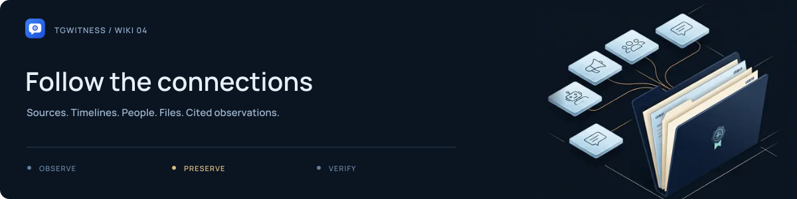
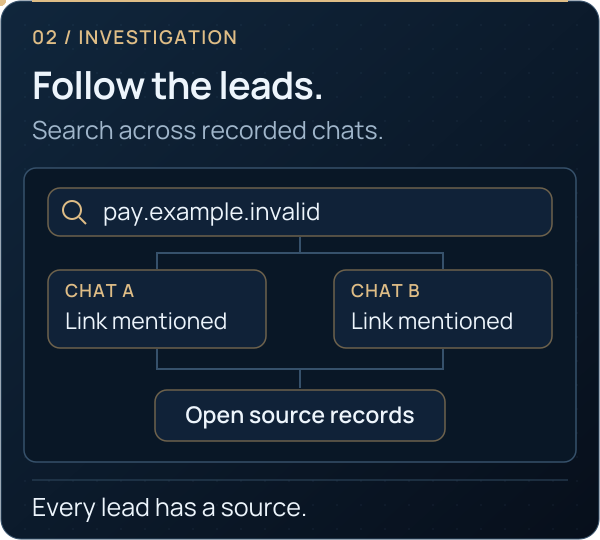

<picture>
  <source media="(max-width: 640px) and (prefers-reduced-motion: reduce)" srcset="../assets/presentation/wiki-investigations-mobile-static.svg">
  <source media="(prefers-reduced-motion: reduce)" srcset="../assets/presentation/wiki-investigations-static.svg">
  <source media="(max-width: 640px)" srcset="../assets/presentation/wiki-investigations-mobile.svg">
  
</picture>

# Investigations across chats

**02 · INVESTIGATE AND EXPORT** · [All guides](Home.md) · [Get help](../../.github/SUPPORT.md)

<details>
<summary>On this page</summary>

- [Set up the case](#set-up-the-case)
- [Keep a source register](#keep-a-source-register)
- [Follow changes and connections](#follow-changes-and-connections)
- [Organize and review on Case Board](#organize-and-review-on-case-board)
- [Record deliberate actions](#record-deliberate-actions)
- [Work with the saved archive](#work-with-the-saved-archive)
- [Hand over the case](#hand-over-the-case)

</details>

One dedicated account, one clear question. Keep what you saw, what you think it means
and what's still open apart from each other.

<p align="center"><picture><source media="(prefers-reduced-motion: reduce)" srcset="../assets/presentation/readme-feature-investigate-static.svg"></picture></p>

## Set up the case

1. Write down the question, the time range and which sources you want.
2. Set the scope in **More tools → Sources → Scope**. Whole-account only if everything on that account belongs to the case.
3. Check settings for outgoing messages, bots, attachments and events.
4. Start observation and note the time.
5. Save chat histories where you need earlier context.

## Keep a source register

For every source: workspace, numeric chat ID, title/username, why it's in, how and when
it was collected, plus access changes and gaps. The numeric ID survives renames.

<picture><source media="(prefers-reduced-motion: reduce)" srcset="../assets/presentation/readme-divider-static.svg"></picture>

## Follow changes and connections

In **Journal** search **All sources**, open a hit and note its workspace, chat ID, message
ID, sequence and hash. Compare versions in **Chats**.

People profiles (opt-in per chat) show names, who replies to whom, mentions and other chats
where the same Telegram ID wrote. Open the cited records before calling anything a finding.

| Match | What it means |
| --- | --- |
| Same numeric sender ID | Same Telegram account |
| Same URL or wallet | Same string in both records; who owns it is another question |
| Same attachment SHA-256 | Same file bytes |
| Similar name or avatar | A lead, nothing more |

## Organize and review on Case Board

**More tools → Case Board** (Standard or Expert mode). Make a collection for the case,
then hit **To board** (or **B**) on a journal record or chat message. Select text for
**Highlight → board**, Shift-click two messages for **Slice between**, or save the current
Journal filters as a slice.

Sort cards, discuss in threads, set statuses. Every change is a signed revision.
**Presentation** walks through cards without edit controls. Board rights are set in [Access](Access.md).

Team notes have their own signed history and never mix with Telegram observations. Reports
label them as team notes. Details: [Case Board](../CASE-BOARD.md).

## Record deliberate actions

From the panel you can preview and join links, send messages and press bot buttons. These
are real actions by the selected account and they're journaled with their results.

If an outcome is unknown, check before retrying. Button presses in another Telegram app
aren't visible to the collector. Payments, phone/location and web apps aren't supported.

## Document as you go

The **Documentation** button opens a drawer that writes the steps for you: what the account
did, what came back and how many seconds later, by the collector's clock and by Telegram's
server time. Messages sent from another app appear too. Press **M** to add a note; label it
as important, a conclusion, an open question, 18+, obscene language, violence or personal
data, and optionally tie it to a step. The last four labels hide that step's content in the
document; the signed journal keeps the record and the document cites it.

A draft can be paused, started over, edited or deleted completely; nothing is signed yet.
**Fix document** signs the whole document with a list of every step, note and conclusion
and records its digest in the journal. After that only a new revision can change it, and a
copy missing a listed item is detectable. Open it as a page or download Markdown or JSON.

Hidden steps are not cut out. When you fix the document, each hidden journal record is
encrypted (AES-256-GCM) inside the signed statement, with one key per reason and a master
key. A board manager can release all keys or only chosen reasons, for example 18+ but not
personal data; every release is recorded in the journal. Hand keys over separately from the
document. A recipient checks the copy and opens what their keys allow:

```sh
python -m tgwitness.documentation_verify documentation.json --fingerprint WORKSPACE_FP \
  --keys documentation-keys.json --reveal opened-records.json
```

Each opened record must match the journal hash listed in the signed document.

**Open in isolation** sends an address, or a Telegram `@username` for Telegram Web, to the
[browser recorder](../OPTIONAL-CAPTURE.md). The screenshot, final address, HTTP status,
server address and certificate issuer become a step. A caption with the requested
username or ID comes from this workspace's records and is shown outside the picture.

<picture><source media="(prefers-reduced-motion: reduce)" srcset="../assets/presentation/readme-divider-static.svg"></picture>

## Work with the saved archive

**More tools → Ask the archive** searches saved records and can ask AI. MCP, OCR/transcription and
webhooks: [Archive and integrations](Archive-and-Integrations.md).

## Hand over the case

A timeline citing saved records (source time and observed time), the source register, scope
changes, gaps, signed ZIPs, history exports, checkpoints and fingerprints.

**Exports → Configure and preview** lets you pick the data, design, contents and findings,
optionally with Case Board items. [Report studio](../CASE_REPORTS.md) has eight designs.
For a trimmed copy use the handover controls.

**Accounts → group → Export group** bundles all accounts' signed exports with a signed file
list. Keep each workspace's fingerprint with its records.

**Next:** [Case Board](../CASE-BOARD.md) · [Report studio](../CASE_REPORTS.md) · [Exports](Exports-and-Verification.md) · [Worked cross-chat case](../INVESTIGATION.md)
