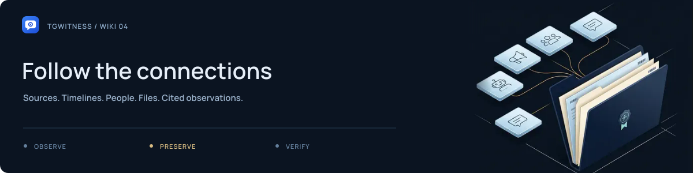

# Investigations across chats

[Project](../../README.md) · [Documentation](../README.md) · [Wiki](Home.md) · [Support](../../.github/SUPPORT.md)

Use one dedicated account and a clearly defined question. Keep source observations, your interpretation and unresolved questions separate throughout the case.

## Set up the case

1. Define the question, relevant time range and sources you intend to observe.
2. Choose an explicit scope in **Sources**. Use whole-account collection only when the dedicated account's other conversations also belong to the investigation.
3. Review outgoing-message, bot, attachment and event settings.
4. Start observation and record its start time.
5. Save current chat histories where earlier visible context is needed.

Investigation mode prepares collection of an account's visible chats and actions. It does not grant access to private sources or turn earlier history into continuous observation.

## Keep a source register

For each source, retain its workspace, numeric chat ID, observed title/username, reason for inclusion, acquisition method and time range. Add access changes and gaps. Names and usernames can change; do not use them as the sole identity of a source.

<picture><source media="(prefers-reduced-motion: reduce)" srcset="../assets/presentation/readme-divider-static.svg"></picture>

## Follow changes and connections

In **Journal**, search **All sources**. Open a matching record and retain its workspace, chat ID, message ID, sequence and hash. In **Chats**, compare saved versions.

People profiles are opt-in per chat. They can show observed names, reply relationships, mentions and other chats in the workspace where the same Telegram ID wrote. Open the cited records before treating a derived fact as a finding.

| Matching observation | What it supports |
| --- | --- |
| Same numeric sender ID | The saved records identify the same Telegram account |
| Same URL or wallet string | The records contain the same string; ownership is a separate question |
| Same attachment SHA-256 | The preserved file bytes match |
| Similar name or avatar | A lead to examine; not proof of one person or operator |

## Record deliberate actions

The panel can save an invitation preview, join/open a supported Telegram link, send text/replies and press supported bot buttons. These are real actions by the selected account. Keep their request/result records with the resulting messages.

An unknown action outcome should be checked before retrying. Callback presses in another Telegram app are not themselves visible to the collector. Payment, phone/location and web-app workflows are outside the mini-client's supported actions.

<picture><source media="(prefers-reduced-motion: reduce)" srcset="../assets/presentation/readme-divider-static.svg"></picture>

## Hand over the case

Build a timeline citing saved records, with both source time and observation time where available. Include the source register, scope changes, gaps, signed evidence ZIPs, separate history exports, checkpoints and trusted fingerprints.

Do not merge journals from different workspaces into one apparent signing identity. A cross-account narrative should cite the original workspace for each observation.

**Next:** [Exports](Exports-and-Verification.md) · [Worked cross-chat case](../INVESTIGATION.md) · [How the evidence works](../HOW-IT-WORKS.md)
