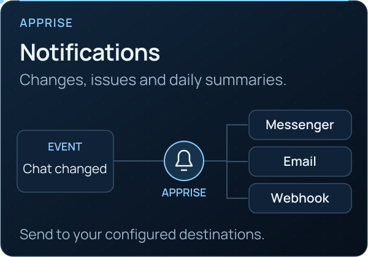

<picture>
  <source media="(max-width: 640px) and (prefers-reduced-motion: reduce)" srcset="../assets/presentation/wiki-notifications-mobile-static.svg">
  <source media="(prefers-reduced-motion: reduce)" srcset="../assets/presentation/wiki-notifications-static.svg">
  <source media="(max-width: 640px)" srcset="../assets/presentation/wiki-notifications-mobile.svg">
  
</picture>

# Notifications

**04 · RUN AND PROTECT** · [All guides](Home.md) · [Get help](../../.github/SUPPORT.md)

On this page

- [Set up delivery](#set-up-delivery)
- [Choose what leaves the workspace](#choose-what-leaves-the-workspace)
- [Check the connection route](#check-the-connection-route)

Send problem alerts, observed chat changes and a daily summary to the destinations
you configure for the selected workspace.

<picture><source media="(prefers-reduced-motion: reduce)" srcset="../assets/presentation/readme-card-apprise-static.svg"></picture>

## Set up delivery

1. Open **Sources → Notifications → Alerts and a daily summary**.
2. Enter one Apprise destination URL per line. Use the
   [service catalogue](https://appriseit.com/services/) for your destination's format.
3. Enable **Send notifications** and select problem alerts, changes in observed
   chats or a daily summary. The summary hour follows the server's time.
4. Choose whether to **Include short excerpts** of saved edited or deleted messages.
5. Select **Save notifications**, then **Send test** and confirm receipt.

Several destinations can belong to one workspace. The top-bar bell also keeps
recent problems and chat changes inside the panel.

## Choose what leaves the workspace

| Option | What it is for |
| --- | --- |
| Problems | Issues such as a signed-out account, low disk space or a failed copy |
| Chat changes | Changes in that workspace's observed sources |
| Daily summary | A scheduled overview |
| Short excerpts | Include saved message text only when you explicitly enable it |

For your own receiver, use Apprise's
[JSON webhook](https://appriseit.com/services/json/). Destination URLs may contain
credentials; keep them out of screenshots and support reports.

## Check the connection route

Delivery uses the workspace's Direct, SOCKS5 or HTTP route. MTProxy cannot carry
notifications. Non-HTTP destinations such as SMTP require a direct route.

Sending is disabled in the fictional demo. Configure and test delivery in your
own installation; a configured destination alone does not confirm delivery.

**Continue:** [Connection routes](Proxies.md) · [Troubleshooting](Troubleshooting.md) · [Operations reference](../OPERATIONS.md#notifications)
