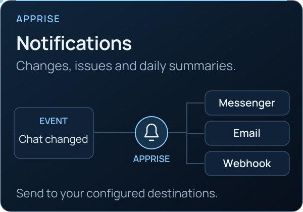

<picture>
  <source media="(max-width: 640px) and (prefers-reduced-motion: reduce)" srcset="../assets/presentation/wiki-notifications-mobile-static.svg">
  <source media="(prefers-reduced-motion: reduce)" srcset="../assets/presentation/wiki-notifications-static.svg">
  <source media="(max-width: 640px)" srcset="../assets/presentation/wiki-notifications-mobile.svg">
  
</picture>

# Notifications

**04 · RUN AND PROTECT** · [All guides](Home.md) · [Get help](../../.github/SUPPORT.md)

On this page

- [Set up delivery](#set-up-delivery)
- [Choose what leaves the workspace](#choose-what-leaves-the-workspace)
- [Check the connection route](#check-the-connection-route)

Problem alerts, chat changes and a daily summary, sent wherever you want for each workspace.

<picture><source media="(prefers-reduced-motion: reduce)" srcset="../assets/presentation/readme-card-apprise-static.svg"></picture>

## Set up delivery

1. Open **Extras → Notifications → Configure**.
2. Pick a service under **Add a destination**, or paste Apprise URLs (one per line) under
   **Destinations as Apprise addresses**. Formats: [service catalogue](https://appriseit.com/services/).
3. Turn on **Send notifications** and choose problems, chat changes and/or a daily summary
   (server time).
4. **Include short excerpts** if you want text of edited/deleted messages in them.
5. **Save notifications**, **Send test**, check it arrived.

You can have several destinations. The bell in the top bar keeps recent stuff in the panel too.

## Choose what leaves the workspace

| Option | What it is for |
| --- | --- |
| Problems | Signed-out account, low disk, failed copy and so on |
| Chat changes | Changes in observed sources |
| Daily summary | Once a day overview |
| Short excerpts | Message text, only if you turn it on |

Own receiver? Use Apprise's [JSON webhook](https://appriseit.com/services/json/).
Destination URLs often contain credentials, keep them out of screenshots.

## Check the connection route

Notifications go over Direct, SOCKS5 or HTTP, not MTProxy. SMTP and other non-HTTP
targets need direct.

The demo doesn't send anything. Set it up and test on your own install, a saved
destination doesn't mean it works.

**Continue:** [Connection routes](Proxies.md) · [Troubleshooting](Troubleshooting.md) · [Operations reference](../OPERATIONS.md#notifications)
