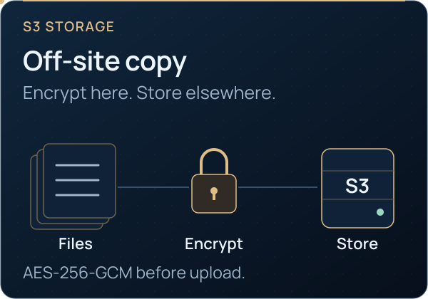

<picture>
  <source media="(max-width: 640px) and (prefers-reduced-motion: reduce)" srcset="../assets/presentation/wiki-off-site-copy-mobile-static.svg">
  <source media="(prefers-reduced-motion: reduce)" srcset="../assets/presentation/wiki-off-site-copy-static.svg">
  <source media="(max-width: 640px)" srcset="../assets/presentation/wiki-off-site-copy-mobile.svg">
  
</picture>

# Encrypted off-site copies

**04 · RUN AND PROTECT** · [All guides](Home.md) · [Get help](../../.github/SUPPORT.md)

On this page

- [Configure the destination](#configure-the-destination)
- [Keep the recovery key](#keep-the-recovery-key)
- [Retention and recovery](#retention-and-recovery)

Keep journal segments, preserved files, checkpoints and finished chat exports in
S3-compatible storage. Each object is encrypted with AES-256-GCM before upload.

<picture><source media="(prefers-reduced-motion: reduce)" srcset="../assets/presentation/readme-card-s3-static.svg"></picture>

## Configure the destination

Open **Exports → Off-site copy** in the intended workspace. Prepare an existing
bucket and storage credentials; TgWitness does not create the bucket.

| Field | Enter |
| --- | --- |
| Endpoint | Your storage service URL, without a bucket path or credentials |
| Region | The region required by that service |
| Bucket | An existing bucket you can access |
| Folder | The object prefix; TgWitness adds a workspace-specific prefix |
| Access keys | Both credentials together; leave both blank on later saves to retain them |
| Address style | Path-style or virtual-hosted addressing as required by the provider |
| Copy interval | The schedule while the application is running |

1. Enter settings with **Keep an off-site copy** unchecked; select **Save off-site copy**.
2. Select **Test connection**. This uploads an encrypted test object.
3. Select **Download encryption key** and retain that file separately.
4. Enable **Keep an off-site copy**, save again, and select **Copy now** for a first pass.
5. Check the copied boundary, object count and any reported error.

## Keep the recovery key

The downloaded JSON contains the decryption key, destination settings, workspace
prefix and signing-key fingerprint. Storage credentials are separate. Both the
key file and credentials with read access are needed for recovery.

Download a fresh key file after changing the endpoint, bucket or prefix. Finished
chat exports already removed from the local queue remain at their old destination.

## Retention and recovery

Object Lock requires support and configuration in the bucket. Check the reported
retention result; an accepted upload alone does not confirm retention.

Use a trusted TgWitness installation and an empty output directory for recovery.
The [complete S3 guide](https://phishdestroy.github.io/TgWitness/docs/exports/#s3-restore)
contains the commands and credential setup. Recovery checks journal consistency,
checkpoints and preserved-media hashes before publishing restored material.

Uploads use Direct, SOCKS5 or HTTP. They are unavailable over MTProxy, and scheduled
copies stop when the application stops. The demo displays the controls with uploads disabled.

An off-site evidence copy does not replace a [complete service backup](Backup-and-Recovery.md)
of account authorizations, private keys and configuration.

**Continue:** [Service backup and recovery](Backup-and-Recovery.md) · [Evidence reference](../EVIDENCE.md#off-site-copy-and-restore-s3)
