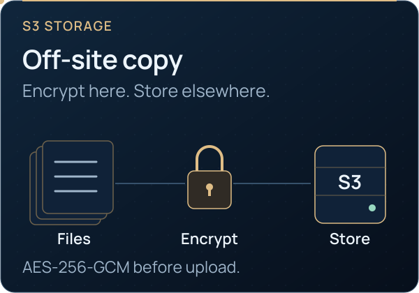

<picture>
  <source media="(max-width: 640px) and (prefers-reduced-motion: reduce)" srcset="../assets/presentation/wiki-off-site-copy-mobile-static.svg">
  <source media="(prefers-reduced-motion: reduce)" srcset="../assets/presentation/wiki-off-site-copy-static.svg">
  <source media="(max-width: 640px)" srcset="../assets/presentation/wiki-off-site-copy-mobile.svg">
  
</picture>

# Encrypted off-site copies

**04 · RUN AND PROTECT** · [All guides](Home.md) · [Get help](../../.github/SUPPORT.md)

On this page

- [Configure the destination](#configure-the-destination)
- [Keep the recovery key](#keep-the-recovery-key)
- [Retention and recovery](#retention-and-recovery)

Copies journal segments, saved files, checkpoints and chat exports to any S3-compatible
storage. Everything is encrypted with AES-256-GCM before it leaves your machine.

<picture><source media="(prefers-reduced-motion: reduce)" srcset="../assets/presentation/readme-card-s3-static.svg"></picture>

## Configure the destination

**Settings → Notifications and off-site copy → Off-site copy** in the workspace you want
(also under **More tools → Extras → Evidence & backups → Configure**). Bring your own bucket and keys,
TgWitness doesn't create buckets.

| Field | Enter |
| --- | --- |
| Endpoint | Storage URL, no bucket path or credentials |
| Region | Whatever the provider wants |
| Bucket | An existing bucket you can write to |
| Folder | Prefix, a per-workspace prefix gets added |
| Access keys | Both together. Leave blank later to keep them |
| Address style | Path-style or virtual-hosted, per provider |
| Copy interval | How often while the app runs |

1. Fill it in with **Keep an off-site copy** unticked, **Save off-site copy**.
2. **Test connection** (uploads an encrypted test object).
3. **Download encryption key** and keep that file somewhere safe.
4. Tick **Keep an off-site copy**, save, **Copy now**.
5. Check the copied boundary, object count and errors.

## Keep the recovery key

The key JSON has the root key, derivation version, destination, prefix and workspace
fingerprint. Symmetric copies derive a separate key for that workspace with HKDF-SHA256.
Storage credentials are separate. You need both to recover.

After upgrading, download a new key file for the separate `hkdf-v2` copy prefix.
Keep earlier key files for earlier copies; existing objects are not overwritten.
Recipient-encrypted copies keep their existing prefix and recipient-key requirement.

Changed endpoint, bucket or prefix? Download a new key file. Exports that already left the
local queue stay at the old destination.

## Retention and recovery

Object Lock has to be supported and set up on the bucket. TgWitness reads back the mode and
retention of each uploaded object; check that reported retention.

Recover into an empty directory with a TgWitness install you trust. Commands are in the
[S3 guide](https://phishdestroy.github.io/TgWitness/docs/exports/#s3-restore). Recovery
checks the journal, checkpoints and file hashes before writing anything out.

Uploads go Direct, SOCKS5 or HTTP, not over MTProxy, and stop when the app stops. The demo
shows the controls with uploads off.

This is not a [full backup](Backup-and-Recovery.md): no logins, keys or config.

**Continue:** [Service backup and recovery](Backup-and-Recovery.md) · [Evidence reference](../EVIDENCE.md#off-site-copy-and-restore-s3)
