<picture>
  <source media="(max-width: 640px) and (prefers-reduced-motion: reduce)" srcset="../assets/presentation/wiki-proxies-mobile-static.svg">
  <source media="(prefers-reduced-motion: reduce)" srcset="../assets/presentation/wiki-proxies-static.svg">
  <source media="(max-width: 640px)" srcset="../assets/presentation/wiki-proxies-mobile.svg">
  
</picture>

# Proxies and connection routes

**01 · CONNECT AND CAPTURE** · [All guides](Home.md) · [Get help](../../.github/SUPPORT.md)

On this page

- [Choose a route](#choose-a-route)
- [Save and test](#save-and-test)
- [Public lists](#public-lists)
- [Pool dashboard and custom sources](#pool-dashboard-and-custom-sources)
- [Other network traffic](#other-network-traffic)

Every workspace has its own Telegram route. The IP mode decides whether it's ever allowed to go direct.

## Choose a route

Open **Account → Settings → Connection settings → Change connection route**.

| IP mode | When a proxy is unavailable |
| --- | --- |
| Hide the address | Waits for a working proxy, never goes direct |
| Direct as a last resort | Goes direct after a delay, back to a proxy once one works |
| Server behind a tunnel or VPN | Direct allowed (it doesn't set up or check the VPN for you) |

New workspaces start on automatic MTProxy with **Hide the address**. The pool checks
servers, keeps the good ones and moves accounts off dead ones.

| Route | Inputs |
| --- | --- |
| Automatic MTProxy | Public lists or an operator catalog |
| Direct | No proxy; requires tunnel/VPN mode |
| SOCKS5 / HTTP CONNECT | Host, port and optional username/password |
| MTProxy | Host, port and compatible secret |
| Telegram proxy link | A supported `tg://proxy` or `https://t.me/proxy` link |
| Included public list | Select a listed server, then save |

MTProxy takes hex/base64url keys and the `dd` form. Fake TLS `ee` secrets don't work.

## Save and test

1. Pause observation first.
2. Pick or enter the route.
3. Save (this cancels any half-done sign-in).
4. **Test Telegram connection**.
5. Sign in if needed, restart observation, send yourself a test message.

A passing test means the network path works. Not that you're logged in, anonymous or catching everything.

<picture><source media="(prefers-reduced-motion: reduce)" srcset="../assets/presentation/readme-divider-static.svg"></picture>

## Public lists

Lists from six public sources ship with the app. The pool refreshes and checks them in
the background, a failed download keeps the last good list. **Update public lists**
refreshes without touching a manual route.

Rotation, failure thresholds, cooldowns, sharing and retries live under
**Parameters → Automatic MTProxy**. Accounts get separate proxies when there are enough.
Sharing limit 1 means an account waits rather than share; different servers can still
have the same exit IP.

**Where the list comes from** shows providers and dates. Public servers come and go, being
on the list isn't a recommendation.

Operators can add a local catalog with `TGWITNESS_PROXY_CATALOG` and route list downloads via
`TGWITNESS_PROXY_FEED_PROXY`. Neither changes the account's Telegram route.

## Pool dashboard and custom sources

**Account → Settings → Connection settings → Proxy servers** lists servers with ping,
status, country, source and which workspaces use them. Filter, pause observation, hit **Use**.

**Lists and sources** (admin): turn off bundled lists, add HTTPS list URLs, upload files or
paste links. Lists are shared by the whole installation, routes stay per workspace.
Fake TLS entries are skipped.

An optional GitHub token lets the refresh download and search for more lists (stored
encrypted, only sent to GitHub). Country lookup is optional too, it sends proxy IPs to a
geolocation service through the outside route. Ping and country aren't trust scores.
**Check all now** refreshes results without touching a manual route.

**Countries**: preferred ones are tried first, avoided ones are excluded, unknown ones are
fine unless you tick **Use only servers in preferred countries** (then the workspace waits
instead). A working server is kept, the choice applies to the next pick and is journaled.

**Open Parameters** jumps to the download and check intervals.

## Other network traffic

MTProxy only carries Telegram. Other outside requests use a separate SOCKS5/HTTP proxy if
set, then the workspace's SOCKS5/HTTP route. With neither, Hide the address refuses them and
the other modes go direct. You can also turn outside requests off. The witness has its own
settings. None of this routes your browser.

Proxy credentials sit in the encrypted vault. Plain HTTP CONNECT and SOCKS auth are not TLS.

**Next:** [Troubleshooting](Troubleshooting.md) · [Connection reference](../CONNECTION-SECURITY.md) · [Operator catalog example](../../deploy/proxies.config.example)
