<picture>
  <source media="(max-width: 640px) and (prefers-reduced-motion: reduce)" srcset="../assets/presentation/wiki-proxies-mobile-static.svg">
  <source media="(prefers-reduced-motion: reduce)" srcset="../assets/presentation/wiki-proxies-static.svg">
  <source media="(max-width: 640px)" srcset="../assets/presentation/wiki-proxies-mobile.svg">
  
</picture>

# Proxies and connection routes

**01 · CONNECT AND CAPTURE** · [All guides](Home.md) · [Get help](../../.github/SUPPORT.md)

On this page

- [Choose a route](#choose-a-route)
- [Save and test](#save-and-test)
- [Public lists](#public-lists)
- [Other network traffic](#other-network-traffic)

Each account workspace has its own route. Configure it before signing in if direct access is unavailable.

## Choose a route

Open **Account → Settings → Connection settings → Change connection route**.

| Route | Inputs |
| --- | --- |
| Direct | No proxy |
| SOCKS5 / HTTP CONNECT | Host, port and optional username/password |
| MTProxy | Host, port and compatible secret |
| Telegram proxy link | A supported `tg://proxy` or `https://t.me/proxy` link |
| Included public list | Select a listed server, then save |

MTProxy accepts a 32-digit hexadecimal secret or `dd` plus 32 digits. Fake TLS `ee` secrets are unsupported.

## Save and test

1. Pause observation before changing an active account's route.
2. Select or enter the route.
3. Save the connection settings. This cancels unfinished sign-in attempts.
4. Run **Test Telegram connection**.
5. Sign in if necessary, restart observation and check a new controlled message.

There is no automatic direct fallback after a proxy failure. A successful transport test is not proof of authorization or complete collection.

<picture><source media="(prefers-reduced-motion: reduce)" srcset="../assets/presentation/readme-divider-static.svg"></picture>

## Public lists

A bundled list is available without downloading a new feed. **Update public lists** refreshes addresses and retains the existing selection. Unavailable sources keep their previous entries.

Open **Where the list comes from** for providers, saved dates and download-route information. Public availability changes; an entry is not an endorsement or a promise that the server is reachable.

An operator can provide a local catalog using `TGWITNESS_PROXY_CATALOG`. Feed downloads can use `TGWITNESS_PROXY_FEED_PROXY`. These are separate from the account's Telegram route.

## Other network traffic

The account route applies to its Telegram client. Witness polling, Telegram's HTTPS Bot API, feed downloads, timestamp services and off-site copies have their own transport behavior. In particular, MTProxy is not an HTTPS proxy for the witness bot.

Proxy credentials are saved in the encrypted vault. Ordinary HTTP CONNECT and SOCKS authentication do not themselves provide TLS protection to the proxy.

**Next:** [Troubleshooting](Troubleshooting.md) · [Connection reference](../CONNECTION-SECURITY.md) · [Operator catalog example](../../deploy/proxies.config.example)
